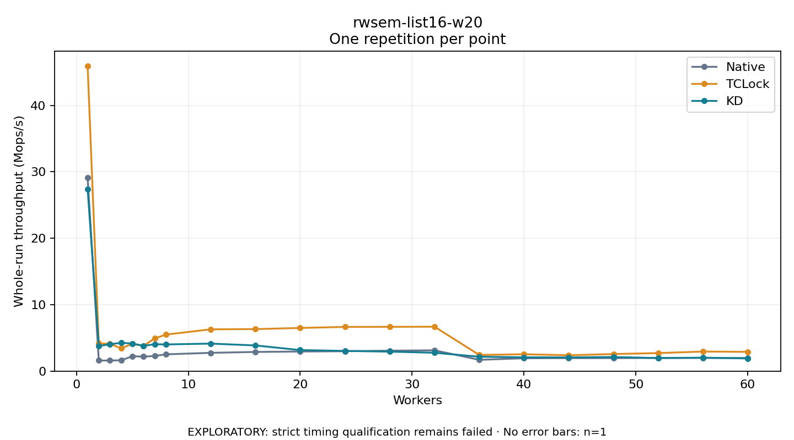

# rwsem-list16-w20

One timed repetition per point; no repeat variability estimate.
EXPLORATORY: strict timing qualification remains failed. Rates include post-lock work. Failed/unrun cases have no plotted rate.

| Workers | Native Mops/s | TCLock Mops/s | KD Mops/s | KD execution |
| ---: | ---: | ---: | ---: | --- |
| 1 | 29.106 | 45.950 | 27.407 | NO_JIT |
| 2 | 1.595 | 4.166 | 3.790 | NO_JIT |
| 3 | 1.595 | 4.099 | 4.036 | NO_JIT |
| 4 | 1.633 | 3.426 | 4.266 | RETURNED_JIT |
| 5 | 2.237 | 4.111 | 4.149 | RETURNED_JIT |
| 6 | 2.179 | 3.805 | 3.799 | RETURNED_JIT |
| 7 | 2.280 | 4.934 | 4.044 | RETURNED_JIT |
| 8 | 2.528 | 5.495 | 4.017 | RETURNED_JIT |
| 12 | 2.753 | 6.292 | 4.142 | RETURNED_JIT |
| 16 | 2.886 | 6.323 | 3.865 | RETURNED_JIT |
| 20 | 2.949 | 6.500 | 3.168 | RETURNED_JIT |
| 24 | 2.996 | 6.656 | 3.043 | RETURNED_JIT |
| 28 | 3.072 | 6.667 | 2.930 | RETURNED_JIT |
| 32 | 3.133 | 6.686 | 2.763 | RETURNED_JIT |
| 36 | 1.699 | 2.433 | 2.168 | RETURNED_JIT |
| 40 | 1.936 | 2.538 | 2.074 | RETURNED_JIT |
| 44 | 1.959 | 2.388 | 2.065 | RETURNED_JIT |
| 48 | 1.959 | 2.571 | 2.119 | RETURNED_JIT |
| 52 | 1.988 | 2.716 | 1.968 | RETURNED_JIT |
| 56 | 1.983 | 2.943 | 2.025 | RETURNED_JIT |
| 60 | 1.975 | 2.902 | 1.911 | RETURNED_JIT |

[Full receipt table](table.csv)

