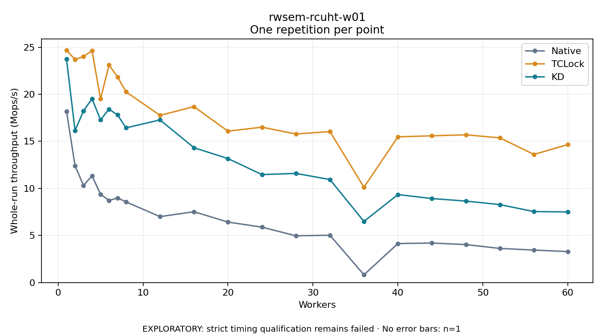

# rwsem-rcuht-w01

One timed repetition per point; no repeat variability estimate.
EXPLORATORY: strict timing qualification remains failed. Rates include post-lock work. Failed/unrun cases have no plotted rate.

| Workers | Native Mops/s | TCLock Mops/s | KD Mops/s | KD execution |
| ---: | ---: | ---: | ---: | --- |
| 1 | 18.195 | 24.677 | 23.718 | NO_JIT |
| 2 | 12.397 | 23.686 | 16.150 | NO_JIT |
| 3 | 10.320 | 24.010 | 18.229 | NO_JIT |
| 4 | 11.329 | 24.614 | 19.524 | NO_JIT |
| 5 | 9.378 | 19.501 | 17.282 | NO_JIT |
| 6 | 8.710 | 23.102 | 18.410 | NO_JIT |
| 7 | 8.988 | 21.841 | 17.801 | NO_JIT |
| 8 | 8.568 | 20.254 | 16.426 | NO_JIT |
| 12 | 7.001 | 17.759 | 17.273 | NO_JIT |
| 16 | 7.522 | 18.677 | 14.318 | NO_JIT |
| 20 | 6.423 | 16.078 | 13.167 | NO_JIT |
| 24 | 5.883 | 16.500 | 11.465 | NO_JIT |
| 28 | 4.965 | 15.778 | 11.590 | NO_JIT |
| 32 | 5.025 | 16.033 | 10.938 | NO_JIT |
| 36 | 0.822 | 10.120 | 6.497 | NO_JIT |
| 40 | 4.142 | 15.478 | 9.346 | NO_JIT |
| 44 | 4.198 | 15.582 | 8.920 | NO_JIT |
| 48 | 4.033 | 15.691 | 8.651 | NO_JIT |
| 52 | 3.624 | 15.366 | 8.279 | NO_JIT |
| 56 | 3.451 | 13.605 | 7.538 | NO_JIT |
| 60 | 3.290 | 14.656 | 7.500 | NO_JIT |

[Full receipt table](table.csv)

