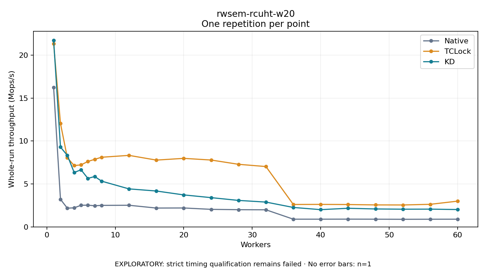

# rwsem-rcuht-w20

One timed repetition per point; no repeat variability estimate.
EXPLORATORY: strict timing qualification remains failed. Rates include post-lock work. Failed/unrun cases have no plotted rate.

| Workers | Native Mops/s | TCLock Mops/s | KD Mops/s | KD execution |
| ---: | ---: | ---: | ---: | --- |
| 1 | 16.232 | 21.344 | 21.737 | NO_JIT |
| 2 | 3.211 | 12.041 | 9.291 | NO_JIT |
| 3 | 2.180 | 8.053 | 8.329 | NO_JIT |
| 4 | 2.219 | 7.143 | 6.333 | RETURNED_JIT |
| 5 | 2.517 | 7.220 | 6.652 | RETURNED_JIT |
| 6 | 2.530 | 7.618 | 5.646 | RETURNED_JIT |
| 7 | 2.458 | 7.868 | 5.868 | RETURNED_JIT |
| 8 | 2.506 | 8.110 | 5.328 | RETURNED_JIT |
| 12 | 2.518 | 8.328 | 4.425 | RETURNED_JIT |
| 16 | 2.193 | 7.778 | 4.178 | RETURNED_JIT |
| 20 | 2.203 | 7.980 | 3.724 | RETURNED_JIT |
| 24 | 2.043 | 7.785 | 3.406 | RETURNED_JIT |
| 28 | 2.002 | 7.288 | 3.083 | RETURNED_JIT |
| 32 | 1.991 | 7.025 | 2.888 | RETURNED_JIT |
| 36 | 0.897 | 2.609 | 2.263 | RETURNED_JIT |
| 40 | 0.897 | 2.620 | 2.007 | RETURNED_JIT |
| 44 | 0.903 | 2.603 | 2.168 | RETURNED_JIT |
| 48 | 0.897 | 2.559 | 2.088 | RETURNED_JIT |
| 52 | 0.884 | 2.552 | 2.060 | RETURNED_JIT |
| 56 | 0.892 | 2.629 | 2.067 | RETURNED_JIT |
| 60 | 0.896 | 2.998 | 2.020 | RETURNED_JIT |

[Full receipt table](table.csv)

