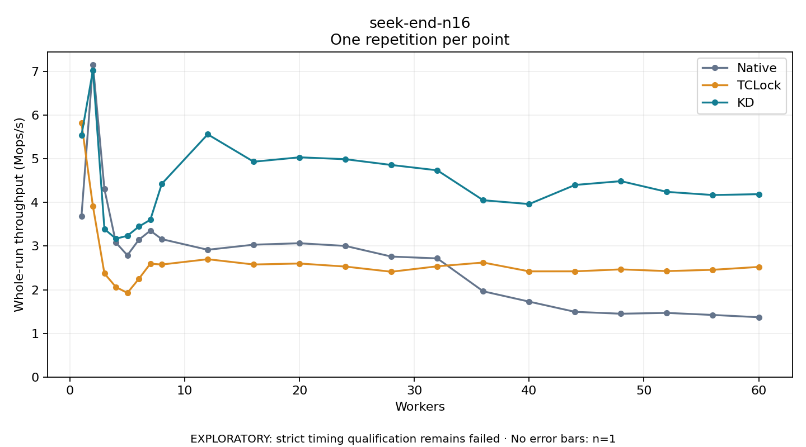

# seek-end-n16

One timed repetition per point; no repeat variability estimate.
EXPLORATORY: strict timing qualification remains failed. Rates include post-lock work. Failed/unrun cases have no plotted rate.

| Workers | Native Mops/s | TCLock Mops/s | KD Mops/s | KD execution |
| ---: | ---: | ---: | ---: | --- |
| 1 | 3.683 | 5.823 | 5.535 | NO_JIT |
| 2 | 7.159 | 3.912 | 7.031 | NO_JIT |
| 3 | 4.307 | 2.372 | 3.392 | RETURNED_JIT |
| 4 | 3.080 | 2.063 | 3.170 | RETURNED_JIT |
| 5 | 2.790 | 1.927 | 3.236 | RETURNED_JIT |
| 6 | 3.146 | 2.250 | 3.448 | RETURNED_JIT |
| 7 | 3.354 | 2.598 | 3.603 | RETURNED_JIT |
| 8 | 3.159 | 2.578 | 4.427 | RETURNED_JIT |
| 12 | 2.916 | 2.700 | 5.561 | RETURNED_JIT |
| 16 | 3.033 | 2.579 | 4.934 | RETURNED_JIT |
| 20 | 3.065 | 2.601 | 5.035 | RETURNED_JIT |
| 24 | 3.004 | 2.531 | 4.991 | RETURNED_JIT |
| 28 | 2.760 | 2.412 | 4.859 | RETURNED_JIT |
| 32 | 2.718 | 2.537 | 4.737 | RETURNED_JIT |
| 36 | 1.964 | 2.623 | 4.051 | RETURNED_JIT |
| 40 | 1.728 | 2.421 | 3.963 | RETURNED_JIT |
| 44 | 1.494 | 2.422 | 4.401 | RETURNED_JIT |
| 48 | 1.451 | 2.467 | 4.488 | RETURNED_JIT |
| 52 | 1.469 | 2.427 | 4.243 | RETURNED_JIT |
| 56 | 1.422 | 2.457 | 4.170 | RETURNED_JIT |
| 60 | 1.370 | 2.523 | 4.190 | RETURNED_JIT |

[Full receipt table](table.csv)

