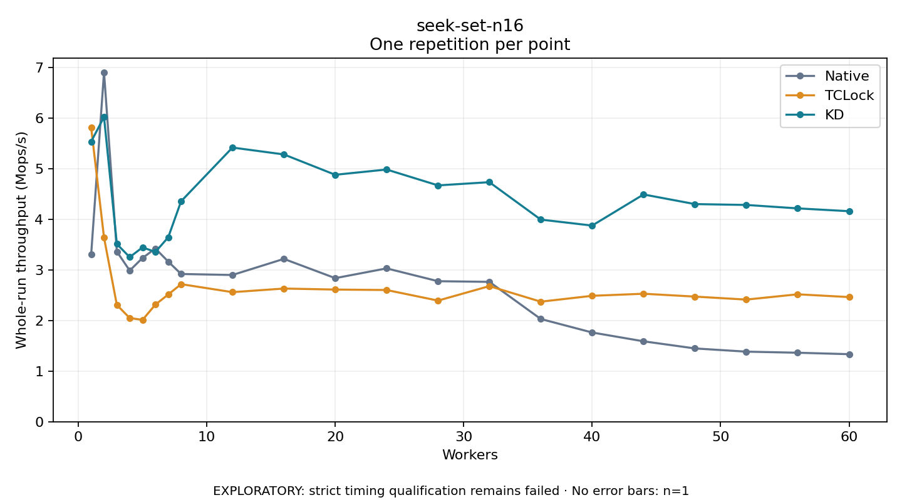

# seek-set-n16

One timed repetition per point; no repeat variability estimate.
EXPLORATORY: strict timing qualification remains failed. Rates include post-lock work. Failed/unrun cases have no plotted rate.

| Workers | Native Mops/s | TCLock Mops/s | KD Mops/s | KD execution |
| ---: | ---: | ---: | ---: | --- |
| 1 | 3.309 | 5.818 | 5.540 | NO_JIT |
| 2 | 6.911 | 3.643 | 6.026 | NO_JIT |
| 3 | 3.365 | 2.309 | 3.513 | RETURNED_JIT |
| 4 | 2.989 | 2.051 | 3.255 | RETURNED_JIT |
| 5 | 3.238 | 2.014 | 3.448 | RETURNED_JIT |
| 6 | 3.426 | 2.316 | 3.357 | RETURNED_JIT |
| 7 | 3.166 | 2.516 | 3.647 | RETURNED_JIT |
| 8 | 2.922 | 2.720 | 4.359 | RETURNED_JIT |
| 12 | 2.902 | 2.562 | 5.421 | RETURNED_JIT |
| 16 | 3.220 | 2.633 | 5.286 | RETURNED_JIT |
| 20 | 2.839 | 2.613 | 4.883 | RETURNED_JIT |
| 24 | 3.032 | 2.604 | 4.987 | RETURNED_JIT |
| 28 | 2.779 | 2.395 | 4.674 | RETURNED_JIT |
| 32 | 2.766 | 2.682 | 4.737 | RETURNED_JIT |
| 36 | 2.032 | 2.374 | 3.997 | RETURNED_JIT |
| 40 | 1.764 | 2.490 | 3.879 | RETURNED_JIT |
| 44 | 1.590 | 2.531 | 4.494 | RETURNED_JIT |
| 48 | 1.449 | 2.474 | 4.304 | RETURNED_JIT |
| 52 | 1.386 | 2.415 | 4.287 | RETURNED_JIT |
| 56 | 1.364 | 2.520 | 4.219 | RETURNED_JIT |
| 60 | 1.336 | 2.465 | 4.163 | RETURNED_JIT |

[Full receipt table](table.csv)

