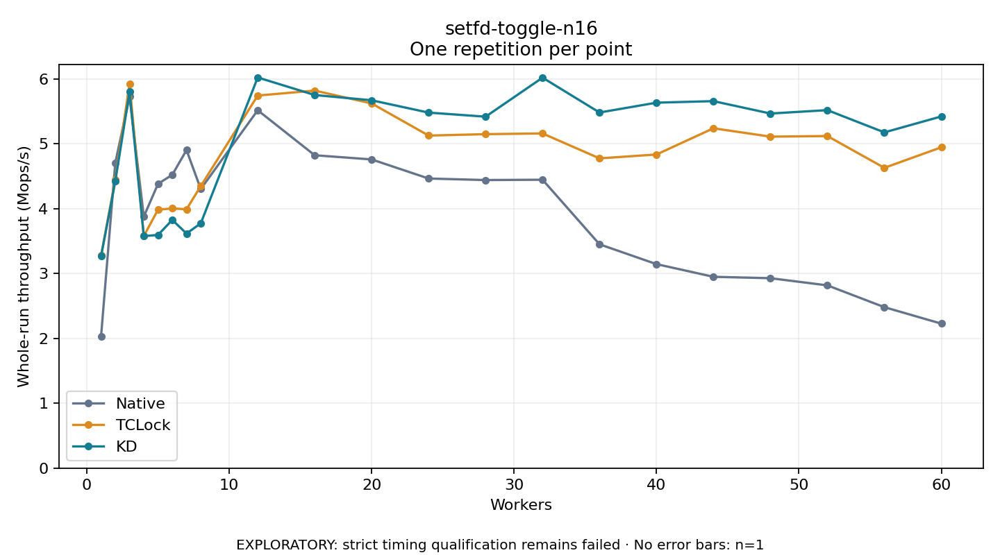

# setfd-toggle-n16

One timed repetition per point; no repeat variability estimate.
EXPLORATORY: strict timing qualification remains failed. Rates include post-lock work. Failed/unrun cases have no plotted rate.

| Workers | Native Mops/s | TCLock Mops/s | KD Mops/s | KD execution |
| ---: | ---: | ---: | ---: | --- |
| 1 | 2.032 | 3.277 | 3.266 | NO_JIT |
| 2 | 4.709 | 4.450 | 4.425 | NO_JIT |
| 3 | 5.725 | 5.924 | 5.802 | NO_JIT |
| 4 | 3.878 | 3.579 | 3.577 | NO_JIT |
| 5 | 4.383 | 3.985 | 3.595 | NO_JIT |
| 6 | 4.522 | 4.004 | 3.827 | NO_JIT |
| 7 | 4.903 | 3.991 | 3.617 | NO_JIT |
| 8 | 4.303 | 4.348 | 3.774 | RETURNED_JIT |
| 12 | 5.518 | 5.744 | 6.023 | RETURNED_JIT |
| 16 | 4.824 | 5.821 | 5.752 | RETURNED_JIT |
| 20 | 4.759 | 5.622 | 5.671 | RETURNED_JIT |
| 24 | 4.465 | 5.127 | 5.481 | RETURNED_JIT |
| 28 | 4.441 | 5.149 | 5.418 | RETURNED_JIT |
| 32 | 4.446 | 5.160 | 6.020 | RETURNED_JIT |
| 36 | 3.451 | 4.776 | 5.483 | RETURNED_JIT |
| 40 | 3.145 | 4.835 | 5.634 | RETURNED_JIT |
| 44 | 2.950 | 5.240 | 5.658 | RETURNED_JIT |
| 48 | 2.928 | 5.111 | 5.467 | RETURNED_JIT |
| 52 | 2.818 | 5.120 | 5.520 | RETURNED_JIT |
| 56 | 2.481 | 4.630 | 5.176 | RETURNED_JIT |
| 60 | 2.228 | 4.946 | 5.422 | RETURNED_JIT |

[Full receipt table](table.csv)

