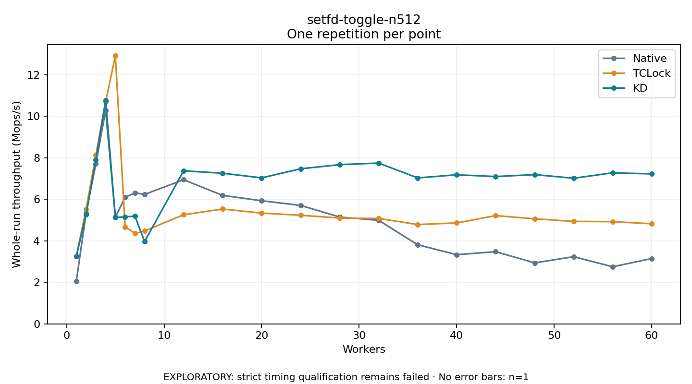

# setfd-toggle-n512

One timed repetition per point; no repeat variability estimate.
EXPLORATORY: strict timing qualification remains failed. Rates include post-lock work. Failed/unrun cases have no plotted rate.

| Workers | Native Mops/s | TCLock Mops/s | KD Mops/s | KD execution |
| ---: | ---: | ---: | ---: | --- |
| 1 | 2.064 | 3.265 | 3.264 | NO_JIT |
| 2 | 5.348 | 5.531 | 5.268 | NO_JIT |
| 3 | 7.711 | 8.137 | 7.916 | NO_JIT |
| 4 | 10.285 | 10.710 | 10.768 | NO_JIT |
| 5 | 5.144 | 12.914 | 5.128 | NO_JIT |
| 6 | 6.096 | 4.672 | 5.159 | NO_JIT |
| 7 | 6.315 | 4.358 | 5.192 | NO_JIT |
| 8 | 6.241 | 4.478 | 3.971 | RETURNED_JIT |
| 12 | 6.946 | 5.260 | 7.376 | RETURNED_JIT |
| 16 | 6.193 | 5.535 | 7.262 | RETURNED_JIT |
| 20 | 5.934 | 5.339 | 7.037 | RETURNED_JIT |
| 24 | 5.710 | 5.234 | 7.475 | RETURNED_JIT |
| 28 | 5.149 | 5.100 | 7.673 | RETURNED_JIT |
| 32 | 4.990 | 5.080 | 7.750 | RETURNED_JIT |
| 36 | 3.815 | 4.788 | 7.035 | RETURNED_JIT |
| 40 | 3.334 | 4.864 | 7.185 | RETURNED_JIT |
| 44 | 3.478 | 5.217 | 7.101 | RETURNED_JIT |
| 48 | 2.940 | 5.063 | 7.193 | RETURNED_JIT |
| 52 | 3.238 | 4.940 | 7.020 | RETURNED_JIT |
| 56 | 2.753 | 4.927 | 7.280 | RETURNED_JIT |
| 60 | 3.150 | 4.825 | 7.229 | RETURNED_JIT |

[Full receipt table](table.csv)

