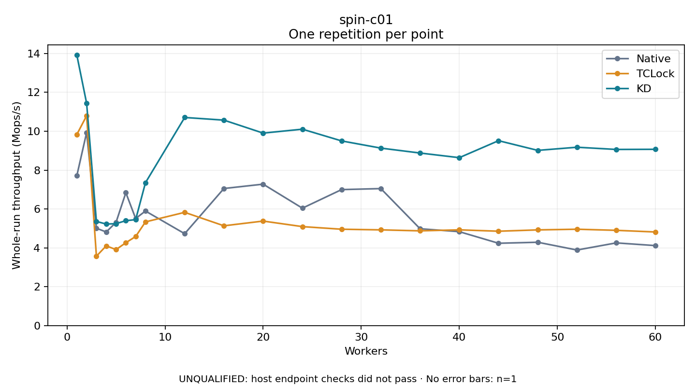

# spin-c01

One timed repetition per point; no repeat variability estimate.
UNQUALIFIED: host endpoint checks did not pass. Rates include post-lock work. Failed/unrun cases have no plotted rate.

| Workers | Native Mops/s | TCLock Mops/s | KD Mops/s | KD execution |
| ---: | ---: | ---: | ---: | --- |
| 1 | 7.705 | 9.829 | 13.925 | NO_JIT |
| 2 | 9.933 | 10.795 | 11.440 | NO_JIT |
| 3 | 5.010 | 3.571 | 5.359 | NO_JIT |
| 4 | 4.815 | 4.103 | 5.223 | NO_JIT |
| 5 | 5.311 | 3.909 | 5.244 | NO_JIT |
| 6 | 6.836 | 4.263 | 5.397 | NO_JIT |
| 7 | 5.510 | 4.582 | 5.450 | NO_JIT |
| 8 | 5.894 | 5.335 | 7.350 | RETURNED_JIT |
| 12 | 4.727 | 5.826 | 10.708 | RETURNED_JIT |
| 16 | 7.053 | 5.133 | 10.571 | RETURNED_JIT |
| 20 | 7.276 | 5.377 | 9.903 | RETURNED_JIT |
| 24 | 6.041 | 5.092 | 10.105 | RETURNED_JIT |
| 28 | 6.997 | 4.957 | 9.501 | RETURNED_JIT |
| 32 | 7.048 | 4.924 | 9.131 | RETURNED_JIT |
| 36 | 4.981 | 4.874 | 8.878 | RETURNED_JIT |
| 40 | 4.831 | 4.925 | 8.639 | RETURNED_JIT |
| 44 | 4.235 | 4.855 | 9.513 | RETURNED_JIT |
| 48 | 4.287 | 4.923 | 9.014 | RETURNED_JIT |
| 52 | 3.887 | 4.957 | 9.176 | RETURNED_JIT |
| 56 | 4.254 | 4.901 | 9.063 | RETURNED_JIT |
| 60 | 4.115 | 4.815 | 9.070 | RETURNED_JIT |

[Full receipt table](table.csv)

