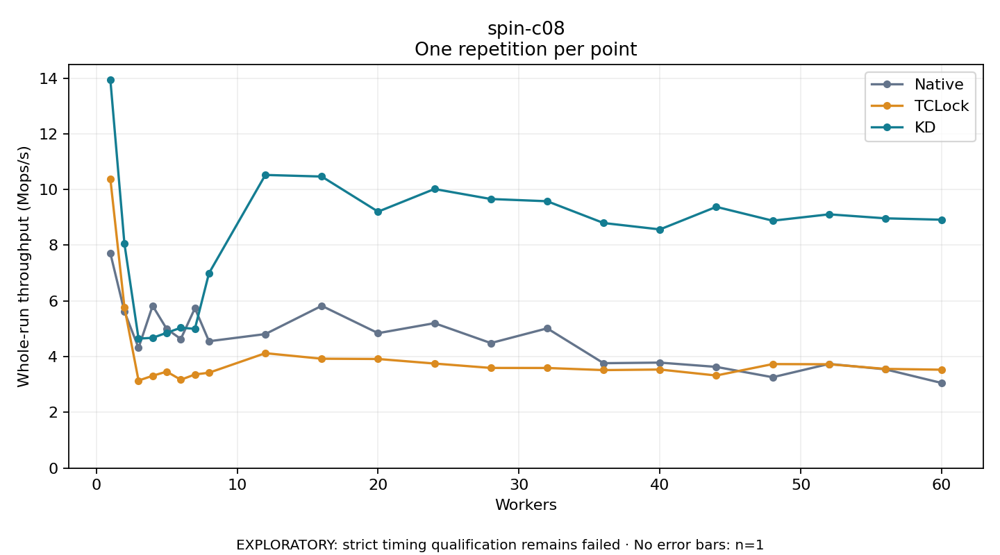

# spin-c08

One timed repetition per point; no repeat variability estimate.
EXPLORATORY: strict timing qualification remains failed. Rates include post-lock work. Failed/unrun cases have no plotted rate.

| Workers | Native Mops/s | TCLock Mops/s | KD Mops/s | KD execution |
| ---: | ---: | ---: | ---: | --- |
| 1 | 7.712 | 10.382 | 13.941 | NO_JIT |
| 2 | 5.617 | 5.772 | 8.049 | NO_JIT |
| 3 | 4.315 | 3.143 | 4.648 | NO_JIT |
| 4 | 5.827 | 3.314 | 4.676 | NO_JIT |
| 5 | 4.995 | 3.464 | 4.857 | NO_JIT |
| 6 | 4.635 | 3.171 | 5.038 | NO_JIT |
| 7 | 5.738 | 3.361 | 5.000 | NO_JIT |
| 8 | 4.554 | 3.424 | 6.996 | RETURNED_JIT |
| 12 | 4.811 | 4.125 | 10.522 | RETURNED_JIT |
| 16 | 5.825 | 3.926 | 10.466 | RETURNED_JIT |
| 20 | 4.843 | 3.917 | 9.205 | RETURNED_JIT |
| 24 | 5.202 | 3.753 | 10.018 | RETURNED_JIT |
| 28 | 4.488 | 3.596 | 9.659 | RETURNED_JIT |
| 32 | 5.017 | 3.594 | 9.579 | RETURNED_JIT |
| 36 | 3.766 | 3.518 | 8.798 | RETURNED_JIT |
| 40 | 3.787 | 3.538 | 8.567 | RETURNED_JIT |
| 44 | 3.633 | 3.324 | 9.377 | RETURNED_JIT |
| 48 | 3.262 | 3.734 | 8.881 | RETURNED_JIT |
| 52 | 3.740 | 3.727 | 9.109 | RETURNED_JIT |
| 56 | 3.546 | 3.561 | 8.965 | RETURNED_JIT |
| 60 | 3.055 | 3.532 | 8.916 | RETURNED_JIT |

[Full receipt table](table.csv)

