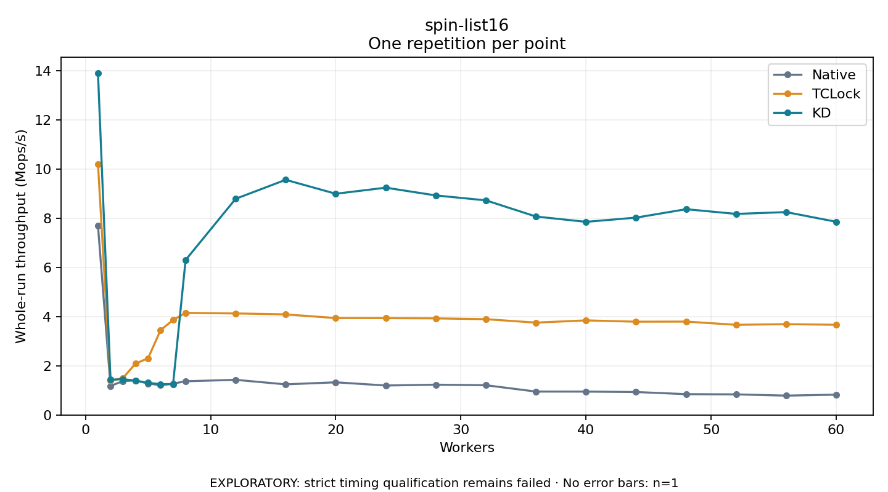

# spin-list16

One timed repetition per point; no repeat variability estimate.
EXPLORATORY: strict timing qualification remains failed. Rates include post-lock work. Failed/unrun cases have no plotted rate.

| Workers | Native Mops/s | TCLock Mops/s | KD Mops/s | KD execution |
| ---: | ---: | ---: | ---: | --- |
| 1 | 7.695 | 10.211 | 13.905 | NO_JIT |
| 2 | 1.179 | 1.391 | 1.436 | NO_JIT |
| 3 | 1.382 | 1.508 | 1.456 | NO_JIT |
| 4 | 1.403 | 2.090 | 1.400 | NO_JIT |
| 5 | 1.282 | 2.308 | 1.310 | NO_JIT |
| 6 | 1.212 | 3.451 | 1.254 | NO_JIT |
| 7 | 1.277 | 3.867 | 1.256 | NO_JIT |
| 8 | 1.371 | 4.156 | 6.306 | RETURNED_JIT |
| 12 | 1.430 | 4.132 | 8.797 | RETURNED_JIT |
| 16 | 1.246 | 4.093 | 9.571 | RETURNED_JIT |
| 20 | 1.330 | 3.944 | 9.004 | RETURNED_JIT |
| 24 | 1.199 | 3.940 | 9.251 | RETURNED_JIT |
| 28 | 1.233 | 3.931 | 8.935 | RETURNED_JIT |
| 32 | 1.211 | 3.898 | 8.735 | RETURNED_JIT |
| 36 | 0.953 | 3.759 | 8.076 | RETURNED_JIT |
| 40 | 0.951 | 3.850 | 7.861 | RETURNED_JIT |
| 44 | 0.934 | 3.796 | 8.032 | RETURNED_JIT |
| 48 | 0.847 | 3.800 | 8.375 | RETURNED_JIT |
| 52 | 0.838 | 3.669 | 8.184 | RETURNED_JIT |
| 56 | 0.787 | 3.696 | 8.256 | RETURNED_JIT |
| 60 | 0.827 | 3.671 | 7.862 | RETURNED_JIT |

[Full receipt table](table.csv)

