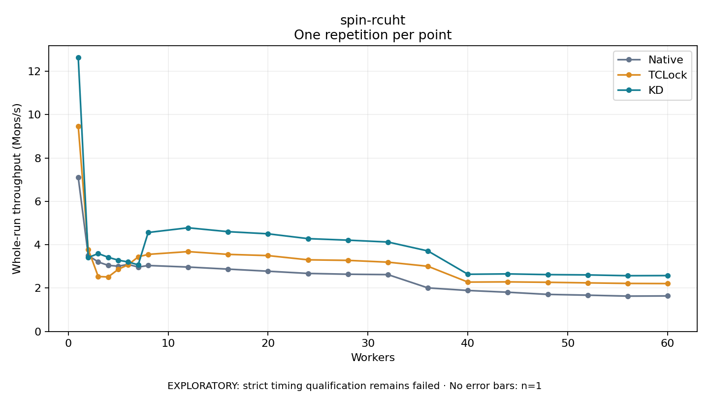

# spin-rcuht

One timed repetition per point; no repeat variability estimate.
EXPLORATORY: strict timing qualification remains failed. Rates include post-lock work. Failed/unrun cases have no plotted rate.

| Workers | Native Mops/s | TCLock Mops/s | KD Mops/s | KD execution |
| ---: | ---: | ---: | ---: | --- |
| 1 | 7.110 | 9.467 | 12.629 | NO_JIT |
| 2 | 3.505 | 3.787 | 3.409 | NO_JIT |
| 3 | 3.205 | 2.534 | 3.594 | NO_JIT |
| 4 | 3.048 | 2.515 | 3.421 | NO_JIT |
| 5 | 3.013 | 2.865 | 3.289 | NO_JIT |
| 6 | 3.092 | 3.079 | 3.204 | NO_JIT |
| 7 | 2.971 | 3.439 | 3.074 | NO_JIT |
| 8 | 3.043 | 3.556 | 4.565 | RETURNED_JIT |
| 12 | 2.971 | 3.683 | 4.782 | RETURNED_JIT |
| 16 | 2.876 | 3.555 | 4.603 | RETURNED_JIT |
| 20 | 2.779 | 3.499 | 4.504 | RETURNED_JIT |
| 24 | 2.677 | 3.304 | 4.281 | RETURNED_JIT |
| 28 | 2.640 | 3.279 | 4.211 | RETURNED_JIT |
| 32 | 2.622 | 3.197 | 4.125 | RETURNED_JIT |
| 36 | 2.010 | 3.006 | 3.713 | RETURNED_JIT |
| 40 | 1.891 | 2.278 | 2.638 | RETURNED_JIT |
| 44 | 1.810 | 2.287 | 2.655 | RETURNED_JIT |
| 48 | 1.710 | 2.268 | 2.622 | RETURNED_JIT |
| 52 | 1.674 | 2.241 | 2.608 | RETURNED_JIT |
| 56 | 1.631 | 2.216 | 2.572 | RETURNED_JIT |
| 60 | 1.639 | 2.208 | 2.578 | RETURNED_JIT |

[Full receipt table](table.csv)

