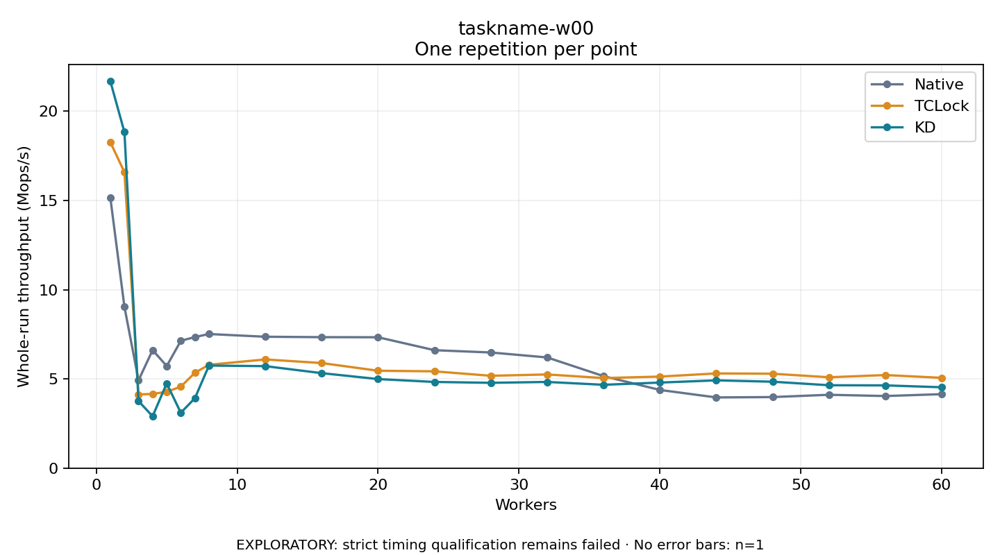

# taskname-w00

One timed repetition per point; no repeat variability estimate.
EXPLORATORY: strict timing qualification remains failed. Rates include post-lock work. Failed/unrun cases have no plotted rate.

| Workers | Native Mops/s | TCLock Mops/s | KD Mops/s | KD execution |
| ---: | ---: | ---: | ---: | --- |
| 1 | 15.154 | 18.267 | 21.682 | NO_JIT |
| 2 | 9.038 | 16.585 | 18.831 | NO_JIT |
| 3 | 4.923 | 4.126 | 3.752 | RETURNED_JIT |
| 4 | 6.617 | 4.159 | 2.908 | RETURNED_JIT |
| 5 | 5.720 | 4.276 | 4.750 | RETURNED_JIT |
| 6 | 7.133 | 4.566 | 3.102 | RETURNED_JIT |
| 7 | 7.348 | 5.343 | 3.920 | RETURNED_JIT |
| 8 | 7.516 | 5.793 | 5.748 | RETURNED_JIT |
| 12 | 7.363 | 6.091 | 5.715 | RETURNED_JIT |
| 16 | 7.340 | 5.888 | 5.322 | RETURNED_JIT |
| 20 | 7.334 | 5.457 | 4.991 | RETURNED_JIT |
| 24 | 6.610 | 5.424 | 4.830 | RETURNED_JIT |
| 28 | 6.481 | 5.175 | 4.781 | RETURNED_JIT |
| 32 | 6.202 | 5.250 | 4.830 | RETURNED_JIT |
| 36 | 5.156 | 5.047 | 4.670 | RETURNED_JIT |
| 40 | 4.381 | 5.130 | 4.794 | RETURNED_JIT |
| 44 | 3.962 | 5.307 | 4.919 | RETURNED_JIT |
| 48 | 3.982 | 5.291 | 4.843 | RETURNED_JIT |
| 52 | 4.111 | 5.091 | 4.644 | RETURNED_JIT |
| 56 | 4.040 | 5.216 | 4.637 | RETURNED_JIT |
| 60 | 4.145 | 5.060 | 4.531 | RETURNED_JIT |

[Full receipt table](table.csv)

