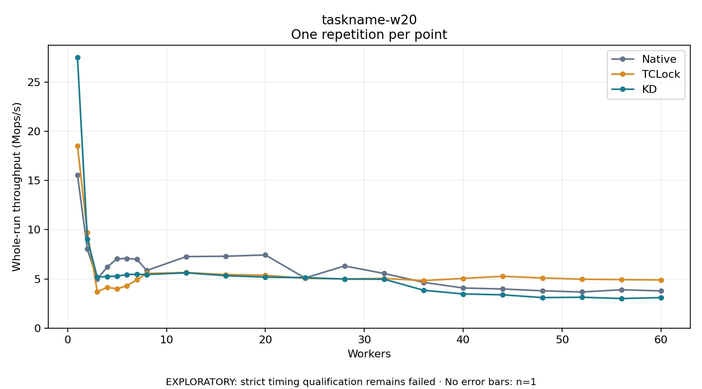

# taskname-w20

One timed repetition per point; no repeat variability estimate.
EXPLORATORY: strict timing qualification remains failed. Rates include post-lock work. Failed/unrun cases have no plotted rate.

| Workers | Native Mops/s | TCLock Mops/s | KD Mops/s | KD execution |
| ---: | ---: | ---: | ---: | --- |
| 1 | 15.583 | 18.516 | 27.531 | NO_JIT |
| 2 | 8.024 | 9.709 | 9.045 | NO_JIT |
| 3 | 4.971 | 3.710 | 5.166 | NO_JIT |
| 4 | 6.209 | 4.138 | 5.250 | NO_JIT |
| 5 | 7.043 | 4.001 | 5.279 | NO_JIT |
| 6 | 7.079 | 4.304 | 5.443 | NO_JIT |
| 7 | 7.000 | 4.911 | 5.465 | NO_JIT |
| 8 | 5.853 | 5.552 | 5.444 | RETURNED_JIT |
| 12 | 7.274 | 5.652 | 5.620 | RETURNED_JIT |
| 16 | 7.305 | 5.438 | 5.329 | RETURNED_JIT |
| 20 | 7.433 | 5.371 | 5.183 | RETURNED_JIT |
| 24 | 5.092 | 5.055 | 5.132 | RETURNED_JIT |
| 28 | 6.319 | 5.005 | 4.982 | NO_JIT |
| 32 | 5.551 | 5.045 | 4.971 | NO_JIT |
| 36 | 4.650 | 4.832 | 3.844 | RETURNED_JIT |
| 40 | 4.075 | 5.049 | 3.472 | RETURNED_JIT |
| 44 | 3.976 | 5.266 | 3.384 | RETURNED_JIT |
| 48 | 3.792 | 5.095 | 3.101 | RETURNED_JIT |
| 52 | 3.671 | 4.971 | 3.136 | RETURNED_JIT |
| 56 | 3.896 | 4.928 | 3.006 | RETURNED_JIT |
| 60 | 3.780 | 4.897 | 3.099 | RETURNED_JIT |

[Full receipt table](table.csv)

