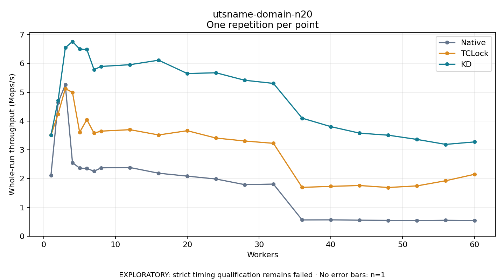

# utsname-domain-n20

One timed repetition per point; no repeat variability estimate.
EXPLORATORY: strict timing qualification remains failed. Rates include post-lock work. Failed/unrun cases have no plotted rate.

| Workers | Native Mops/s | TCLock Mops/s | KD Mops/s | KD execution |
| ---: | ---: | ---: | ---: | --- |
| 1 | 2.114 | 3.508 | 3.507 | NO_JIT |
| 2 | 4.643 | 4.247 | 4.720 | NO_JIT |
| 3 | 5.260 | 5.126 | 6.547 | NO_JIT |
| 4 | 2.554 | 4.996 | 6.765 | NO_JIT |
| 5 | 2.365 | 3.607 | 6.503 | NO_JIT |
| 6 | 2.355 | 4.051 | 6.490 | NO_JIT |
| 7 | 2.257 | 3.581 | 5.788 | NO_JIT |
| 8 | 2.374 | 3.650 | 5.898 | NO_JIT |
| 12 | 2.386 | 3.701 | 5.959 | RETURNED_JIT |
| 16 | 2.188 | 3.517 | 6.115 | RETURNED_JIT |
| 20 | 2.086 | 3.664 | 5.652 | RETURNED_JIT |
| 24 | 1.986 | 3.409 | 5.678 | RETURNED_JIT |
| 28 | 1.791 | 3.307 | 5.418 | RETURNED_JIT |
| 32 | 1.810 | 3.226 | 5.309 | RETURNED_JIT |
| 36 | 0.563 | 1.695 | 4.101 | RETURNED_JIT |
| 40 | 0.567 | 1.731 | 3.806 | RETURNED_JIT |
| 44 | 0.555 | 1.760 | 3.580 | RETURNED_JIT |
| 48 | 0.549 | 1.691 | 3.509 | RETURNED_JIT |
| 52 | 0.543 | 1.748 | 3.362 | RETURNED_JIT |
| 56 | 0.552 | 1.926 | 3.189 | RETURNED_JIT |
| 60 | 0.544 | 2.149 | 3.275 | RETURNED_JIT |

[Full receipt table](table.csv)

