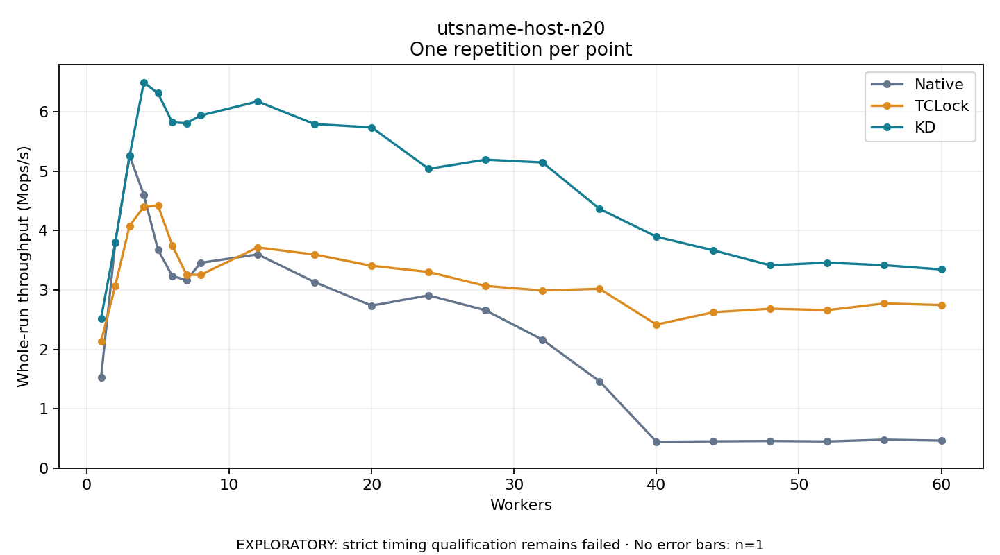

# utsname-host-n20

One timed repetition per point; no repeat variability estimate.
EXPLORATORY: strict timing qualification remains failed. Rates include post-lock work. Failed/unrun cases have no plotted rate.

| Workers | Native Mops/s | TCLock Mops/s | KD Mops/s | KD execution |
| ---: | ---: | ---: | ---: | --- |
| 1 | 1.530 | 2.132 | 2.527 | NO_JIT |
| 2 | 3.799 | 3.072 | 3.803 | NO_JIT |
| 3 | 5.268 | 4.080 | 5.251 | NO_JIT |
| 4 | 4.604 | 4.404 | 6.496 | NO_JIT |
| 5 | 3.678 | 4.422 | 6.314 | NO_JIT |
| 6 | 3.235 | 3.753 | 5.825 | NO_JIT |
| 7 | 3.168 | 3.256 | 5.810 | NO_JIT |
| 8 | 3.459 | 3.257 | 5.941 | NO_JIT |
| 12 | 3.601 | 3.717 | 6.177 | RETURNED_JIT |
| 16 | 3.134 | 3.597 | 5.795 | RETURNED_JIT |
| 20 | 2.737 | 3.409 | 5.740 | RETURNED_JIT |
| 24 | 2.910 | 3.304 | 5.043 | RETURNED_JIT |
| 28 | 2.658 | 3.069 | 5.196 | RETURNED_JIT |
| 32 | 2.163 | 2.993 | 5.149 | RETURNED_JIT |
| 36 | 1.462 | 3.021 | 4.368 | RETURNED_JIT |
| 40 | 0.444 | 2.418 | 3.898 | RETURNED_JIT |
| 44 | 0.451 | 2.626 | 3.668 | RETURNED_JIT |
| 48 | 0.457 | 2.685 | 3.416 | RETURNED_JIT |
| 52 | 0.449 | 2.661 | 3.462 | RETURNED_JIT |
| 56 | 0.479 | 2.774 | 3.417 | RETURNED_JIT |
| 60 | 0.464 | 2.748 | 3.346 | RETURNED_JIT |

[Full receipt table](table.csv)

