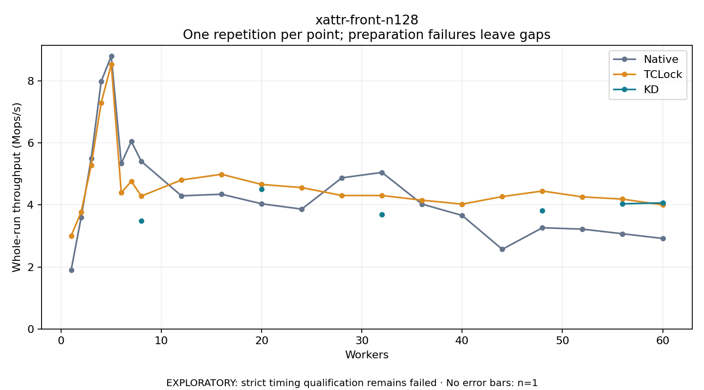

# xattr-front-n128

One timed repetition per point; no repeat variability estimate.
EXPLORATORY: strict timing qualification remains failed. Rates include post-lock work. Failed/unrun cases have no plotted rate.

| Workers | Native Mops/s | TCLock Mops/s | KD Mops/s | KD execution |
| ---: | ---: | ---: | ---: | --- |
| 1 | 1.899 | 3.006 | — | PREPARATION_FAILED |
| 2 | 3.604 | 3.773 | — | PREPARATION_FAILED |
| 3 | 5.504 | 5.282 | — | PREPARATION_FAILED |
| 4 | 7.990 | 7.302 | — | PREPARATION_FAILED |
| 5 | 8.805 | 8.534 | — | PREPARATION_FAILED |
| 6 | 5.339 | 4.397 | — | PREPARATION_FAILED |
| 7 | 6.051 | 4.763 | — | PREPARATION_FAILED |
| 8 | 5.407 | 4.287 | 3.491 | RETURNED_JIT |
| 12 | 4.295 | 4.806 | — | PREPARATION_FAILED |
| 16 | 4.346 | 4.989 | — | PREPARATION_FAILED |
| 20 | 4.039 | 4.662 | 4.509 | RETURNED_JIT |
| 24 | 3.866 | 4.561 | — | PREPARATION_FAILED |
| 28 | 4.876 | 4.306 | — | PREPARATION_FAILED |
| 32 | 5.050 | 4.306 | 3.689 | RETURNED_JIT |
| 36 | 4.028 | 4.154 | — | PREPARATION_FAILED |
| 40 | 3.661 | 4.027 | — | PREPARATION_FAILED |
| 44 | 2.569 | 4.270 | — | PREPARATION_FAILED |
| 48 | 3.265 | 4.450 | 3.815 | RETURNED_JIT |
| 52 | 3.220 | 4.261 | — | PREPARATION_FAILED |
| 56 | 3.071 | 4.188 | 4.038 | RETURNED_JIT |
| 60 | 2.919 | 4.002 | 4.067 | RETURNED_JIT |

[Full receipt table](table.csv)

