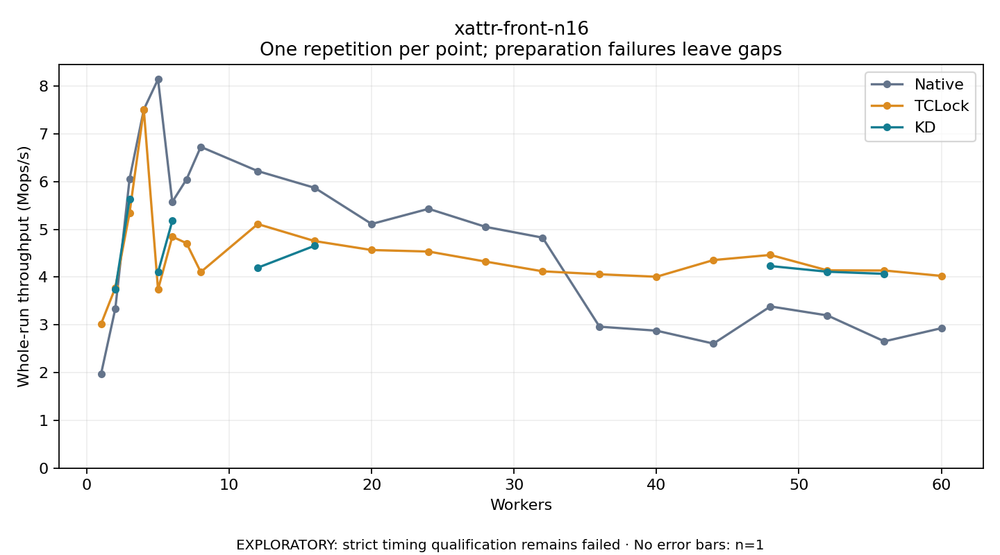

# xattr-front-n16

One timed repetition per point; no repeat variability estimate.
EXPLORATORY: strict timing qualification remains failed. Rates include post-lock work. Failed/unrun cases have no plotted rate.

| Workers | Native Mops/s | TCLock Mops/s | KD Mops/s | KD execution |
| ---: | ---: | ---: | ---: | --- |
| 1 | 1.972 | 3.018 | — | PREPARATION_FAILED |
| 2 | 3.339 | 3.777 | 3.745 | NO_JIT |
| 3 | 6.053 | 5.344 | 5.637 | RETURNED_JIT |
| 4 | 7.508 | 7.512 | — | PREPARATION_FAILED |
| 5 | 8.143 | 3.740 | 4.102 | NO_JIT |
| 6 | 5.573 | 4.847 | 5.176 | RETURNED_JIT |
| 7 | 6.047 | 4.710 | — | PREPARATION_FAILED |
| 8 | 6.728 | 4.106 | — | PREPARATION_FAILED |
| 12 | 6.220 | 5.111 | 4.196 | RETURNED_JIT |
| 16 | 5.869 | 4.755 | 4.657 | RETURNED_JIT |
| 20 | 5.112 | 4.567 | — | PREPARATION_FAILED |
| 24 | 5.430 | 4.535 | — | PREPARATION_FAILED |
| 28 | 5.052 | 4.325 | — | PREPARATION_FAILED |
| 32 | 4.826 | 4.121 | — | PREPARATION_FAILED |
| 36 | 2.962 | 4.059 | — | PREPARATION_FAILED |
| 40 | 2.878 | 4.007 | — | PREPARATION_FAILED |
| 44 | 2.607 | 4.357 | — | PREPARATION_FAILED |
| 48 | 3.386 | 4.464 | 4.232 | RETURNED_JIT |
| 52 | 3.198 | 4.142 | 4.113 | RETURNED_JIT |
| 56 | 2.654 | 4.138 | 4.068 | RETURNED_JIT |
| 60 | 2.930 | 4.025 | — | PREPARATION_FAILED |

[Full receipt table](table.csv)

[Initial stopped attempt](first-attempt/README.md) is retained. Continuation kept the identical plan and skipped all three previously attempted points, including the failed KD preparation.
