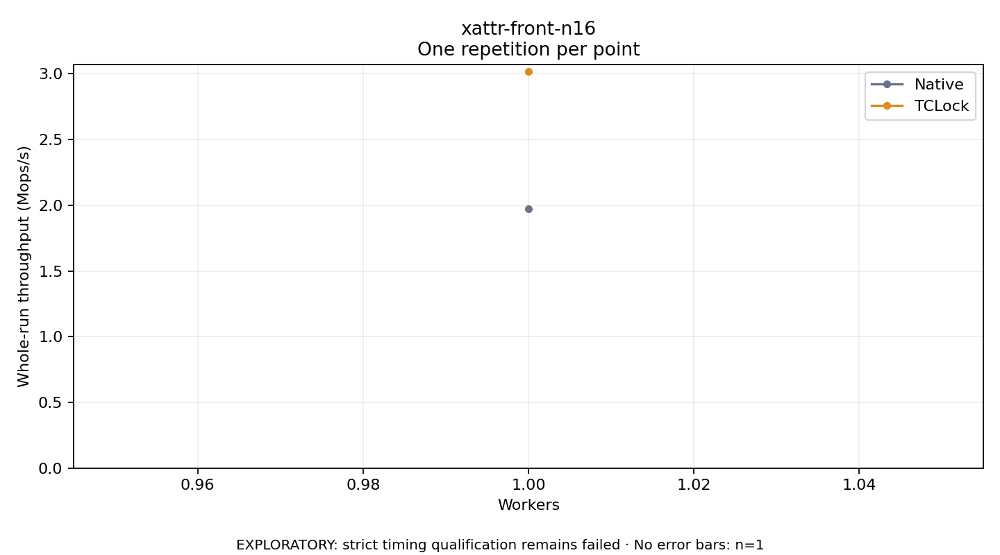

# xattr-front-n16

One timed repetition per point; no repeat variability estimate.
EXPLORATORY: strict timing qualification remains failed. Rates include post-lock work. Failed/unrun cases have no plotted rate.

| Workers | Native Mops/s | TCLock Mops/s | KD Mops/s | KD execution |
| ---: | ---: | ---: | ---: | --- |
| 1 | 1.972 | 3.018 | — | PREPARATION_FAILED |
| 2 | — | — | — | NOT_RUN |
| 3 | — | — | — | NOT_RUN |
| 4 | — | — | — | NOT_RUN |
| 5 | — | — | — | NOT_RUN |
| 6 | — | — | — | NOT_RUN |
| 7 | — | — | — | NOT_RUN |
| 8 | — | — | — | NOT_RUN |
| 12 | — | — | — | NOT_RUN |
| 16 | — | — | — | NOT_RUN |
| 20 | — | — | — | NOT_RUN |
| 24 | — | — | — | NOT_RUN |
| 28 | — | — | — | NOT_RUN |
| 32 | — | — | — | NOT_RUN |
| 36 | — | — | — | NOT_RUN |
| 40 | — | — | — | NOT_RUN |
| 44 | — | — | — | NOT_RUN |
| 48 | — | — | — | NOT_RUN |
| 52 | — | — | — | NOT_RUN |
| 56 | — | — | — | NOT_RUN |
| 60 | — | — | — | NOT_RUN |

[Full receipt table](table.csv)

