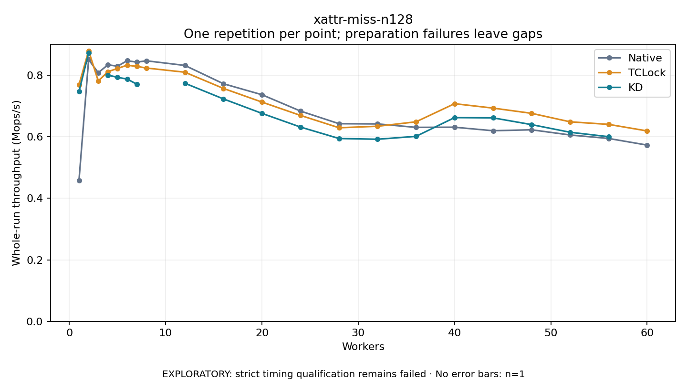

# xattr-miss-n128

One timed repetition per point; no repeat variability estimate.
EXPLORATORY: strict timing qualification remains failed. Rates include post-lock work. Failed/unrun cases have no plotted rate.

| Workers | Native Mops/s | TCLock Mops/s | KD Mops/s | KD execution |
| ---: | ---: | ---: | ---: | --- |
| 1 | 0.459 | 0.769 | 0.747 | NO_JIT |
| 2 | 0.851 | 0.880 | 0.872 | NO_JIT |
| 3 | 0.808 | 0.781 | — | PREPARATION_FAILED |
| 4 | 0.834 | 0.811 | 0.801 | NO_JIT |
| 5 | 0.829 | 0.822 | 0.793 | NO_JIT |
| 6 | 0.847 | 0.833 | 0.788 | NO_JIT |
| 7 | 0.843 | 0.829 | 0.771 | RETURNED_JIT |
| 8 | 0.847 | 0.824 | — | PREPARATION_FAILED |
| 12 | 0.832 | 0.810 | 0.774 | RETURNED_JIT |
| 16 | 0.772 | 0.757 | 0.723 | RETURNED_JIT |
| 20 | 0.737 | 0.713 | 0.676 | RETURNED_JIT |
| 24 | 0.684 | 0.669 | 0.632 | RETURNED_JIT |
| 28 | 0.643 | 0.629 | 0.594 | RETURNED_JIT |
| 32 | 0.642 | 0.634 | 0.592 | RETURNED_JIT |
| 36 | 0.631 | 0.649 | 0.601 | RETURNED_JIT |
| 40 | 0.631 | 0.708 | 0.662 | RETURNED_JIT |
| 44 | 0.620 | 0.693 | 0.662 | RETURNED_JIT |
| 48 | 0.623 | 0.676 | 0.640 | RETURNED_JIT |
| 52 | 0.606 | 0.649 | 0.615 | RETURNED_JIT |
| 56 | 0.595 | 0.640 | 0.600 | RETURNED_JIT |
| 60 | 0.573 | 0.619 | — | PREPARATION_FAILED |

[Full receipt table](table.csv)

