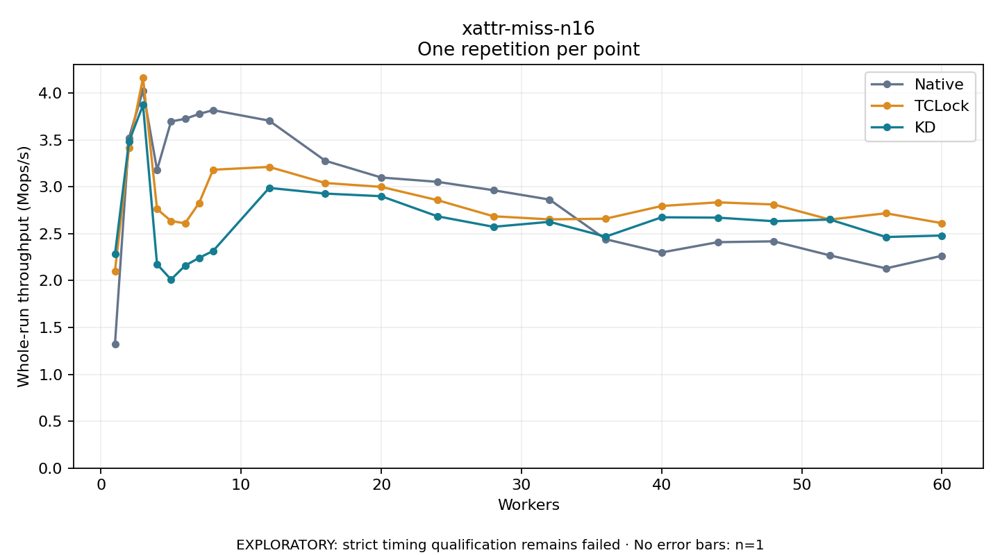

# xattr-miss-n16

One timed repetition per point; no repeat variability estimate.
EXPLORATORY: strict timing qualification remains failed. Rates include post-lock work. Failed/unrun cases have no plotted rate.

| Workers | Native Mops/s | TCLock Mops/s | KD Mops/s | KD execution |
| ---: | ---: | ---: | ---: | --- |
| 1 | 1.325 | 2.102 | 2.283 | NO_JIT |
| 2 | 3.523 | 3.417 | 3.484 | NO_JIT |
| 3 | 4.026 | 4.162 | 3.871 | NO_JIT |
| 4 | 3.180 | 2.763 | 2.174 | RETURNED_JIT |
| 5 | 3.697 | 2.635 | 2.011 | RETURNED_JIT |
| 6 | 3.724 | 2.611 | 2.159 | RETURNED_JIT |
| 7 | 3.777 | 2.827 | 2.242 | RETURNED_JIT |
| 8 | 3.817 | 3.182 | 2.316 | RETURNED_JIT |
| 12 | 3.705 | 3.212 | 2.988 | RETURNED_JIT |
| 16 | 3.278 | 3.040 | 2.928 | RETURNED_JIT |
| 20 | 3.099 | 2.999 | 2.899 | RETURNED_JIT |
| 24 | 3.053 | 2.858 | 2.685 | RETURNED_JIT |
| 28 | 2.963 | 2.686 | 2.573 | RETURNED_JIT |
| 32 | 2.864 | 2.653 | 2.626 | RETURNED_JIT |
| 36 | 2.441 | 2.660 | 2.468 | RETURNED_JIT |
| 40 | 2.300 | 2.795 | 2.675 | RETURNED_JIT |
| 44 | 2.409 | 2.834 | 2.671 | RETURNED_JIT |
| 48 | 2.418 | 2.811 | 2.633 | RETURNED_JIT |
| 52 | 2.269 | 2.651 | 2.651 | RETURNED_JIT |
| 56 | 2.130 | 2.717 | 2.464 | RETURNED_JIT |
| 60 | 2.265 | 2.612 | 2.480 | RETURNED_JIT |

[Full receipt table](table.csv)

