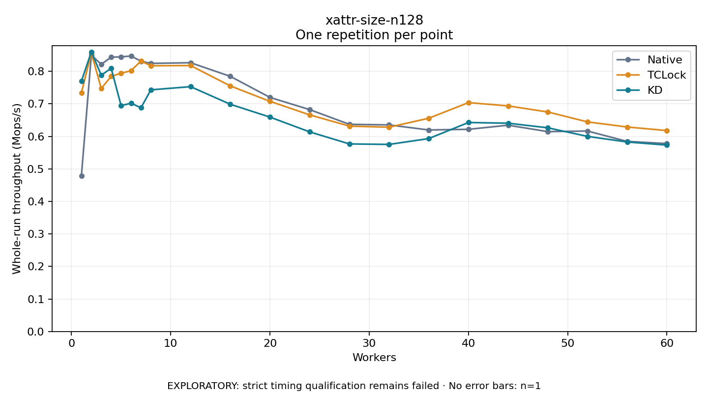

# xattr-size-n128

One timed repetition per point; no repeat variability estimate.
EXPLORATORY: strict timing qualification remains failed. Rates include post-lock work. Failed/unrun cases have no plotted rate.

| Workers | Native Mops/s | TCLock Mops/s | KD Mops/s | KD execution |
| ---: | ---: | ---: | ---: | --- |
| 1 | 0.479 | 0.734 | 0.770 | NO_JIT |
| 2 | 0.850 | 0.856 | 0.860 | NO_JIT |
| 3 | 0.821 | 0.747 | 0.788 | NO_JIT |
| 4 | 0.844 | 0.785 | 0.809 | NO_JIT |
| 5 | 0.844 | 0.794 | 0.694 | RETURNED_JIT |
| 6 | 0.847 | 0.802 | 0.702 | RETURNED_JIT |
| 7 | 0.831 | 0.832 | 0.688 | RETURNED_JIT |
| 8 | 0.824 | 0.817 | 0.743 | RETURNED_JIT |
| 12 | 0.826 | 0.818 | 0.753 | RETURNED_JIT |
| 16 | 0.785 | 0.755 | 0.699 | RETURNED_JIT |
| 20 | 0.720 | 0.708 | 0.659 | RETURNED_JIT |
| 24 | 0.682 | 0.666 | 0.614 | RETURNED_JIT |
| 28 | 0.637 | 0.631 | 0.577 | RETURNED_JIT |
| 32 | 0.635 | 0.628 | 0.575 | RETURNED_JIT |
| 36 | 0.620 | 0.656 | 0.593 | RETURNED_JIT |
| 40 | 0.622 | 0.704 | 0.643 | RETURNED_JIT |
| 44 | 0.634 | 0.694 | 0.640 | RETURNED_JIT |
| 48 | 0.615 | 0.675 | 0.626 | RETURNED_JIT |
| 52 | 0.616 | 0.644 | 0.600 | RETURNED_JIT |
| 56 | 0.584 | 0.629 | 0.583 | RETURNED_JIT |
| 60 | 0.578 | 0.618 | 0.573 | RETURNED_JIT |

[Full receipt table](table.csv)

