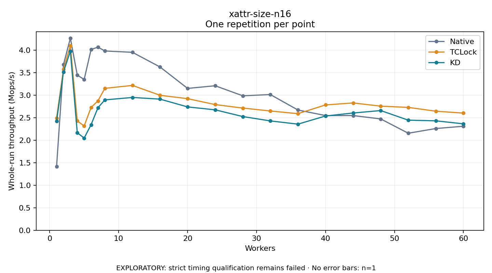

# xattr-size-n16

One timed repetition per point; no repeat variability estimate.
EXPLORATORY: strict timing qualification remains failed. Rates include post-lock work. Failed/unrun cases have no plotted rate.

| Workers | Native Mops/s | TCLock Mops/s | KD Mops/s | KD execution |
| ---: | ---: | ---: | ---: | --- |
| 1 | 1.415 | 2.496 | 2.423 | NO_JIT |
| 2 | 3.681 | 3.580 | 3.518 | NO_JIT |
| 3 | 4.270 | 4.103 | 3.982 | NO_JIT |
| 4 | 3.450 | 2.432 | 2.169 | NO_JIT |
| 5 | 3.351 | 2.317 | 2.049 | RETURNED_JIT |
| 6 | 4.016 | 2.729 | 2.345 | RETURNED_JIT |
| 7 | 4.071 | 2.876 | 2.723 | RETURNED_JIT |
| 8 | 3.985 | 3.154 | 2.898 | RETURNED_JIT |
| 12 | 3.955 | 3.220 | 2.952 | RETURNED_JIT |
| 16 | 3.629 | 3.000 | 2.915 | RETURNED_JIT |
| 20 | 3.153 | 2.925 | 2.742 | RETURNED_JIT |
| 24 | 3.212 | 2.793 | 2.677 | RETURNED_JIT |
| 28 | 2.988 | 2.716 | 2.527 | RETURNED_JIT |
| 32 | 3.016 | 2.651 | 2.430 | RETURNED_JIT |
| 36 | 2.673 | 2.591 | 2.359 | RETURNED_JIT |
| 40 | 2.549 | 2.786 | 2.540 | RETURNED_JIT |
| 44 | 2.550 | 2.830 | 2.606 | RETURNED_JIT |
| 48 | 2.475 | 2.758 | 2.661 | RETURNED_JIT |
| 52 | 2.157 | 2.731 | 2.447 | RETURNED_JIT |
| 56 | 2.261 | 2.646 | 2.432 | RETURNED_JIT |
| 60 | 2.312 | 2.604 | 2.366 | RETURNED_JIT |

[Full receipt table](table.csv)

