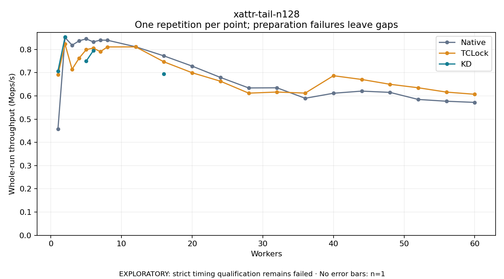

# xattr-tail-n128

One timed repetition per point; no repeat variability estimate.
EXPLORATORY: strict timing qualification remains failed. Rates include post-lock work. Failed/unrun cases have no plotted rate.

| Workers | Native Mops/s | TCLock Mops/s | KD Mops/s | KD execution |
| ---: | ---: | ---: | ---: | --- |
| 1 | 0.457 | 0.691 | 0.707 | NO_JIT |
| 2 | 0.851 | 0.823 | 0.853 | NO_JIT |
| 3 | 0.818 | 0.714 | — | PREPARATION_FAILED |
| 4 | 0.837 | 0.763 | — | PREPARATION_FAILED |
| 5 | 0.845 | 0.799 | 0.750 | RETURNED_JIT |
| 6 | 0.832 | 0.806 | 0.794 | NO_JIT |
| 7 | 0.840 | 0.790 | — | PREPARATION_FAILED |
| 8 | 0.839 | 0.810 | — | PREPARATION_FAILED |
| 12 | 0.811 | 0.811 | — | PREPARATION_FAILED |
| 16 | 0.772 | 0.746 | 0.694 | RETURNED_JIT |
| 20 | 0.728 | 0.699 | — | PREPARATION_FAILED |
| 24 | 0.679 | 0.663 | — | PREPARATION_FAILED |
| 28 | 0.634 | 0.612 | — | PREPARATION_FAILED |
| 32 | 0.635 | 0.616 | — | PREPARATION_FAILED |
| 36 | 0.590 | 0.612 | — | PREPARATION_FAILED |
| 40 | 0.611 | 0.687 | — | PREPARATION_FAILED |
| 44 | 0.620 | 0.671 | — | PREPARATION_FAILED |
| 48 | 0.615 | 0.650 | — | PREPARATION_FAILED |
| 52 | 0.585 | 0.635 | — | PREPARATION_FAILED |
| 56 | 0.577 | 0.616 | — | PREPARATION_FAILED |
| 60 | 0.572 | 0.607 | — | PREPARATION_FAILED |

[Full receipt table](table.csv)

