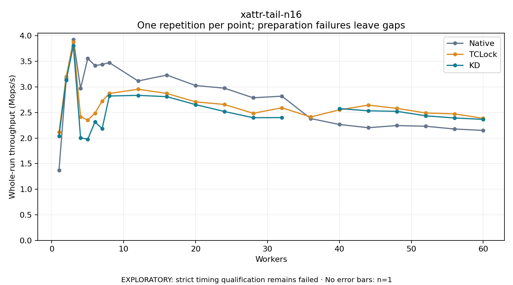

# xattr-tail-n16

One timed repetition per point; no repeat variability estimate.
EXPLORATORY: strict timing qualification remains failed. Rates include post-lock work. Failed/unrun cases have no plotted rate.

| Workers | Native Mops/s | TCLock Mops/s | KD Mops/s | KD execution |
| ---: | ---: | ---: | ---: | --- |
| 1 | 1.371 | 2.114 | 2.041 | NO_JIT |
| 2 | 3.156 | 3.202 | 3.130 | NO_JIT |
| 3 | 3.923 | 3.876 | 3.806 | NO_JIT |
| 4 | 2.968 | 2.417 | 2.006 | RETURNED_JIT |
| 5 | 3.556 | 2.352 | 1.976 | RETURNED_JIT |
| 6 | 3.418 | 2.486 | 2.315 | RETURNED_JIT |
| 7 | 3.437 | 2.722 | 2.184 | RETURNED_JIT |
| 8 | 3.474 | 2.871 | 2.822 | RETURNED_JIT |
| 12 | 3.116 | 2.954 | 2.835 | RETURNED_JIT |
| 16 | 3.231 | 2.872 | 2.809 | RETURNED_JIT |
| 20 | 3.026 | 2.708 | 2.653 | RETURNED_JIT |
| 24 | 2.975 | 2.657 | 2.520 | RETURNED_JIT |
| 28 | 2.787 | 2.484 | 2.398 | RETURNED_JIT |
| 32 | 2.819 | 2.591 | 2.400 | RETURNED_JIT |
| 36 | 2.381 | 2.413 | — | PREPARATION_FAILED |
| 40 | 2.265 | 2.551 | 2.576 | RETURNED_JIT |
| 44 | 2.203 | 2.644 | 2.532 | RETURNED_JIT |
| 48 | 2.244 | 2.580 | 2.522 | RETURNED_JIT |
| 52 | 2.231 | 2.490 | 2.435 | RETURNED_JIT |
| 56 | 2.177 | 2.473 | 2.393 | RETURNED_JIT |
| 60 | 2.149 | 2.385 | 2.365 | RETURNED_JIT |

[Full receipt table](table.csv)

