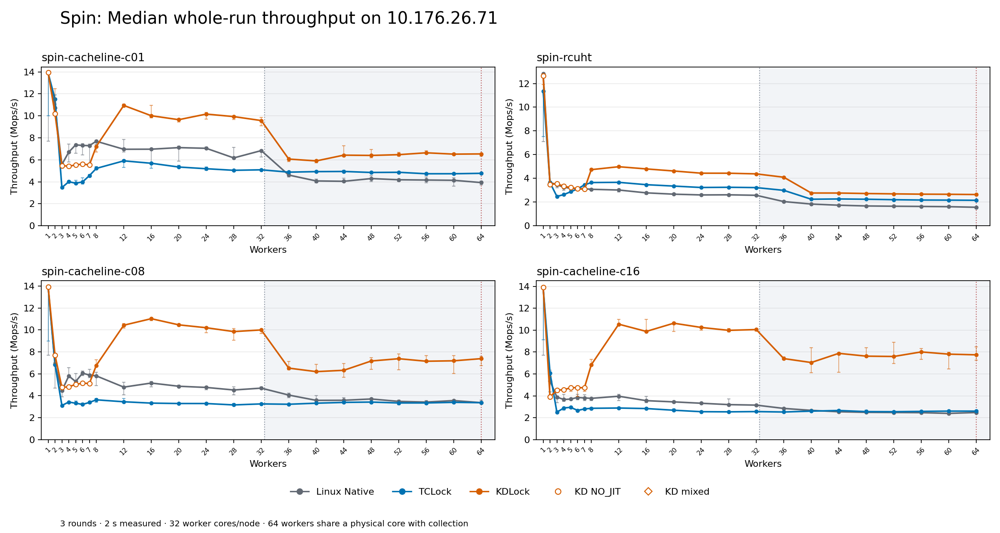
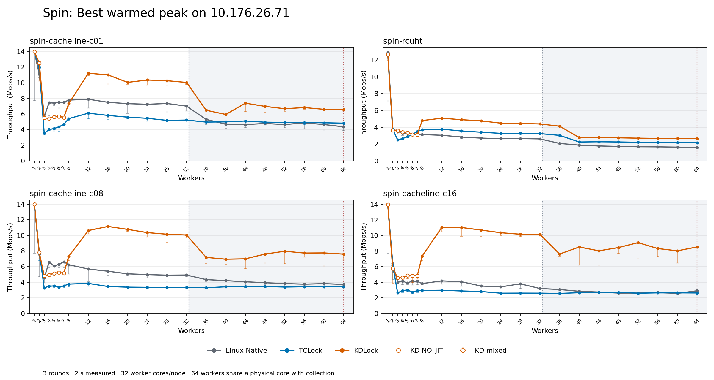
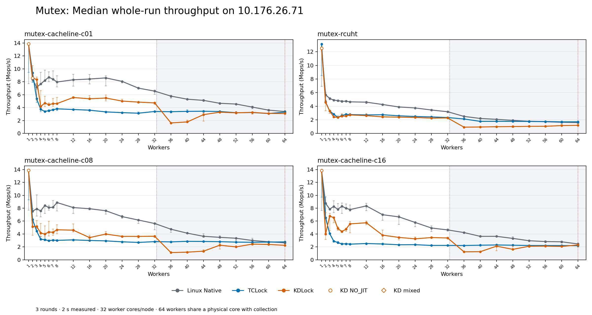
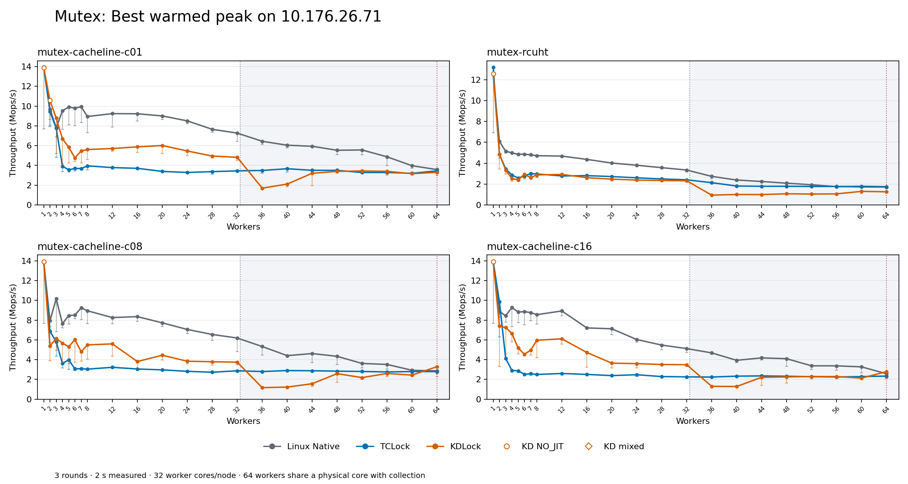
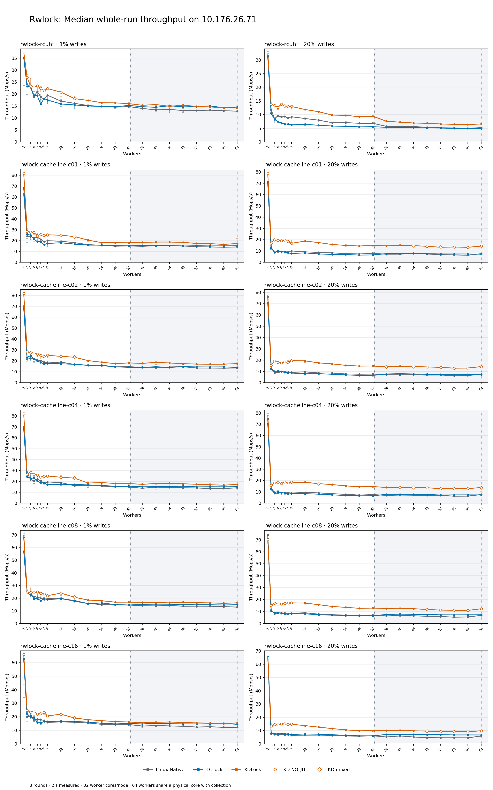
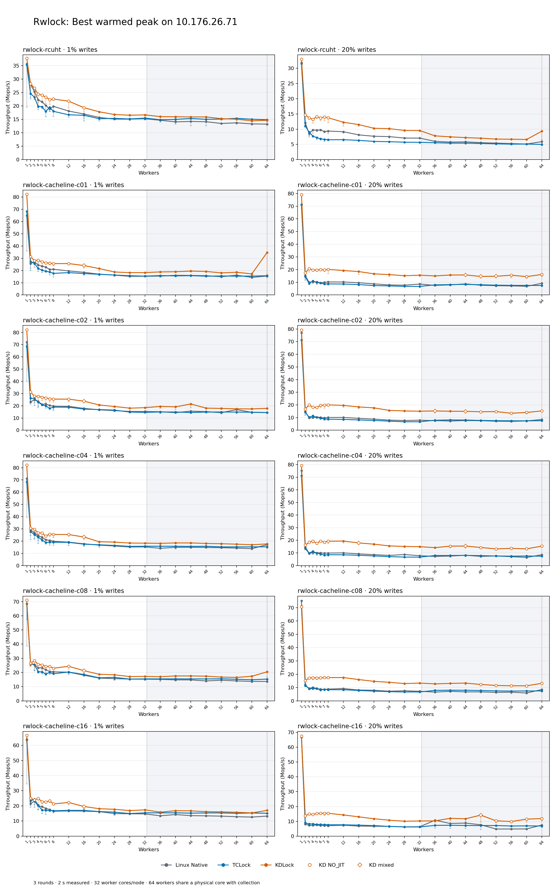

# Complete benchmark on 10.176.26.71: full-matrix-20261010T094831Z

All **3,960 planned timed sessions** were executed and drained; **3,960** passed performance-data acceptance. The remaining **0** sessions remain in the raw evidence and are excluded from scores.

Thread counts: **1, 2, 3, 4, 5, 6, 7, 8, 12, 16, 20, 24, 28, 32, 36, 40, 44, 48, 52, 56, 60, 64**. Every configuration uses Linux Native, TCLock and KDLock, with three rounds per backend.

Spin and mutex cover cacheline sizes 1/8/16 plus RCUHT. Rwlocks cover cacheline sizes 1/2/4/8/16 plus RCUHT, each at 1% and 20% writes. Warmup is 48,000 operations per worker; measurement is 2,000 ms; peak selection uses an observed 300 ms window after 300 ms of settling. Spin/mutex use their frozen 64 post-work arithmetic rounds; rwlocks use four. Compare backends within each workload.

The temporary VM exposes 66 vCPUs with 24 GiB RAM and two NUMA nodes. Workers use guest CPUs 0–31,33–64, pinned to host physical cores 0–63: 32 worker cores per NUMA node. Collector vCPU 65 is outside every guest worker cohort. **At 64 workers, collector 65 and QEMU service threads share host core 63 with worker vCPU 64.** CPU 32 is unused by the benchmark. The host has only 64 physical cores; the 64-worker point includes physical collection contention. Host frequency governor remains `ondemand`. These samples are separate from previous VM topologies.

Accepted KD sessions: **824 ACTUAL_JIT**, **496 NO_JIT**. NO_JIT throughput is a native-path control, and does not prove JIT gain. Status-separated aggregates are retained. Three-round descriptive totals do not merge execution statuses to satisfy the rwlock runner’s strict parity criterion.

Rates are **Mops/s**. Best peak is the highest valid warmed window across the three rounds. Whole-run is the median of completed operations divided by actual wall time. Ranges and spread are retained in CSV; spread is `(max-min)/median × 100%`, not a confidence interval.

- [Every session](samples.csv)
- [Three-round statistics](statistics.csv)
- [Statistics by execution status](statistics-by-execution.csv)
- [KD comparison ratios](comparison.csv)
- [Independent verification](verification.json)
- [Captured environment and commands](evidence.json)

An earlier interrupted group contains **94** additional completed, drained sessions. A disappearing `/proc/<pid>/task` entry stopped the original idle scan. That attempt and failure remain archived; the whole group was rerun using unchanged benchmark source and timing. A bounded retry requires an entire original idle check to succeed. The interrupted samples are independently audited and excluded from the final three-round statistics, without selecting among repeated scores.

- [Interrupted attempt samples](interrupted-attempts.csv)

## Evidence and reproduction

The measured source was transferred from Git HEAD
`997198ed391edc3c9acd8ff7bf8b351f480c6092` with the captured working-tree edits,
including the nine pre-existing edits and the expanded runner/driver. All 513
approved tracked source hashes still matched after the benchmark. Each group
retains its exact measured source and binaries. Use those bytes for matching
these measurements; a later commit alone does not identify the measured tree.
The detailed source state, every runner command and all group environments are
in [evidence.json](evidence.json).

The kernel remained `6.1.159-kdclobber2`, Build ID
`5ca28058e156f34a2c7fe91e8e0fbf92f4e51960`, with `nokaslr`, `nopvspin` and
voluntary preemption. The confirmed pre-run snapshot was
`full64-20261010T094831Z`: its name refers to 64 **workers**, and its VM topology
was 66 vCPUs. Host pinning and `ondemand` governors matched before and after.
The final guest was idle with no detected kernel faults. The regular 64-vCPU
boot was restored afterward; [the restoration receipt](vm-restoration.json)
records its verified pins, NUMA layout, kernel and live native spinlock dispatch.
Snapshots from the two topologies must not be loaded interchangeably.

The full 292,478,482-byte [raw archive](../../../raw/bench/full-matrix-20261010T094831Z/evidence.tar.gz)
is retained on the source and benchmark hosts, outside tracked report files.
SHA256: `77edea47e365ba2cb5f7b1f60717259bb2687c2a26e9c481b1e05a90cda9e573`.
[Archive metadata](archive.json) and [extraction validation](archive-validation.json)
confirm that an extracted copy independently reproduced all CSV bytes,
3,960 final peaks, 94 interrupted peaks and all retained input/image hashes.
The guest originals remain intact; a fresh Git checkout supplies compact reports
without the large ignored raw archive.
Published SVGs have trailing whitespace normalized for Git; the
[normalization receipt](svg-normalization.json) records identical SVG elements
and path tokens. The raw archive retains the original generated SVG bytes.

Follow the [full-matrix workflow](../../../../../../tools/vm/README.md#complete-164-worker-comparison)
for CPU placement, verified recovery, pinned dependencies and all 14 groups.
The [offline reporting guide](../../../../../full_compare/README.md) describes
[this saved exporter](export.py), its [plotting dependencies](requirements.txt)
and auditing extracted evidence with `--no-plots`.

## Spin scaling

## Mutex scaling

## Rwlock scaling

## spin-cacheline-c01

| Workers | Backend | Valid | Best peak | Median whole | Whole min / max | KD execution |
| --- | --- | --- | --- | --- | --- | --- |
| 1 | Linux Native | 3/3 | 13.958 | 13.901 | 7.713 / 13.913 | — |
| 1 | TCLock | 3/3 | 13.947 | 13.894 | 10.009 / 13.898 | — |
| 1 | KDLock | 3/3 | 13.972 | 13.933 | 13.931 / 13.934 | 0 JIT / 3 NO_JIT |
| 2 | Linux Native | 3/3 | 11.098 | 10.732 | 10.584 / 11.073 | — |
| 2 | TCLock | 3/3 | 11.977 | 11.535 | 11.520 / 11.913 | — |
| 2 | KDLock | 3/3 | 12.551 | 10.188 | 10.031 / 12.467 | 0 JIT / 3 NO_JIT |
| 3 | Linux Native | 3/3 | 5.680 | 5.570 | 5.246 / 5.577 | — |
| 3 | TCLock | 3/3 | 3.555 | 3.473 | 3.436 / 3.536 | — |
| 3 | KDLock | 3/3 | 5.503 | 5.476 | 5.472 / 5.482 | 0 JIT / 3 NO_JIT |
| 4 | Linux Native | 3/3 | 7.454 | 6.702 | 5.788 / 7.415 | — |
| 4 | TCLock | 3/3 | 4.020 | 4.003 | 3.978 / 4.006 | — |
| 4 | KDLock | 3/3 | 5.453 | 5.414 | 5.333 / 5.433 | 0 JIT / 3 NO_JIT |
| 5 | Linux Native | 3/3 | 7.401 | 7.361 | 6.582 / 7.365 | — |
| 5 | TCLock | 3/3 | 4.142 | 3.873 | 3.816 / 4.124 | — |
| 5 | KDLock | 3/3 | 5.624 | 5.533 | 5.518 / 5.579 | 0 JIT / 3 NO_JIT |
| 6 | Linux Native | 3/3 | 7.504 | 7.307 | 6.464 / 7.479 | — |
| 6 | TCLock | 3/3 | 4.363 | 3.983 | 3.794 / 4.345 | — |
| 6 | KDLock | 3/3 | 5.704 | 5.609 | 5.414 / 5.684 | 0 JIT / 3 NO_JIT |
| 7 | Linux Native | 3/3 | 7.512 | 7.290 | 5.485 / 7.450 | — |
| 7 | TCLock | 3/3 | 4.684 | 4.558 | 4.478 / 4.666 | — |
| 7 | KDLock | 3/3 | 5.566 | 5.536 | 5.446 / 5.544 | 0 JIT / 3 NO_JIT |
| 8 | Linux Native | 3/3 | 7.787 | 7.689 | 7.381 / 7.754 | — |
| 8 | TCLock | 3/3 | 5.415 | 5.215 | 5.167 / 5.386 | — |
| 8 | KDLock | 3/3 | 7.334 | 7.218 | 6.701 / 7.286 | 3 JIT / 0 NO_JIT |
| 12 | Linux Native | 3/3 | 7.898 | 6.958 | 6.719 / 7.856 | — |
| 12 | TCLock | 3/3 | 6.114 | 5.903 | 5.325 / 5.992 | — |
| 12 | KDLock | 3/3 | 11.230 | 10.948 | 10.769 / 11.087 | 3 JIT / 0 NO_JIT |
| 16 | Linux Native | 3/3 | 7.503 | 6.966 | 5.562 / 7.026 | — |
| 16 | TCLock | 3/3 | 5.826 | 5.685 | 5.232 / 5.704 | — |
| 16 | KDLock | 3/3 | 11.011 | 10.011 | 9.826 / 10.972 | 3 JIT / 0 NO_JIT |
| 20 | Linux Native | 3/3 | 7.333 | 7.109 | 5.879 / 7.229 | — |
| 20 | TCLock | 3/3 | 5.602 | 5.343 | 5.294 / 5.501 | — |
| 20 | KDLock | 3/3 | 10.055 | 9.650 | 9.433 / 9.758 | 3 JIT / 0 NO_JIT |
| 24 | Linux Native | 3/3 | 7.250 | 7.046 | 7.004 / 7.148 | — |
| 24 | TCLock | 3/3 | 5.458 | 5.188 | 5.043 / 5.347 | — |
| 24 | KDLock | 3/3 | 10.360 | 10.161 | 9.686 / 10.324 | 3 JIT / 0 NO_JIT |
| 28 | Linux Native | 3/3 | 7.354 | 6.171 | 6.153 / 7.122 | — |
| 28 | TCLock | 3/3 | 5.192 | 5.045 | 5.036 / 5.085 | — |
| 28 | KDLock | 3/3 | 10.270 | 9.932 | 9.663 / 9.967 | 3 JIT / 0 NO_JIT |
| 32 | Linux Native | 3/3 | 7.017 | 6.837 | 6.263 / 6.900 | — |
| 32 | TCLock | 3/3 | 5.229 | 5.089 | 5.088 / 5.104 | — |
| 32 | KDLock | 3/3 | 10.046 | 9.571 | 9.100 / 9.866 | 3 JIT / 0 NO_JIT |
| 36 | Linux Native | 3/3 | 5.315 | 4.611 | 4.453 / 4.806 | — |
| 36 | TCLock | 3/3 | 4.974 | 4.877 | 4.797 / 4.894 | — |
| 36 | KDLock | 3/3 | 6.485 | 6.067 | 5.856 / 6.199 | 3 JIT / 0 NO_JIT |
| 40 | Linux Native | 3/3 | 4.710 | 4.075 | 3.913 / 4.265 | — |
| 40 | TCLock | 3/3 | 5.003 | 4.924 | 4.838 / 4.941 | — |
| 40 | KDLock | 3/3 | 5.950 | 5.898 | 5.735 / 5.923 | 3 JIT / 0 NO_JIT |
| 44 | Linux Native | 3/3 | 4.655 | 4.043 | 3.973 / 4.314 | — |
| 44 | TCLock | 3/3 | 5.114 | 4.940 | 4.939 / 5.056 | — |
| 44 | KDLock | 3/3 | 7.398 | 6.423 | 6.298 / 7.260 | 3 JIT / 0 NO_JIT |
| 48 | Linux Native | 3/3 | 4.796 | 4.292 | 4.004 / 4.539 | — |
| 48 | TCLock | 3/3 | 4.959 | 4.847 | 4.774 / 4.898 | — |
| 48 | KDLock | 3/3 | 6.981 | 6.397 | 6.186 / 6.949 | 3 JIT / 0 NO_JIT |
| 52 | Linux Native | 3/3 | 4.658 | 4.184 | 4.037 / 4.231 | — |
| 52 | TCLock | 3/3 | 4.930 | 4.863 | 4.818 / 4.886 | — |
| 52 | KDLock | 3/3 | 6.685 | 6.468 | 6.326 / 6.662 | 3 JIT / 0 NO_JIT |
| 56 | Linux Native | 3/3 | 4.874 | 4.160 | 3.925 / 4.419 | — |
| 56 | TCLock | 3/3 | 4.923 | 4.729 | 4.599 / 4.832 | — |
| 56 | KDLock | 3/3 | 6.833 | 6.637 | 6.581 / 6.806 | 3 JIT / 0 NO_JIT |
| 60 | Linux Native | 3/3 | 4.659 | 4.135 | 3.621 / 4.366 | — |
| 60 | TCLock | 3/3 | 4.884 | 4.731 | 4.693 / 4.812 | — |
| 60 | KDLock | 3/3 | 6.605 | 6.515 | 6.456 / 6.588 | 3 JIT / 0 NO_JIT |
| 64 | Linux Native | 3/3 | 4.369 | 3.927 | 3.722 / 4.059 | — |
| 64 | TCLock | 3/3 | 4.833 | 4.770 | 4.678 / 4.792 | — |
| 64 | KDLock | 3/3 | 6.583 | 6.535 | 6.350 / 6.542 | 3 JIT / 0 NO_JIT |

## mutex-cacheline-c01

| Workers | Backend | Valid | Best peak | Median whole | Whole min / max | KD execution |
| --- | --- | --- | --- | --- | --- | --- |
| 1 | Linux Native | 3/3 | 13.908 | 13.863 | 7.685 / 13.867 | — |
| 1 | TCLock | 3/3 | 13.971 | 13.899 | 9.453 / 13.924 | — |
| 1 | KDLock | 3/3 | 13.903 | 13.862 | 13.849 / 13.877 | 0 JIT / 3 NO_JIT |
| 2 | Linux Native | 3/3 | 9.684 | 8.360 | 8.000 / 9.327 | — |
| 2 | TCLock | 3/3 | 9.453 | 9.368 | 7.891 / 9.397 | — |
| 2 | KDLock | 3/3 | 10.579 | 8.572 | 8.562 / 10.501 | 0 JIT / 3 NO_JIT |
| 3 | Linux Native | 3/3 | 7.796 | 7.150 | 6.807 / 7.712 | — |
| 3 | TCLock | 3/3 | 7.764 | 5.365 | 4.817 / 7.673 | — |
| 3 | KDLock | 3/3 | 8.787 | 8.352 | 5.119 / 8.717 | 3 JIT / 0 NO_JIT |
| 4 | Linux Native | 3/3 | 9.529 | 7.653 | 7.619 / 9.456 | — |
| 4 | TCLock | 3/3 | 3.922 | 3.723 | 3.359 / 3.886 | — |
| 4 | KDLock | 3/3 | 6.699 | 4.172 | 4.108 / 6.640 | 3 JIT / 0 NO_JIT |
| 5 | Linux Native | 3/3 | 9.909 | 8.211 | 8.048 / 9.806 | — |
| 5 | TCLock | 3/3 | 3.556 | 3.404 | 3.320 / 3.416 | — |
| 5 | KDLock | 3/3 | 5.840 | 4.690 | 4.160 / 5.751 | 3 JIT / 0 NO_JIT |
| 6 | Linux Native | 3/3 | 9.798 | 8.706 | 8.000 / 9.541 | — |
| 6 | TCLock | 3/3 | 3.694 | 3.521 | 3.429 / 3.666 | — |
| 6 | KDLock | 3/3 | 4.759 | 4.462 | 4.307 / 4.716 | 3 JIT / 0 NO_JIT |
| 7 | Linux Native | 3/3 | 9.928 | 8.397 | 8.300 / 9.679 | — |
| 7 | TCLock | 3/3 | 3.685 | 3.657 | 3.615 / 3.671 | — |
| 7 | KDLock | 3/3 | 5.472 | 4.597 | 4.200 / 5.403 | 3 JIT / 0 NO_JIT |
| 8 | Linux Native | 3/3 | 8.949 | 7.962 | 7.226 / 8.904 | — |
| 8 | TCLock | 3/3 | 3.955 | 3.809 | 3.537 / 3.923 | — |
| 8 | KDLock | 3/3 | 5.606 | 4.621 | 4.551 / 5.570 | 3 JIT / 0 NO_JIT |
| 12 | Linux Native | 3/3 | 9.238 | 8.304 | 7.330 / 9.163 | — |
| 12 | TCLock | 3/3 | 3.782 | 3.701 | 3.699 / 3.734 | — |
| 12 | KDLock | 3/3 | 5.711 | 5.559 | 5.398 / 5.678 | 3 JIT / 0 NO_JIT |
| 16 | Linux Native | 3/3 | 9.224 | 8.423 | 7.669 / 9.114 | — |
| 16 | TCLock | 3/3 | 3.708 | 3.596 | 3.593 / 3.686 | — |
| 16 | KDLock | 3/3 | 5.876 | 5.362 | 5.238 / 5.827 | 3 JIT / 0 NO_JIT |
| 20 | Linux Native | 3/3 | 9.005 | 8.595 | 7.367 / 8.907 | — |
| 20 | TCLock | 3/3 | 3.395 | 3.332 | 3.317 / 3.363 | — |
| 20 | KDLock | 3/3 | 6.017 | 5.478 | 5.049 / 5.949 | 3 JIT / 0 NO_JIT |
| 24 | Linux Native | 3/3 | 8.506 | 8.057 | 7.828 / 8.100 | — |
| 24 | TCLock | 3/3 | 3.290 | 3.218 | 3.195 / 3.247 | — |
| 24 | KDLock | 3/3 | 5.461 | 5.007 | 4.956 / 5.315 | 3 JIT / 0 NO_JIT |
| 28 | Linux Native | 3/3 | 7.652 | 7.011 | 6.919 / 7.174 | — |
| 28 | TCLock | 3/3 | 3.372 | 3.130 | 3.080 / 3.302 | — |
| 28 | KDLock | 3/3 | 4.947 | 4.848 | 4.700 / 4.923 | 3 JIT / 0 NO_JIT |
| 32 | Linux Native | 3/3 | 7.269 | 6.550 | 6.072 / 6.722 | — |
| 32 | TCLock | 3/3 | 3.448 | 3.395 | 3.369 / 3.418 | — |
| 32 | KDLock | 3/3 | 4.822 | 4.725 | 4.489 / 4.792 | 3 JIT / 0 NO_JIT |
| 36 | Linux Native | 3/3 | 6.444 | 5.775 | 5.466 / 5.912 | — |
| 36 | TCLock | 3/3 | 3.492 | 3.360 | 3.178 / 3.476 | — |
| 36 | KDLock | 3/3 | 1.700 | 1.623 | 1.539 / 1.653 | 3 JIT / 0 NO_JIT |
| 40 | Linux Native | 3/3 | 6.045 | 5.300 | 5.187 / 5.367 | — |
| 40 | TCLock | 3/3 | 3.667 | 3.413 | 3.311 / 3.646 | — |
| 40 | KDLock | 3/3 | 2.115 | 1.777 | 1.771 / 2.062 | 3 JIT / 0 NO_JIT |
| 44 | Linux Native | 3/3 | 5.935 | 5.116 | 5.030 / 5.264 | — |
| 44 | TCLock | 3/3 | 3.505 | 3.435 | 3.419 / 3.477 | — |
| 44 | KDLock | 3/3 | 3.204 | 2.904 | 1.928 / 3.177 | 3 JIT / 0 NO_JIT |
| 48 | Linux Native | 3/3 | 5.533 | 4.665 | 4.535 / 4.775 | — |
| 48 | TCLock | 3/3 | 3.503 | 3.391 | 3.355 / 3.467 | — |
| 48 | KDLock | 3/3 | 3.401 | 3.288 | 3.209 / 3.366 | 3 JIT / 0 NO_JIT |
| 52 | Linux Native | 3/3 | 5.566 | 4.547 | 4.442 / 4.549 | — |
| 52 | TCLock | 3/3 | 3.282 | 3.208 | 3.148 / 3.261 | — |
| 52 | KDLock | 3/3 | 3.441 | 3.183 | 3.137 / 3.412 | 3 JIT / 0 NO_JIT |
| 56 | Linux Native | 3/3 | 4.872 | 4.075 | 3.803 / 4.229 | — |
| 56 | TCLock | 3/3 | 3.291 | 3.230 | 3.151 / 3.268 | — |
| 56 | KDLock | 3/3 | 3.404 | 3.256 | 2.996 / 3.356 | 3 JIT / 0 NO_JIT |
| 60 | Linux Native | 3/3 | 3.969 | 3.604 | 3.563 / 3.734 | — |
| 60 | TCLock | 3/3 | 3.200 | 3.077 | 3.027 / 3.174 | — |
| 60 | KDLock | 3/3 | 3.160 | 3.097 | 3.011 / 3.124 | 3 JIT / 0 NO_JIT |
| 64 | Linux Native | 3/3 | 3.580 | 3.391 | 3.359 / 3.515 | — |
| 64 | TCLock | 3/3 | 3.452 | 3.295 | 3.264 / 3.435 | — |
| 64 | KDLock | 3/3 | 3.305 | 3.073 | 2.976 / 3.267 | 3 JIT / 0 NO_JIT |

## rwlock-rcuht · 1% writes

| Workers | Backend | Valid | Best peak | Median whole | Whole min / max | KD execution |
| --- | --- | --- | --- | --- | --- | --- |
| 1 | Linux Native | 3/3 | 35.711 | 35.332 | 19.605 / 35.435 | — |
| 1 | TCLock | 3/3 | 35.345 | 35.194 | 23.550 / 35.200 | — |
| 1 | KDLock | 3/3 | 37.796 | 37.591 | 37.438 / 37.609 | 0 JIT / 3 NO_JIT |
| 2 | Linux Native | 3/3 | 28.146 | 24.087 | 19.878 / 27.902 | — |
| 2 | TCLock | 3/3 | 24.594 | 23.184 | 22.537 / 24.482 | — |
| 2 | KDLock | 3/3 | 28.331 | 27.001 | 26.797 / 28.191 | 0 JIT / 3 NO_JIT |
| 3 | Linux Native | 3/3 | 25.405 | 23.074 | 22.645 / 24.309 | — |
| 3 | TCLock | 3/3 | 23.343 | 23.083 | 22.189 / 23.270 | — |
| 3 | KDLock | 3/3 | 26.646 | 23.311 | 22.310 / 26.550 | 0 JIT / 3 NO_JIT |
| 4 | Linux Native | 3/3 | 22.239 | 18.879 | 18.390 / 22.075 | — |
| 4 | TCLock | 3/3 | 19.841 | 19.476 | 19.123 / 19.717 | — |
| 4 | KDLock | 3/3 | 24.420 | 23.000 | 21.035 / 24.198 | 0 JIT / 3 NO_JIT |
| 5 | Linux Native | 3/3 | 21.549 | 21.091 | 19.747 / 21.237 | — |
| 5 | TCLock | 3/3 | 19.731 | 19.308 | 18.738 / 19.489 | — |
| 5 | KDLock | 3/3 | 24.048 | 23.475 | 21.583 / 23.839 | 0 JIT / 3 NO_JIT |
| 6 | Linux Native | 3/3 | 20.196 | 18.832 | 17.443 / 19.996 | — |
| 6 | TCLock | 3/3 | 17.945 | 15.790 | 15.769 / 17.711 | — |
| 6 | KDLock | 3/3 | 23.297 | 22.417 | 20.840 / 23.129 | 0 JIT / 3 NO_JIT |
| 7 | Linux Native | 3/3 | 18.896 | 17.844 | 17.695 / 18.216 | — |
| 7 | TCLock | 3/3 | 19.512 | 18.155 | 17.835 / 19.186 | — |
| 7 | KDLock | 3/3 | 22.385 | 21.362 | 20.451 / 22.205 | 0 JIT / 3 NO_JIT |
| 8 | Linux Native | 3/3 | 19.865 | 19.531 | 16.857 / 19.695 | — |
| 8 | TCLock | 3/3 | 18.012 | 17.535 | 16.022 / 17.671 | — |
| 8 | KDLock | 3/3 | 22.595 | 22.302 | 21.982 / 22.501 | 0 JIT / 3 NO_JIT |
| 12 | Linux Native | 3/3 | 18.117 | 17.048 | 15.451 / 17.822 | — |
| 12 | TCLock | 3/3 | 16.720 | 15.887 | 14.910 / 16.561 | — |
| 12 | KDLock | 3/3 | 21.804 | 20.792 | 18.941 / 21.247 | 0 JIT / 3 NO_JIT |
| 16 | Linux Native | 3/3 | 17.002 | 16.132 | 15.088 / 16.288 | — |
| 16 | TCLock | 3/3 | 16.543 | 15.476 | 13.886 / 16.366 | — |
| 16 | KDLock | 3/3 | 19.371 | 18.103 | 17.497 / 19.048 | 0 JIT / 3 NO_JIT |
| 20 | Linux Native | 3/3 | 15.754 | 15.214 | 14.865 / 15.560 | — |
| 20 | TCLock | 3/3 | 15.264 | 15.033 | 14.303 / 15.172 | — |
| 20 | KDLock | 3/3 | 17.831 | 17.351 | 17.323 / 17.579 | 3 JIT / 0 NO_JIT |
| 24 | Linux Native | 3/3 | 15.097 | 14.862 | 14.842 / 14.900 | — |
| 24 | TCLock | 3/3 | 15.397 | 14.871 | 14.665 / 14.984 | — |
| 24 | KDLock | 3/3 | 16.829 | 16.402 | 16.003 / 16.470 | 3 JIT / 0 NO_JIT |
| 28 | Linux Native | 3/3 | 15.097 | 14.547 | 13.986 / 14.971 | — |
| 28 | TCLock | 3/3 | 15.167 | 14.733 | 14.707 / 15.018 | — |
| 28 | KDLock | 3/3 | 16.561 | 16.327 | 16.277 / 16.414 | 3 JIT / 0 NO_JIT |
| 32 | Linux Native | 3/3 | 15.236 | 14.783 | 14.615 / 15.093 | — |
| 32 | TCLock | 3/3 | 15.490 | 15.256 | 15.021 / 15.339 | — |
| 32 | KDLock | 3/3 | 16.697 | 16.026 | 15.794 / 16.524 | 3 JIT / 0 NO_JIT |
| 36 | Linux Native | 3/3 | 14.677 | 14.007 | 13.392 / 14.530 | — |
| 36 | TCLock | 3/3 | 14.886 | 14.730 | 14.599 / 14.752 | — |
| 36 | KDLock | 3/3 | 16.042 | 15.323 | 14.919 / 15.736 | 3 JIT / 0 NO_JIT |
| 40 | Linux Native | 3/3 | 14.090 | 13.417 | 12.826 / 13.931 | — |
| 40 | TCLock | 3/3 | 15.001 | 14.493 | 14.248 / 14.853 | — |
| 40 | KDLock | 3/3 | 15.978 | 15.633 | 15.363 / 15.810 | 3 JIT / 0 NO_JIT |
| 44 | Linux Native | 3/3 | 14.243 | 13.594 | 12.262 / 14.079 | — |
| 44 | TCLock | 3/3 | 15.338 | 15.149 | 14.811 / 15.200 | — |
| 44 | KDLock | 3/3 | 15.916 | 14.895 | 14.828 / 15.578 | 3 JIT / 0 NO_JIT |
| 48 | Linux Native | 3/3 | 14.140 | 13.155 | 12.263 / 13.935 | — |
| 48 | TCLock | 3/3 | 15.037 | 14.658 | 14.602 / 14.887 | — |
| 48 | KDLock | 3/3 | 15.929 | 15.360 | 14.761 / 15.732 | 3 JIT / 0 NO_JIT |
| 52 | Linux Native | 3/3 | 13.483 | 13.168 | 13.152 / 13.338 | — |
| 52 | TCLock | 3/3 | 15.130 | 14.761 | 14.739 / 14.952 | — |
| 52 | KDLock | 3/3 | 15.285 | 14.860 | 14.565 / 15.074 | 3 JIT / 0 NO_JIT |
| 56 | Linux Native | 3/3 | 13.727 | 13.294 | 13.109 / 13.499 | — |
| 56 | TCLock | 3/3 | 15.394 | 15.064 | 14.648 / 15.186 | — |
| 56 | KDLock | 3/3 | 15.070 | 14.638 | 14.584 / 14.873 | 3 JIT / 0 NO_JIT |
| 60 | Linux Native | 3/3 | 13.321 | 13.052 | 12.703 / 13.180 | — |
| 60 | TCLock | 3/3 | 15.066 | 14.288 | 13.866 / 14.560 | — |
| 60 | KDLock | 3/3 | 14.490 | 14.288 | 14.230 / 14.346 | 3 JIT / 0 NO_JIT |
| 64 | Linux Native | 3/3 | 13.246 | 12.879 | 12.659 / 12.951 | — |
| 64 | TCLock | 3/3 | 14.893 | 14.587 | 13.921 / 14.694 | — |
| 64 | KDLock | 3/3 | 14.668 | 14.198 | 13.900 / 14.432 | 3 JIT / 0 NO_JIT |

## rwlock-rcuht · 20% writes

| Workers | Backend | Valid | Best peak | Median whole | Whole min / max | KD execution |
| --- | --- | --- | --- | --- | --- | --- |
| 1 | Linux Native | 3/3 | 31.823 | 31.494 | 31.413 / 31.501 | — |
| 1 | TCLock | 3/3 | 31.504 | 31.230 | 31.122 / 31.318 | — |
| 1 | KDLock | 3/3 | 32.958 | 32.649 | 32.541 / 32.682 | 0 JIT / 3 NO_JIT |
| 2 | Linux Native | 3/3 | 12.061 | 11.794 | 11.021 / 11.885 | — |
| 2 | TCLock | 3/3 | 11.057 | 10.470 | 10.409 / 10.799 | — |
| 2 | KDLock | 3/3 | 14.694 | 13.782 | 13.446 / 14.555 | 0 JIT / 3 NO_JIT |
| 3 | Linux Native | 3/3 | 8.524 | 8.453 | 6.924 / 8.476 | — |
| 3 | TCLock | 3/3 | 9.017 | 8.303 | 7.850 / 8.886 | — |
| 3 | KDLock | 3/3 | 13.716 | 13.347 | 13.164 / 13.641 | 0 JIT / 3 NO_JIT |
| 4 | Linux Native | 3/3 | 9.764 | 9.655 | 7.971 / 9.672 | — |
| 4 | TCLock | 3/3 | 7.716 | 7.455 | 7.288 / 7.640 | — |
| 4 | KDLock | 3/3 | 13.197 | 12.678 | 11.917 / 13.136 | 0 JIT / 3 NO_JIT |
| 5 | Linux Native | 3/3 | 9.640 | 9.162 | 8.872 / 9.547 | — |
| 5 | TCLock | 3/3 | 7.210 | 6.957 | 6.507 / 7.143 | — |
| 5 | KDLock | 3/3 | 14.107 | 13.813 | 13.297 / 13.977 | 0 JIT / 3 NO_JIT |
| 6 | Linux Native | 3/3 | 9.766 | 9.330 | 9.079 / 9.574 | — |
| 6 | TCLock | 3/3 | 6.827 | 6.605 | 6.374 / 6.765 | — |
| 6 | KDLock | 3/3 | 13.693 | 13.290 | 12.629 / 13.548 | 0 JIT / 3 NO_JIT |
| 7 | Linux Native | 3/3 | 9.202 | 8.755 | 8.641 / 8.901 | — |
| 7 | TCLock | 3/3 | 6.652 | 6.578 | 5.887 / 6.592 | — |
| 7 | KDLock | 3/3 | 13.985 | 12.949 | 12.618 / 13.839 | 0 JIT / 3 NO_JIT |
| 8 | Linux Native | 3/3 | 9.384 | 9.241 | 8.421 / 9.275 | — |
| 8 | TCLock | 3/3 | 6.514 | 6.289 | 6.122 / 6.446 | — |
| 8 | KDLock | 3/3 | 13.741 | 13.004 | 11.958 / 13.583 | 0 JIT / 3 NO_JIT |
| 12 | Linux Native | 3/3 | 9.159 | 8.595 | 7.964 / 9.054 | — |
| 12 | TCLock | 3/3 | 6.553 | 6.469 | 6.010 / 6.498 | — |
| 12 | KDLock | 3/3 | 12.271 | 11.894 | 10.914 / 12.077 | 3 JIT / 0 NO_JIT |
| 16 | Linux Native | 3/3 | 8.123 | 7.996 | 7.370 / 8.021 | — |
| 16 | TCLock | 3/3 | 6.324 | 6.127 | 5.912 / 6.212 | — |
| 16 | KDLock | 3/3 | 11.500 | 11.091 | 10.799 / 11.334 | 3 JIT / 0 NO_JIT |
| 20 | Linux Native | 3/3 | 7.673 | 7.084 | 7.074 / 7.611 | — |
| 20 | TCLock | 3/3 | 5.980 | 5.858 | 5.824 / 5.897 | — |
| 20 | KDLock | 3/3 | 10.291 | 9.864 | 9.840 / 10.147 | 3 JIT / 0 NO_JIT |
| 24 | Linux Native | 3/3 | 7.560 | 7.088 | 6.942 / 7.477 | — |
| 24 | TCLock | 3/3 | 5.891 | 5.729 | 5.564 / 5.828 | — |
| 24 | KDLock | 3/3 | 10.165 | 9.765 | 9.449 / 9.977 | 3 JIT / 0 NO_JIT |
| 28 | Linux Native | 3/3 | 7.076 | 6.858 | 6.801 / 7.011 | — |
| 28 | TCLock | 3/3 | 5.720 | 5.548 | 5.516 / 5.660 | — |
| 28 | KDLock | 3/3 | 9.579 | 9.257 | 9.146 / 9.428 | 3 JIT / 0 NO_JIT |
| 32 | Linux Native | 3/3 | 7.064 | 6.854 | 6.842 / 6.961 | — |
| 32 | TCLock | 3/3 | 5.678 | 5.601 | 5.527 / 5.628 | — |
| 32 | KDLock | 3/3 | 9.542 | 9.434 | 9.269 / 9.517 | 3 JIT / 0 NO_JIT |
| 36 | Linux Native | 3/3 | 6.001 | 5.724 | 5.587 / 5.951 | — |
| 36 | TCLock | 3/3 | 5.550 | 5.390 | 5.386 / 5.490 | — |
| 36 | KDLock | 3/3 | 7.808 | 7.616 | 7.583 / 7.694 | 3 JIT / 0 NO_JIT |
| 40 | Linux Native | 3/3 | 5.755 | 5.618 | 5.510 / 5.648 | — |
| 40 | TCLock | 3/3 | 5.426 | 5.353 | 5.263 / 5.359 | — |
| 40 | KDLock | 3/3 | 7.471 | 7.246 | 7.190 / 7.292 | 3 JIT / 0 NO_JIT |
| 44 | Linux Native | 3/3 | 5.831 | 5.662 | 5.595 / 5.715 | — |
| 44 | TCLock | 3/3 | 5.421 | 5.282 | 5.220 / 5.352 | — |
| 44 | KDLock | 3/3 | 7.231 | 6.959 | 6.693 / 7.050 | 3 JIT / 0 NO_JIT |
| 48 | Linux Native | 3/3 | 5.570 | 5.370 | 5.294 / 5.494 | — |
| 48 | TCLock | 3/3 | 5.320 | 5.151 | 5.117 / 5.243 | — |
| 48 | KDLock | 3/3 | 7.041 | 6.850 | 6.772 / 6.860 | 3 JIT / 0 NO_JIT |
| 52 | Linux Native | 3/3 | 5.425 | 5.204 | 5.149 / 5.368 | — |
| 52 | TCLock | 3/3 | 5.185 | 5.115 | 5.107 / 5.126 | — |
| 52 | KDLock | 3/3 | 6.741 | 6.606 | 6.552 / 6.612 | 3 JIT / 0 NO_JIT |
| 56 | Linux Native | 3/3 | 5.267 | 5.139 | 5.108 / 5.143 | — |
| 56 | TCLock | 3/3 | 5.084 | 4.994 | 4.989 / 5.021 | — |
| 56 | KDLock | 3/3 | 6.705 | 6.474 | 6.431 / 6.534 | 3 JIT / 0 NO_JIT |
| 60 | Linux Native | 3/3 | 5.108 | 5.018 | 4.961 / 5.042 | — |
| 60 | TCLock | 3/3 | 5.119 | 4.998 | 4.988 / 5.058 | — |
| 60 | KDLock | 3/3 | 6.617 | 6.400 | 6.398 / 6.458 | 3 JIT / 0 NO_JIT |
| 64 | Linux Native | 3/3 | 5.914 | 5.259 | 5.146 / 5.427 | — |
| 64 | TCLock | 3/3 | 4.990 | 4.880 | 4.741 / 4.910 | — |
| 64 | KDLock | 3/3 | 9.321 | 6.610 | 6.344 / 6.995 | 3 JIT / 0 NO_JIT |

## spin-rcuht

| Workers | Backend | Valid | Best peak | Median whole | Whole min / max | KD execution |
| --- | --- | --- | --- | --- | --- | --- |
| 1 | Linux Native | 3/3 | 12.900 | 12.832 | 7.117 / 12.835 | — |
| 1 | TCLock | 3/3 | 12.674 | 11.353 | 7.536 / 12.627 | — |
| 1 | KDLock | 3/3 | 12.685 | 12.640 | 11.899 / 12.665 | 0 JIT / 3 NO_JIT |
| 2 | Linux Native | 3/3 | 3.803 | 3.652 | 3.477 / 3.724 | — |
| 2 | TCLock | 3/3 | 3.757 | 3.628 | 3.608 / 3.740 | — |
| 2 | KDLock | 3/3 | 3.655 | 3.493 | 3.482 / 3.636 | 0 JIT / 3 NO_JIT |
| 3 | Linux Native | 3/3 | 3.525 | 3.464 | 3.200 / 3.498 | — |
| 3 | TCLock | 3/3 | 2.514 | 2.473 | 2.405 / 2.505 | — |
| 3 | KDLock | 3/3 | 3.599 | 3.544 | 3.520 / 3.575 | 0 JIT / 3 NO_JIT |
| 4 | Linux Native | 3/3 | 3.289 | 3.246 | 3.006 / 3.277 | — |
| 4 | TCLock | 3/3 | 2.657 | 2.624 | 2.587 / 2.647 | — |
| 4 | KDLock | 3/3 | 3.412 | 3.326 | 3.288 / 3.394 | 0 JIT / 3 NO_JIT |
| 5 | Linux Native | 3/3 | 3.282 | 3.165 | 3.050 / 3.267 | — |
| 5 | TCLock | 3/3 | 2.885 | 2.867 | 2.766 / 2.875 | — |
| 5 | KDLock | 3/3 | 3.371 | 3.226 | 3.217 / 3.348 | 0 JIT / 3 NO_JIT |
| 6 | Linux Native | 3/3 | 3.197 | 3.126 | 3.087 / 3.183 | — |
| 6 | TCLock | 3/3 | 3.138 | 3.104 | 3.048 / 3.124 | — |
| 6 | KDLock | 3/3 | 3.155 | 3.118 | 3.093 / 3.123 | 0 JIT / 3 NO_JIT |
| 7 | Linux Native | 3/3 | 3.172 | 3.121 | 3.104 / 3.128 | — |
| 7 | TCLock | 3/3 | 3.513 | 3.443 | 3.433 / 3.481 | — |
| 7 | KDLock | 3/3 | 3.116 | 3.078 | 3.044 / 3.082 | 0 JIT / 3 NO_JIT |
| 8 | Linux Native | 3/3 | 3.139 | 3.074 | 2.993 / 3.091 | — |
| 8 | TCLock | 3/3 | 3.692 | 3.643 | 3.599 / 3.662 | — |
| 8 | KDLock | 3/3 | 4.798 | 4.732 | 4.731 / 4.775 | 3 JIT / 0 NO_JIT |
| 12 | Linux Native | 3/3 | 3.051 | 3.014 | 2.861 / 3.023 | — |
| 12 | TCLock | 3/3 | 3.780 | 3.661 | 3.542 / 3.676 | — |
| 12 | KDLock | 3/3 | 5.083 | 4.979 | 4.929 / 5.014 | 3 JIT / 0 NO_JIT |
| 16 | Linux Native | 3/3 | 2.841 | 2.773 | 2.633 / 2.825 | — |
| 16 | TCLock | 3/3 | 3.561 | 3.463 | 3.373 / 3.476 | — |
| 16 | KDLock | 3/3 | 4.902 | 4.793 | 4.755 / 4.828 | 3 JIT / 0 NO_JIT |
| 20 | Linux Native | 3/3 | 2.714 | 2.662 | 2.627 / 2.691 | — |
| 20 | TCLock | 3/3 | 3.416 | 3.346 | 3.333 / 3.365 | — |
| 20 | KDLock | 3/3 | 4.762 | 4.619 | 4.617 / 4.657 | 3 JIT / 0 NO_JIT |
| 24 | Linux Native | 3/3 | 2.642 | 2.598 | 2.598 / 2.615 | — |
| 24 | TCLock | 3/3 | 3.279 | 3.226 | 3.205 / 3.230 | — |
| 24 | KDLock | 3/3 | 4.494 | 4.433 | 4.419 / 4.446 | 3 JIT / 0 NO_JIT |
| 28 | Linux Native | 3/3 | 2.659 | 2.609 | 2.600 / 2.622 | — |
| 28 | TCLock | 3/3 | 3.280 | 3.244 | 3.225 / 3.251 | — |
| 28 | KDLock | 3/3 | 4.454 | 4.430 | 4.421 / 4.434 | 3 JIT / 0 NO_JIT |
| 32 | Linux Native | 3/3 | 2.621 | 2.568 | 2.565 / 2.591 | — |
| 32 | TCLock | 3/3 | 3.248 | 3.217 | 3.212 / 3.219 | — |
| 32 | KDLock | 3/3 | 4.399 | 4.375 | 4.371 / 4.380 | 3 JIT / 0 NO_JIT |
| 36 | Linux Native | 3/3 | 2.081 | 2.039 | 2.030 / 2.052 | — |
| 36 | TCLock | 3/3 | 3.040 | 2.986 | 2.984 / 3.018 | — |
| 36 | KDLock | 3/3 | 4.130 | 4.092 | 4.076 / 4.107 | 3 JIT / 0 NO_JIT |
| 40 | Linux Native | 3/3 | 1.877 | 1.829 | 1.829 / 1.838 | — |
| 40 | TCLock | 3/3 | 2.250 | 2.236 | 2.222 / 2.240 | — |
| 40 | KDLock | 3/3 | 2.782 | 2.761 | 2.753 / 2.770 | 3 JIT / 0 NO_JIT |
| 44 | Linux Native | 3/3 | 1.781 | 1.732 | 1.720 / 1.736 | — |
| 44 | TCLock | 3/3 | 2.279 | 2.258 | 2.241 / 2.265 | — |
| 44 | KDLock | 3/3 | 2.778 | 2.758 | 2.755 / 2.762 | 3 JIT / 0 NO_JIT |
| 48 | Linux Native | 3/3 | 1.720 | 1.669 | 1.664 / 1.693 | — |
| 48 | TCLock | 3/3 | 2.255 | 2.236 | 2.235 / 2.243 | — |
| 48 | KDLock | 3/3 | 2.749 | 2.718 | 2.714 / 2.728 | 3 JIT / 0 NO_JIT |
| 52 | Linux Native | 3/3 | 1.686 | 1.646 | 1.643 / 1.658 | — |
| 52 | TCLock | 3/3 | 2.216 | 2.195 | 2.194 / 2.203 | — |
| 52 | KDLock | 3/3 | 2.706 | 2.688 | 2.686 / 2.694 | 3 JIT / 0 NO_JIT |
| 56 | Linux Native | 3/3 | 1.673 | 1.629 | 1.623 / 1.632 | — |
| 56 | TCLock | 3/3 | 2.190 | 2.169 | 2.162 / 2.178 | — |
| 56 | KDLock | 3/3 | 2.677 | 2.664 | 2.650 / 2.666 | 3 JIT / 0 NO_JIT |
| 60 | Linux Native | 3/3 | 1.638 | 1.607 | 1.595 / 1.609 | — |
| 60 | TCLock | 3/3 | 2.176 | 2.161 | 2.158 / 2.165 | — |
| 60 | KDLock | 3/3 | 2.668 | 2.654 | 2.650 / 2.656 | 3 JIT / 0 NO_JIT |
| 64 | Linux Native | 3/3 | 1.596 | 1.557 | 1.443 / 1.573 | — |
| 64 | TCLock | 3/3 | 2.160 | 2.146 | 2.142 / 2.147 | — |
| 64 | KDLock | 3/3 | 2.651 | 2.632 | 2.628 / 2.637 | 3 JIT / 0 NO_JIT |

## mutex-rcuht

| Workers | Backend | Valid | Best peak | Median whole | Whole min / max | KD execution |
| --- | --- | --- | --- | --- | --- | --- |
| 1 | Linux Native | 3/3 | 12.533 | 12.459 | 6.913 / 12.485 | — |
| 1 | TCLock | 3/3 | 13.206 | 13.153 | 8.511 / 13.189 | — |
| 1 | KDLock | 3/3 | 12.587 | 12.537 | 12.533 / 12.571 | 0 JIT / 3 NO_JIT |
| 2 | Linux Native | 3/3 | 6.081 | 5.683 | 5.357 / 6.047 | — |
| 2 | TCLock | 3/3 | 4.871 | 4.638 | 4.492 / 4.857 | — |
| 2 | KDLock | 3/3 | 4.875 | 4.576 | 3.338 / 4.853 | 3 JIT / 0 NO_JIT |
| 3 | Linux Native | 3/3 | 5.156 | 5.136 | 4.934 / 5.141 | — |
| 3 | TCLock | 3/3 | 3.461 | 3.291 | 3.189 / 3.439 | — |
| 3 | KDLock | 3/3 | 3.348 | 3.286 | 2.935 / 3.302 | 3 JIT / 0 NO_JIT |
| 4 | Linux Native | 3/3 | 4.987 | 4.895 | 4.857 / 4.971 | — |
| 4 | TCLock | 3/3 | 2.860 | 2.813 | 2.777 / 2.848 | — |
| 4 | KDLock | 3/3 | 2.535 | 2.411 | 2.276 / 2.458 | 3 JIT / 0 NO_JIT |
| 5 | Linux Native | 3/3 | 4.859 | 4.825 | 4.812 / 4.842 | — |
| 5 | TCLock | 3/3 | 2.591 | 2.365 | 2.286 / 2.587 | — |
| 5 | KDLock | 3/3 | 2.406 | 2.367 | 2.296 / 2.386 | 3 JIT / 0 NO_JIT |
| 6 | Linux Native | 3/3 | 4.866 | 4.721 | 4.689 / 4.848 | — |
| 6 | TCLock | 3/3 | 2.771 | 2.635 | 2.602 / 2.762 | — |
| 6 | KDLock | 3/3 | 2.937 | 2.537 | 2.440 / 2.906 | 3 JIT / 0 NO_JIT |
| 7 | Linux Native | 3/3 | 4.803 | 4.735 | 4.686 / 4.782 | — |
| 7 | TCLock | 3/3 | 3.010 | 2.799 | 2.778 / 2.949 | — |
| 7 | KDLock | 3/3 | 2.618 | 2.556 | 2.515 / 2.572 | 3 JIT / 0 NO_JIT |
| 8 | Linux Native | 3/3 | 4.723 | 4.638 | 4.604 / 4.698 | — |
| 8 | TCLock | 3/3 | 2.968 | 2.768 | 2.585 / 2.938 | — |
| 8 | KDLock | 3/3 | 2.882 | 2.713 | 2.643 / 2.852 | 3 JIT / 0 NO_JIT |
| 12 | Linux Native | 3/3 | 4.683 | 4.594 | 4.394 / 4.627 | — |
| 12 | TCLock | 3/3 | 2.782 | 2.720 | 2.703 / 2.759 | — |
| 12 | KDLock | 3/3 | 2.927 | 2.612 | 2.570 / 2.891 | 3 JIT / 0 NO_JIT |
| 16 | Linux Native | 3/3 | 4.368 | 4.250 | 4.148 / 4.317 | — |
| 16 | TCLock | 3/3 | 2.812 | 2.746 | 2.636 / 2.774 | — |
| 16 | KDLock | 3/3 | 2.616 | 2.431 | 2.420 / 2.581 | 3 JIT / 0 NO_JIT |
| 20 | Linux Native | 3/3 | 4.016 | 3.886 | 3.873 / 3.969 | — |
| 20 | TCLock | 3/3 | 2.722 | 2.588 | 2.569 / 2.681 | — |
| 20 | KDLock | 3/3 | 2.474 | 2.393 | 2.304 / 2.439 | 3 JIT / 0 NO_JIT |
| 24 | Linux Native | 3/3 | 3.809 | 3.744 | 3.698 / 3.776 | — |
| 24 | TCLock | 3/3 | 2.603 | 2.485 | 2.425 / 2.562 | — |
| 24 | KDLock | 3/3 | 2.388 | 2.339 | 2.327 / 2.352 | 3 JIT / 0 NO_JIT |
| 28 | Linux Native | 3/3 | 3.574 | 3.441 | 3.381 / 3.458 | — |
| 28 | TCLock | 3/3 | 2.494 | 2.424 | 2.349 / 2.470 | — |
| 28 | KDLock | 3/3 | 2.344 | 2.246 | 2.228 / 2.323 | 3 JIT / 0 NO_JIT |
| 32 | Linux Native | 3/3 | 3.348 | 3.185 | 3.085 / 3.196 | — |
| 32 | TCLock | 3/3 | 2.412 | 2.330 | 2.235 / 2.403 | — |
| 32 | KDLock | 3/3 | 2.318 | 2.267 | 2.241 / 2.301 | 3 JIT / 0 NO_JIT |
| 36 | Linux Native | 3/3 | 2.742 | 2.499 | 2.465 / 2.600 | — |
| 36 | TCLock | 3/3 | 2.136 | 2.123 | 2.121 / 2.128 | — |
| 36 | KDLock | 3/3 | 0.945 | 0.918 | 0.886 / 0.929 | 3 JIT / 0 NO_JIT |
| 40 | Linux Native | 3/3 | 2.389 | 2.198 | 2.165 / 2.211 | — |
| 40 | TCLock | 3/3 | 1.817 | 1.770 | 1.765 / 1.807 | — |
| 40 | KDLock | 3/3 | 1.004 | 0.942 | 0.925 / 0.994 | 3 JIT / 0 NO_JIT |
| 44 | Linux Native | 3/3 | 2.252 | 2.068 | 2.068 / 2.088 | — |
| 44 | TCLock | 3/3 | 1.791 | 1.777 | 1.755 / 1.778 | — |
| 44 | KDLock | 3/3 | 0.998 | 0.985 | 0.970 / 0.988 | 3 JIT / 0 NO_JIT |
| 48 | Linux Native | 3/3 | 2.089 | 1.919 | 1.918 / 1.993 | — |
| 48 | TCLock | 3/3 | 1.792 | 1.768 | 1.761 / 1.775 | — |
| 48 | KDLock | 3/3 | 1.073 | 1.007 | 0.980 / 1.058 | 3 JIT / 0 NO_JIT |
| 52 | Linux Native | 3/3 | 1.937 | 1.780 | 1.775 / 1.782 | — |
| 52 | TCLock | 3/3 | 1.775 | 1.758 | 1.734 / 1.759 | — |
| 52 | KDLock | 3/3 | 1.048 | 1.038 | 1.005 / 1.038 | 3 JIT / 0 NO_JIT |
| 56 | Linux Native | 3/3 | 1.756 | 1.720 | 1.681 / 1.728 | — |
| 56 | TCLock | 3/3 | 1.774 | 1.745 | 1.737 / 1.759 | — |
| 56 | KDLock | 3/3 | 1.065 | 1.048 | 1.042 / 1.055 | 3 JIT / 0 NO_JIT |
| 60 | Linux Native | 3/3 | 1.794 | 1.639 | 1.633 / 1.690 | — |
| 60 | TCLock | 3/3 | 1.736 | 1.696 | 1.689 / 1.726 | — |
| 60 | KDLock | 3/3 | 1.304 | 1.150 | 1.099 / 1.296 | 3 JIT / 0 NO_JIT |
| 64 | Linux Native | 3/3 | 1.753 | 1.592 | 1.548 / 1.598 | — |
| 64 | TCLock | 3/3 | 1.722 | 1.706 | 1.668 / 1.710 | — |
| 64 | KDLock | 3/3 | 1.267 | 1.184 | 1.167 / 1.234 | 3 JIT / 0 NO_JIT |

## rwlock-cacheline-c01 · 1% writes

| Workers | Backend | Valid | Best peak | Median whole | Whole min / max | KD execution |
| --- | --- | --- | --- | --- | --- | --- |
| 1 | Linux Native | 3/3 | 64.934 | 62.509 | 35.420 / 63.991 | — |
| 1 | TCLock | 3/3 | 68.407 | 68.236 | 47.142 / 68.282 | — |
| 1 | KDLock | 3/3 | 82.237 | 81.848 | 81.626 / 82.120 | 0 JIT / 3 NO_JIT |
| 2 | Linux Native | 3/3 | 25.605 | 24.149 | 21.740 / 25.539 | — |
| 2 | TCLock | 3/3 | 27.251 | 25.859 | 18.467 / 27.023 | — |
| 2 | KDLock | 3/3 | 31.259 | 28.408 | 27.096 / 31.187 | 0 JIT / 3 NO_JIT |
| 3 | Linux Native | 3/3 | 27.203 | 23.662 | 21.051 / 27.103 | — |
| 3 | TCLock | 3/3 | 25.822 | 24.973 | 24.481 / 25.714 | — |
| 3 | KDLock | 3/3 | 28.111 | 27.795 | 26.889 / 27.853 | 0 JIT / 3 NO_JIT |
| 4 | Linux Native | 3/3 | 24.387 | 22.768 | 21.477 / 24.169 | — |
| 4 | TCLock | 3/3 | 21.675 | 21.161 | 18.993 / 21.492 | — |
| 4 | KDLock | 3/3 | 28.313 | 27.418 | 25.690 / 28.060 | 0 JIT / 3 NO_JIT |
| 5 | Linux Native | 3/3 | 23.508 | 23.045 | 20.371 / 23.221 | — |
| 5 | TCLock | 3/3 | 20.294 | 19.132 | 18.087 / 19.191 | — |
| 5 | KDLock | 3/3 | 27.039 | 24.677 | 23.882 / 26.984 | 0 JIT / 3 NO_JIT |
| 6 | Linux Native | 3/3 | 22.812 | 21.119 | 18.808 / 22.590 | — |
| 6 | TCLock | 3/3 | 19.319 | 18.983 | 17.893 / 19.131 | — |
| 6 | KDLock | 3/3 | 26.238 | 25.494 | 25.181 / 26.022 | 0 JIT / 3 NO_JIT |
| 7 | Linux Native | 3/3 | 20.852 | 19.082 | 17.973 / 20.678 | — |
| 7 | TCLock | 3/3 | 18.800 | 16.310 | 16.169 / 18.630 | — |
| 7 | KDLock | 3/3 | 25.987 | 24.754 | 24.423 / 25.762 | 0 JIT / 3 NO_JIT |
| 8 | Linux Native | 3/3 | 21.022 | 19.902 | 14.578 / 20.831 | — |
| 8 | TCLock | 3/3 | 17.644 | 17.458 | 16.922 / 17.469 | — |
| 8 | KDLock | 3/3 | 25.637 | 25.310 | 23.510 / 25.439 | 0 JIT / 3 NO_JIT |
| 12 | Linux Native | 3/3 | 19.615 | 19.396 | 18.152 / 19.443 | — |
| 12 | TCLock | 3/3 | 18.256 | 18.004 | 17.275 / 18.081 | — |
| 12 | KDLock | 3/3 | 25.646 | 24.944 | 24.239 / 25.362 | 0 JIT / 3 NO_JIT |
| 16 | Linux Native | 3/3 | 18.500 | 18.107 | 17.170 / 18.325 | — |
| 16 | TCLock | 3/3 | 17.484 | 16.805 | 16.001 / 17.236 | — |
| 16 | KDLock | 3/3 | 24.046 | 23.695 | 21.769 / 23.737 | 2 JIT / 1 NO_JIT |
| 20 | Linux Native | 3/3 | 17.003 | 16.261 | 16.156 / 16.747 | — |
| 20 | TCLock | 3/3 | 16.852 | 15.855 | 15.714 / 16.424 | — |
| 20 | KDLock | 3/3 | 21.565 | 20.409 | 19.316 / 20.971 | 3 JIT / 0 NO_JIT |
| 24 | Linux Native | 3/3 | 16.200 | 15.729 | 14.784 / 16.066 | — |
| 24 | TCLock | 3/3 | 16.274 | 15.870 | 15.828 / 16.119 | — |
| 24 | KDLock | 3/3 | 18.776 | 18.127 | 18.081 / 18.616 | 3 JIT / 0 NO_JIT |
| 28 | Linux Native | 3/3 | 15.226 | 14.881 | 14.603 / 15.089 | — |
| 28 | TCLock | 3/3 | 15.739 | 15.393 | 14.971 / 15.587 | — |
| 28 | KDLock | 3/3 | 18.229 | 18.053 | 17.601 / 18.093 | 3 JIT / 0 NO_JIT |
| 32 | Linux Native | 3/3 | 15.312 | 15.126 | 14.898 / 15.141 | — |
| 32 | TCLock | 3/3 | 15.391 | 15.152 | 14.994 / 15.241 | — |
| 32 | KDLock | 3/3 | 18.282 | 17.982 | 17.436 / 18.092 | 3 JIT / 0 NO_JIT |
| 36 | Linux Native | 3/3 | 15.410 | 14.761 | 14.430 / 15.208 | — |
| 36 | TCLock | 3/3 | 15.820 | 15.605 | 14.982 / 15.675 | — |
| 36 | KDLock | 3/3 | 18.830 | 18.367 | 18.096 / 18.606 | 3 JIT / 0 NO_JIT |
| 40 | Linux Native | 3/3 | 16.056 | 15.373 | 14.624 / 15.785 | — |
| 40 | TCLock | 3/3 | 15.591 | 15.270 | 15.093 / 15.411 | — |
| 40 | KDLock | 3/3 | 18.967 | 18.681 | 18.493 / 18.698 | 3 JIT / 0 NO_JIT |
| 44 | Linux Native | 3/3 | 15.925 | 15.391 | 15.072 / 15.527 | — |
| 44 | TCLock | 3/3 | 15.758 | 15.388 | 15.008 / 15.517 | — |
| 44 | KDLock | 3/3 | 19.522 | 18.684 | 18.363 / 18.974 | 3 JIT / 0 NO_JIT |
| 48 | Linux Native | 3/3 | 15.729 | 15.096 | 14.944 / 15.445 | — |
| 48 | TCLock | 3/3 | 15.334 | 15.041 | 14.447 / 15.166 | — |
| 48 | KDLock | 3/3 | 19.220 | 18.371 | 18.198 / 18.461 | 3 JIT / 0 NO_JIT |
| 52 | Linux Native | 3/3 | 14.907 | 14.390 | 14.153 / 14.615 | — |
| 52 | TCLock | 3/3 | 15.509 | 15.253 | 14.931 / 15.333 | — |
| 52 | KDLock | 3/3 | 18.026 | 17.401 | 17.104 / 17.515 | 3 JIT / 0 NO_JIT |
| 56 | Linux Native | 3/3 | 16.149 | 14.184 | 13.753 / 14.619 | — |
| 56 | TCLock | 3/3 | 15.369 | 15.101 | 14.989 / 15.211 | — |
| 56 | KDLock | 3/3 | 18.560 | 17.186 | 17.041 / 17.735 | 3 JIT / 0 NO_JIT |
| 60 | Linux Native | 3/3 | 14.348 | 13.937 | 13.644 / 14.018 | — |
| 60 | TCLock | 3/3 | 15.406 | 15.165 | 14.943 / 15.239 | — |
| 60 | KDLock | 3/3 | 17.200 | 16.550 | 15.685 / 16.946 | 3 JIT / 0 NO_JIT |
| 64 | Linux Native | 3/3 | 15.458 | 14.179 | 13.903 / 14.603 | — |
| 64 | TCLock | 3/3 | 15.725 | 15.217 | 15.063 / 15.528 | — |
| 64 | KDLock | 3/3 | 34.751 | 17.301 | 16.956 / 21.866 | 3 JIT / 0 NO_JIT |

## rwlock-cacheline-c01 · 20% writes

| Workers | Backend | Valid | Best peak | Median whole | Whole min / max | KD execution |
| --- | --- | --- | --- | --- | --- | --- |
| 1 | Linux Native | 3/3 | 71.074 | 70.055 | 69.900 / 70.329 | — |
| 1 | TCLock | 3/3 | 71.338 | 71.067 | 71.029 / 71.078 | — |
| 1 | KDLock | 3/3 | 79.007 | 78.763 | 78.677 / 78.781 | 0 JIT / 3 NO_JIT |
| 2 | Linux Native | 3/3 | 15.238 | 13.319 | 11.349 / 14.990 | — |
| 2 | TCLock | 3/3 | 14.562 | 12.618 | 12.327 / 14.303 | — |
| 2 | KDLock | 3/3 | 17.370 | 17.003 | 16.966 / 17.115 | 0 JIT / 3 NO_JIT |
| 3 | Linux Native | 3/3 | 9.971 | 8.817 | 8.201 / 9.819 | — |
| 3 | TCLock | 3/3 | 8.984 | 8.828 | 8.709 / 8.945 | — |
| 3 | KDLock | 3/3 | 20.704 | 20.113 | 17.932 / 20.538 | 0 JIT / 3 NO_JIT |
| 4 | Linux Native | 3/3 | 10.368 | 9.451 | 9.195 / 9.684 | — |
| 4 | TCLock | 3/3 | 11.065 | 10.325 | 10.252 / 10.825 | — |
| 4 | KDLock | 3/3 | 19.600 | 19.369 | 18.638 / 19.533 | 0 JIT / 3 NO_JIT |
| 5 | Linux Native | 3/3 | 10.235 | 9.460 | 8.110 / 10.152 | — |
| 5 | TCLock | 3/3 | 9.734 | 9.273 | 8.994 / 9.340 | — |
| 5 | KDLock | 3/3 | 19.657 | 19.195 | 19.120 / 19.500 | 0 JIT / 3 NO_JIT |
| 6 | Linux Native | 3/3 | 9.641 | 9.223 | 9.206 / 9.315 | — |
| 6 | TCLock | 3/3 | 9.441 | 9.267 | 8.615 / 9.334 | — |
| 6 | KDLock | 3/3 | 20.001 | 19.672 | 19.301 / 19.787 | 0 JIT / 3 NO_JIT |
| 7 | Linux Native | 3/3 | 9.935 | 9.399 | 9.261 / 9.896 | — |
| 7 | TCLock | 3/3 | 8.596 | 8.426 | 8.093 / 8.528 | — |
| 7 | KDLock | 3/3 | 19.800 | 18.374 | 18.325 / 19.699 | 0 JIT / 3 NO_JIT |
| 8 | Linux Native | 3/3 | 10.241 | 10.123 | 9.858 / 10.151 | — |
| 8 | TCLock | 3/3 | 8.731 | 7.891 | 7.843 / 8.638 | — |
| 8 | KDLock | 3/3 | 20.151 | 16.856 | 16.793 / 19.960 | 0 JIT / 3 NO_JIT |
| 12 | Linux Native | 3/3 | 10.206 | 9.326 | 8.421 / 10.100 | — |
| 12 | TCLock | 3/3 | 8.602 | 8.402 | 8.373 / 8.476 | — |
| 12 | KDLock | 3/3 | 19.249 | 18.866 | 17.944 / 19.056 | 3 JIT / 0 NO_JIT |
| 16 | Linux Native | 3/3 | 9.634 | 8.836 | 8.803 / 9.273 | — |
| 16 | TCLock | 3/3 | 8.193 | 7.488 | 7.282 / 8.044 | — |
| 16 | KDLock | 3/3 | 18.444 | 17.534 | 16.120 / 17.817 | 3 JIT / 0 NO_JIT |
| 20 | Linux Native | 3/3 | 8.741 | 8.430 | 8.212 / 8.528 | — |
| 20 | TCLock | 3/3 | 7.401 | 7.068 | 6.802 / 7.198 | — |
| 20 | KDLock | 3/3 | 16.656 | 15.818 | 15.727 / 16.363 | 3 JIT / 0 NO_JIT |
| 24 | Linux Native | 3/3 | 7.880 | 7.794 | 7.427 / 7.795 | — |
| 24 | TCLock | 3/3 | 7.124 | 6.955 | 6.360 / 7.034 | — |
| 24 | KDLock | 3/3 | 16.049 | 15.021 | 14.273 / 15.869 | 3 JIT / 0 NO_JIT |
| 28 | Linux Native | 3/3 | 7.696 | 7.446 | 7.429 / 7.611 | — |
| 28 | TCLock | 3/3 | 6.779 | 6.483 | 6.475 / 6.704 | — |
| 28 | KDLock | 3/3 | 15.154 | 14.494 | 14.114 / 15.003 | 3 JIT / 0 NO_JIT |
| 32 | Linux Native | 3/3 | 8.592 | 7.991 | 7.711 / 8.062 | — |
| 32 | TCLock | 3/3 | 6.723 | 6.588 | 6.465 / 6.652 | — |
| 32 | KDLock | 3/3 | 15.571 | 15.015 | 14.501 / 15.318 | 3 JIT / 0 NO_JIT |
| 36 | Linux Native | 3/3 | 7.514 | 7.248 | 7.136 / 7.381 | — |
| 36 | TCLock | 3/3 | 7.958 | 7.738 | 7.707 / 7.767 | — |
| 36 | KDLock | 3/3 | 15.009 | 14.606 | 14.462 / 14.611 | 3 JIT / 0 NO_JIT |
| 40 | Linux Native | 3/3 | 7.939 | 7.291 | 7.044 / 7.498 | — |
| 40 | TCLock | 3/3 | 8.154 | 7.965 | 7.927 / 8.035 | — |
| 40 | KDLock | 3/3 | 15.714 | 15.152 | 14.982 / 15.224 | 3 JIT / 0 NO_JIT |
| 44 | Linux Native | 3/3 | 8.717 | 7.989 | 7.613 / 8.338 | — |
| 44 | TCLock | 3/3 | 8.337 | 8.125 | 8.099 / 8.165 | — |
| 44 | KDLock | 3/3 | 15.773 | 14.811 | 14.527 / 14.914 | 2 JIT / 1 NO_JIT |
| 48 | Linux Native | 3/3 | 7.665 | 7.415 | 7.410 / 7.435 | — |
| 48 | TCLock | 3/3 | 8.054 | 7.660 | 7.573 / 7.916 | — |
| 48 | KDLock | 3/3 | 14.591 | 14.236 | 14.094 / 14.257 | 2 JIT / 1 NO_JIT |
| 52 | Linux Native | 3/3 | 7.270 | 6.876 | 6.570 / 6.959 | — |
| 52 | TCLock | 3/3 | 7.736 | 7.461 | 7.454 / 7.635 | — |
| 52 | KDLock | 3/3 | 14.766 | 13.375 | 13.351 / 14.311 | 1 JIT / 2 NO_JIT |
| 56 | Linux Native | 3/3 | 7.143 | 6.602 | 6.515 / 6.639 | — |
| 56 | TCLock | 3/3 | 7.567 | 7.439 | 7.151 / 7.477 | — |
| 56 | KDLock | 3/3 | 15.553 | 13.630 | 13.438 / 13.976 | 0 JIT / 3 NO_JIT |
| 60 | Linux Native | 3/3 | 6.796 | 6.345 | 6.320 / 6.609 | — |
| 60 | TCLock | 3/3 | 7.535 | 7.429 | 7.075 / 7.449 | — |
| 60 | KDLock | 3/3 | 14.476 | 13.333 | 12.974 / 13.373 | 0 JIT / 3 NO_JIT |
| 64 | Linux Native | 3/3 | 9.186 | 7.698 | 7.597 / 7.776 | — |
| 64 | TCLock | 3/3 | 7.446 | 7.283 | 7.154 / 7.334 | — |
| 64 | KDLock | 3/3 | 16.148 | 14.420 | 13.766 / 14.648 | 0 JIT / 3 NO_JIT |

## spin-cacheline-c08

| Workers | Backend | Valid | Best peak | Median whole | Whole min / max | KD execution |
| --- | --- | --- | --- | --- | --- | --- |
| 1 | Linux Native | 3/3 | 13.951 | 13.900 | 7.703 / 13.908 | — |
| 1 | TCLock | 3/3 | 13.959 | 13.918 | 8.996 / 13.952 | — |
| 1 | KDLock | 3/3 | 13.970 | 13.917 | 13.914 / 13.945 | 0 JIT / 3 NO_JIT |
| 2 | Linux Native | 3/3 | 7.594 | 6.836 | 4.702 / 7.563 | — |
| 2 | TCLock | 3/3 | 7.881 | 6.847 | 6.750 / 7.005 | — |
| 2 | KDLock | 3/3 | 7.812 | 7.704 | 6.993 / 7.746 | 0 JIT / 3 NO_JIT |
| 3 | Linux Native | 3/3 | 4.541 | 4.453 | 3.908 / 4.527 | — |
| 3 | TCLock | 3/3 | 3.278 | 3.116 | 3.110 / 3.143 | — |
| 3 | KDLock | 3/3 | 4.818 | 4.761 | 4.575 / 4.800 | 0 JIT / 3 NO_JIT |
| 4 | Linux Native | 3/3 | 6.582 | 5.808 | 5.685 / 6.548 | — |
| 4 | TCLock | 3/3 | 3.483 | 3.425 | 3.381 / 3.432 | — |
| 4 | KDLock | 3/3 | 4.942 | 4.821 | 4.756 / 4.924 | 0 JIT / 3 NO_JIT |
| 5 | Linux Native | 3/3 | 6.079 | 5.293 | 4.851 / 6.021 | — |
| 5 | TCLock | 3/3 | 3.522 | 3.320 | 3.226 / 3.503 | — |
| 5 | KDLock | 3/3 | 5.137 | 5.029 | 4.994 / 5.114 | 0 JIT / 3 NO_JIT |
| 6 | Linux Native | 3/3 | 6.292 | 6.059 | 5.852 / 6.245 | — |
| 6 | TCLock | 3/3 | 3.345 | 3.211 | 3.158 / 3.328 | — |
| 6 | KDLock | 3/3 | 5.233 | 5.148 | 5.137 / 5.211 | 0 JIT / 3 NO_JIT |
| 7 | Linux Native | 3/3 | 6.609 | 5.891 | 5.642 / 6.412 | — |
| 7 | TCLock | 3/3 | 3.538 | 3.390 | 3.289 / 3.490 | — |
| 7 | KDLock | 3/3 | 5.156 | 5.121 | 5.066 / 5.135 | 0 JIT / 3 NO_JIT |
| 8 | Linux Native | 3/3 | 6.239 | 5.815 | 4.909 / 6.153 | — |
| 8 | TCLock | 3/3 | 3.758 | 3.629 | 3.409 / 3.731 | — |
| 8 | KDLock | 3/3 | 7.320 | 6.768 | 6.727 / 7.289 | 3 JIT / 0 NO_JIT |
| 12 | Linux Native | 3/3 | 5.684 | 4.787 | 4.093 / 5.228 | — |
| 12 | TCLock | 3/3 | 3.843 | 3.452 | 3.422 / 3.758 | — |
| 12 | KDLock | 3/3 | 10.615 | 10.435 | 10.156 / 10.571 | 3 JIT / 0 NO_JIT |
| 16 | Linux Native | 3/3 | 5.404 | 5.159 | 4.827 / 5.313 | — |
| 16 | TCLock | 3/3 | 3.448 | 3.328 | 3.257 / 3.349 | — |
| 16 | KDLock | 3/3 | 11.142 | 11.030 | 10.837 / 11.060 | 3 JIT / 0 NO_JIT |
| 20 | Linux Native | 3/3 | 5.071 | 4.867 | 4.819 / 4.961 | — |
| 20 | TCLock | 3/3 | 3.363 | 3.292 | 3.276 / 3.297 | — |
| 20 | KDLock | 3/3 | 10.766 | 10.468 | 10.349 / 10.478 | 3 JIT / 0 NO_JIT |
| 24 | Linux Native | 3/3 | 4.974 | 4.758 | 4.535 / 4.867 | — |
| 24 | TCLock | 3/3 | 3.339 | 3.290 | 3.192 / 3.302 | — |
| 24 | KDLock | 3/3 | 10.353 | 10.205 | 9.733 / 10.228 | 3 JIT / 0 NO_JIT |
| 28 | Linux Native | 3/3 | 4.897 | 4.526 | 4.093 / 4.805 | — |
| 28 | TCLock | 3/3 | 3.303 | 3.164 | 3.133 / 3.283 | — |
| 28 | KDLock | 3/3 | 10.144 | 9.853 | 9.066 / 10.123 | 3 JIT / 0 NO_JIT |
| 32 | Linux Native | 3/3 | 4.915 | 4.695 | 4.653 / 4.826 | — |
| 32 | TCLock | 3/3 | 3.335 | 3.257 | 3.245 / 3.300 | — |
| 32 | KDLock | 3/3 | 10.042 | 10.004 | 9.658 / 10.015 | 3 JIT / 0 NO_JIT |
| 36 | Linux Native | 3/3 | 4.332 | 4.063 | 3.841 / 4.262 | — |
| 36 | TCLock | 3/3 | 3.284 | 3.225 | 3.200 / 3.258 | — |
| 36 | KDLock | 3/3 | 7.178 | 6.521 | 6.380 / 7.113 | 3 JIT / 0 NO_JIT |
| 40 | Linux Native | 3/3 | 4.198 | 3.579 | 3.468 / 3.999 | — |
| 40 | TCLock | 3/3 | 3.410 | 3.321 | 3.313 / 3.399 | — |
| 40 | KDLock | 3/3 | 6.944 | 6.200 | 6.170 / 6.860 | 3 JIT / 0 NO_JIT |
| 44 | Linux Native | 3/3 | 4.054 | 3.587 | 3.507 / 3.834 | — |
| 44 | TCLock | 3/3 | 3.460 | 3.393 | 3.337 / 3.440 | — |
| 44 | KDLock | 3/3 | 6.995 | 6.323 | 5.704 / 6.927 | 3 JIT / 0 NO_JIT |
| 48 | Linux Native | 3/3 | 3.932 | 3.705 | 3.477 / 3.749 | — |
| 48 | TCLock | 3/3 | 3.450 | 3.424 | 3.309 / 3.427 | — |
| 48 | KDLock | 3/3 | 7.605 | 7.171 | 6.425 / 7.465 | 3 JIT / 0 NO_JIT |
| 52 | Linux Native | 3/3 | 3.823 | 3.486 | 3.183 / 3.612 | — |
| 52 | TCLock | 3/3 | 3.379 | 3.342 | 3.316 / 3.364 | — |
| 52 | KDLock | 3/3 | 7.968 | 7.380 | 6.359 / 7.829 | 3 JIT / 0 NO_JIT |
| 56 | Linux Native | 3/3 | 3.746 | 3.424 | 3.210 / 3.554 | — |
| 56 | TCLock | 3/3 | 3.419 | 3.344 | 3.307 / 3.405 | — |
| 56 | KDLock | 3/3 | 7.733 | 7.149 | 7.145 / 7.667 | 3 JIT / 0 NO_JIT |
| 60 | Linux Native | 3/3 | 3.815 | 3.561 | 3.300 / 3.584 | — |
| 60 | TCLock | 3/3 | 3.430 | 3.401 | 3.380 / 3.420 | — |
| 60 | KDLock | 3/3 | 7.749 | 7.188 | 6.025 / 7.666 | 3 JIT / 0 NO_JIT |
| 64 | Linux Native | 3/3 | 3.714 | 3.369 | 3.257 / 3.604 | — |
| 64 | TCLock | 3/3 | 3.416 | 3.367 | 3.366 / 3.403 | — |
| 64 | KDLock | 3/3 | 7.596 | 7.385 | 6.736 / 7.572 | 3 JIT / 0 NO_JIT |

## mutex-cacheline-c08

| Workers | Backend | Valid | Best peak | Median whole | Whole min / max | KD execution |
| --- | --- | --- | --- | --- | --- | --- |
| 1 | Linux Native | 3/3 | 13.909 | 13.844 | 7.683 / 13.896 | — |
| 1 | TCLock | 3/3 | 13.961 | 13.907 | 9.293 / 13.918 | — |
| 1 | KDLock | 3/3 | 13.917 | 13.869 | 13.861 / 13.881 | 0 JIT / 3 NO_JIT |
| 2 | Linux Native | 3/3 | 7.943 | 7.545 | 7.337 / 7.913 | — |
| 2 | TCLock | 3/3 | 6.886 | 6.229 | 5.704 / 6.335 | — |
| 2 | KDLock | 3/3 | 5.383 | 5.124 | 3.796 / 5.252 | 3 JIT / 0 NO_JIT |
| 3 | Linux Native | 3/3 | 10.159 | 7.897 | 6.781 / 10.067 | — |
| 3 | TCLock | 3/3 | 5.808 | 4.459 | 4.350 / 5.040 | — |
| 3 | KDLock | 3/3 | 6.153 | 5.184 | 4.866 / 6.095 | 3 JIT / 0 NO_JIT |
| 4 | Linux Native | 3/3 | 7.644 | 7.594 | 6.681 / 7.605 | — |
| 4 | TCLock | 3/3 | 3.610 | 3.185 | 3.118 / 3.597 | — |
| 4 | KDLock | 3/3 | 5.670 | 4.157 | 3.616 / 5.625 | 3 JIT / 0 NO_JIT |
| 5 | Linux Native | 3/3 | 8.459 | 8.420 | 7.214 / 8.435 | — |
| 5 | TCLock | 3/3 | 3.981 | 3.116 | 2.961 / 3.855 | — |
| 5 | KDLock | 3/3 | 5.316 | 3.995 | 3.528 / 5.268 | 3 JIT / 0 NO_JIT |
| 6 | Linux Native | 3/3 | 8.520 | 8.108 | 7.708 / 8.456 | — |
| 6 | TCLock | 3/3 | 3.070 | 2.964 | 2.890 / 3.054 | — |
| 6 | KDLock | 3/3 | 6.019 | 4.311 | 3.703 / 5.974 | 3 JIT / 0 NO_JIT |
| 7 | Linux Native | 3/3 | 9.247 | 8.142 | 8.043 / 9.197 | — |
| 7 | TCLock | 3/3 | 3.088 | 3.053 | 3.029 / 3.065 | — |
| 7 | KDLock | 3/3 | 4.808 | 4.272 | 3.811 / 4.757 | 3 JIT / 0 NO_JIT |
| 8 | Linux Native | 3/3 | 8.947 | 8.877 | 7.591 / 8.884 | — |
| 8 | TCLock | 3/3 | 3.040 | 3.013 | 2.984 / 3.016 | — |
| 8 | KDLock | 3/3 | 5.494 | 4.654 | 4.020 / 5.434 | 3 JIT / 0 NO_JIT |
| 12 | Linux Native | 3/3 | 8.259 | 8.099 | 7.203 / 8.170 | — |
| 12 | TCLock | 3/3 | 3.227 | 3.091 | 3.044 / 3.094 | — |
| 12 | KDLock | 3/3 | 5.599 | 4.593 | 4.301 / 5.562 | 3 JIT / 0 NO_JIT |
| 16 | Linux Native | 3/3 | 8.357 | 7.918 | 7.733 / 8.034 | — |
| 16 | TCLock | 3/3 | 3.057 | 2.996 | 2.925 / 3.015 | — |
| 16 | KDLock | 3/3 | 3.810 | 3.447 | 2.990 / 3.800 | 3 JIT / 0 NO_JIT |
| 20 | Linux Native | 3/3 | 7.726 | 7.606 | 7.085 / 7.618 | — |
| 20 | TCLock | 3/3 | 2.967 | 2.936 | 2.906 / 2.938 | — |
| 20 | KDLock | 3/3 | 4.450 | 3.989 | 3.889 / 4.392 | 3 JIT / 0 NO_JIT |
| 24 | Linux Native | 3/3 | 7.058 | 6.699 | 6.442 / 6.900 | — |
| 24 | TCLock | 3/3 | 2.820 | 2.790 | 2.755 / 2.792 | — |
| 24 | KDLock | 3/3 | 3.841 | 3.629 | 3.528 / 3.733 | 3 JIT / 0 NO_JIT |
| 28 | Linux Native | 3/3 | 6.549 | 6.164 | 5.622 / 6.198 | — |
| 28 | TCLock | 3/3 | 2.728 | 2.693 | 2.672 / 2.705 | — |
| 28 | KDLock | 3/3 | 3.790 | 3.628 | 3.382 / 3.757 | 3 JIT / 0 NO_JIT |
| 32 | Linux Native | 3/3 | 6.192 | 5.630 | 4.650 / 5.667 | — |
| 32 | TCLock | 3/3 | 2.874 | 2.819 | 2.780 / 2.848 | — |
| 32 | KDLock | 3/3 | 3.746 | 3.652 | 3.460 / 3.716 | 3 JIT / 0 NO_JIT |
| 36 | Linux Native | 3/3 | 5.331 | 4.741 | 4.245 / 4.833 | — |
| 36 | TCLock | 3/3 | 2.799 | 2.779 | 2.753 / 2.784 | — |
| 36 | KDLock | 3/3 | 1.170 | 1.116 | 1.063 / 1.134 | 3 JIT / 0 NO_JIT |
| 40 | Linux Native | 3/3 | 4.408 | 4.132 | 4.030 / 4.140 | — |
| 40 | TCLock | 3/3 | 2.896 | 2.864 | 2.830 / 2.868 | — |
| 40 | KDLock | 3/3 | 1.225 | 1.186 | 1.176 / 1.208 | 3 JIT / 0 NO_JIT |
| 44 | Linux Native | 3/3 | 4.618 | 3.645 | 3.486 / 4.049 | — |
| 44 | TCLock | 3/3 | 2.877 | 2.843 | 2.814 / 2.853 | — |
| 44 | KDLock | 3/3 | 1.564 | 1.335 | 1.261 / 1.541 | 3 JIT / 0 NO_JIT |
| 48 | Linux Native | 3/3 | 4.341 | 3.484 | 3.413 / 3.718 | — |
| 48 | TCLock | 3/3 | 2.838 | 2.810 | 2.786 / 2.814 | — |
| 48 | KDLock | 3/3 | 2.586 | 2.264 | 1.665 / 2.540 | 3 JIT / 0 NO_JIT |
| 52 | Linux Native | 3/3 | 3.616 | 3.344 | 2.977 / 3.379 | — |
| 52 | TCLock | 3/3 | 2.806 | 2.745 | 2.740 / 2.787 | — |
| 52 | KDLock | 3/3 | 2.184 | 2.001 | 1.967 / 2.161 | 3 JIT / 0 NO_JIT |
| 56 | Linux Native | 3/3 | 3.520 | 2.995 | 2.962 / 3.363 | — |
| 56 | TCLock | 3/3 | 2.758 | 2.714 | 2.682 / 2.741 | — |
| 56 | KDLock | 3/3 | 2.607 | 2.433 | 2.262 / 2.547 | 3 JIT / 0 NO_JIT |
| 60 | Linux Native | 3/3 | 2.926 | 2.793 | 2.754 / 2.849 | — |
| 60 | TCLock | 3/3 | 2.798 | 2.750 | 2.696 / 2.758 | — |
| 60 | KDLock | 3/3 | 2.436 | 2.379 | 2.287 / 2.416 | 3 JIT / 0 NO_JIT |
| 64 | Linux Native | 3/3 | 2.865 | 2.634 | 2.497 / 2.749 | — |
| 64 | TCLock | 3/3 | 2.794 | 2.779 | 2.769 / 2.782 | — |
| 64 | KDLock | 3/3 | 3.290 | 2.245 | 2.235 / 2.773 | 3 JIT / 0 NO_JIT |

## spin-cacheline-c16

| Workers | Backend | Valid | Best peak | Median whole | Whole min / max | KD execution |
| --- | --- | --- | --- | --- | --- | --- |
| 1 | Linux Native | 3/3 | 13.947 | 13.889 | 7.705 / 13.924 | — |
| 1 | TCLock | 3/3 | 13.950 | 13.892 | 9.109 / 13.895 | — |
| 1 | KDLock | 3/3 | 13.972 | 13.929 | 13.922 / 13.937 | 0 JIT / 3 NO_JIT |
| 2 | Linux Native | 3/3 | 6.403 | 5.361 | 4.054 / 6.328 | — |
| 2 | TCLock | 3/3 | 6.197 | 6.094 | 4.362 / 6.192 | — |
| 2 | KDLock | 3/3 | 5.784 | 3.913 | 3.848 / 5.753 | 0 JIT / 3 NO_JIT |
| 3 | Linux Native | 3/3 | 4.017 | 3.887 | 3.371 / 4.002 | — |
| 3 | TCLock | 3/3 | 2.645 | 2.502 | 2.480 / 2.638 | — |
| 3 | KDLock | 3/3 | 4.577 | 4.514 | 4.490 / 4.558 | 0 JIT / 3 NO_JIT |
| 4 | Linux Native | 3/3 | 4.146 | 3.663 | 3.481 / 4.119 | — |
| 4 | TCLock | 3/3 | 2.921 | 2.891 | 2.700 / 2.908 | — |
| 4 | KDLock | 3/3 | 4.602 | 4.559 | 4.541 / 4.580 | 0 JIT / 3 NO_JIT |
| 5 | Linux Native | 3/3 | 3.918 | 3.705 | 3.696 / 3.705 | — |
| 5 | TCLock | 3/3 | 3.007 | 2.949 | 2.848 / 2.998 | — |
| 5 | KDLock | 3/3 | 4.868 | 4.734 | 4.408 / 4.836 | 0 JIT / 3 NO_JIT |
| 6 | Linux Native | 3/3 | 4.153 | 3.848 | 3.624 / 4.133 | — |
| 6 | TCLock | 3/3 | 2.746 | 2.669 | 2.578 / 2.720 | — |
| 6 | KDLock | 3/3 | 4.841 | 4.755 | 3.930 / 4.808 | 0 JIT / 3 NO_JIT |
| 7 | Linux Native | 3/3 | 4.130 | 3.807 | 3.552 / 4.101 | — |
| 7 | TCLock | 3/3 | 2.919 | 2.797 | 2.673 / 2.899 | — |
| 7 | KDLock | 3/3 | 4.832 | 4.729 | 4.392 / 4.805 | 0 JIT / 3 NO_JIT |
| 8 | Linux Native | 3/3 | 3.831 | 3.769 | 3.555 / 3.805 | — |
| 8 | TCLock | 3/3 | 2.946 | 2.861 | 2.716 / 2.930 | — |
| 8 | KDLock | 3/3 | 7.362 | 6.835 | 6.714 / 7.318 | 3 JIT / 0 NO_JIT |
| 12 | Linux Native | 3/3 | 4.178 | 3.962 | 3.580 / 4.139 | — |
| 12 | TCLock | 3/3 | 2.977 | 2.885 | 2.841 / 2.947 | — |
| 12 | KDLock | 3/3 | 11.048 | 10.546 | 10.425 / 10.992 | 3 JIT / 0 NO_JIT |
| 16 | Linux Native | 3/3 | 4.069 | 3.558 | 3.385 / 3.951 | — |
| 16 | TCLock | 3/3 | 2.883 | 2.838 | 2.831 / 2.856 | — |
| 16 | KDLock | 3/3 | 11.037 | 9.884 | 9.873 / 10.978 | 3 JIT / 0 NO_JIT |
| 20 | Linux Native | 3/3 | 3.519 | 3.447 | 3.421 / 3.468 | — |
| 20 | TCLock | 3/3 | 2.813 | 2.684 | 2.656 / 2.795 | — |
| 20 | KDLock | 3/3 | 10.708 | 10.635 | 9.885 / 10.674 | 3 JIT / 0 NO_JIT |
| 24 | Linux Native | 3/3 | 3.409 | 3.321 | 3.292 / 3.356 | — |
| 24 | TCLock | 3/3 | 2.600 | 2.550 | 2.532 / 2.583 | — |
| 24 | KDLock | 3/3 | 10.365 | 10.247 | 10.000 / 10.336 | 3 JIT / 0 NO_JIT |
| 28 | Linux Native | 3/3 | 3.799 | 3.197 | 3.171 / 3.724 | — |
| 28 | TCLock | 3/3 | 2.609 | 2.537 | 2.537 / 2.589 | — |
| 28 | KDLock | 3/3 | 10.169 | 9.983 | 9.854 / 10.146 | 3 JIT / 0 NO_JIT |
| 32 | Linux Native | 3/3 | 3.198 | 3.150 | 3.148 / 3.176 | — |
| 32 | TCLock | 3/3 | 2.603 | 2.560 | 2.524 / 2.566 | — |
| 32 | KDLock | 3/3 | 10.152 | 10.056 | 9.920 / 10.117 | 3 JIT / 0 NO_JIT |
| 36 | Linux Native | 3/3 | 3.072 | 2.849 | 2.807 / 2.856 | — |
| 36 | TCLock | 3/3 | 2.568 | 2.522 | 2.516 / 2.552 | — |
| 36 | KDLock | 3/3 | 7.627 | 7.403 | 7.313 / 7.546 | 3 JIT / 0 NO_JIT |
| 40 | Linux Native | 3/3 | 2.840 | 2.671 | 2.637 / 2.709 | — |
| 40 | TCLock | 3/3 | 2.666 | 2.602 | 2.589 / 2.651 | — |
| 40 | KDLock | 3/3 | 8.531 | 7.043 | 6.097 / 8.414 | 3 JIT / 0 NO_JIT |
| 44 | Linux Native | 3/3 | 2.741 | 2.545 | 2.465 / 2.639 | — |
| 44 | TCLock | 3/3 | 2.738 | 2.658 | 2.602 / 2.722 | — |
| 44 | KDLock | 3/3 | 8.038 | 7.882 | 6.134 / 7.888 | 3 JIT / 0 NO_JIT |
| 48 | Linux Native | 3/3 | 2.616 | 2.491 | 2.417 / 2.491 | — |
| 48 | TCLock | 3/3 | 2.714 | 2.558 | 2.542 / 2.702 | — |
| 48 | KDLock | 3/3 | 8.458 | 7.625 | 7.611 / 8.393 | 3 JIT / 0 NO_JIT |
| 52 | Linux Native | 3/3 | 2.620 | 2.478 | 2.423 / 2.511 | — |
| 52 | TCLock | 3/3 | 2.597 | 2.548 | 2.525 / 2.587 | — |
| 52 | KDLock | 3/3 | 9.093 | 7.595 | 6.936 / 8.892 | 3 JIT / 0 NO_JIT |
| 56 | Linux Native | 3/3 | 2.682 | 2.463 | 2.386 / 2.481 | — |
| 56 | TCLock | 3/3 | 2.644 | 2.577 | 2.560 / 2.631 | — |
| 56 | KDLock | 3/3 | 8.332 | 8.012 | 7.322 / 8.333 | 3 JIT / 0 NO_JIT |
| 60 | Linux Native | 3/3 | 2.577 | 2.394 | 2.316 / 2.513 | — |
| 60 | TCLock | 3/3 | 2.645 | 2.604 | 2.597 / 2.632 | — |
| 60 | KDLock | 3/3 | 8.038 | 7.808 | 6.454 / 7.973 | 3 JIT / 0 NO_JIT |
| 64 | Linux Native | 3/3 | 2.907 | 2.478 | 2.472 / 2.569 | — |
| 64 | TCLock | 3/3 | 2.630 | 2.600 | 2.590 / 2.617 | — |
| 64 | KDLock | 3/3 | 8.537 | 7.747 | 7.271 / 8.459 | 3 JIT / 0 NO_JIT |

## mutex-cacheline-c16

| Workers | Backend | Valid | Best peak | Median whole | Whole min / max | KD execution |
| --- | --- | --- | --- | --- | --- | --- |
| 1 | Linux Native | 3/3 | 13.897 | 13.858 | 7.666 / 13.861 | — |
| 1 | TCLock | 3/3 | 13.959 | 13.913 | 9.705 / 13.924 | — |
| 1 | KDLock | 3/3 | 13.927 | 13.857 | 13.849 / 13.869 | 0 JIT / 3 NO_JIT |
| 2 | Linux Native | 3/3 | 8.868 | 8.757 | 6.598 / 8.776 | — |
| 2 | TCLock | 3/3 | 9.862 | 6.518 | 6.335 / 9.742 | — |
| 2 | KDLock | 3/3 | 7.396 | 3.978 | 3.154 / 7.304 | 3 JIT / 0 NO_JIT |
| 3 | Linux Native | 3/3 | 8.445 | 7.859 | 7.757 / 7.871 | — |
| 3 | TCLock | 3/3 | 4.126 | 4.061 | 4.056 / 4.061 | — |
| 3 | KDLock | 3/3 | 7.249 | 6.767 | 4.510 / 7.189 | 3 JIT / 0 NO_JIT |
| 4 | Linux Native | 3/3 | 9.271 | 8.272 | 7.332 / 9.135 | — |
| 4 | TCLock | 3/3 | 2.911 | 2.895 | 2.881 / 2.905 | — |
| 4 | KDLock | 3/3 | 6.644 | 6.546 | 5.755 / 6.630 | 3 JIT / 0 NO_JIT |
| 5 | Linux Native | 3/3 | 8.819 | 7.828 | 7.722 / 8.743 | — |
| 5 | TCLock | 3/3 | 2.866 | 2.677 | 2.673 / 2.865 | — |
| 5 | KDLock | 3/3 | 5.177 | 4.855 | 4.549 / 5.110 | 3 JIT / 0 NO_JIT |
| 6 | Linux Native | 3/3 | 8.846 | 8.308 | 7.186 / 8.790 | — |
| 6 | TCLock | 3/3 | 2.526 | 2.452 | 2.446 / 2.512 | — |
| 6 | KDLock | 3/3 | 4.547 | 4.374 | 4.373 / 4.534 | 3 JIT / 0 NO_JIT |
| 7 | Linux Native | 3/3 | 8.766 | 8.002 | 7.887 / 8.667 | — |
| 7 | TCLock | 3/3 | 2.576 | 2.485 | 2.411 / 2.521 | — |
| 7 | KDLock | 3/3 | 4.952 | 4.743 | 4.406 / 4.906 | 3 JIT / 0 NO_JIT |
| 8 | Linux Native | 3/3 | 8.548 | 7.786 | 7.549 / 8.494 | — |
| 8 | TCLock | 3/3 | 2.502 | 2.429 | 2.371 / 2.489 | — |
| 8 | KDLock | 3/3 | 5.963 | 5.564 | 4.168 / 5.926 | 3 JIT / 0 NO_JIT |
| 12 | Linux Native | 3/3 | 8.926 | 8.355 | 7.635 / 8.773 | — |
| 12 | TCLock | 3/3 | 2.600 | 2.521 | 2.506 / 2.562 | — |
| 12 | KDLock | 3/3 | 6.106 | 5.743 | 5.442 / 6.027 | 3 JIT / 0 NO_JIT |
| 16 | Linux Native | 3/3 | 7.210 | 6.991 | 6.131 / 7.056 | — |
| 16 | TCLock | 3/3 | 2.506 | 2.454 | 2.412 / 2.487 | — |
| 16 | KDLock | 3/3 | 4.725 | 3.820 | 3.184 / 4.606 | 3 JIT / 0 NO_JIT |
| 20 | Linux Native | 3/3 | 7.122 | 6.657 | 5.467 / 6.926 | — |
| 20 | TCLock | 3/3 | 2.387 | 2.329 | 2.329 / 2.342 | — |
| 20 | KDLock | 3/3 | 3.647 | 3.473 | 3.095 / 3.559 | 3 JIT / 0 NO_JIT |
| 24 | Linux Native | 3/3 | 6.033 | 5.792 | 5.132 / 5.849 | — |
| 24 | TCLock | 3/3 | 2.475 | 2.345 | 2.316 / 2.419 | — |
| 24 | KDLock | 3/3 | 3.598 | 3.251 | 3.087 / 3.536 | 3 JIT / 0 NO_JIT |
| 28 | Linux Native | 3/3 | 5.474 | 4.929 | 4.384 / 5.244 | — |
| 28 | TCLock | 3/3 | 2.287 | 2.227 | 2.201 / 2.263 | — |
| 28 | KDLock | 3/3 | 3.510 | 3.449 | 3.374 / 3.488 | 3 JIT / 0 NO_JIT |
| 32 | Linux Native | 3/3 | 5.117 | 4.631 | 4.443 / 4.807 | — |
| 32 | TCLock | 3/3 | 2.256 | 2.227 | 2.205 / 2.248 | — |
| 32 | KDLock | 3/3 | 3.486 | 3.381 | 3.281 / 3.457 | 3 JIT / 0 NO_JIT |
| 36 | Linux Native | 3/3 | 4.685 | 4.224 | 4.214 / 4.291 | — |
| 36 | TCLock | 3/3 | 2.240 | 2.215 | 2.162 / 2.229 | — |
| 36 | KDLock | 3/3 | 1.303 | 1.238 | 1.227 / 1.284 | 3 JIT / 0 NO_JIT |
| 40 | Linux Native | 3/3 | 3.934 | 3.635 | 3.624 / 3.724 | — |
| 40 | TCLock | 3/3 | 2.331 | 2.263 | 2.255 / 2.310 | — |
| 40 | KDLock | 3/3 | 1.281 | 1.257 | 1.225 / 1.264 | 3 JIT / 0 NO_JIT |
| 44 | Linux Native | 3/3 | 4.180 | 3.639 | 3.540 / 3.646 | — |
| 44 | TCLock | 3/3 | 2.356 | 2.301 | 2.238 / 2.310 | — |
| 44 | KDLock | 3/3 | 2.214 | 2.115 | 1.400 / 2.166 | 3 JIT / 0 NO_JIT |
| 48 | Linux Native | 3/3 | 4.097 | 3.317 | 3.263 / 3.590 | — |
| 48 | TCLock | 3/3 | 2.320 | 2.264 | 2.263 / 2.280 | — |
| 48 | KDLock | 3/3 | 2.253 | 1.621 | 1.548 / 2.168 | 3 JIT / 0 NO_JIT |
| 52 | Linux Native | 3/3 | 3.375 | 2.957 | 2.951 / 3.024 | — |
| 52 | TCLock | 3/3 | 2.275 | 2.215 | 2.199 / 2.256 | — |
| 52 | KDLock | 3/3 | 2.293 | 2.099 | 2.042 / 2.275 | 3 JIT / 0 NO_JIT |
| 56 | Linux Native | 3/3 | 3.373 | 2.829 | 2.777 / 2.962 | — |
| 56 | TCLock | 3/3 | 2.249 | 2.213 | 2.202 / 2.235 | — |
| 56 | KDLock | 3/3 | 2.288 | 2.122 | 2.084 / 2.254 | 3 JIT / 0 NO_JIT |
| 60 | Linux Native | 3/3 | 3.272 | 2.792 | 2.633 / 2.925 | — |
| 60 | TCLock | 3/3 | 2.285 | 2.205 | 2.183 / 2.234 | — |
| 60 | KDLock | 3/3 | 2.133 | 2.069 | 2.065 / 2.110 | 3 JIT / 0 NO_JIT |
| 64 | Linux Native | 3/3 | 2.574 | 2.458 | 2.342 / 2.506 | — |
| 64 | TCLock | 3/3 | 2.336 | 2.190 | 2.167 / 2.222 | — |
| 64 | KDLock | 3/3 | 2.781 | 2.306 | 1.986 / 2.429 | 3 JIT / 0 NO_JIT |

## rwlock-cacheline-c02 · 1% writes

| Workers | Backend | Valid | Best peak | Median whole | Whole min / max | KD execution |
| --- | --- | --- | --- | --- | --- | --- |
| 1 | Linux Native | 3/3 | 72.190 | 70.053 | 39.330 / 70.813 | — |
| 1 | TCLock | 3/3 | 68.490 | 68.213 | 48.472 / 68.233 | — |
| 1 | KDLock | 3/3 | 82.250 | 81.963 | 81.960 / 82.025 | 0 JIT / 3 NO_JIT |
| 2 | Linux Native | 3/3 | 23.194 | 21.390 | 19.770 / 23.353 | — |
| 2 | TCLock | 3/3 | 26.265 | 23.118 | 22.136 / 26.200 | — |
| 2 | KDLock | 3/3 | 31.220 | 28.366 | 28.194 / 31.109 | 0 JIT / 3 NO_JIT |
| 3 | Linux Native | 3/3 | 24.807 | 22.506 | 21.151 / 24.594 | — |
| 3 | TCLock | 3/3 | 26.013 | 24.949 | 20.153 / 26.002 | — |
| 3 | KDLock | 3/3 | 27.860 | 27.563 | 25.510 / 27.660 | 0 JIT / 3 NO_JIT |
| 4 | Linux Native | 3/3 | 23.555 | 22.149 | 18.334 / 23.523 | — |
| 4 | TCLock | 3/3 | 22.973 | 21.739 | 19.438 / 21.889 | — |
| 4 | KDLock | 3/3 | 27.704 | 27.527 | 24.413 / 27.628 | 0 JIT / 3 NO_JIT |
| 5 | Linux Native | 3/3 | 21.171 | 20.878 | 19.790 / 20.963 | — |
| 5 | TCLock | 3/3 | 20.864 | 19.861 | 19.769 / 20.422 | — |
| 5 | KDLock | 3/3 | 27.024 | 26.123 | 24.147 / 26.780 | 0 JIT / 3 NO_JIT |
| 6 | Linux Native | 3/3 | 21.507 | 20.302 | 19.300 / 20.306 | — |
| 6 | TCLock | 3/3 | 19.884 | 18.662 | 17.975 / 19.732 | — |
| 6 | KDLock | 3/3 | 26.422 | 25.053 | 22.007 / 26.210 | 0 JIT / 3 NO_JIT |
| 7 | Linux Native | 3/3 | 20.250 | 18.988 | 18.225 / 19.403 | — |
| 7 | TCLock | 3/3 | 17.891 | 17.247 | 17.020 / 17.839 | — |
| 7 | KDLock | 3/3 | 25.703 | 23.980 | 23.034 / 25.493 | 0 JIT / 3 NO_JIT |
| 8 | Linux Native | 3/3 | 19.691 | 18.143 | 16.533 / 19.520 | — |
| 8 | TCLock | 3/3 | 18.915 | 17.829 | 16.037 / 18.826 | — |
| 8 | KDLock | 3/3 | 25.467 | 25.117 | 22.944 / 25.263 | 0 JIT / 3 NO_JIT |
| 12 | Linux Native | 3/3 | 19.532 | 18.945 | 17.772 / 19.419 | — |
| 12 | TCLock | 3/3 | 18.842 | 17.352 | 17.242 / 18.667 | — |
| 12 | KDLock | 3/3 | 25.458 | 24.230 | 23.047 / 25.270 | 0 JIT / 3 NO_JIT |
| 16 | Linux Native | 3/3 | 17.895 | 16.756 | 16.012 / 17.780 | — |
| 16 | TCLock | 3/3 | 17.261 | 16.969 | 16.235 / 17.121 | — |
| 16 | KDLock | 3/3 | 23.778 | 23.397 | 22.687 / 23.446 | 1 JIT / 2 NO_JIT |
| 20 | Linux Native | 3/3 | 16.702 | 16.004 | 15.793 / 16.583 | — |
| 20 | TCLock | 3/3 | 16.904 | 16.033 | 16.007 / 16.748 | — |
| 20 | KDLock | 3/3 | 20.693 | 20.321 | 19.611 / 20.430 | 3 JIT / 0 NO_JIT |
| 24 | Linux Native | 3/3 | 16.060 | 15.744 | 15.031 / 15.882 | — |
| 24 | TCLock | 3/3 | 16.485 | 16.072 | 15.472 / 16.321 | — |
| 24 | KDLock | 3/3 | 19.408 | 18.826 | 18.733 / 19.246 | 3 JIT / 0 NO_JIT |
| 28 | Linux Native | 3/3 | 15.367 | 14.558 | 14.519 / 15.242 | — |
| 28 | TCLock | 3/3 | 14.849 | 14.576 | 14.183 / 14.667 | — |
| 28 | KDLock | 3/3 | 18.065 | 17.546 | 17.248 / 17.904 | 3 JIT / 0 NO_JIT |
| 32 | Linux Native | 3/3 | 15.345 | 14.738 | 13.962 / 15.204 | — |
| 32 | TCLock | 3/3 | 14.602 | 14.184 | 14.015 / 14.477 | — |
| 32 | KDLock | 3/3 | 18.456 | 18.196 | 17.670 / 18.217 | 3 JIT / 0 NO_JIT |
| 36 | Linux Native | 3/3 | 15.131 | 14.077 | 13.352 / 14.836 | — |
| 36 | TCLock | 3/3 | 14.929 | 14.184 | 13.282 / 14.769 | — |
| 36 | KDLock | 3/3 | 19.482 | 17.770 | 17.645 / 17.829 | 3 JIT / 0 NO_JIT |
| 40 | Linux Native | 3/3 | 14.386 | 13.847 | 13.590 / 14.165 | — |
| 40 | TCLock | 3/3 | 14.921 | 14.671 | 14.062 / 14.745 | — |
| 40 | KDLock | 3/3 | 19.128 | 18.729 | 16.709 / 18.743 | 3 JIT / 0 NO_JIT |
| 44 | Linux Native | 3/3 | 15.594 | 14.498 | 14.424 / 14.597 | — |
| 44 | TCLock | 3/3 | 14.495 | 14.107 | 14.096 / 14.315 | — |
| 44 | KDLock | 3/3 | 21.523 | 18.159 | 18.134 / 18.660 | 3 JIT / 0 NO_JIT |
| 48 | Linux Native | 3/3 | 15.228 | 14.743 | 14.593 / 14.935 | — |
| 48 | TCLock | 3/3 | 14.874 | 14.716 | 14.255 / 14.726 | — |
| 48 | KDLock | 3/3 | 18.080 | 17.505 | 17.366 / 17.823 | 3 JIT / 0 NO_JIT |
| 52 | Linux Native | 3/3 | 14.356 | 13.525 | 13.401 / 14.151 | — |
| 52 | TCLock | 3/3 | 14.937 | 14.531 | 14.506 / 14.775 | — |
| 52 | KDLock | 3/3 | 17.854 | 17.125 | 16.915 / 17.524 | 3 JIT / 0 NO_JIT |
| 56 | Linux Native | 3/3 | 16.892 | 13.495 | 13.255 / 13.572 | — |
| 56 | TCLock | 3/3 | 14.852 | 14.488 | 14.337 / 14.684 | — |
| 56 | KDLock | 3/3 | 17.504 | 17.011 | 16.960 / 17.176 | 3 JIT / 0 NO_JIT |
| 60 | Linux Native | 3/3 | 14.629 | 13.368 | 13.238 / 13.565 | — |
| 60 | TCLock | 3/3 | 14.743 | 14.539 | 14.505 / 14.578 | — |
| 60 | KDLock | 3/3 | 17.432 | 17.068 | 16.892 / 17.150 | 3 JIT / 0 NO_JIT |
| 64 | Linux Native | 3/3 | 14.467 | 13.571 | 13.544 / 13.852 | — |
| 64 | TCLock | 3/3 | 14.453 | 14.080 | 13.782 / 14.203 | — |
| 64 | KDLock | 3/3 | 17.916 | 17.528 | 17.068 / 18.427 | 3 JIT / 0 NO_JIT |

## rwlock-cacheline-c02 · 20% writes

| Workers | Backend | Valid | Best peak | Median whole | Whole min / max | KD execution |
| --- | --- | --- | --- | --- | --- | --- |
| 1 | Linux Native | 3/3 | 76.947 | 76.077 | 75.083 / 76.228 | — |
| 1 | TCLock | 3/3 | 71.348 | 70.828 | 70.695 / 71.163 | — |
| 1 | KDLock | 3/3 | 79.138 | 78.710 | 78.508 / 78.815 | 0 JIT / 3 NO_JIT |
| 2 | Linux Native | 3/3 | 14.798 | 12.508 | 11.972 / 14.644 | — |
| 2 | TCLock | 3/3 | 14.429 | 12.466 | 11.658 / 14.266 | — |
| 2 | KDLock | 3/3 | 16.762 | 15.386 | 15.019 / 16.499 | 0 JIT / 3 NO_JIT |
| 3 | Linux Native | 3/3 | 9.840 | 8.910 | 8.896 / 8.914 | — |
| 3 | TCLock | 3/3 | 10.258 | 10.157 | 9.919 / 10.207 | — |
| 3 | KDLock | 3/3 | 20.091 | 19.374 | 19.301 / 19.912 | 0 JIT / 3 NO_JIT |
| 4 | Linux Native | 3/3 | 9.907 | 9.126 | 9.100 / 9.336 | — |
| 4 | TCLock | 3/3 | 11.331 | 10.256 | 10.076 / 10.936 | — |
| 4 | KDLock | 3/3 | 18.133 | 17.880 | 17.651 / 17.952 | 0 JIT / 3 NO_JIT |
| 5 | Linux Native | 3/3 | 10.390 | 9.658 | 9.383 / 10.307 | — |
| 5 | TCLock | 3/3 | 10.216 | 9.946 | 9.706 / 9.966 | — |
| 5 | KDLock | 3/3 | 18.071 | 17.508 | 17.468 / 17.905 | 0 JIT / 3 NO_JIT |
| 6 | Linux Native | 3/3 | 10.101 | 9.720 | 8.630 / 10.026 | — |
| 6 | TCLock | 3/3 | 9.458 | 9.126 | 8.530 / 9.352 | — |
| 6 | KDLock | 3/3 | 19.648 | 18.421 | 17.979 / 19.443 | 0 JIT / 3 NO_JIT |
| 7 | Linux Native | 3/3 | 9.759 | 9.432 | 7.898 / 9.716 | — |
| 7 | TCLock | 3/3 | 8.952 | 8.655 | 7.907 / 8.866 | — |
| 7 | KDLock | 3/3 | 19.756 | 18.008 | 17.301 / 19.640 | 0 JIT / 3 NO_JIT |
| 8 | Linux Native | 3/3 | 10.077 | 9.237 | 8.957 / 9.996 | — |
| 8 | TCLock | 3/3 | 8.736 | 8.621 | 8.614 / 8.688 | — |
| 8 | KDLock | 3/3 | 20.053 | 19.612 | 18.701 / 19.865 | 0 JIT / 3 NO_JIT |
| 12 | Linux Native | 3/3 | 10.116 | 9.653 | 8.684 / 10.059 | — |
| 12 | TCLock | 3/3 | 8.581 | 7.907 | 7.792 / 8.489 | — |
| 12 | KDLock | 3/3 | 19.630 | 19.371 | 17.976 / 19.437 | 3 JIT / 0 NO_JIT |
| 16 | Linux Native | 3/3 | 9.370 | 8.675 | 8.252 / 9.309 | — |
| 16 | TCLock | 3/3 | 8.148 | 7.999 | 7.859 / 8.037 | — |
| 16 | KDLock | 3/3 | 18.417 | 17.595 | 16.996 / 18.169 | 3 JIT / 0 NO_JIT |
| 20 | Linux Native | 3/3 | 8.813 | 8.586 | 8.541 / 8.641 | — |
| 20 | TCLock | 3/3 | 7.729 | 7.542 | 7.047 / 7.638 | — |
| 20 | KDLock | 3/3 | 17.683 | 16.703 | 16.403 / 17.461 | 3 JIT / 0 NO_JIT |
| 24 | Linux Native | 3/3 | 7.985 | 7.772 | 7.511 / 7.905 | — |
| 24 | TCLock | 3/3 | 7.188 | 6.979 | 6.869 / 7.109 | — |
| 24 | KDLock | 3/3 | 15.680 | 15.405 | 15.362 / 15.500 | 3 JIT / 0 NO_JIT |
| 28 | Linux Native | 3/3 | 7.706 | 7.586 | 7.359 / 7.611 | — |
| 28 | TCLock | 3/3 | 6.696 | 6.537 | 6.426 / 6.620 | — |
| 28 | KDLock | 3/3 | 15.240 | 14.761 | 14.758 / 15.097 | 3 JIT / 0 NO_JIT |
| 32 | Linux Native | 3/3 | 7.940 | 7.674 | 7.558 / 7.824 | — |
| 32 | TCLock | 3/3 | 6.705 | 6.523 | 6.361 / 6.603 | — |
| 32 | KDLock | 3/3 | 15.049 | 14.818 | 14.717 / 14.890 | 3 JIT / 0 NO_JIT |
| 36 | Linux Native | 3/3 | 7.601 | 7.138 | 7.040 / 7.190 | — |
| 36 | TCLock | 3/3 | 7.913 | 7.746 | 7.735 / 7.820 | — |
| 36 | KDLock | 3/3 | 15.236 | 14.086 | 13.678 / 14.702 | 2 JIT / 1 NO_JIT |
| 40 | Linux Native | 3/3 | 7.270 | 6.992 | 6.943 / 7.155 | — |
| 40 | TCLock | 3/3 | 8.149 | 7.994 | 7.784 / 8.006 | — |
| 40 | KDLock | 3/3 | 15.008 | 14.562 | 14.230 / 14.752 | 3 JIT / 0 NO_JIT |
| 44 | Linux Native | 3/3 | 7.665 | 7.200 | 7.162 / 7.438 | — |
| 44 | TCLock | 3/3 | 8.070 | 7.763 | 7.747 / 7.940 | — |
| 44 | KDLock | 3/3 | 14.956 | 14.346 | 13.975 / 14.571 | 1 JIT / 2 NO_JIT |
| 48 | Linux Native | 3/3 | 7.567 | 6.798 | 6.602 / 7.303 | — |
| 48 | TCLock | 3/3 | 7.753 | 7.506 | 7.375 / 7.652 | — |
| 48 | KDLock | 3/3 | 14.606 | 14.000 | 13.747 / 14.010 | 0 JIT / 3 NO_JIT |
| 52 | Linux Native | 3/3 | 7.130 | 6.858 | 6.317 / 6.945 | — |
| 52 | TCLock | 3/3 | 7.567 | 7.385 | 7.366 / 7.467 | — |
| 52 | KDLock | 3/3 | 14.752 | 13.648 | 13.614 / 13.991 | 0 JIT / 3 NO_JIT |
| 56 | Linux Native | 3/3 | 7.002 | 6.212 | 6.186 / 6.538 | — |
| 56 | TCLock | 3/3 | 7.476 | 7.238 | 7.121 / 7.393 | — |
| 56 | KDLock | 3/3 | 13.417 | 12.918 | 12.793 / 13.141 | 0 JIT / 3 NO_JIT |
| 60 | Linux Native | 3/3 | 7.362 | 6.380 | 6.279 / 6.442 | — |
| 60 | TCLock | 3/3 | 7.409 | 7.312 | 7.250 / 7.316 | — |
| 60 | KDLock | 3/3 | 14.069 | 13.010 | 12.623 / 13.139 | 0 JIT / 3 NO_JIT |
| 64 | Linux Native | 3/3 | 8.510 | 7.595 | 7.069 / 7.743 | — |
| 64 | TCLock | 3/3 | 7.535 | 7.238 | 7.050 / 7.416 | — |
| 64 | KDLock | 3/3 | 15.257 | 14.315 | 14.044 / 14.436 | 0 JIT / 3 NO_JIT |

## rwlock-cacheline-c04 · 1% writes

| Workers | Backend | Valid | Best peak | Median whole | Whole min / max | KD execution |
| --- | --- | --- | --- | --- | --- | --- |
| 1 | Linux Native | 3/3 | 71.266 | 69.810 | 38.714 / 69.855 | — |
| 1 | TCLock | 3/3 | 68.479 | 67.851 | 47.687 / 67.962 | — |
| 1 | KDLock | 3/3 | 82.252 | 81.986 | 81.629 / 82.039 | 0 JIT / 3 NO_JIT |
| 2 | Linux Native | 3/3 | 29.187 | 27.881 | 20.378 / 28.958 | — |
| 2 | TCLock | 3/3 | 27.740 | 24.220 | 21.251 / 27.556 | — |
| 2 | KDLock | 3/3 | 30.564 | 26.549 | 26.506 / 30.371 | 0 JIT / 3 NO_JIT |
| 3 | Linux Native | 3/3 | 26.719 | 21.587 | 20.755 / 26.528 | — |
| 3 | TCLock | 3/3 | 25.317 | 22.822 | 21.494 / 25.139 | — |
| 3 | KDLock | 3/3 | 29.547 | 28.239 | 27.794 / 29.348 | 0 JIT / 3 NO_JIT |
| 4 | Linux Native | 3/3 | 24.516 | 20.518 | 19.797 / 24.303 | — |
| 4 | TCLock | 3/3 | 23.229 | 23.051 | 17.988 / 23.145 | — |
| 4 | KDLock | 3/3 | 26.793 | 26.475 | 24.760 / 26.646 | 0 JIT / 3 NO_JIT |
| 5 | Linux Native | 3/3 | 23.036 | 21.948 | 21.343 / 22.143 | — |
| 5 | TCLock | 3/3 | 20.985 | 20.320 | 19.267 / 20.794 | — |
| 5 | KDLock | 3/3 | 26.557 | 25.657 | 23.629 / 26.454 | 0 JIT / 3 NO_JIT |
| 6 | Linux Native | 3/3 | 21.098 | 20.513 | 19.743 / 20.911 | — |
| 6 | TCLock | 3/3 | 18.748 | 18.580 | 17.384 / 18.668 | — |
| 6 | KDLock | 3/3 | 24.110 | 23.877 | 23.052 / 23.878 | 0 JIT / 3 NO_JIT |
| 7 | Linux Native | 3/3 | 20.561 | 18.177 | 17.251 / 20.434 | — |
| 7 | TCLock | 3/3 | 19.255 | 18.520 | 16.714 / 19.074 | — |
| 7 | KDLock | 3/3 | 25.675 | 24.563 | 23.347 / 25.366 | 0 JIT / 3 NO_JIT |
| 8 | Linux Native | 3/3 | 19.854 | 19.446 | 18.551 / 19.743 | — |
| 8 | TCLock | 3/3 | 19.091 | 16.890 | 16.454 / 18.937 | — |
| 8 | KDLock | 3/3 | 25.393 | 24.905 | 22.855 / 25.173 | 0 JIT / 3 NO_JIT |
| 12 | Linux Native | 3/3 | 19.117 | 18.815 | 17.805 / 18.825 | — |
| 12 | TCLock | 3/3 | 18.919 | 17.336 | 16.185 / 18.799 | — |
| 12 | KDLock | 3/3 | 25.365 | 23.716 | 23.705 / 25.209 | 0 JIT / 3 NO_JIT |
| 16 | Linux Native | 3/3 | 17.776 | 15.930 | 15.486 / 17.622 | — |
| 16 | TCLock | 3/3 | 17.491 | 17.117 | 15.751 / 17.305 | — |
| 16 | KDLock | 3/3 | 23.313 | 22.917 | 21.065 / 23.027 | 1 JIT / 2 NO_JIT |
| 20 | Linux Native | 3/3 | 16.699 | 16.296 | 14.280 / 16.566 | — |
| 20 | TCLock | 3/3 | 16.972 | 16.703 | 16.651 / 16.811 | — |
| 20 | KDLock | 3/3 | 19.448 | 18.418 | 18.354 / 19.209 | 3 JIT / 0 NO_JIT |
| 24 | Linux Native | 3/3 | 15.970 | 15.642 | 15.003 / 15.839 | — |
| 24 | TCLock | 3/3 | 16.443 | 16.256 | 15.697 / 16.275 | — |
| 24 | KDLock | 3/3 | 19.166 | 18.835 | 18.590 / 18.999 | 3 JIT / 0 NO_JIT |
| 28 | Linux Native | 3/3 | 15.169 | 15.012 | 14.869 / 15.031 | — |
| 28 | TCLock | 3/3 | 15.669 | 15.409 | 14.849 / 15.503 | — |
| 28 | KDLock | 3/3 | 18.380 | 18.024 | 17.475 / 18.239 | 3 JIT / 0 NO_JIT |
| 32 | Linux Native | 3/3 | 15.227 | 14.767 | 14.574 / 15.096 | — |
| 32 | TCLock | 3/3 | 15.788 | 15.544 | 15.529 / 15.640 | — |
| 32 | KDLock | 3/3 | 18.318 | 17.950 | 17.605 / 18.150 | 3 JIT / 0 NO_JIT |
| 36 | Linux Native | 3/3 | 14.117 | 13.648 | 13.424 / 13.981 | — |
| 36 | TCLock | 3/3 | 15.779 | 14.959 | 14.599 / 15.605 | — |
| 36 | KDLock | 3/3 | 18.151 | 17.243 | 16.740 / 17.968 | 3 JIT / 0 NO_JIT |
| 40 | Linux Native | 3/3 | 14.896 | 14.669 | 12.801 / 14.672 | — |
| 40 | TCLock | 3/3 | 15.734 | 15.045 | 14.683 / 15.584 | — |
| 40 | KDLock | 3/3 | 18.504 | 18.023 | 17.941 / 18.275 | 3 JIT / 0 NO_JIT |
| 44 | Linux Native | 3/3 | 14.939 | 14.480 | 14.410 / 14.653 | — |
| 44 | TCLock | 3/3 | 15.650 | 15.239 | 14.666 / 15.505 | — |
| 44 | KDLock | 3/3 | 18.486 | 18.178 | 17.855 / 18.249 | 3 JIT / 0 NO_JIT |
| 48 | Linux Native | 3/3 | 14.791 | 14.061 | 13.884 / 14.374 | — |
| 48 | TCLock | 3/3 | 15.736 | 15.543 | 15.108 / 15.560 | — |
| 48 | KDLock | 3/3 | 18.083 | 17.733 | 17.666 / 17.942 | 3 JIT / 0 NO_JIT |
| 52 | Linux Native | 3/3 | 14.593 | 13.939 | 13.692 / 14.425 | — |
| 52 | TCLock | 3/3 | 15.256 | 14.910 | 14.885 / 15.071 | — |
| 52 | KDLock | 3/3 | 17.828 | 17.320 | 16.540 / 17.520 | 3 JIT / 0 NO_JIT |
| 56 | Linux Native | 3/3 | 14.280 | 13.393 | 13.236 / 14.075 | — |
| 56 | TCLock | 3/3 | 15.210 | 14.981 | 14.668 / 15.027 | — |
| 56 | KDLock | 3/3 | 17.492 | 16.835 | 16.759 / 17.810 | 3 JIT / 0 NO_JIT |
| 60 | Linux Native | 3/3 | 13.799 | 13.428 | 13.178 / 13.475 | — |
| 60 | TCLock | 3/3 | 15.263 | 14.928 | 14.863 / 15.105 | — |
| 60 | KDLock | 3/3 | 16.991 | 16.462 | 16.368 / 16.817 | 3 JIT / 0 NO_JIT |
| 64 | Linux Native | 3/3 | 17.100 | 14.030 | 13.489 / 14.485 | — |
| 64 | TCLock | 3/3 | 15.316 | 15.044 | 14.899 / 15.098 | — |
| 64 | KDLock | 3/3 | 17.684 | 17.166 | 16.918 / 17.326 | 3 JIT / 0 NO_JIT |

## rwlock-cacheline-c04 · 20% writes

| Workers | Backend | Valid | Best peak | Median whole | Whole min / max | KD execution |
| --- | --- | --- | --- | --- | --- | --- |
| 1 | Linux Native | 3/3 | 75.213 | 74.816 | 74.688 / 74.818 | — |
| 1 | TCLock | 3/3 | 71.310 | 70.690 | 70.614 / 71.135 | — |
| 1 | KDLock | 3/3 | 79.378 | 79.099 | 79.098 / 79.121 | 0 JIT / 3 NO_JIT |
| 2 | Linux Native | 3/3 | 13.617 | 12.212 | 11.837 / 13.559 | — |
| 2 | TCLock | 3/3 | 14.453 | 13.104 | 12.164 / 14.290 | — |
| 2 | KDLock | 3/3 | 16.301 | 15.762 | 15.391 / 16.107 | 0 JIT / 3 NO_JIT |
| 3 | Linux Native | 3/3 | 9.587 | 8.650 | 8.573 / 9.533 | — |
| 3 | TCLock | 3/3 | 9.868 | 9.580 | 8.697 / 9.772 | — |
| 3 | KDLock | 3/3 | 18.414 | 18.086 | 17.864 / 18.269 | 0 JIT / 3 NO_JIT |
| 4 | Linux Native | 3/3 | 10.103 | 8.856 | 8.106 / 10.024 | — |
| 4 | TCLock | 3/3 | 11.221 | 10.129 | 9.470 / 11.012 | — |
| 4 | KDLock | 3/3 | 19.296 | 18.469 | 17.747 / 19.234 | 0 JIT / 3 NO_JIT |
| 5 | Linux Native | 3/3 | 10.024 | 9.269 | 7.609 / 9.945 | — |
| 5 | TCLock | 3/3 | 9.776 | 9.201 | 8.469 / 9.621 | — |
| 5 | KDLock | 3/3 | 17.725 | 17.521 | 16.662 / 17.620 | 0 JIT / 3 NO_JIT |
| 6 | Linux Native | 3/3 | 10.036 | 9.078 | 8.464 / 9.398 | — |
| 6 | TCLock | 3/3 | 9.159 | 9.033 | 7.698 / 9.098 | — |
| 6 | KDLock | 3/3 | 19.281 | 18.738 | 18.636 / 19.117 | 0 JIT / 3 NO_JIT |
| 7 | Linux Native | 3/3 | 9.763 | 9.287 | 8.472 / 9.680 | — |
| 7 | TCLock | 3/3 | 8.245 | 8.103 | 7.883 / 8.171 | — |
| 7 | KDLock | 3/3 | 18.522 | 18.038 | 17.909 / 18.331 | 0 JIT / 3 NO_JIT |
| 8 | Linux Native | 3/3 | 9.896 | 8.941 | 8.311 / 9.809 | — |
| 8 | TCLock | 3/3 | 8.567 | 8.423 | 7.356 / 8.502 | — |
| 8 | KDLock | 3/3 | 19.279 | 18.505 | 17.149 / 19.080 | 0 JIT / 3 NO_JIT |
| 12 | Linux Native | 3/3 | 10.016 | 9.497 | 9.364 / 9.829 | — |
| 12 | TCLock | 3/3 | 8.514 | 8.387 | 8.315 / 8.417 | — |
| 12 | KDLock | 3/3 | 19.358 | 18.498 | 17.775 / 19.184 | 3 JIT / 0 NO_JIT |
| 16 | Linux Native | 3/3 | 9.246 | 9.111 | 8.517 / 9.148 | — |
| 16 | TCLock | 3/3 | 8.134 | 7.967 | 7.394 / 8.001 | — |
| 16 | KDLock | 3/3 | 17.959 | 17.292 | 17.161 / 17.738 | 2 JIT / 1 NO_JIT |
| 20 | Linux Native | 3/3 | 8.611 | 8.390 | 7.913 / 8.424 | — |
| 20 | TCLock | 3/3 | 7.636 | 7.334 | 7.161 / 7.532 | — |
| 20 | KDLock | 3/3 | 16.925 | 16.478 | 15.817 / 16.672 | 3 JIT / 0 NO_JIT |
| 24 | Linux Native | 3/3 | 8.051 | 7.803 | 7.686 / 7.888 | — |
| 24 | TCLock | 3/3 | 7.077 | 6.815 | 6.698 / 7.000 | — |
| 24 | KDLock | 3/3 | 15.577 | 15.337 | 15.083 / 15.386 | 3 JIT / 0 NO_JIT |
| 28 | Linux Native | 3/3 | 8.708 | 7.141 | 6.901 / 7.752 | — |
| 28 | TCLock | 3/3 | 6.715 | 6.459 | 6.449 / 6.655 | — |
| 28 | KDLock | 3/3 | 15.129 | 14.504 | 14.271 / 14.543 | 3 JIT / 0 NO_JIT |
| 32 | Linux Native | 3/3 | 7.813 | 7.565 | 7.521 / 7.617 | — |
| 32 | TCLock | 3/3 | 6.656 | 6.525 | 6.466 / 6.590 | — |
| 32 | KDLock | 3/3 | 14.947 | 14.698 | 14.673 / 14.758 | 3 JIT / 0 NO_JIT |
| 36 | Linux Native | 3/3 | 7.216 | 6.897 | 6.456 / 7.098 | — |
| 36 | TCLock | 3/3 | 7.956 | 7.807 | 7.693 / 7.864 | — |
| 36 | KDLock | 3/3 | 14.160 | 13.928 | 13.758 / 13.967 | 3 JIT / 0 NO_JIT |
| 40 | Linux Native | 3/3 | 7.502 | 7.167 | 6.905 / 7.224 | — |
| 40 | TCLock | 3/3 | 7.964 | 7.774 | 7.774 / 7.849 | — |
| 40 | KDLock | 3/3 | 15.393 | 13.879 | 13.704 / 14.491 | 0 JIT / 3 NO_JIT |
| 44 | Linux Native | 3/3 | 8.171 | 7.049 | 6.804 / 7.655 | — |
| 44 | TCLock | 3/3 | 8.054 | 7.838 | 7.747 / 7.941 | — |
| 44 | KDLock | 3/3 | 15.440 | 13.825 | 13.665 / 14.256 | 2 JIT / 1 NO_JIT |
| 48 | Linux Native | 3/3 | 7.240 | 6.822 | 6.488 / 7.050 | — |
| 48 | TCLock | 3/3 | 7.858 | 7.676 | 7.463 / 7.741 | — |
| 48 | KDLock | 3/3 | 14.300 | 13.656 | 13.421 / 13.907 | 0 JIT / 3 NO_JIT |
| 52 | Linux Native | 3/3 | 7.633 | 6.932 | 6.653 / 6.985 | — |
| 52 | TCLock | 3/3 | 7.554 | 7.179 | 7.013 / 7.426 | — |
| 52 | KDLock | 3/3 | 13.198 | 12.875 | 12.628 / 12.957 | 0 JIT / 3 NO_JIT |
| 56 | Linux Native | 3/3 | 7.045 | 6.163 | 6.041 / 6.642 | — |
| 56 | TCLock | 3/3 | 7.440 | 7.308 | 7.144 / 7.309 | — |
| 56 | KDLock | 3/3 | 13.629 | 12.835 | 12.676 / 13.125 | 0 JIT / 3 NO_JIT |
| 60 | Linux Native | 3/3 | 6.416 | 6.211 | 6.161 / 6.251 | — |
| 60 | TCLock | 3/3 | 7.542 | 7.320 | 7.235 / 7.452 | — |
| 60 | KDLock | 3/3 | 13.216 | 12.929 | 12.670 / 13.055 | 0 JIT / 3 NO_JIT |
| 64 | Linux Native | 3/3 | 8.578 | 7.617 | 6.923 / 10.151 | — |
| 64 | TCLock | 3/3 | 7.423 | 7.291 | 7.018 / 7.319 | — |
| 64 | KDLock | 3/3 | 15.412 | 13.831 | 13.775 / 14.383 | 0 JIT / 3 NO_JIT |

## rwlock-cacheline-c08 · 1% writes

| Workers | Backend | Valid | Best peak | Median whole | Whole min / max | KD execution |
| --- | --- | --- | --- | --- | --- | --- |
| 1 | Linux Native | 3/3 | 70.889 | 68.031 | 38.404 / 69.711 | — |
| 1 | TCLock | 3/3 | 68.396 | 56.924 | 44.527 / 67.952 | — |
| 1 | KDLock | 3/3 | 70.999 | 70.711 | 70.680 / 70.750 | 0 JIT / 3 NO_JIT |
| 2 | Linux Native | 3/3 | 25.944 | 24.666 | 21.115 / 25.682 | — |
| 2 | TCLock | 3/3 | 26.503 | 25.222 | 24.629 / 26.264 | — |
| 2 | KDLock | 3/3 | 26.468 | 24.763 | 24.345 / 26.280 | 0 JIT / 3 NO_JIT |
| 3 | Linux Native | 3/3 | 25.595 | 22.426 | 21.351 / 22.682 | — |
| 3 | TCLock | 3/3 | 25.555 | 24.099 | 20.922 / 25.311 | — |
| 3 | KDLock | 3/3 | 28.318 | 24.425 | 23.873 / 28.235 | 0 JIT / 3 NO_JIT |
| 4 | Linux Native | 3/3 | 23.312 | 21.430 | 20.606 / 22.517 | — |
| 4 | TCLock | 3/3 | 20.527 | 19.462 | 19.388 / 20.400 | — |
| 4 | KDLock | 3/3 | 25.763 | 24.377 | 23.128 / 25.555 | 0 JIT / 3 NO_JIT |
| 5 | Linux Native | 3/3 | 23.309 | 20.677 | 20.571 / 23.220 | — |
| 5 | TCLock | 3/3 | 20.384 | 19.808 | 18.876 / 20.273 | — |
| 5 | KDLock | 3/3 | 25.267 | 25.040 | 21.582 / 25.075 | 0 JIT / 3 NO_JIT |
| 6 | Linux Native | 3/3 | 21.892 | 20.017 | 19.883 / 21.686 | — |
| 6 | TCLock | 3/3 | 18.931 | 18.013 | 17.915 / 18.649 | — |
| 6 | KDLock | 3/3 | 24.263 | 23.908 | 23.306 / 24.140 | 0 JIT / 3 NO_JIT |
| 7 | Linux Native | 3/3 | 20.704 | 18.992 | 17.619 / 20.594 | — |
| 7 | TCLock | 3/3 | 20.006 | 19.733 | 19.407 / 19.831 | — |
| 7 | KDLock | 3/3 | 24.257 | 23.313 | 21.809 / 24.037 | 0 JIT / 3 NO_JIT |
| 8 | Linux Native | 3/3 | 20.472 | 19.612 | 19.312 / 20.294 | — |
| 8 | TCLock | 3/3 | 19.119 | 18.916 | 18.795 / 19.026 | — |
| 8 | KDLock | 3/3 | 22.995 | 21.992 | 21.974 / 22.806 | 0 JIT / 3 NO_JIT |
| 12 | Linux Native | 3/3 | 20.215 | 19.942 | 17.202 / 19.976 | — |
| 12 | TCLock | 3/3 | 20.302 | 19.549 | 18.994 / 20.104 | — |
| 12 | KDLock | 3/3 | 24.370 | 24.009 | 22.137 / 24.111 | 0 JIT / 3 NO_JIT |
| 16 | Linux Native | 3/3 | 18.040 | 17.497 | 16.953 / 17.804 | — |
| 16 | TCLock | 3/3 | 18.583 | 18.163 | 18.156 / 18.413 | — |
| 16 | KDLock | 3/3 | 21.281 | 20.707 | 19.173 / 21.088 | 1 JIT / 2 NO_JIT |
| 20 | Linux Native | 3/3 | 16.027 | 15.883 | 15.588 / 15.915 | — |
| 20 | TCLock | 3/3 | 16.239 | 15.619 | 14.965 / 16.080 | — |
| 20 | KDLock | 3/3 | 18.739 | 18.513 | 18.217 / 18.566 | 3 JIT / 0 NO_JIT |
| 24 | Linux Native | 3/3 | 15.651 | 14.918 | 14.321 / 15.498 | — |
| 24 | TCLock | 3/3 | 16.578 | 16.238 | 15.965 / 16.425 | — |
| 24 | KDLock | 3/3 | 18.389 | 17.973 | 17.717 / 18.217 | 3 JIT / 0 NO_JIT |
| 28 | Linux Native | 3/3 | 15.337 | 14.797 | 14.535 / 15.188 | — |
| 28 | TCLock | 3/3 | 15.348 | 14.939 | 14.519 / 15.200 | — |
| 28 | KDLock | 3/3 | 17.085 | 16.855 | 16.652 / 17.029 | 3 JIT / 0 NO_JIT |
| 32 | Linux Native | 3/3 | 15.272 | 14.612 | 14.478 / 15.139 | — |
| 32 | TCLock | 3/3 | 15.462 | 14.571 | 14.288 / 15.326 | — |
| 32 | KDLock | 3/3 | 17.236 | 16.896 | 16.895 / 17.119 | 3 JIT / 0 NO_JIT |
| 36 | Linux Native | 3/3 | 15.162 | 14.010 | 12.944 / 14.914 | — |
| 36 | TCLock | 3/3 | 15.462 | 15.184 | 14.791 / 15.325 | — |
| 36 | KDLock | 3/3 | 16.997 | 16.675 | 16.452 / 16.851 | 3 JIT / 0 NO_JIT |
| 40 | Linux Native | 3/3 | 14.783 | 13.892 | 13.798 / 14.226 | — |
| 40 | TCLock | 3/3 | 15.491 | 15.288 | 15.227 / 15.351 | — |
| 40 | KDLock | 3/3 | 17.561 | 16.516 | 16.305 / 16.991 | 3 JIT / 0 NO_JIT |
| 44 | Linux Native | 3/3 | 14.763 | 14.294 | 14.250 / 14.303 | — |
| 44 | TCLock | 3/3 | 15.450 | 15.254 | 14.672 / 15.278 | — |
| 44 | KDLock | 3/3 | 17.550 | 16.298 | 15.910 / 17.254 | 3 JIT / 0 NO_JIT |
| 48 | Linux Native | 3/3 | 14.036 | 13.642 | 13.473 / 13.687 | — |
| 48 | TCLock | 3/3 | 15.450 | 15.052 | 14.996 / 15.321 | — |
| 48 | KDLock | 3/3 | 17.401 | 16.789 | 16.551 / 17.121 | 3 JIT / 0 NO_JIT |
| 52 | Linux Native | 3/3 | 14.542 | 13.699 | 12.675 / 14.317 | — |
| 52 | TCLock | 3/3 | 15.535 | 15.275 | 14.434 / 15.370 | — |
| 52 | KDLock | 3/3 | 16.743 | 16.435 | 16.176 / 16.514 | 3 JIT / 0 NO_JIT |
| 56 | Linux Native | 3/3 | 14.058 | 13.659 | 13.215 / 13.857 | — |
| 56 | TCLock | 3/3 | 15.211 | 14.771 | 14.507 / 15.053 | — |
| 56 | KDLock | 3/3 | 16.524 | 16.275 | 15.694 / 16.338 | 3 JIT / 0 NO_JIT |
| 60 | Linux Native | 3/3 | 13.698 | 13.300 | 12.736 / 13.369 | — |
| 60 | TCLock | 3/3 | 14.857 | 14.599 | 14.496 / 14.686 | — |
| 60 | KDLock | 3/3 | 17.336 | 15.967 | 15.591 / 16.334 | 3 JIT / 0 NO_JIT |
| 64 | Linux Native | 3/3 | 13.705 | 12.958 | 12.953 / 13.511 | — |
| 64 | TCLock | 3/3 | 15.346 | 14.830 | 14.669 / 15.116 | — |
| 64 | KDLock | 3/3 | 20.459 | 16.308 | 16.107 / 16.454 | 3 JIT / 0 NO_JIT |

## rwlock-cacheline-c08 · 20% writes

| Workers | Backend | Valid | Best peak | Median whole | Whole min / max | KD execution |
| --- | --- | --- | --- | --- | --- | --- |
| 1 | Linux Native | 3/3 | 75.224 | 74.149 | 73.963 / 74.480 | — |
| 1 | TCLock | 3/3 | 71.219 | 70.897 | 70.584 / 71.026 | — |
| 1 | KDLock | 3/3 | 70.624 | 70.124 | 69.856 / 70.389 | 0 JIT / 3 NO_JIT |
| 2 | Linux Native | 3/3 | 12.162 | 10.940 | 10.921 / 11.550 | — |
| 2 | TCLock | 3/3 | 11.431 | 10.562 | 10.429 / 11.301 | — |
| 2 | KDLock | 3/3 | 15.247 | 15.021 | 14.777 / 15.118 | 0 JIT / 3 NO_JIT |
| 3 | Linux Native | 3/3 | 9.023 | 8.152 | 7.755 / 8.932 | — |
| 3 | TCLock | 3/3 | 9.357 | 8.863 | 8.650 / 9.303 | — |
| 3 | KDLock | 3/3 | 17.173 | 16.912 | 16.683 / 17.092 | 0 JIT / 3 NO_JIT |
| 4 | Linux Native | 3/3 | 9.182 | 8.899 | 7.930 / 9.093 | — |
| 4 | TCLock | 3/3 | 9.969 | 9.056 | 8.877 / 9.572 | — |
| 4 | KDLock | 3/3 | 17.333 | 16.228 | 15.810 / 17.246 | 0 JIT / 3 NO_JIT |
| 5 | Linux Native | 3/3 | 9.182 | 8.830 | 8.631 / 8.885 | — |
| 5 | TCLock | 3/3 | 9.262 | 8.484 | 8.357 / 9.122 | — |
| 5 | KDLock | 3/3 | 17.188 | 16.353 | 15.795 / 17.084 | 0 JIT / 3 NO_JIT |
| 6 | Linux Native | 3/3 | 8.739 | 8.632 | 7.626 / 8.661 | — |
| 6 | TCLock | 3/3 | 8.177 | 7.989 | 7.879 / 8.074 | — |
| 6 | KDLock | 3/3 | 17.257 | 16.822 | 16.134 / 17.086 | 0 JIT / 3 NO_JIT |
| 7 | Linux Native | 3/3 | 8.537 | 7.933 | 7.925 / 8.243 | — |
| 7 | TCLock | 3/3 | 8.572 | 7.779 | 7.558 / 8.476 | — |
| 7 | KDLock | 3/3 | 17.440 | 17.199 | 17.107 / 17.252 | 0 JIT / 3 NO_JIT |
| 8 | Linux Native | 3/3 | 8.826 | 8.479 | 7.716 / 8.525 | — |
| 8 | TCLock | 3/3 | 8.356 | 8.209 | 7.606 / 8.299 | — |
| 8 | KDLock | 3/3 | 17.455 | 17.233 | 16.847 / 17.301 | 0 JIT / 3 NO_JIT |
| 12 | Linux Native | 3/3 | 9.229 | 8.978 | 7.929 / 9.126 | — |
| 12 | TCLock | 3/3 | 8.351 | 8.153 | 7.523 / 8.239 | — |
| 12 | KDLock | 3/3 | 17.494 | 17.078 | 16.059 / 17.310 | 3 JIT / 0 NO_JIT |
| 16 | Linux Native | 3/3 | 8.138 | 7.776 | 7.632 / 8.050 | — |
| 16 | TCLock | 3/3 | 7.761 | 7.202 | 7.128 / 7.671 | — |
| 16 | KDLock | 3/3 | 15.989 | 15.733 | 15.010 / 15.763 | 3 JIT / 0 NO_JIT |
| 20 | Linux Native | 3/3 | 7.940 | 7.336 | 7.089 / 7.737 | — |
| 20 | TCLock | 3/3 | 7.307 | 7.024 | 6.785 / 7.189 | — |
| 20 | KDLock | 3/3 | 14.663 | 14.237 | 13.539 / 14.446 | 3 JIT / 0 NO_JIT |
| 24 | Linux Native | 3/3 | 7.230 | 6.983 | 6.838 / 7.165 | — |
| 24 | TCLock | 3/3 | 6.874 | 6.675 | 6.657 / 6.808 | — |
| 24 | KDLock | 3/3 | 13.921 | 13.485 | 13.193 / 13.739 | 3 JIT / 0 NO_JIT |
| 28 | Linux Native | 3/3 | 7.542 | 6.767 | 6.691 / 6.808 | — |
| 28 | TCLock | 3/3 | 6.671 | 6.512 | 6.377 / 6.597 | — |
| 28 | KDLock | 3/3 | 12.982 | 12.706 | 12.497 / 12.836 | 3 JIT / 0 NO_JIT |
| 32 | Linux Native | 3/3 | 7.190 | 7.032 | 7.011 / 7.080 | — |
| 32 | TCLock | 3/3 | 6.675 | 6.492 | 6.476 / 6.598 | — |
| 32 | KDLock | 3/3 | 13.345 | 12.903 | 12.692 / 13.226 | 3 JIT / 0 NO_JIT |
| 36 | Linux Native | 3/3 | 6.574 | 6.353 | 6.149 / 6.476 | — |
| 36 | TCLock | 3/3 | 7.848 | 7.515 | 7.403 / 7.681 | — |
| 36 | KDLock | 3/3 | 12.744 | 12.572 | 12.183 / 12.582 | 3 JIT / 0 NO_JIT |
| 40 | Linux Native | 3/3 | 7.143 | 6.659 | 6.333 / 6.965 | — |
| 40 | TCLock | 3/3 | 7.975 | 7.833 | 7.730 / 7.841 | — |
| 40 | KDLock | 3/3 | 13.098 | 12.745 | 12.688 / 12.777 | 3 JIT / 0 NO_JIT |
| 44 | Linux Native | 3/3 | 6.726 | 6.429 | 6.288 / 6.507 | — |
| 44 | TCLock | 3/3 | 7.934 | 7.674 | 7.592 / 7.772 | — |
| 44 | KDLock | 3/3 | 13.326 | 12.376 | 11.875 / 12.751 | 3 JIT / 0 NO_JIT |
| 48 | Linux Native | 3/3 | 6.728 | 6.029 | 6.015 / 6.280 | — |
| 48 | TCLock | 3/3 | 7.752 | 7.575 | 7.269 / 7.582 | — |
| 48 | KDLock | 3/3 | 12.304 | 11.708 | 11.161 / 11.898 | 0 JIT / 3 NO_JIT |
| 52 | Linux Native | 3/3 | 6.365 | 5.815 | 5.735 / 6.041 | — |
| 52 | TCLock | 3/3 | 7.482 | 7.232 | 7.151 / 7.382 | — |
| 52 | KDLock | 3/3 | 11.559 | 11.211 | 10.988 / 11.400 | 0 JIT / 3 NO_JIT |
| 56 | Linux Native | 3/3 | 6.494 | 5.286 | 5.224 / 5.752 | — |
| 56 | TCLock | 3/3 | 7.317 | 7.210 | 7.138 / 7.228 | — |
| 56 | KDLock | 3/3 | 11.329 | 11.096 | 10.860 / 11.128 | 0 JIT / 3 NO_JIT |
| 60 | Linux Native | 3/3 | 5.894 | 5.447 | 5.373 / 5.670 | — |
| 60 | TCLock | 3/3 | 7.430 | 7.246 | 7.088 / 7.323 | — |
| 60 | KDLock | 3/3 | 11.290 | 10.929 | 10.758 / 11.131 | 0 JIT / 3 NO_JIT |
| 64 | Linux Native | 3/3 | 8.474 | 6.782 | 6.401 / 7.562 | — |
| 64 | TCLock | 3/3 | 7.440 | 7.285 | 7.115 / 7.300 | — |
| 64 | KDLock | 3/3 | 13.158 | 12.320 | 12.231 / 12.647 | 0 JIT / 3 NO_JIT |

## rwlock-cacheline-c16 · 1% writes

| Workers | Backend | Valid | Best peak | Median whole | Whole min / max | KD execution |
| --- | --- | --- | --- | --- | --- | --- |
| 1 | Linux Native | 3/3 | 63.999 | 62.746 | 34.343 / 63.333 | — |
| 1 | TCLock | 3/3 | 63.588 | 62.948 | 44.049 / 63.034 | — |
| 1 | KDLock | 3/3 | 66.512 | 66.148 | 66.127 / 66.198 | 0 JIT / 3 NO_JIT |
| 2 | Linux Native | 3/3 | 21.504 | 19.909 | 16.715 / 21.379 | — |
| 2 | TCLock | 3/3 | 23.259 | 22.161 | 20.276 / 23.165 | — |
| 2 | KDLock | 3/3 | 25.034 | 24.742 | 23.513 / 24.747 | 0 JIT / 3 NO_JIT |
| 3 | Linux Native | 3/3 | 23.052 | 20.772 | 18.877 / 22.764 | — |
| 3 | TCLock | 3/3 | 24.448 | 19.822 | 18.954 / 24.260 | — |
| 3 | KDLock | 3/3 | 23.908 | 23.445 | 23.185 / 23.713 | 0 JIT / 3 NO_JIT |
| 4 | Linux Native | 3/3 | 20.080 | 17.908 | 16.495 / 20.029 | — |
| 4 | TCLock | 3/3 | 20.386 | 19.385 | 17.387 / 20.269 | — |
| 4 | KDLock | 3/3 | 24.903 | 24.300 | 21.073 / 24.713 | 0 JIT / 3 NO_JIT |
| 5 | Linux Native | 3/3 | 19.463 | 18.279 | 17.192 / 18.752 | — |
| 5 | TCLock | 3/3 | 17.246 | 15.844 | 14.892 / 17.169 | — |
| 5 | KDLock | 3/3 | 22.793 | 21.962 | 21.000 / 22.644 | 0 JIT / 3 NO_JIT |
| 6 | Linux Native | 3/3 | 18.341 | 18.027 | 17.203 / 18.182 | — |
| 6 | TCLock | 3/3 | 17.113 | 15.487 | 14.268 / 17.097 | — |
| 6 | KDLock | 3/3 | 22.568 | 22.300 | 22.034 / 22.368 | 0 JIT / 3 NO_JIT |
| 7 | Linux Native | 3/3 | 17.594 | 17.242 | 17.014 / 17.399 | — |
| 7 | TCLock | 3/3 | 16.904 | 16.551 | 16.403 / 16.768 | — |
| 7 | KDLock | 3/3 | 23.369 | 23.166 | 21.875 / 23.219 | 0 JIT / 3 NO_JIT |
| 8 | Linux Native | 3/3 | 16.416 | 15.856 | 15.277 / 16.184 | — |
| 8 | TCLock | 3/3 | 16.784 | 16.546 | 16.220 / 16.636 | — |
| 8 | KDLock | 3/3 | 21.292 | 20.692 | 20.516 / 21.164 | 0 JIT / 3 NO_JIT |
| 12 | Linux Native | 3/3 | 16.636 | 16.267 | 15.588 / 16.527 | — |
| 12 | TCLock | 3/3 | 17.031 | 16.785 | 16.299 / 16.914 | — |
| 12 | KDLock | 3/3 | 22.254 | 21.918 | 20.470 / 22.016 | 0 JIT / 3 NO_JIT |
| 16 | Linux Native | 3/3 | 16.536 | 15.965 | 15.798 / 16.140 | — |
| 16 | TCLock | 3/3 | 17.006 | 16.563 | 16.516 / 16.851 | — |
| 16 | KDLock | 3/3 | 19.586 | 19.109 | 18.014 / 19.366 | 1 JIT / 2 NO_JIT |
| 20 | Linux Native | 3/3 | 16.180 | 15.430 | 14.711 / 16.047 | — |
| 20 | TCLock | 3/3 | 16.257 | 16.046 | 14.858 / 16.088 | — |
| 20 | KDLock | 3/3 | 18.116 | 17.870 | 17.389 / 17.945 | 3 JIT / 0 NO_JIT |
| 24 | Linux Native | 3/3 | 14.905 | 14.447 | 13.677 / 14.459 | — |
| 24 | TCLock | 3/3 | 15.837 | 15.237 | 14.069 / 15.700 | — |
| 24 | KDLock | 3/3 | 17.738 | 17.139 | 16.469 / 17.504 | 3 JIT / 0 NO_JIT |
| 28 | Linux Native | 3/3 | 14.776 | 14.282 | 14.030 / 14.656 | — |
| 28 | TCLock | 3/3 | 14.929 | 14.743 | 14.682 / 14.783 | — |
| 28 | KDLock | 3/3 | 16.874 | 16.475 | 15.682 / 16.688 | 3 JIT / 0 NO_JIT |
| 32 | Linux Native | 3/3 | 14.686 | 14.313 | 14.090 / 14.533 | — |
| 32 | TCLock | 3/3 | 15.390 | 15.029 | 14.686 / 15.241 | — |
| 32 | KDLock | 3/3 | 17.361 | 16.143 | 15.908 / 16.952 | 3 JIT / 0 NO_JIT |
| 36 | Linux Native | 3/3 | 13.435 | 13.153 | 12.074 / 13.305 | — |
| 36 | TCLock | 3/3 | 15.378 | 14.729 | 14.685 / 15.200 | — |
| 36 | KDLock | 3/3 | 15.849 | 15.572 | 15.542 / 15.664 | 3 JIT / 0 NO_JIT |
| 40 | Linux Native | 3/3 | 14.279 | 13.501 | 13.105 / 13.953 | — |
| 40 | TCLock | 3/3 | 15.430 | 15.196 | 14.883 / 15.280 | — |
| 40 | KDLock | 3/3 | 16.820 | 15.936 | 15.879 / 16.617 | 3 JIT / 0 NO_JIT |
| 44 | Linux Native | 3/3 | 13.538 | 13.262 | 12.649 / 13.382 | — |
| 44 | TCLock | 3/3 | 15.163 | 14.857 | 14.441 / 14.975 | — |
| 44 | KDLock | 3/3 | 16.695 | 16.177 | 15.957 / 16.402 | 3 JIT / 0 NO_JIT |
| 48 | Linux Native | 3/3 | 13.412 | 13.004 | 12.774 / 13.207 | — |
| 48 | TCLock | 3/3 | 15.338 | 14.770 | 14.728 / 15.172 | — |
| 48 | KDLock | 3/3 | 16.159 | 15.759 | 15.145 / 15.840 | 3 JIT / 0 NO_JIT |
| 52 | Linux Native | 3/3 | 13.205 | 12.416 | 11.958 / 12.835 | — |
| 52 | TCLock | 3/3 | 15.355 | 14.743 | 14.642 / 15.146 | — |
| 52 | KDLock | 3/3 | 16.029 | 15.504 | 15.391 / 15.764 | 3 JIT / 0 NO_JIT |
| 56 | Linux Native | 3/3 | 12.822 | 12.652 | 12.220 / 13.636 | — |
| 56 | TCLock | 3/3 | 15.089 | 14.754 | 14.565 / 14.900 | — |
| 56 | KDLock | 3/3 | 15.764 | 15.278 | 15.045 / 15.467 | 3 JIT / 0 NO_JIT |
| 60 | Linux Native | 3/3 | 12.584 | 12.204 | 12.116 / 12.237 | — |
| 60 | TCLock | 3/3 | 15.303 | 15.096 | 14.662 / 15.106 | — |
| 60 | KDLock | 3/3 | 15.332 | 15.003 | 14.930 / 15.109 | 3 JIT / 0 NO_JIT |
| 64 | Linux Native | 3/3 | 13.247 | 12.276 | 12.111 / 12.564 | — |
| 64 | TCLock | 3/3 | 15.114 | 14.469 | 14.328 / 14.906 | — |
| 64 | KDLock | 3/3 | 17.017 | 15.486 | 14.974 / 17.004 | 3 JIT / 0 NO_JIT |

## rwlock-cacheline-c16 · 20% writes

| Workers | Backend | Valid | Best peak | Median whole | Whole min / max | KD execution |
| --- | --- | --- | --- | --- | --- | --- |
| 1 | Linux Native | 3/3 | 67.525 | 66.546 | 65.853 / 66.993 | — |
| 1 | TCLock | 3/3 | 66.794 | 66.236 | 66.162 / 66.290 | — |
| 1 | KDLock | 3/3 | 67.552 | 67.060 | 66.793 / 67.117 | 0 JIT / 3 NO_JIT |
| 2 | Linux Native | 3/3 | 8.076 | 7.759 | 7.030 / 7.983 | — |
| 2 | TCLock | 3/3 | 8.989 | 8.025 | 7.921 / 8.884 | — |
| 2 | KDLock | 3/3 | 13.736 | 13.498 | 13.176 / 13.606 | 0 JIT / 3 NO_JIT |
| 3 | Linux Native | 3/3 | 7.239 | 7.129 | 6.487 / 7.159 | — |
| 3 | TCLock | 3/3 | 8.194 | 7.588 | 7.446 / 8.129 | — |
| 3 | KDLock | 3/3 | 14.991 | 14.454 | 14.063 / 14.771 | 0 JIT / 3 NO_JIT |
| 4 | Linux Native | 3/3 | 7.305 | 6.881 | 6.729 / 7.116 | — |
| 4 | TCLock | 3/3 | 8.266 | 7.475 | 7.318 / 8.111 | — |
| 4 | KDLock | 3/3 | 14.608 | 14.447 | 14.207 / 14.500 | 0 JIT / 3 NO_JIT |
| 5 | Linux Native | 3/3 | 7.553 | 7.369 | 6.955 / 7.445 | — |
| 5 | TCLock | 3/3 | 7.858 | 7.691 | 7.680 / 7.749 | — |
| 5 | KDLock | 3/3 | 15.292 | 15.020 | 14.434 / 15.202 | 0 JIT / 3 NO_JIT |
| 6 | Linux Native | 3/3 | 7.089 | 6.830 | 6.769 / 6.931 | — |
| 6 | TCLock | 3/3 | 7.902 | 7.534 | 7.287 / 7.819 | — |
| 6 | KDLock | 3/3 | 15.465 | 15.089 | 14.401 / 15.307 | 0 JIT / 3 NO_JIT |
| 7 | Linux Native | 3/3 | 7.172 | 6.960 | 6.446 / 6.996 | — |
| 7 | TCLock | 3/3 | 7.805 | 7.415 | 7.252 / 7.734 | — |
| 7 | KDLock | 3/3 | 15.343 | 14.754 | 13.758 / 15.213 | 0 JIT / 3 NO_JIT |
| 8 | Linux Native | 3/3 | 7.007 | 6.436 | 6.133 / 6.954 | — |
| 8 | TCLock | 3/3 | 7.674 | 7.122 | 7.033 / 7.604 | — |
| 8 | KDLock | 3/3 | 15.399 | 14.794 | 14.308 / 15.239 | 0 JIT / 3 NO_JIT |
| 12 | Linux Native | 3/3 | 7.358 | 6.551 | 6.427 / 7.273 | — |
| 12 | TCLock | 3/3 | 7.665 | 7.416 | 7.126 / 7.556 | — |
| 12 | KDLock | 3/3 | 14.309 | 13.744 | 13.710 / 13.924 | 3 JIT / 0 NO_JIT |
| 16 | Linux Native | 3/3 | 6.788 | 6.586 | 6.451 / 6.635 | — |
| 16 | TCLock | 3/3 | 7.427 | 7.275 | 7.037 / 7.329 | — |
| 16 | KDLock | 3/3 | 13.028 | 12.616 | 12.492 / 12.860 | 3 JIT / 0 NO_JIT |
| 20 | Linux Native | 3/3 | 6.658 | 6.387 | 6.254 / 6.575 | — |
| 20 | TCLock | 3/3 | 7.104 | 6.857 | 6.606 / 7.017 | — |
| 20 | KDLock | 3/3 | 11.733 | 11.519 | 11.140 / 11.559 | 3 JIT / 0 NO_JIT |
| 24 | Linux Native | 3/3 | 6.598 | 5.978 | 5.921 / 6.019 | — |
| 24 | TCLock | 3/3 | 6.580 | 6.480 | 6.297 / 6.505 | — |
| 24 | KDLock | 3/3 | 10.764 | 10.560 | 10.493 / 10.575 | 3 JIT / 0 NO_JIT |
| 28 | Linux Native | 3/3 | 6.261 | 5.771 | 5.702 / 5.858 | — |
| 28 | TCLock | 3/3 | 6.207 | 6.047 | 5.981 / 6.137 | — |
| 28 | KDLock | 3/3 | 10.062 | 9.827 | 9.773 / 9.849 | 3 JIT / 0 NO_JIT |
| 32 | Linux Native | 3/3 | 6.322 | 6.103 | 5.992 / 6.214 | — |
| 32 | TCLock | 3/3 | 6.184 | 5.994 | 5.962 / 6.115 | — |
| 32 | KDLock | 3/3 | 10.236 | 9.991 | 9.988 / 10.085 | 3 JIT / 0 NO_JIT |
| 36 | Linux Native | 3/3 | 10.715 | 5.188 | 5.161 / 5.978 | — |
| 36 | TCLock | 3/3 | 7.260 | 7.108 | 7.050 / 7.174 | — |
| 36 | KDLock | 3/3 | 10.274 | 9.980 | 9.957 / 10.115 | 3 JIT / 0 NO_JIT |
| 40 | Linux Native | 3/3 | 8.539 | 5.968 | 5.071 / 6.026 | — |
| 40 | TCLock | 3/3 | 7.331 | 7.088 | 7.075 / 7.232 | — |
| 40 | KDLock | 3/3 | 12.032 | 10.170 | 10.166 / 10.384 | 3 JIT / 0 NO_JIT |
| 44 | Linux Native | 3/3 | 8.809 | 5.179 | 5.062 / 5.776 | — |
| 44 | TCLock | 3/3 | 7.190 | 7.040 | 6.998 / 7.089 | — |
| 44 | KDLock | 3/3 | 11.704 | 9.819 | 9.659 / 9.855 | 3 JIT / 0 NO_JIT |
| 48 | Linux Native | 3/3 | 7.677 | 4.654 | 4.391 / 5.057 | — |
| 48 | TCLock | 3/3 | 7.123 | 6.994 | 6.895 / 7.005 | — |
| 48 | KDLock | 3/3 | 14.185 | 9.623 | 9.290 / 10.286 | 2 JIT / 1 NO_JIT |
| 52 | Linux Native | 3/3 | 4.782 | 4.568 | 4.416 / 4.683 | — |
| 52 | TCLock | 3/3 | 7.142 | 6.926 | 6.614 / 6.964 | — |
| 52 | KDLock | 3/3 | 10.339 | 9.225 | 8.808 / 9.418 | 0 JIT / 3 NO_JIT |
| 56 | Linux Native | 3/3 | 4.817 | 4.552 | 4.323 / 4.600 | — |
| 56 | TCLock | 3/3 | 6.839 | 6.706 | 6.655 / 6.726 | — |
| 56 | KDLock | 3/3 | 9.848 | 9.226 | 9.132 / 9.566 | 0 JIT / 3 NO_JIT |
| 60 | Linux Native | 3/3 | 4.847 | 4.531 | 4.412 / 4.641 | — |
| 60 | TCLock | 3/3 | 6.930 | 6.717 | 6.573 / 6.806 | — |
| 60 | KDLock | 3/3 | 11.462 | 9.144 | 9.143 / 9.551 | 0 JIT / 3 NO_JIT |
| 64 | Linux Native | 3/3 | 7.459 | 5.935 | 5.425 / 6.602 | — |
| 64 | TCLock | 3/3 | 6.839 | 6.698 | 6.639 / 6.722 | — |
| 64 | KDLock | 3/3 | 11.885 | 9.868 | 9.812 / 10.231 | 0 JIT / 3 NO_JIT |
