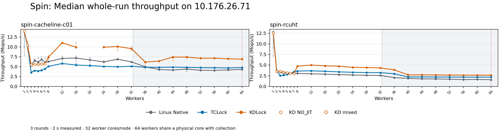
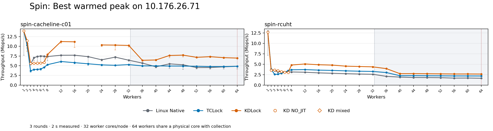
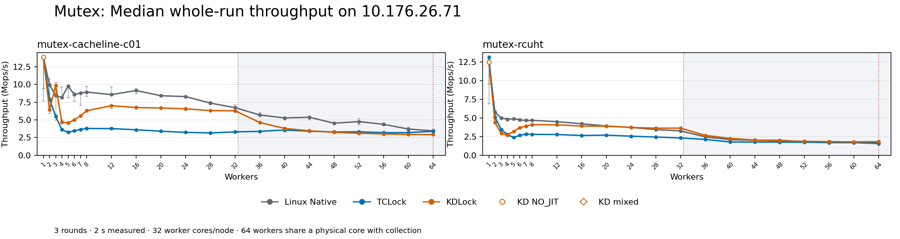
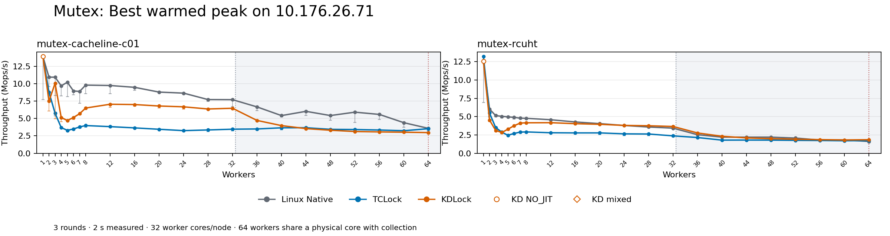
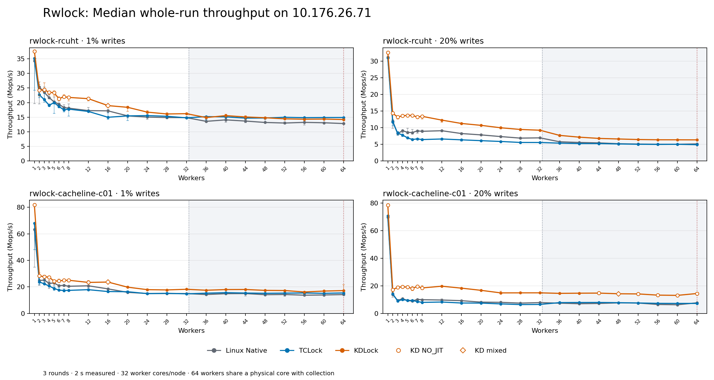
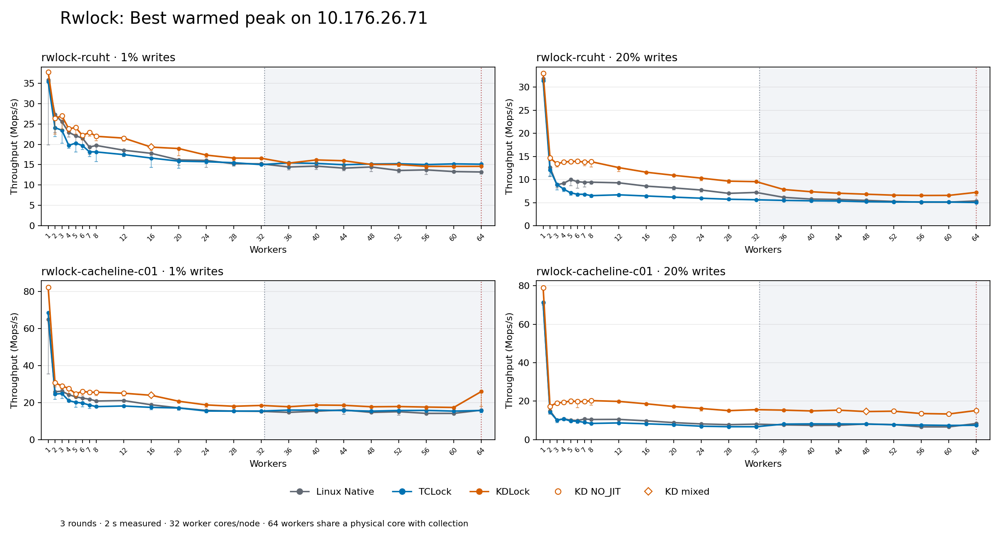

# Complete benchmark on 10.176.26.71: full-matrix-20261011T025525Z

[Current comparison overview](overview.md) gives selected worker counts, source identity and archive verification.

All **1,584 planned timed sessions** were executed and drained; **1,582** passed performance-data acceptance. The remaining **2** sessions remain in the raw evidence and are excluded from scores.

Thread counts: **1, 2, 3, 4, 5, 6, 7, 8, 12, 16, 20, 24, 28, 32, 36, 40, 44, 48, 52, 56, 60, 64**. Every configuration uses Linux Native, TCLock and KDLock, with three rounds per backend.

Spin, mutex and rwlock cover one-cacheline and RCUHT payloads; rwlocks use 1% and 20% writes. Multi-cacheline scenarios are excluded. Warmup is 48,000 operations per worker; measurement is 2,000 ms; peak selection uses an observed 300 ms window after 300 ms of settling. Spin/mutex use their frozen 64 post-work arithmetic rounds; rwlocks use four. Compare backends within each workload.

The temporary VM exposes 66 vCPUs with 24 GiB RAM and two NUMA nodes. Workers use guest CPUs 0–31,33–64, pinned to host physical cores 0–63: 32 worker cores per NUMA node. Collector vCPU 65 is outside every guest worker cohort. **At 64 workers, collector 65 and QEMU service threads share host core 63 with worker vCPU 64.** CPU 32 is unused by the benchmark. The host has only 64 physical cores; the 64-worker point includes physical collection contention. Host frequency governor remains `ondemand`. These samples are separate from previous VM topologies.

Accepted KD sessions: **356 ACTUAL_JIT**, **170 NO_JIT**. NO_JIT throughput is a native-path control, and does not prove JIT gain. Status-separated aggregates are retained. Three-round descriptive totals do not merge execution statuses to satisfy the rwlock runner’s strict parity criterion.

Rates are **Mops/s**. Best peak is the highest valid warmed window across the three rounds. Whole-run is the median of completed operations divided by actual wall time. Ranges and spread are retained in CSV; spread is `(max-min)/median × 100%`, not a confidence interval.

- [Every session](samples.csv)
- [Three-round statistics](statistics.csv)
- [Statistics by execution status](statistics-by-execution.csv)
- [KD comparison ratios](comparison.csv)
- [Independent verification](verification.json)
- [Captured environment and commands](evidence.json)

## Spin scaling

## Mutex scaling

## Rwlock scaling

## spin-cacheline-c01

| Workers | Backend | Valid | Best peak | Median whole | Whole min / max | KD execution |
| --- | --- | --- | --- | --- | --- | --- |
| 1 | Linux Native | 3/3 | 13.954 | 13.902 | 7.704 / 13.909 | — |
| 1 | TCLock | 3/3 | 13.944 | 13.887 | 9.964 / 13.907 | — |
| 1 | KDLock | 3/3 | 13.966 | 13.911 | 13.911 / 13.914 | 0 JIT / 3 NO_JIT |
| 2 | Linux Native | 3/3 | 10.724 | 10.330 | 9.683 / 10.669 | — |
| 2 | TCLock | 3/3 | 10.282 | 10.209 | 9.441 / 10.244 | — |
| 2 | KDLock | 3/3 | 11.455 | 10.425 | 8.694 / 11.421 | 0 JIT / 3 NO_JIT |
| 3 | Linux Native | 3/3 | 5.409 | 5.316 | 5.043 / 5.389 | — |
| 3 | TCLock | 3/3 | 3.681 | 3.532 | 3.299 / 3.663 | — |
| 3 | KDLock | 3/3 | 5.563 | 5.477 | 5.293 / 5.537 | 0 JIT / 3 NO_JIT |
| 4 | Linux Native | 3/3 | 7.047 | 6.576 | 6.257 / 6.997 | — |
| 4 | TCLock | 3/3 | 4.016 | 3.993 | 3.930 / 3.994 | — |
| 4 | KDLock | 3/3 | 5.612 | 5.584 | 5.518 / 5.595 | 0 JIT / 3 NO_JIT |
| 5 | Linux Native | 3/3 | 7.384 | 6.139 | 5.961 / 7.336 | — |
| 5 | TCLock | 3/3 | 4.052 | 3.899 | 3.854 / 4.031 | — |
| 5 | KDLock | 3/3 | 5.654 | 5.563 | 5.542 / 5.639 | 0 JIT / 3 NO_JIT |
| 6 | Linux Native | 3/3 | 7.514 | 6.813 | 5.894 / 7.490 | — |
| 6 | TCLock | 3/3 | 4.145 | 4.065 | 3.801 / 4.131 | — |
| 6 | KDLock | 3/3 | 5.711 | 5.656 | 5.618 / 5.690 | 0 JIT / 3 NO_JIT |
| 7 | Linux Native | 3/3 | 7.451 | 6.086 | 5.842 / 7.424 | — |
| 7 | TCLock | 3/3 | 4.579 | 4.470 | 4.366 / 4.559 | — |
| 7 | KDLock | 3/3 | 5.829 | 5.699 | 5.531 / 5.809 | 0 JIT / 3 NO_JIT |
| 8 | Linux Native | 3/3 | 7.369 | 6.283 | 6.248 / 7.139 | — |
| 8 | TCLock | 3/3 | 5.268 | 5.081 | 5.077 / 5.238 | — |
| 8 | KDLock | 3/3 | 7.891 | 7.405 | 7.234 / 7.838 | 3 JIT / 0 NO_JIT |
| 12 | Linux Native | 3/3 | 7.707 | 7.082 | 5.983 / 7.655 | — |
| 12 | TCLock | 3/3 | 6.083 | 5.802 | 5.688 / 5.989 | — |
| 12 | KDLock | 3/3 | 11.240 | 11.047 | 10.797 / 11.203 | 3 JIT / 0 NO_JIT |
| 16 | Linux Native | 3/3 | 7.716 | 7.182 | 5.733 / 7.658 | — |
| 16 | TCLock | 3/3 | 5.789 | 5.404 | 5.377 / 5.660 | — |
| 16 | KDLock | 3/3 | 11.169 | 9.909 | 9.687 / 11.113 | 3 JIT / 0 NO_JIT |
| 20 | Linux Native | 3/3 | 7.339 | 6.697 | 5.446 / 7.283 | — |
| 20 | TCLock | 3/3 | 5.499 | 5.280 | 4.983 / 5.417 | — |
| 20 | KDLock | 1/3 | 10.638 | 9.892 | 9.892 / 9.892 | 1 JIT / 0 NO_JIT |
| 24 | Linux Native | 3/3 | 6.533 | 6.203 | 6.062 / 6.467 | — |
| 24 | TCLock | 3/3 | 5.216 | 5.056 | 4.886 / 5.119 | — |
| 24 | KDLock | 3/3 | 10.361 | 9.943 | 9.868 / 10.130 | 3 JIT / 0 NO_JIT |
| 28 | Linux Native | 3/3 | 7.216 | 6.887 | 6.683 / 7.163 | — |
| 28 | TCLock | 3/3 | 5.114 | 4.970 | 4.954 / 5.049 | — |
| 28 | KDLock | 3/3 | 10.325 | 10.091 | 9.072 / 10.308 | 3 JIT / 0 NO_JIT |
| 32 | Linux Native | 3/3 | 6.422 | 6.213 | 6.090 / 6.257 | — |
| 32 | TCLock | 3/3 | 5.290 | 5.097 | 5.078 / 5.155 | — |
| 32 | KDLock | 3/3 | 10.237 | 9.578 | 9.065 / 10.143 | 3 JIT / 0 NO_JIT |
| 36 | Linux Native | 3/3 | 5.682 | 4.956 | 4.683 / 5.070 | — |
| 36 | TCLock | 3/3 | 4.961 | 4.850 | 4.763 / 4.861 | — |
| 36 | KDLock | 3/3 | 6.399 | 6.164 | 5.208 / 6.334 | 3 JIT / 0 NO_JIT |
| 40 | Linux Native | 3/3 | 4.723 | 4.275 | 4.147 / 4.505 | — |
| 40 | TCLock | 3/3 | 4.963 | 4.836 | 4.832 / 4.855 | — |
| 40 | KDLock | 3/3 | 6.487 | 6.405 | 6.255 / 6.470 | 3 JIT / 0 NO_JIT |
| 44 | Linux Native | 3/3 | 5.486 | 4.135 | 4.051 / 4.783 | — |
| 44 | TCLock | 3/3 | 4.921 | 4.875 | 4.821 / 4.883 | — |
| 44 | KDLock | 3/3 | 7.644 | 7.430 | 6.568 / 7.621 | 3 JIT / 0 NO_JIT |
| 48 | Linux Native | 3/3 | 5.242 | 4.387 | 3.766 / 4.618 | — |
| 48 | TCLock | 3/3 | 4.913 | 4.812 | 4.734 / 4.858 | — |
| 48 | KDLock | 3/3 | 7.736 | 7.414 | 7.262 / 7.694 | 3 JIT / 0 NO_JIT |
| 52 | Linux Native | 3/3 | 4.526 | 4.082 | 3.939 / 4.290 | — |
| 52 | TCLock | 3/3 | 4.859 | 4.752 | 4.649 / 4.808 | — |
| 52 | KDLock | 3/3 | 7.169 | 7.124 | 7.085 / 7.147 | 3 JIT / 0 NO_JIT |
| 56 | Linux Native | 3/3 | 4.540 | 4.060 | 3.861 / 4.140 | — |
| 56 | TCLock | 3/3 | 4.779 | 4.713 | 4.554 / 4.715 | — |
| 56 | KDLock | 3/3 | 7.333 | 7.157 | 7.081 / 7.306 | 3 JIT / 0 NO_JIT |
| 60 | Linux Native | 3/3 | 4.710 | 4.173 | 3.964 / 4.351 | — |
| 60 | TCLock | 3/3 | 4.779 | 4.678 | 4.634 / 4.709 | — |
| 60 | KDLock | 3/3 | 7.081 | 6.988 | 6.865 / 7.043 | 3 JIT / 0 NO_JIT |
| 64 | Linux Native | 3/3 | 4.860 | 4.304 | 4.024 / 4.402 | — |
| 64 | TCLock | 3/3 | 4.852 | 4.750 | 4.700 / 4.806 | — |
| 64 | KDLock | 3/3 | 6.973 | 6.915 | 6.862 / 6.929 | 3 JIT / 0 NO_JIT |

## mutex-cacheline-c01

| Workers | Backend | Valid | Best peak | Median whole | Whole min / max | KD execution |
| --- | --- | --- | --- | --- | --- | --- |
| 1 | Linux Native | 3/3 | 13.905 | 13.863 | 7.685 / 13.866 | — |
| 1 | TCLock | 3/3 | 13.974 | 13.925 | 9.454 / 13.927 | — |
| 1 | KDLock | 3/3 | 13.913 | 13.865 | 13.851 / 13.887 | 0 JIT / 3 NO_JIT |
| 2 | Linux Native | 3/3 | 10.935 | 9.955 | 8.153 / 10.798 | — |
| 2 | TCLock | 3/3 | 8.767 | 7.919 | 7.613 / 8.706 | — |
| 2 | KDLock | 3/3 | 7.481 | 6.417 | 5.912 / 7.243 | 3 JIT / 0 NO_JIT |
| 3 | Linux Native | 3/3 | 10.926 | 8.445 | 8.264 / 10.268 | — |
| 3 | TCLock | 3/3 | 5.749 | 5.472 | 5.354 / 5.727 | — |
| 3 | KDLock | 3/3 | 10.048 | 9.827 | 4.924 / 9.996 | 3 JIT / 0 NO_JIT |
| 4 | Linux Native | 3/3 | 9.685 | 8.173 | 8.154 / 9.641 | — |
| 4 | TCLock | 3/3 | 3.694 | 3.607 | 3.600 / 3.689 | — |
| 4 | KDLock | 3/3 | 5.144 | 4.692 | 4.500 / 4.973 | 3 JIT / 0 NO_JIT |
| 5 | Linux Native | 3/3 | 10.203 | 9.772 | 8.100 / 9.897 | — |
| 5 | TCLock | 3/3 | 3.292 | 3.247 | 3.117 / 3.278 | — |
| 5 | KDLock | 3/3 | 4.704 | 4.558 | 4.542 / 4.635 | 3 JIT / 0 NO_JIT |
| 6 | Linux Native | 3/3 | 8.954 | 8.574 | 7.612 / 8.917 | — |
| 6 | TCLock | 3/3 | 3.490 | 3.456 | 3.282 / 3.478 | — |
| 6 | KDLock | 3/3 | 5.140 | 4.996 | 4.788 / 5.007 | 3 JIT / 0 NO_JIT |
| 7 | Linux Native | 3/3 | 8.879 | 8.782 | 7.064 / 8.793 | — |
| 7 | TCLock | 3/3 | 3.782 | 3.640 | 3.544 / 3.774 | — |
| 7 | KDLock | 3/3 | 5.677 | 5.571 | 5.468 / 5.612 | 3 JIT / 0 NO_JIT |
| 8 | Linux Native | 3/3 | 9.789 | 8.928 | 8.302 / 9.690 | — |
| 8 | TCLock | 3/3 | 3.982 | 3.785 | 3.725 / 3.967 | — |
| 8 | KDLock | 3/3 | 6.498 | 6.291 | 6.226 / 6.401 | 3 JIT / 0 NO_JIT |
| 12 | Linux Native | 3/3 | 9.733 | 8.567 | 8.534 / 9.621 | — |
| 12 | TCLock | 3/3 | 3.828 | 3.766 | 3.717 / 3.808 | — |
| 12 | KDLock | 3/3 | 7.043 | 6.994 | 6.596 / 6.995 | 3 JIT / 0 NO_JIT |
| 16 | Linux Native | 3/3 | 9.470 | 9.140 | 8.712 / 9.356 | — |
| 16 | TCLock | 3/3 | 3.646 | 3.599 | 3.563 / 3.621 | — |
| 16 | KDLock | 3/3 | 6.998 | 6.742 | 6.662 / 6.946 | 3 JIT / 0 NO_JIT |
| 20 | Linux Native | 3/3 | 8.787 | 8.414 | 8.399 / 8.507 | — |
| 20 | TCLock | 3/3 | 3.448 | 3.395 | 3.378 / 3.421 | — |
| 20 | KDLock | 3/3 | 6.789 | 6.673 | 6.467 / 6.763 | 3 JIT / 0 NO_JIT |
| 24 | Linux Native | 3/3 | 8.638 | 8.282 | 8.205 / 8.431 | — |
| 24 | TCLock | 3/3 | 3.253 | 3.232 | 3.203 / 3.241 | — |
| 24 | KDLock | 3/3 | 6.672 | 6.562 | 6.304 / 6.613 | 3 JIT / 0 NO_JIT |
| 28 | Linux Native | 3/3 | 7.712 | 7.372 | 7.161 / 7.557 | — |
| 28 | TCLock | 3/3 | 3.352 | 3.153 | 3.111 / 3.333 | — |
| 28 | KDLock | 3/3 | 6.362 | 6.308 | 6.287 / 6.342 | 3 JIT / 0 NO_JIT |
| 32 | Linux Native | 3/3 | 7.698 | 6.716 | 6.446 / 7.104 | — |
| 32 | TCLock | 3/3 | 3.459 | 3.304 | 3.176 / 3.447 | — |
| 32 | KDLock | 3/3 | 6.467 | 6.278 | 6.261 / 6.432 | 3 JIT / 0 NO_JIT |
| 36 | Linux Native | 3/3 | 6.662 | 5.691 | 5.681 / 6.005 | — |
| 36 | TCLock | 3/3 | 3.494 | 3.373 | 3.303 / 3.467 | — |
| 36 | KDLock | 3/3 | 4.719 | 4.624 | 4.609 / 4.672 | 3 JIT / 0 NO_JIT |
| 40 | Linux Native | 3/3 | 5.413 | 5.268 | 5.003 / 5.283 | — |
| 40 | TCLock | 3/3 | 3.659 | 3.567 | 3.303 / 3.637 | — |
| 40 | KDLock | 3/3 | 3.976 | 3.791 | 3.780 / 3.938 | 3 JIT / 0 NO_JIT |
| 44 | Linux Native | 3/3 | 6.024 | 5.369 | 4.993 / 5.418 | — |
| 44 | TCLock | 3/3 | 3.670 | 3.401 | 3.374 / 3.648 | — |
| 44 | KDLock | 3/3 | 3.544 | 3.457 | 3.418 / 3.507 | 3 JIT / 0 NO_JIT |
| 48 | Linux Native | 3/3 | 5.419 | 4.524 | 4.459 / 4.604 | — |
| 48 | TCLock | 3/3 | 3.441 | 3.289 | 3.287 / 3.404 | — |
| 48 | KDLock | 3/3 | 3.312 | 3.237 | 3.202 / 3.293 | 3 JIT / 0 NO_JIT |
| 52 | Linux Native | 3/3 | 5.905 | 4.757 | 4.291 / 5.176 | — |
| 52 | TCLock | 3/3 | 3.411 | 3.312 | 3.286 / 3.385 | — |
| 52 | KDLock | 3/3 | 3.127 | 3.107 | 3.017 / 3.116 | 3 JIT / 0 NO_JIT |
| 56 | Linux Native | 3/3 | 5.582 | 4.367 | 4.344 / 4.561 | — |
| 56 | TCLock | 3/3 | 3.341 | 3.188 | 3.183 / 3.310 | — |
| 56 | KDLock | 3/3 | 3.070 | 3.017 | 2.954 / 3.057 | 3 JIT / 0 NO_JIT |
| 60 | Linux Native | 3/3 | 4.394 | 3.703 | 3.553 / 3.968 | — |
| 60 | TCLock | 3/3 | 3.237 | 3.196 | 3.126 / 3.225 | — |
| 60 | KDLock | 3/3 | 3.029 | 2.932 | 2.918 / 2.993 | 3 JIT / 0 NO_JIT |
| 64 | Linux Native | 3/3 | 3.582 | 3.444 | 3.318 / 3.448 | — |
| 64 | TCLock | 3/3 | 3.534 | 3.387 | 3.214 / 3.494 | — |
| 64 | KDLock | 3/3 | 2.972 | 2.913 | 2.885 / 2.942 | 3 JIT / 0 NO_JIT |

## rwlock-rcuht · 1% writes

| Workers | Backend | Valid | Best peak | Median whole | Whole min / max | KD execution |
| --- | --- | --- | --- | --- | --- | --- |
| 1 | Linux Native | 3/3 | 35.819 | 34.345 | 19.604 / 35.516 | — |
| 1 | TCLock | 3/3 | 35.396 | 35.107 | 24.274 / 35.115 | — |
| 1 | KDLock | 3/3 | 37.764 | 37.565 | 37.454 / 37.570 | 0 JIT / 3 NO_JIT |
| 2 | Linux Native | 3/3 | 27.283 | 25.331 | 19.573 / 27.083 | — |
| 2 | TCLock | 3/3 | 24.075 | 22.676 | 21.730 / 23.847 | — |
| 2 | KDLock | 3/3 | 26.367 | 24.238 | 22.270 / 26.182 | 0 JIT / 3 NO_JIT |
| 3 | Linux Native | 3/3 | 25.540 | 23.528 | 20.707 / 25.363 | — |
| 3 | TCLock | 3/3 | 23.450 | 21.034 | 20.158 / 23.269 | — |
| 3 | KDLock | 3/3 | 27.004 | 24.426 | 23.532 / 26.820 | 0 JIT / 3 NO_JIT |
| 4 | Linux Native | 3/3 | 22.935 | 21.722 | 21.480 / 22.654 | — |
| 4 | TCLock | 3/3 | 19.724 | 19.075 | 18.919 / 19.538 | — |
| 4 | KDLock | 3/3 | 23.799 | 23.505 | 22.830 / 23.613 | 0 JIT / 3 NO_JIT |
| 5 | Linux Native | 3/3 | 22.104 | 20.264 | 19.799 / 21.931 | — |
| 5 | TCLock | 3/3 | 20.299 | 19.978 | 16.257 / 20.153 | — |
| 5 | KDLock | 3/3 | 24.119 | 23.388 | 22.292 / 24.057 | 0 JIT / 3 NO_JIT |
| 6 | Linux Native | 3/3 | 21.499 | 19.484 | 19.375 / 21.264 | — |
| 6 | TCLock | 3/3 | 19.676 | 18.676 | 18.563 / 19.432 | — |
| 6 | KDLock | 3/3 | 22.169 | 21.323 | 20.861 / 22.010 | 0 JIT / 3 NO_JIT |
| 7 | Linux Native | 3/3 | 19.323 | 18.287 | 17.388 / 19.223 | — |
| 7 | TCLock | 3/3 | 18.159 | 17.504 | 16.830 / 17.974 | — |
| 7 | KDLock | 3/3 | 22.939 | 22.041 | 21.824 / 22.735 | 0 JIT / 3 NO_JIT |
| 8 | Linux Native | 3/3 | 19.714 | 18.088 | 17.874 / 19.529 | — |
| 8 | TCLock | 3/3 | 18.124 | 17.765 | 15.428 / 17.979 | — |
| 8 | KDLock | 3/3 | 21.963 | 21.777 | 20.602 / 21.795 | 0 JIT / 3 NO_JIT |
| 12 | Linux Native | 3/3 | 18.546 | 17.247 | 16.805 / 18.379 | — |
| 12 | TCLock | 3/3 | 17.470 | 16.968 | 16.864 / 17.403 | — |
| 12 | KDLock | 3/3 | 21.523 | 21.344 | 20.610 / 21.379 | 0 JIT / 3 NO_JIT |
| 16 | Linux Native | 3/3 | 17.776 | 17.168 | 16.553 / 17.610 | — |
| 16 | TCLock | 3/3 | 16.617 | 14.968 | 14.238 / 16.464 | — |
| 16 | KDLock | 3/3 | 19.309 | 18.967 | 18.322 / 19.231 | 1 JIT / 2 NO_JIT |
| 20 | Linux Native | 3/3 | 16.163 | 15.447 | 14.746 / 15.696 | — |
| 20 | TCLock | 3/3 | 15.864 | 15.441 | 13.893 / 15.630 | — |
| 20 | KDLock | 3/3 | 18.957 | 18.383 | 17.050 / 18.745 | 3 JIT / 0 NO_JIT |
| 24 | Linux Native | 3/3 | 16.047 | 15.027 | 14.241 / 15.570 | — |
| 24 | TCLock | 3/3 | 15.726 | 15.540 | 15.102 / 15.555 | — |
| 24 | KDLock | 3/3 | 17.347 | 16.737 | 16.686 / 17.188 | 3 JIT / 0 NO_JIT |
| 28 | Linux Native | 3/3 | 15.216 | 14.878 | 14.455 / 14.896 | — |
| 28 | TCLock | 3/3 | 15.479 | 15.312 | 14.708 / 15.328 | — |
| 28 | KDLock | 3/3 | 16.624 | 16.100 | 15.830 / 16.479 | 3 JIT / 0 NO_JIT |
| 32 | Linux Native | 3/3 | 15.212 | 14.844 | 14.718 / 14.852 | — |
| 32 | TCLock | 3/3 | 15.012 | 14.769 | 14.744 / 14.858 | — |
| 32 | KDLock | 3/3 | 16.579 | 16.202 | 16.069 / 16.430 | 3 JIT / 0 NO_JIT |
| 36 | Linux Native | 3/3 | 14.427 | 13.577 | 13.555 / 14.297 | — |
| 36 | TCLock | 3/3 | 15.431 | 15.193 | 14.030 / 15.275 | — |
| 36 | KDLock | 3/3 | 15.380 | 14.870 | 14.708 / 15.247 | 3 JIT / 0 NO_JIT |
| 40 | Linux Native | 3/3 | 14.645 | 14.076 | 13.199 / 14.464 | — |
| 40 | TCLock | 3/3 | 15.311 | 15.097 | 14.994 / 15.132 | — |
| 40 | KDLock | 3/3 | 16.162 | 15.540 | 14.983 / 15.984 | 3 JIT / 0 NO_JIT |
| 44 | Linux Native | 3/3 | 14.147 | 13.671 | 13.152 / 13.968 | — |
| 44 | TCLock | 3/3 | 14.977 | 14.686 | 14.671 / 14.795 | — |
| 44 | KDLock | 3/3 | 15.962 | 15.074 | 14.217 / 15.445 | 3 JIT / 0 NO_JIT |
| 48 | Linux Native | 3/3 | 14.428 | 13.189 | 13.164 / 14.209 | — |
| 48 | TCLock | 3/3 | 15.159 | 14.722 | 14.681 / 14.997 | — |
| 48 | KDLock | 3/3 | 15.046 | 14.807 | 14.688 / 14.865 | 3 JIT / 0 NO_JIT |
| 52 | Linux Native | 3/3 | 13.568 | 12.996 | 12.774 / 13.369 | — |
| 52 | TCLock | 3/3 | 15.226 | 14.959 | 14.589 / 15.045 | — |
| 52 | KDLock | 3/3 | 15.024 | 14.435 | 14.343 / 14.780 | 3 JIT / 0 NO_JIT |
| 56 | Linux Native | 3/3 | 13.716 | 13.220 | 12.336 / 13.534 | — |
| 56 | TCLock | 3/3 | 15.023 | 14.831 | 14.689 / 14.851 | — |
| 56 | KDLock | 3/3 | 14.583 | 14.306 | 13.923 / 14.402 | 3 JIT / 0 NO_JIT |
| 60 | Linux Native | 3/3 | 13.302 | 13.085 | 12.970 / 13.102 | — |
| 60 | TCLock | 3/3 | 15.189 | 14.885 | 14.690 / 15.027 | — |
| 60 | KDLock | 3/3 | 14.575 | 14.358 | 14.135 / 14.368 | 3 JIT / 0 NO_JIT |
| 64 | Linux Native | 3/3 | 13.200 | 12.816 | 12.508 / 12.988 | — |
| 64 | TCLock | 3/3 | 15.112 | 14.892 | 14.594 / 14.892 | — |
| 64 | KDLock | 3/3 | 14.587 | 14.202 | 14.112 / 14.269 | 3 JIT / 0 NO_JIT |

## rwlock-rcuht · 20% writes

| Workers | Backend | Valid | Best peak | Median whole | Whole min / max | KD execution |
| --- | --- | --- | --- | --- | --- | --- |
| 1 | Linux Native | 3/3 | 31.821 | 31.202 | 31.174 / 31.483 | — |
| 1 | TCLock | 3/3 | 31.388 | 30.974 | 30.953 / 31.046 | — |
| 1 | KDLock | 3/3 | 32.978 | 32.669 | 32.603 / 32.703 | 0 JIT / 3 NO_JIT |
| 2 | Linux Native | 3/3 | 12.621 | 12.007 | 9.857 / 12.393 | — |
| 2 | TCLock | 3/3 | 12.062 | 11.737 | 10.553 / 11.802 | — |
| 2 | KDLock | 3/3 | 14.704 | 14.365 | 13.861 / 14.491 | 0 JIT / 3 NO_JIT |
| 3 | Linux Native | 3/3 | 8.848 | 8.186 | 8.174 / 8.762 | — |
| 3 | TCLock | 3/3 | 8.964 | 8.388 | 7.657 / 8.843 | — |
| 3 | KDLock | 3/3 | 13.407 | 13.223 | 12.567 / 13.242 | 0 JIT / 3 NO_JIT |
| 4 | Linux Native | 3/3 | 9.207 | 9.122 | 8.512 / 9.130 | — |
| 4 | TCLock | 3/3 | 7.905 | 7.783 | 7.337 / 7.846 | — |
| 4 | KDLock | 3/3 | 13.782 | 13.588 | 13.408 / 13.667 | 0 JIT / 3 NO_JIT |
| 5 | Linux Native | 3/3 | 9.975 | 8.606 | 8.098 / 9.871 | — |
| 5 | TCLock | 3/3 | 7.118 | 6.955 | 6.587 / 7.037 | — |
| 5 | KDLock | 3/3 | 13.901 | 13.715 | 13.604 / 13.758 | 0 JIT / 3 NO_JIT |
| 6 | Linux Native | 3/3 | 9.531 | 8.541 | 8.014 / 9.473 | — |
| 6 | TCLock | 3/3 | 6.806 | 6.441 | 6.294 / 6.728 | — |
| 6 | KDLock | 3/3 | 13.937 | 13.708 | 13.585 / 13.857 | 0 JIT / 3 NO_JIT |
| 7 | Linux Native | 3/3 | 9.401 | 9.041 | 8.317 / 9.077 | — |
| 7 | TCLock | 3/3 | 6.808 | 6.645 | 6.618 / 6.741 | — |
| 7 | KDLock | 3/3 | 13.770 | 13.232 | 12.841 / 13.594 | 0 JIT / 3 NO_JIT |
| 8 | Linux Native | 3/3 | 9.425 | 8.921 | 8.661 / 9.334 | — |
| 8 | TCLock | 3/3 | 6.510 | 6.434 | 6.055 / 6.474 | — |
| 8 | KDLock | 3/3 | 13.854 | 13.427 | 12.592 / 13.717 | 0 JIT / 3 NO_JIT |
| 12 | Linux Native | 3/3 | 9.287 | 9.095 | 8.773 / 9.102 | — |
| 12 | TCLock | 3/3 | 6.691 | 6.606 | 6.281 / 6.629 | — |
| 12 | KDLock | 3/3 | 12.578 | 12.288 | 11.584 / 12.361 | 3 JIT / 0 NO_JIT |
| 16 | Linux Native | 3/3 | 8.570 | 8.246 | 8.006 / 8.472 | — |
| 16 | TCLock | 3/3 | 6.438 | 6.354 | 5.977 / 6.379 | — |
| 16 | KDLock | 3/3 | 11.579 | 11.279 | 11.186 / 11.434 | 3 JIT / 0 NO_JIT |
| 20 | Linux Native | 3/3 | 8.180 | 7.837 | 7.665 / 8.076 | — |
| 20 | TCLock | 3/3 | 6.187 | 6.101 | 5.966 / 6.113 | — |
| 20 | KDLock | 3/3 | 10.911 | 10.710 | 10.548 / 10.759 | 3 JIT / 0 NO_JIT |
| 24 | Linux Native | 3/3 | 7.725 | 7.333 | 7.248 / 7.630 | — |
| 24 | TCLock | 3/3 | 5.954 | 5.861 | 5.673 / 5.896 | — |
| 24 | KDLock | 3/3 | 10.301 | 9.982 | 9.631 / 10.132 | 3 JIT / 0 NO_JIT |
| 28 | Linux Native | 3/3 | 7.004 | 6.869 | 6.715 / 6.937 | — |
| 28 | TCLock | 3/3 | 5.734 | 5.565 | 5.432 / 5.675 | — |
| 28 | KDLock | 3/3 | 9.649 | 9.474 | 9.119 / 9.538 | 3 JIT / 0 NO_JIT |
| 32 | Linux Native | 3/3 | 7.206 | 6.950 | 6.912 / 7.024 | — |
| 32 | TCLock | 3/3 | 5.618 | 5.552 | 5.505 / 5.560 | — |
| 32 | KDLock | 3/3 | 9.541 | 9.246 | 9.199 / 9.423 | 3 JIT / 0 NO_JIT |
| 36 | Linux Native | 3/3 | 6.138 | 5.764 | 5.534 / 5.891 | — |
| 36 | TCLock | 3/3 | 5.483 | 5.358 | 5.323 / 5.418 | — |
| 36 | KDLock | 3/3 | 7.839 | 7.692 | 7.379 / 7.742 | 3 JIT / 0 NO_JIT |
| 40 | Linux Native | 3/3 | 5.772 | 5.554 | 5.549 / 5.667 | — |
| 40 | TCLock | 3/3 | 5.395 | 5.235 | 5.109 / 5.313 | — |
| 40 | KDLock | 3/3 | 7.356 | 7.157 | 7.146 / 7.247 | 3 JIT / 0 NO_JIT |
| 44 | Linux Native | 3/3 | 5.683 | 5.427 | 5.416 / 5.539 | — |
| 44 | TCLock | 3/3 | 5.353 | 5.228 | 4.983 / 5.235 | — |
| 44 | KDLock | 3/3 | 7.033 | 6.781 | 6.686 / 6.932 | 3 JIT / 0 NO_JIT |
| 48 | Linux Native | 3/3 | 5.478 | 5.176 | 5.050 / 5.305 | — |
| 48 | TCLock | 3/3 | 5.196 | 5.110 | 5.041 / 5.126 | — |
| 48 | KDLock | 3/3 | 6.822 | 6.609 | 6.588 / 6.717 | 3 JIT / 0 NO_JIT |
| 52 | Linux Native | 3/3 | 5.260 | 5.075 | 5.010 / 5.103 | — |
| 52 | TCLock | 3/3 | 5.142 | 5.023 | 4.845 / 5.080 | — |
| 52 | KDLock | 3/3 | 6.613 | 6.443 | 6.375 / 6.508 | 3 JIT / 0 NO_JIT |
| 56 | Linux Native | 3/3 | 5.099 | 5.023 | 4.843 / 5.024 | — |
| 56 | TCLock | 3/3 | 5.143 | 4.974 | 4.951 / 5.069 | — |
| 56 | KDLock | 3/3 | 6.547 | 6.372 | 6.320 / 6.444 | 3 JIT / 0 NO_JIT |
| 60 | Linux Native | 3/3 | 5.100 | 5.015 | 4.955 / 5.058 | — |
| 60 | TCLock | 3/3 | 5.126 | 5.015 | 4.893 / 5.052 | — |
| 60 | KDLock | 3/3 | 6.566 | 6.360 | 6.323 / 6.423 | 3 JIT / 0 NO_JIT |
| 64 | Linux Native | 3/3 | 5.364 | 5.120 | 4.997 / 5.168 | — |
| 64 | TCLock | 3/3 | 5.032 | 4.887 | 4.882 / 4.906 | — |
| 64 | KDLock | 3/3 | 7.222 | 6.340 | 6.305 / 6.546 | 3 JIT / 0 NO_JIT |

## spin-rcuht

| Workers | Backend | Valid | Best peak | Median whole | Whole min / max | KD execution |
| --- | --- | --- | --- | --- | --- | --- |
| 1 | Linux Native | 3/3 | 12.893 | 12.814 | 7.115 / 12.853 | — |
| 1 | TCLock | 3/3 | 12.681 | 12.581 | 9.041 / 12.644 | — |
| 1 | KDLock | 3/3 | 12.680 | 12.613 | 12.599 / 12.615 | 0 JIT / 3 NO_JIT |
| 2 | Linux Native | 3/3 | 3.803 | 3.561 | 3.559 / 3.607 | — |
| 2 | TCLock | 3/3 | 3.828 | 3.723 | 3.470 / 3.806 | — |
| 2 | KDLock | 3/3 | 3.549 | 3.514 | 3.434 / 3.525 | 0 JIT / 3 NO_JIT |
| 3 | Linux Native | 3/3 | 3.461 | 3.415 | 3.187 / 3.434 | — |
| 3 | TCLock | 3/3 | 2.561 | 2.544 | 2.539 / 2.552 | — |
| 3 | KDLock | 3/3 | 3.591 | 3.542 | 3.520 / 3.569 | 0 JIT / 3 NO_JIT |
| 4 | Linux Native | 3/3 | 3.174 | 3.119 | 3.051 / 3.158 | — |
| 4 | TCLock | 3/3 | 2.621 | 2.610 | 2.593 / 2.611 | — |
| 4 | KDLock | 3/3 | 3.445 | 3.377 | 3.291 / 3.417 | 0 JIT / 3 NO_JIT |
| 5 | Linux Native | 3/3 | 3.268 | 3.225 | 3.167 / 3.225 | — |
| 5 | TCLock | 3/3 | 2.852 | 2.842 | 2.838 / 2.843 | — |
| 5 | KDLock | 3/3 | 3.234 | 3.207 | 3.199 / 3.211 | 0 JIT / 3 NO_JIT |
| 6 | Linux Native | 3/3 | 3.170 | 3.095 | 3.020 / 3.097 | — |
| 6 | TCLock | 3/3 | 3.064 | 3.024 | 3.013 / 3.049 | — |
| 6 | KDLock | 3/3 | 3.098 | 3.076 | 3.070 / 3.077 | 0 JIT / 3 NO_JIT |
| 7 | Linux Native | 3/3 | 3.175 | 3.154 | 2.952 / 3.162 | — |
| 7 | TCLock | 3/3 | 3.477 | 3.437 | 3.381 / 3.457 | — |
| 7 | KDLock | 3/3 | 3.040 | 3.017 | 2.989 / 3.020 | 0 JIT / 3 NO_JIT |
| 8 | Linux Native | 3/3 | 3.145 | 3.061 | 2.952 / 3.120 | — |
| 8 | TCLock | 3/3 | 3.668 | 3.605 | 3.532 / 3.625 | — |
| 8 | KDLock | 3/3 | 4.808 | 4.750 | 4.744 / 4.781 | 3 JIT / 0 NO_JIT |
| 12 | Linux Native | 3/3 | 3.081 | 2.957 | 2.894 / 3.057 | — |
| 12 | TCLock | 3/3 | 3.713 | 3.661 | 3.634 / 3.684 | — |
| 12 | KDLock | 3/3 | 5.062 | 5.028 | 5.011 / 5.037 | 3 JIT / 0 NO_JIT |
| 16 | Linux Native | 3/3 | 2.922 | 2.875 | 2.821 / 2.909 | — |
| 16 | TCLock | 3/3 | 3.589 | 3.553 | 3.546 / 3.562 | — |
| 16 | KDLock | 3/3 | 4.873 | 4.841 | 4.839 / 4.845 | 3 JIT / 0 NO_JIT |
| 20 | Linux Native | 3/3 | 2.831 | 2.786 | 2.759 / 2.800 | — |
| 20 | TCLock | 3/3 | 3.518 | 3.418 | 3.358 / 3.463 | — |
| 20 | KDLock | 3/3 | 4.788 | 4.753 | 4.594 / 4.760 | 3 JIT / 0 NO_JIT |
| 24 | Linux Native | 3/3 | 2.736 | 2.682 | 2.672 / 2.714 | — |
| 24 | TCLock | 3/3 | 3.409 | 3.321 | 3.294 / 3.362 | — |
| 24 | KDLock | 3/3 | 4.541 | 4.479 | 4.473 / 4.521 | 3 JIT / 0 NO_JIT |
| 28 | Linux Native | 3/3 | 2.652 | 2.609 | 2.592 / 2.629 | — |
| 28 | TCLock | 3/3 | 3.325 | 3.245 | 3.231 / 3.274 | — |
| 28 | KDLock | 3/3 | 4.457 | 4.426 | 4.426 / 4.427 | 3 JIT / 0 NO_JIT |
| 32 | Linux Native | 3/3 | 2.594 | 2.570 | 2.555 / 2.576 | — |
| 32 | TCLock | 3/3 | 3.271 | 3.228 | 3.199 / 3.235 | — |
| 32 | KDLock | 3/3 | 4.371 | 4.347 | 4.343 / 4.352 | 3 JIT / 0 NO_JIT |
| 36 | Linux Native | 3/3 | 2.089 | 2.062 | 2.016 / 2.065 | — |
| 36 | TCLock | 3/3 | 3.003 | 2.976 | 2.970 / 2.985 | — |
| 36 | KDLock | 3/3 | 3.941 | 3.889 | 3.882 / 3.910 | 3 JIT / 0 NO_JIT |
| 40 | Linux Native | 3/3 | 1.916 | 1.893 | 1.876 / 1.895 | — |
| 40 | TCLock | 3/3 | 2.247 | 2.225 | 2.209 / 2.226 | — |
| 40 | KDLock | 3/3 | 2.736 | 2.717 | 2.707 / 2.721 | 3 JIT / 0 NO_JIT |
| 44 | Linux Native | 3/3 | 1.817 | 1.777 | 1.752 / 1.778 | — |
| 44 | TCLock | 3/3 | 2.261 | 2.231 | 2.201 / 2.247 | — |
| 44 | KDLock | 3/3 | 2.753 | 2.730 | 2.729 / 2.732 | 3 JIT / 0 NO_JIT |
| 48 | Linux Native | 3/3 | 1.802 | 1.752 | 1.741 / 1.759 | — |
| 48 | TCLock | 3/3 | 2.232 | 2.204 | 2.190 / 2.219 | — |
| 48 | KDLock | 3/3 | 2.718 | 2.694 | 2.686 / 2.696 | 3 JIT / 0 NO_JIT |
| 52 | Linux Native | 3/3 | 1.775 | 1.686 | 1.675 / 1.694 | — |
| 52 | TCLock | 3/3 | 2.220 | 2.198 | 2.197 / 2.202 | — |
| 52 | KDLock | 3/3 | 2.691 | 2.672 | 2.670 / 2.675 | 3 JIT / 0 NO_JIT |
| 56 | Linux Native | 3/3 | 1.673 | 1.613 | 1.594 / 1.644 | — |
| 56 | TCLock | 3/3 | 2.192 | 2.172 | 2.169 / 2.179 | — |
| 56 | KDLock | 3/3 | 2.660 | 2.646 | 2.645 / 2.648 | 3 JIT / 0 NO_JIT |
| 60 | Linux Native | 3/3 | 1.690 | 1.629 | 1.618 / 1.631 | — |
| 60 | TCLock | 3/3 | 2.190 | 2.176 | 2.175 / 2.177 | — |
| 60 | KDLock | 3/3 | 2.662 | 2.648 | 2.647 / 2.649 | 3 JIT / 0 NO_JIT |
| 64 | Linux Native | 3/3 | 1.638 | 1.565 | 1.559 / 1.582 | — |
| 64 | TCLock | 3/3 | 2.181 | 2.165 | 2.159 / 2.167 | — |
| 64 | KDLock | 3/3 | 2.648 | 2.633 | 2.633 / 2.635 | 3 JIT / 0 NO_JIT |

## mutex-rcuht

| Workers | Backend | Valid | Best peak | Median whole | Whole min / max | KD execution |
| --- | --- | --- | --- | --- | --- | --- |
| 1 | Linux Native | 3/3 | 12.540 | 12.442 | 6.918 / 12.469 | — |
| 1 | TCLock | 3/3 | 13.211 | 13.166 | 9.538 / 13.168 | — |
| 1 | KDLock | 3/3 | 12.557 | 12.488 | 12.353 / 12.500 | 0 JIT / 3 NO_JIT |
| 2 | Linux Native | 3/3 | 6.035 | 5.737 | 5.253 / 5.990 | — |
| 2 | TCLock | 3/3 | 5.493 | 5.103 | 4.943 / 5.468 | — |
| 2 | KDLock | 3/3 | 4.532 | 4.370 | 4.347 / 4.460 | 3 JIT / 0 NO_JIT |
| 3 | Linux Native | 3/3 | 5.138 | 5.020 | 4.896 / 5.116 | — |
| 3 | TCLock | 3/3 | 3.516 | 3.439 | 3.274 / 3.496 | — |
| 3 | KDLock | 3/3 | 3.124 | 2.925 | 2.893 / 3.034 | 3 JIT / 0 NO_JIT |
| 4 | Linux Native | 3/3 | 5.037 | 4.820 | 4.808 / 5.016 | — |
| 4 | TCLock | 3/3 | 2.883 | 2.789 | 2.658 / 2.872 | — |
| 4 | KDLock | 3/3 | 2.829 | 2.691 | 2.664 / 2.704 | 3 JIT / 0 NO_JIT |
| 5 | Linux Native | 3/3 | 4.969 | 4.895 | 4.705 / 4.951 | — |
| 5 | TCLock | 3/3 | 2.458 | 2.374 | 2.366 / 2.443 | — |
| 5 | KDLock | 3/3 | 3.283 | 3.210 | 3.189 / 3.234 | 3 JIT / 0 NO_JIT |
| 6 | Linux Native | 3/3 | 4.896 | 4.743 | 4.651 / 4.878 | — |
| 6 | TCLock | 3/3 | 2.702 | 2.668 | 2.563 / 2.690 | — |
| 6 | KDLock | 3/3 | 3.753 | 3.696 | 3.686 / 3.705 | 3 JIT / 0 NO_JIT |
| 7 | Linux Native | 3/3 | 4.790 | 4.671 | 4.637 / 4.771 | — |
| 7 | TCLock | 3/3 | 2.887 | 2.832 | 2.714 / 2.868 | — |
| 7 | KDLock | 3/3 | 4.114 | 3.915 | 3.872 / 4.071 | 3 JIT / 0 NO_JIT |
| 8 | Linux Native | 3/3 | 4.769 | 4.688 | 4.676 / 4.722 | — |
| 8 | TCLock | 3/3 | 2.914 | 2.805 | 2.742 / 2.886 | — |
| 8 | KDLock | 3/3 | 4.158 | 4.101 | 4.019 / 4.132 | 3 JIT / 0 NO_JIT |
| 12 | Linux Native | 3/3 | 4.575 | 4.509 | 4.477 / 4.530 | — |
| 12 | TCLock | 3/3 | 2.799 | 2.779 | 2.710 / 2.786 | — |
| 12 | KDLock | 3/3 | 4.173 | 4.089 | 4.043 / 4.151 | 3 JIT / 0 NO_JIT |
| 16 | Linux Native | 3/3 | 4.273 | 4.224 | 4.191 / 4.235 | — |
| 16 | TCLock | 3/3 | 2.779 | 2.648 | 2.577 / 2.767 | — |
| 16 | KDLock | 3/3 | 4.037 | 3.920 | 3.862 / 4.017 | 3 JIT / 0 NO_JIT |
| 20 | Linux Native | 3/3 | 4.043 | 3.921 | 3.794 / 3.956 | — |
| 20 | TCLock | 3/3 | 2.780 | 2.694 | 2.530 / 2.759 | — |
| 20 | KDLock | 3/3 | 3.953 | 3.895 | 3.841 / 3.937 | 3 JIT / 0 NO_JIT |
| 24 | Linux Native | 3/3 | 3.791 | 3.728 | 3.705 / 3.735 | — |
| 24 | TCLock | 3/3 | 2.651 | 2.559 | 2.355 / 2.639 | — |
| 24 | KDLock | 3/3 | 3.801 | 3.731 | 3.679 / 3.758 | 3 JIT / 0 NO_JIT |
| 28 | Linux Native | 3/3 | 3.582 | 3.442 | 3.417 / 3.470 | — |
| 28 | TCLock | 3/3 | 2.629 | 2.442 | 2.407 / 2.610 | — |
| 28 | KDLock | 3/3 | 3.754 | 3.628 | 3.593 / 3.739 | 3 JIT / 0 NO_JIT |
| 32 | Linux Native | 3/3 | 3.428 | 3.265 | 3.194 / 3.342 | — |
| 32 | TCLock | 3/3 | 2.375 | 2.320 | 2.214 / 2.363 | — |
| 32 | KDLock | 3/3 | 3.656 | 3.637 | 3.619 / 3.641 | 3 JIT / 0 NO_JIT |
| 36 | Linux Native | 3/3 | 2.534 | 2.466 | 2.446 / 2.483 | — |
| 36 | TCLock | 3/3 | 2.150 | 2.124 | 2.117 / 2.137 | — |
| 36 | KDLock | 3/3 | 2.771 | 2.659 | 2.634 / 2.680 | 3 JIT / 0 NO_JIT |
| 40 | Linux Native | 3/3 | 2.204 | 2.096 | 2.095 / 2.168 | — |
| 40 | TCLock | 3/3 | 1.792 | 1.779 | 1.770 / 1.780 | — |
| 40 | KDLock | 3/3 | 2.321 | 2.262 | 2.260 / 2.264 | 3 JIT / 0 NO_JIT |
| 44 | Linux Native | 3/3 | 2.195 | 2.019 | 1.937 / 2.034 | — |
| 44 | TCLock | 3/3 | 1.802 | 1.775 | 1.756 / 1.783 | — |
| 44 | KDLock | 3/3 | 2.095 | 2.033 | 2.013 / 2.070 | 3 JIT / 0 NO_JIT |
| 48 | Linux Native | 3/3 | 2.201 | 2.010 | 1.886 / 2.036 | — |
| 48 | TCLock | 3/3 | 1.795 | 1.762 | 1.757 / 1.775 | — |
| 48 | KDLock | 3/3 | 1.990 | 1.920 | 1.904 / 1.958 | 3 JIT / 0 NO_JIT |
| 52 | Linux Native | 3/3 | 2.077 | 1.815 | 1.782 / 1.942 | — |
| 52 | TCLock | 3/3 | 1.767 | 1.742 | 1.703 / 1.752 | — |
| 52 | KDLock | 3/3 | 1.919 | 1.867 | 1.859 / 1.899 | 3 JIT / 0 NO_JIT |
| 56 | Linux Native | 3/3 | 1.806 | 1.712 | 1.693 / 1.723 | — |
| 56 | TCLock | 3/3 | 1.745 | 1.703 | 1.703 / 1.731 | — |
| 56 | KDLock | 3/3 | 1.862 | 1.829 | 1.815 / 1.846 | 3 JIT / 0 NO_JIT |
| 60 | Linux Native | 3/3 | 1.818 | 1.693 | 1.655 / 1.715 | — |
| 60 | TCLock | 3/3 | 1.710 | 1.693 | 1.673 / 1.699 | — |
| 60 | KDLock | 3/3 | 1.816 | 1.791 | 1.789 / 1.791 | 3 JIT / 0 NO_JIT |
| 64 | Linux Native | 3/3 | 1.615 | 1.562 | 1.561 / 1.580 | — |
| 64 | TCLock | 3/3 | 1.730 | 1.703 | 1.672 / 1.720 | — |
| 64 | KDLock | 3/3 | 1.852 | 1.825 | 1.799 / 1.835 | 3 JIT / 0 NO_JIT |

## rwlock-cacheline-c01 · 1% writes

| Workers | Backend | Valid | Best peak | Median whole | Whole min / max | KD execution |
| --- | --- | --- | --- | --- | --- | --- |
| 1 | Linux Native | 3/3 | 64.943 | 63.195 | 34.864 / 63.598 | — |
| 1 | TCLock | 3/3 | 68.421 | 67.935 | 48.013 / 68.204 | — |
| 1 | KDLock | 3/3 | 82.253 | 81.878 | 81.634 / 81.918 | 0 JIT / 3 NO_JIT |
| 2 | Linux Native | 3/3 | 25.822 | 24.722 | 21.282 / 25.590 | — |
| 2 | TCLock | 3/3 | 24.540 | 23.756 | 21.597 / 24.333 | — |
| 2 | KDLock | 3/3 | 30.745 | 28.364 | 28.243 / 30.576 | 0 JIT / 3 NO_JIT |
| 3 | Linux Native | 3/3 | 26.148 | 25.167 | 23.453 / 25.222 | — |
| 3 | TCLock | 3/3 | 24.865 | 22.281 | 22.094 / 24.681 | — |
| 3 | KDLock | 3/3 | 28.873 | 27.634 | 27.198 / 28.712 | 0 JIT / 3 NO_JIT |
| 4 | Linux Native | 3/3 | 24.229 | 22.663 | 18.696 / 24.158 | — |
| 4 | TCLock | 3/3 | 20.992 | 20.709 | 20.565 / 20.899 | — |
| 4 | KDLock | 3/3 | 27.666 | 27.308 | 24.698 / 27.457 | 0 JIT / 3 NO_JIT |
| 5 | Linux Native | 3/3 | 23.060 | 22.905 | 20.939 / 22.938 | — |
| 5 | TCLock | 3/3 | 20.122 | 18.823 | 17.325 / 20.015 | — |
| 5 | KDLock | 3/3 | 24.697 | 24.338 | 22.539 / 24.482 | 0 JIT / 3 NO_JIT |
| 6 | Linux Native | 3/3 | 22.372 | 20.890 | 20.090 / 21.313 | — |
| 6 | TCLock | 3/3 | 19.711 | 17.595 | 17.504 / 19.543 | — |
| 6 | KDLock | 3/3 | 26.058 | 24.546 | 23.757 / 25.841 | 0 JIT / 3 NO_JIT |
| 7 | Linux Native | 3/3 | 21.821 | 21.152 | 20.226 / 21.618 | — |
| 7 | TCLock | 3/3 | 18.641 | 17.260 | 16.606 / 18.461 | — |
| 7 | KDLock | 3/3 | 25.509 | 24.897 | 24.529 / 25.286 | 0 JIT / 3 NO_JIT |
| 8 | Linux Native | 3/3 | 20.803 | 20.475 | 19.794 / 20.723 | — |
| 8 | TCLock | 3/3 | 17.793 | 17.365 | 17.272 / 17.756 | — |
| 8 | KDLock | 3/3 | 25.580 | 24.981 | 23.615 / 25.431 | 0 JIT / 3 NO_JIT |
| 12 | Linux Native | 3/3 | 21.045 | 20.823 | 19.104 / 20.971 | — |
| 12 | TCLock | 3/3 | 18.141 | 17.892 | 17.832 / 18.001 | — |
| 12 | KDLock | 3/3 | 25.018 | 23.360 | 23.343 / 24.777 | 0 JIT / 3 NO_JIT |
| 16 | Linux Native | 3/3 | 18.787 | 18.491 | 17.470 / 18.621 | — |
| 16 | TCLock | 3/3 | 17.374 | 16.477 | 15.877 / 17.228 | — |
| 16 | KDLock | 3/3 | 23.899 | 23.623 | 23.398 / 23.718 | 2 JIT / 1 NO_JIT |
| 20 | Linux Native | 3/3 | 17.097 | 15.864 | 15.694 / 16.867 | — |
| 20 | TCLock | 3/3 | 17.052 | 16.347 | 15.655 / 16.880 | — |
| 20 | KDLock | 3/3 | 20.693 | 19.774 | 19.698 / 20.505 | 3 JIT / 0 NO_JIT |
| 24 | Linux Native | 3/3 | 15.747 | 15.019 | 14.826 / 15.635 | — |
| 24 | TCLock | 3/3 | 15.426 | 14.910 | 14.446 / 15.273 | — |
| 24 | KDLock | 3/3 | 18.705 | 17.901 | 17.422 / 18.555 | 3 JIT / 0 NO_JIT |
| 28 | Linux Native | 3/3 | 15.398 | 15.000 | 14.640 / 15.275 | — |
| 28 | TCLock | 3/3 | 15.354 | 15.133 | 14.598 / 15.183 | — |
| 28 | KDLock | 3/3 | 17.983 | 17.704 | 16.646 / 17.831 | 3 JIT / 0 NO_JIT |
| 32 | Linux Native | 3/3 | 15.248 | 14.965 | 14.348 / 15.009 | — |
| 32 | TCLock | 3/3 | 15.405 | 14.743 | 14.489 / 15.245 | — |
| 32 | KDLock | 3/3 | 18.433 | 18.189 | 17.869 / 18.256 | 3 JIT / 0 NO_JIT |
| 36 | Linux Native | 3/3 | 14.692 | 14.246 | 13.864 / 14.546 | — |
| 36 | TCLock | 3/3 | 15.911 | 15.236 | 15.191 / 15.737 | — |
| 36 | KDLock | 3/3 | 17.725 | 17.464 | 17.252 / 17.529 | 3 JIT / 0 NO_JIT |
| 40 | Linux Native | 3/3 | 15.313 | 14.869 | 14.471 / 15.086 | — |
| 40 | TCLock | 3/3 | 15.897 | 15.632 | 15.407 / 15.730 | — |
| 40 | KDLock | 3/3 | 18.646 | 17.966 | 17.927 / 18.434 | 3 JIT / 0 NO_JIT |
| 44 | Linux Native | 3/3 | 16.009 | 14.975 | 13.225 / 15.002 | — |
| 44 | TCLock | 3/3 | 15.683 | 15.349 | 14.795 / 15.509 | — |
| 44 | KDLock | 3/3 | 18.507 | 18.039 | 17.456 / 18.161 | 3 JIT / 0 NO_JIT |
| 48 | Linux Native | 3/3 | 14.667 | 14.119 | 14.062 / 14.483 | — |
| 48 | TCLock | 3/3 | 15.356 | 15.157 | 15.016 / 15.184 | — |
| 48 | KDLock | 3/3 | 17.715 | 17.351 | 17.222 / 17.410 | 3 JIT / 0 NO_JIT |
| 52 | Linux Native | 3/3 | 15.054 | 14.257 | 12.846 / 14.360 | — |
| 52 | TCLock | 3/3 | 15.693 | 15.281 | 15.037 / 15.518 | — |
| 52 | KDLock | 3/3 | 17.833 | 17.243 | 17.226 / 17.420 | 3 JIT / 0 NO_JIT |
| 56 | Linux Native | 3/3 | 14.147 | 13.731 | 13.545 / 13.901 | — |
| 56 | TCLock | 3/3 | 15.750 | 15.414 | 15.329 / 15.505 | — |
| 56 | KDLock | 3/3 | 17.562 | 16.151 | 15.979 / 16.463 | 3 JIT / 0 NO_JIT |
| 60 | Linux Native | 3/3 | 14.147 | 13.909 | 13.636 / 14.177 | — |
| 60 | TCLock | 3/3 | 15.362 | 15.136 | 14.930 / 15.171 | — |
| 60 | KDLock | 3/3 | 17.341 | 16.843 | 16.739 / 17.139 | 3 JIT / 0 NO_JIT |
| 64 | Linux Native | 3/3 | 15.876 | 14.213 | 14.176 / 14.329 | — |
| 64 | TCLock | 3/3 | 15.696 | 15.434 | 14.260 / 15.452 | — |
| 64 | KDLock | 3/3 | 25.909 | 17.192 | 17.095 / 21.683 | 3 JIT / 0 NO_JIT |

## rwlock-cacheline-c01 · 20% writes

| Workers | Backend | Valid | Best peak | Median whole | Whole min / max | KD execution |
| --- | --- | --- | --- | --- | --- | --- |
| 1 | Linux Native | 3/3 | 71.106 | 69.614 | 69.523 / 69.890 | — |
| 1 | TCLock | 3/3 | 71.345 | 70.767 | 70.739 / 70.832 | — |
| 1 | KDLock | 3/3 | 79.018 | 78.424 | 78.275 / 78.435 | 0 JIT / 3 NO_JIT |
| 2 | Linux Native | 3/3 | 14.964 | 13.746 | 11.769 / 14.822 | — |
| 2 | TCLock | 3/3 | 14.374 | 14.171 | 13.467 / 14.266 | — |
| 2 | KDLock | 3/3 | 17.372 | 17.144 | 15.123 / 17.202 | 0 JIT / 3 NO_JIT |
| 3 | Linux Native | 3/3 | 10.173 | 9.412 | 8.829 / 10.119 | — |
| 3 | TCLock | 3/3 | 10.128 | 9.051 | 8.685 / 10.097 | — |
| 3 | KDLock | 3/3 | 19.098 | 18.934 | 18.013 / 18.962 | 0 JIT / 3 NO_JIT |
| 4 | Linux Native | 3/3 | 10.822 | 10.693 | 9.949 / 10.707 | — |
| 4 | TCLock | 3/3 | 10.720 | 9.997 | 9.704 / 10.456 | — |
| 4 | KDLock | 3/3 | 19.362 | 19.245 | 18.593 / 19.264 | 0 JIT / 3 NO_JIT |
| 5 | Linux Native | 3/3 | 10.105 | 9.327 | 9.182 / 10.030 | — |
| 5 | TCLock | 3/3 | 9.667 | 9.490 | 9.354 / 9.538 | — |
| 5 | KDLock | 3/3 | 20.110 | 19.086 | 18.450 / 19.920 | 0 JIT / 3 NO_JIT |
| 6 | Linux Native | 3/3 | 9.939 | 8.935 | 8.429 / 9.912 | — |
| 6 | TCLock | 3/3 | 9.533 | 9.322 | 8.531 / 9.430 | — |
| 6 | KDLock | 3/3 | 19.762 | 18.061 | 16.514 / 19.580 | 0 JIT / 3 NO_JIT |
| 7 | Linux Native | 3/3 | 10.704 | 10.130 | 8.977 / 10.150 | — |
| 7 | TCLock | 3/3 | 8.973 | 8.627 | 8.369 / 8.869 | — |
| 7 | KDLock | 3/3 | 19.807 | 19.589 | 18.767 / 19.673 | 0 JIT / 3 NO_JIT |
| 8 | Linux Native | 3/3 | 10.457 | 9.932 | 9.552 / 10.011 | — |
| 8 | TCLock | 3/3 | 8.404 | 7.981 | 7.907 / 8.304 | — |
| 8 | KDLock | 3/3 | 20.280 | 18.459 | 17.828 / 20.162 | 0 JIT / 3 NO_JIT |
| 12 | Linux Native | 3/3 | 10.520 | 9.696 | 8.692 / 10.435 | — |
| 12 | TCLock | 3/3 | 8.679 | 8.246 | 8.176 / 8.544 | — |
| 12 | KDLock | 3/3 | 19.866 | 19.704 | 19.225 / 19.704 | 3 JIT / 0 NO_JIT |
| 16 | Linux Native | 3/3 | 9.776 | 9.225 | 8.678 / 9.281 | — |
| 16 | TCLock | 3/3 | 8.225 | 7.538 | 7.514 / 8.129 | — |
| 16 | KDLock | 3/3 | 18.629 | 18.304 | 17.769 / 18.561 | 3 JIT / 0 NO_JIT |
| 20 | Linux Native | 3/3 | 8.832 | 8.169 | 8.112 / 8.738 | — |
| 20 | TCLock | 3/3 | 7.722 | 7.486 | 7.298 / 7.532 | — |
| 20 | KDLock | 3/3 | 17.216 | 16.714 | 16.342 / 16.943 | 3 JIT / 0 NO_JIT |
| 24 | Linux Native | 3/3 | 8.158 | 8.023 | 7.748 / 8.074 | — |
| 24 | TCLock | 3/3 | 6.964 | 6.883 | 6.580 / 6.891 | — |
| 24 | KDLock | 3/3 | 16.188 | 14.866 | 14.727 / 16.009 | 3 JIT / 0 NO_JIT |
| 28 | Linux Native | 3/3 | 7.779 | 7.461 | 7.420 / 7.701 | — |
| 28 | TCLock | 3/3 | 6.706 | 6.409 | 6.374 / 6.624 | — |
| 28 | KDLock | 3/3 | 15.063 | 14.891 | 14.628 / 14.929 | 3 JIT / 0 NO_JIT |
| 32 | Linux Native | 3/3 | 8.040 | 7.824 | 7.661 / 7.951 | — |
| 32 | TCLock | 3/3 | 6.704 | 6.506 | 6.503 / 6.635 | — |
| 32 | KDLock | 3/3 | 15.587 | 14.907 | 14.799 / 15.199 | 3 JIT / 0 NO_JIT |
| 36 | Linux Native | 3/3 | 7.661 | 7.414 | 6.972 / 7.424 | — |
| 36 | TCLock | 3/3 | 8.060 | 7.824 | 7.728 / 7.947 | — |
| 36 | KDLock | 3/3 | 15.332 | 14.522 | 14.495 / 14.662 | 3 JIT / 0 NO_JIT |
| 40 | Linux Native | 3/3 | 7.435 | 7.029 | 6.705 / 7.046 | — |
| 40 | TCLock | 3/3 | 8.165 | 7.905 | 7.879 / 8.078 | — |
| 40 | KDLock | 3/3 | 14.905 | 14.650 | 14.260 / 14.712 | 3 JIT / 0 NO_JIT |
| 44 | Linux Native | 3/3 | 7.457 | 7.210 | 7.195 / 7.236 | — |
| 44 | TCLock | 3/3 | 8.140 | 7.932 | 7.707 / 8.014 | — |
| 44 | KDLock | 3/3 | 15.318 | 14.712 | 14.433 / 14.822 | 0 JIT / 3 NO_JIT |
| 48 | Linux Native | 3/3 | 8.140 | 7.648 | 6.949 / 7.893 | — |
| 48 | TCLock | 3/3 | 8.071 | 7.770 | 7.748 / 7.884 | — |
| 48 | KDLock | 3/3 | 14.578 | 14.230 | 14.146 / 14.250 | 1 JIT / 2 NO_JIT |
| 52 | Linux Native | 3/3 | 7.787 | 7.534 | 6.617 / 7.578 | — |
| 52 | TCLock | 3/3 | 7.737 | 7.559 | 7.264 / 7.612 | — |
| 52 | KDLock | 3/3 | 14.791 | 14.118 | 13.460 / 14.238 | 0 JIT / 3 NO_JIT |
| 56 | Linux Native | 3/3 | 6.630 | 6.489 | 6.155 / 6.986 | — |
| 56 | TCLock | 3/3 | 7.567 | 7.289 | 7.125 / 7.467 | — |
| 56 | KDLock | 3/3 | 13.554 | 13.242 | 13.046 / 13.349 | 0 JIT / 3 NO_JIT |
| 60 | Linux Native | 3/3 | 6.623 | 6.277 | 6.154 / 6.509 | — |
| 60 | TCLock | 3/3 | 7.393 | 7.238 | 7.185 / 7.292 | — |
| 60 | KDLock | 3/3 | 13.332 | 13.067 | 12.994 / 13.141 | 0 JIT / 3 NO_JIT |
| 64 | Linux Native | 3/3 | 8.362 | 7.672 | 7.448 / 7.955 | — |
| 64 | TCLock | 3/3 | 7.456 | 7.235 | 6.798 / 7.241 | — |
| 64 | KDLock | 3/3 | 15.129 | 14.425 | 14.243 / 14.426 | 0 JIT / 3 NO_JIT |
