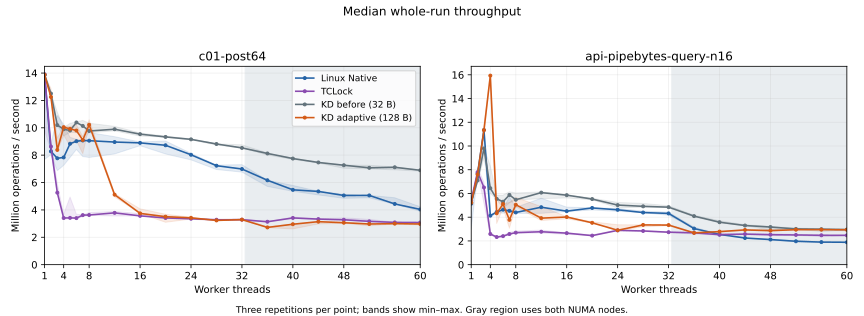
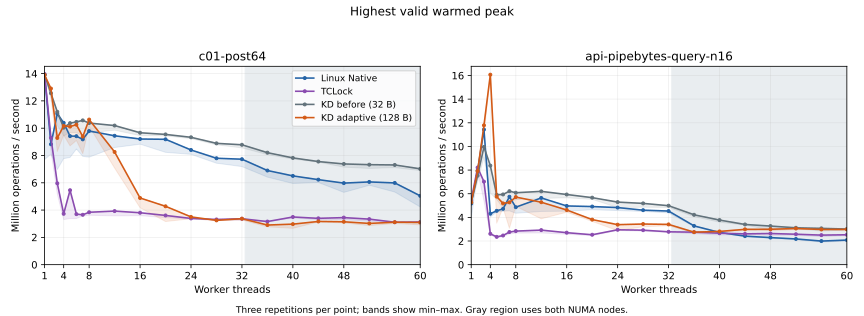
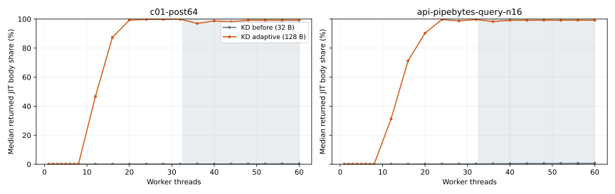

# Adaptive KD mutex: c01 and pipebytes, 1–60 workers

**Rejected by the user on 2026-10-16.** This experiment and all its evidence
remain preserved at `archive/owned-mutex-adaptive-a49a87c`. The subsequent
[exact legacy recovery](../mutex-legacy-recovery-20261016T113518Z/README.md)
reaches 5.367 Mops/s at 60 workers on pipebytes n16; the measurements below
remain the rejected experiment's original results.

The requested hybrid policy is implemented as an **opt-in experiment**. Short
queues keep ABI4's local CAS/OSQ path; high queue pressure offers early
delegation, bounded refill, successor prefetch and optional legacy-style NUMA
cohorts. It retains the owned protocol's blocking waits, immutable image binding
and exact FULL/ACK retirement.

The fresh matrix contains **504 accepted and drained sessions**: two workloads,
21 worker counts, four arms and three repetitions. It compares modified KD
(`contention_adaptive_v8`), the exact frozen pre-change KD, TCLock and Linux Native.
Pilot results and historical legacy measurements are separate. The policy remains
off by default because the measurements do not justify replacing local-first
acquisition generally. ABI2 remains the default caller.

## Results

**The routing goal is met, but the performance goal is not established.** At
1–7 workers, adaptive KD executes at least 99.9% of median operations locally;
at 60 workers, about 99.2% return delegated JIT bodies in both workloads.
Single-worker throughput stays within 0.6% of the old implementation. That does
not preserve all low-count performance: c01 falls 17.8% at three workers and
10.2% at seven; pipebytes falls 35.7% at seven. At 60 workers, c01 falls 56.9%,
while pipebytes is approximately level with the old implementation (−0.6%).
The historical legacy pipebytes result of 5.330 Mops/s is not recovered.

Pipebytes has a pronounced four-worker gain: adaptive trials are
15.753–16.009 Mops/s, versus 6.001–8.320 before. Each adaptive worker contributes
about 25%; more than 99.99% of operations execute locally (1,148–1,282 returned
JIT bodies per trial). This predominantly local result does not establish a
delegation benefit. Results at five and seven workers vary
substantially across repetitions. No isolated experiment attributes these changes
to the new layout, hint load, queue traffic or another individual mechanism.

Rates below are medians of three whole-run measurements, in million operations
per second. Change is relative to frozen pre-change KD. A positive change favors
the adaptive candidate. JIT is the median fraction of operations whose delegated
body actually returned; image publication alone is not counted.

### c01-post64

| Workers | Native | TCLock | KD before | KD adaptive | Change | Adaptive JIT |
| ---: | ---: | ---: | ---: | ---: | ---: | ---: |
| 1 | 13.852 | 13.913 | 13.886 | 13.873 | -0.1% | 0.000% |
| 2 | 8.274 | 8.631 | 12.502 | 12.249 | -2.0% | 0.001% |
| 3 | 7.773 | 5.260 | 10.196 | 8.384 | -17.8% | 0.003% |
| 4 | 7.834 | 3.409 | 9.895 | 10.045 | +1.5% | 0.006% |
| 5 | 8.836 | 3.420 | 9.803 | 9.922 | +1.2% | 0.008% |
| 6 | 9.019 | 3.401 | 10.390 | 9.800 | -5.7% | 0.012% |
| 7 | 9.071 | 3.619 | 10.137 | 9.105 | -10.2% | 0.016% |
| 8 | 9.058 | 3.628 | 9.765 | 10.220 | +4.7% | 0.018% |
| 12 | 8.959 | 3.785 | 9.895 | 5.115 | -48.3% | 46.662% |
| 16 | 8.898 | 3.565 | 9.535 | 3.747 | -60.7% | 87.396% |
| 20 | 8.722 | 3.410 | 9.332 | 3.504 | -62.5% | 99.282% |
| 24 | 8.029 | 3.353 | 9.155 | 3.424 | -62.6% | 99.777% |
| 28 | 7.231 | 3.283 | 8.815 | 3.232 | -63.3% | 99.766% |
| 32 | 6.988 | 3.287 | 8.530 | 3.290 | -61.4% | 99.900% |
| 36 | 6.165 | 3.136 | 8.125 | 2.721 | -66.5% | 96.958% |
| 40 | 5.467 | 3.413 | 7.752 | 2.955 | -61.9% | 98.705% |
| 44 | 5.351 | 3.330 | 7.467 | 3.142 | -57.9% | 98.144% |
| 48 | 5.057 | 3.280 | 7.265 | 3.064 | -57.8% | 99.223% |
| 52 | 5.059 | 3.165 | 7.075 | 2.971 | -58.0% | 99.211% |
| 56 | 4.436 | 3.088 | 7.115 | 2.997 | -57.9% | 99.215% |
| 60 | 4.037 | 3.079 | 6.894 | 2.972 | -56.9% | 99.213% |

### api-pipebytes-query-n16

| Workers | Native | TCLock | KD before | KD adaptive | Change | Adaptive JIT |
| ---: | ---: | ---: | ---: | ---: | ---: | ---: |
| 1 | 5.138 | 5.419 | 5.247 | 5.219 | -0.5% | 0.000% |
| 2 | 7.672 | 7.798 | 7.092 | 7.599 | +7.1% | 0.002% |
| 3 | 11.350 | 6.506 | 9.793 | 11.337 | +15.8% | 0.004% |
| 4 | 4.133 | 2.587 | 6.445 | 15.933 | +147.2% | 0.004% |
| 5 | 4.434 | 2.329 | 5.546 | 4.329 | -22.0% | 0.010% |
| 6 | 4.635 | 2.402 | 5.306 | 5.108 | -3.7% | 0.012% |
| 7 | 4.537 | 2.581 | 5.878 | 3.778 | -35.7% | 0.024% |
| 8 | 4.398 | 2.698 | 5.471 | 5.052 | -7.7% | 0.019% |
| 12 | 4.843 | 2.776 | 6.073 | 3.920 | -35.4% | 31.221% |
| 16 | 4.509 | 2.657 | 5.858 | 4.017 | -31.4% | 71.263% |
| 20 | 4.781 | 2.448 | 5.529 | 3.527 | -36.2% | 90.325% |
| 24 | 4.624 | 2.890 | 5.022 | 2.899 | -42.3% | 99.741% |
| 28 | 4.392 | 2.840 | 4.917 | 3.351 | -31.8% | 98.705% |
| 32 | 4.319 | 2.737 | 4.846 | 3.336 | -31.2% | 99.685% |
| 36 | 3.043 | 2.684 | 4.091 | 2.679 | -34.5% | 98.270% |
| 40 | 2.546 | 2.526 | 3.577 | 2.787 | -22.1% | 99.179% |
| 44 | 2.246 | 2.577 | 3.299 | 2.928 | -11.2% | 99.175% |
| 48 | 2.117 | 2.523 | 3.171 | 2.865 | -9.7% | 99.211% |
| 52 | 1.972 | 2.505 | 3.014 | 2.947 | -2.2% | 99.198% |
| 56 | 1.902 | 2.477 | 2.991 | 2.950 | -1.4% | 99.210% |
| 60 | 1.888 | 2.471 | 2.961 | 2.944 | -0.6% | 99.182% |

### Curves and variation

The bands retain all three repetitions' min–max range. Gray regions use both
NUMA nodes. [Statistics](summary.csv) contain min/median/max/spread for whole-run
and warmed-peak throughput, CPU cost, worker shares and JIT share. They also keep
the whole-run result paired with the best peak. [Every sample](samples.csv) and
[per-worker progress](workers.csv.gz) and [NUMA-node progress](nodes.csv) remain
available. Three repetitions describe
variation; these data do not establish statistical significance, fairness or a
universal performance improvement.

## What changed

The policy is selected with `--owned-mutex-cabi --owned-mutex-adaptive` in the
synthetic runner and `--owned-mutex-adaptive` in the API runner. This comparison
also enables `--owned-mutex-numa`. Provider controls are read-only and checked
against each session's recorded identity.

- Every 64th contended ABI4 entry per CPU can inspect at most seven distinct,
  matching OSQ members. Seven queued spinners plus the arriving caller are a
  conservative pressure cue. It is advisory, not an exact configured-thread
  counter; eight configured workers need not activate it. Small queues retain
  local optimism and its reuse allowance of 32.
- A hot episode bypasses the failed owner CAS and unbounded optimistic pass.
  Exact source/task/resource admission and ownership retries remain mandatory.
  Queue drain or a free-owner observation clears the hint.
- Adaptive batches prefetch a still-linked successor and allow bounded refill.
  With NUMA enabled, remote heads move aside once; they do not get scanned and
  rewritten for every local dispatch. Waiting remote requests limit the local
  cohort to 128 bodies. Scan and body budgets are each capped at 1,024 across
  refills. SELF, HANDOFF, rescheduling, refusal, FULL and early unlock stop the
  batch. The deferred prefix rejoins before unstarted and new requests.
- `struct kd_mutex` changes from 32 bytes/alignment 8 to **128 bytes/alignment
  64**: owner 0, OSQ 8, wait lock 64, wait list 72, advisory hint 88. Owner/OSQ
  traffic is separated from delegate publication; cold hint reads do not share
  the owner CAS cacheline. Rebuild callers and provider together. The wrapper
  ABI, acquisition cookie and 320-byte private request packet are unchanged.

This is a combined policy/layout change, not an isolated measurement of one
instruction. There is no separate 128-byte, adaptive-off performance arm; the
before arm is the exact original 32-byte implementation. General defaults remain ABI2, reuse 0 and adaptation off. The new
object layout applies even when adaptation is off; the old 32-byte profile's
performance acceptance does not transfer automatically.

## Relationship to KD mutex legacy

The [legacy combiner](https://github.com/hailongeric/kdlock/blob/e306412c55fe1e091f56c6bb5e34591bbb42e365/kernel_module/mutex/combiner.inc)
used a live MCS successor chain, early queuing, successor prefetch and bounded
local cohorts. The new policy adopts those scheduling ideas within the owned
FIFO protocol. It does not restore the shadow mapping, original Linux mutex
ownership or the legacy spin-only producer wait. Current delegated producers
still poll at most 4,096 times before sleeping; physical owners and FULL/ACK
continuations retain their exact lifetimes.

Changing the amount of delegation is not sufficient to reproduce legacy
throughput. The owned implementation still publishes through a guarded FIFO,
uses independent executor storage, binds immutable image versions and supports
sleeping producers. The high JIT share in this experiment proves that routing
changed; it does not identify the cost of any one retained mechanism. c01 also
benefits from local ownership reuse, so forcing more bodies through the combiner
can reduce aggregate throughput. These are implementation differences and
interpretations, not a measured cycle attribution.

The [2026-10-11 legacy report](../../real_api/20261011-sync/RESULTS.md) recorded
5.330 Mops/s at 60 workers for pipebytes n16. Its provider matches `e306412`; the
adapter/header identities and archive differ from this experiment. The separate
[historical reference](historical-legacy-reference.json) retains that comparison
with the earlier 2026-10-16 owned round. Neither historical dataset enters the
fresh ratios or curves above.

## Configuration and controls

Physical host: `10.176.26.71`. Exactly 64 guest vCPUs, one-to-one pinned to host
CPUs. Node 0 is CPUs 0–31 and node 1 is 32–63. Workers use CPUs 0 through N−1;
collector CPU 63 is separate. Counts are 1–8 by one and 12–60 by four. Kernel
`6.1.159-kdclobber2`, Build ID
`5ca28058e156f34a2c7fe91e8e0fbf92f4e51960`, `nokaslr nopvspin`, voluntary
preemption and native qspinlocks. Host governors remain ondemand. No kernel,
boot or CPU-topology change was made.

Each measurement lasts two seconds. Every synthetic worker performs 48,000
warmup operations; API warmup also lasts at least one second. Peaks require a
valid 300 ms window after 300 ms settling, with progress from every worker.
Whole-run throughput includes the measured tail. The c01 body increments one
shared payload cacheline and retains 64 arithmetic rounds after unlock. Pipebytes
n16 issues `FIONREAD`, traverses 16 occupied pipe buffers and validates 65,536
bytes. Its rate includes syscall and result-check costs. These are throughput
measurements, not individual lock acquisition latencies.

Both KD arms use ABI4, reuse 32, bounded result polling 4096 and blocking waits.
Origin spin is off. The frozen before arm has NUMA selection/refill off and uses
its original 32-byte object. Adaptive KD enables the new pressure policy and
NUMA cohorts. Native/TCLock controls are fresh. The two KD arms alternate order
between repetitions; the maintained runners also alternate/rotate backend order.
Scoring runs have provider/workload UBSAN off and no lock profiler.

Native API runs use the original embedded Linux mutex around the matched body;
KD/TCLock use their controlled private objects. This is not a general replacement
for arbitrary kernel-owned pipe mutexes. The one-cacheline label counts payload,
not lock metadata.

The baseline was frozen from `ff01dff1243ae965bb8cfc77257f759cfcb11f19` plus the
35 preexisting workspace edits before this task. Its 1,097 source hashes are
checked before and after each comparison group; original provider/daemon/workload
binary hashes are checked before every session. The original 32-byte workload
binaries were built in pilot-v2 while that public layout was unchanged and are
retained with their source records. The new provider and 128-byte workloads are
built together. Source changes, binaries and generated JIT images are independently
verified by [the auditor](analyze.py); source identities remain the captured
workspace identities, not a retroactive label using the later commit.

## Validation and retained failures

[Validation](validation.json) separates the final source checks, live FULL/ACK
controls and earlier component tests. The final candidate passed production core,
ABI4 compiled/JIT entry (including the hot-hint offset), cohort retirement,
planner/parameter checks, the two basic C tests, real blocking-wait probes at
budgets 0/1024/4096, ABI2 forced-FULL nested execution and ABI4 forced-FULL
nested/early execution. All scored sessions pass business results, placement,
worker progress and normal source/frame retirement. The audit independently
recomputes all 504 warmed peaks. No full project test suite was requested or run.

The initial offline audit compared raw synthetic sessions to their derived
summary rows as if their schemas were identical. The corrected auditor verifies
all raw fields and recomputes the five summary-only score fields; both audit
attempts are retained. The first host consistency check likewise included
transient QEMU worker IDs; the final check verifies the unchanged vCPU identities
and CPU affinities and records service-worker churn on CPU 63. Neither correction
changed a measurement or relaxed result, progress or drain acceptance.

All earlier attempts remain in the raw archive. Timed pilot samples also appear
in the [sample tables](samples.csv):

- An initial preflight fixture build failed on an unused stub; the corrected
  fixture passed. Intentional negative mutation binaries are recorded separately
  from kernel faults; their exact userspace trap line was preserved.
- Pilot-v3 failed its old one-cacheline layout assertion before loading modules.
  Pilot-v3b then failed the client layout validator before starting workers.
  The existing drain/retirement ioctls succeeded, followed by ordinary unload;
  its original failed record and separate cleanup receipt remain unchanged.
- Pilot-v6's 48-worker early-unlock/FULL warmup exceeded 120 seconds. All workers
  later completed their 48,000 operations naturally (2,304,000 total, about 251
  seconds), after which normal retirement/unload succeeded. It remains a timeout,
  not a successful scored or functional session. The 48-worker nested control
  passed; the final 16-worker nested/early controls passed and drained.
- Rejected screens include early-delegation-only, initial pressure-latch/layout
  choices, a read-before-owner-CAS variant and the eight-entry/four-bypass NUMA
  selector. No rejected candidate is pooled with `full-v8`. Variants with the
  hint on the owner line had low-count regressions; the final hint lives on
  the queue line. Pilot throughput is exploratory, not an independent optimization gate.

## Evidence and reproduction

- [Independent verification](verification.json)
- [Three-round statistics](summary.csv), [raw sample rows](samples.csv), [ratios](comparisons.json)
- [Per-worker progress and CPU time](workers.csv.gz), [NUMA-node totals](nodes.csv)
- [Validation receipt](validation.json)
- [Exact matrix commands](full-v8-plan.json)
- [Comparison driver](driver.py), [frozen-baseline adapter](compare.py)
- [Source identity and preservation](source-state.json)
- [Host before](host-before.json), [host after](host-after.json), [guest before](guest-before.json), [guest after](guest-after.json)
- [Raw archive checksum and locations](archive.json)
- [Local publication checks](publication.json)
- [Host placement consistency](host-consistency.json)

Complete raw evidence, including every pilot and failure, is retained under
`/root/kdlock-evidence/10.176.26.71/bench/mutex-adaptive-20261016T075356Z` and in
matching ignored archives on both physical hosts. The archive includes frozen
sources, module/daemon/client binaries, generated code, per-worker timing,
commands and complete drain records. Source edits and Git work stay on `380G10`;
all compilation, tests and live benchmarks ran in the VM on `10.176.26.71`.
