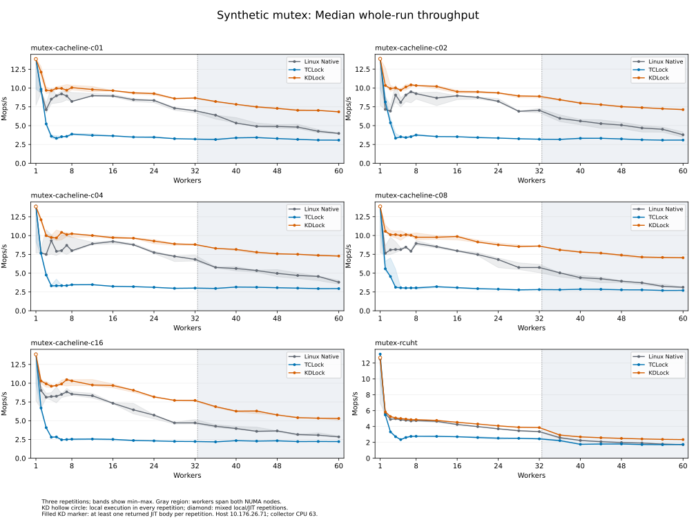
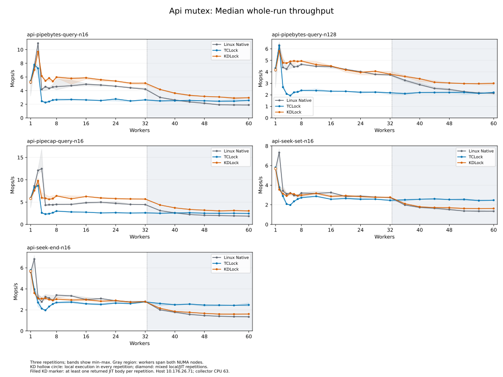

# Expanded KD mutex workloads: 1 to 60 workers

This fresh comparison contains 2,079 executed, 2,079 drained and 2,079 accepted sessions across all 11 mutex workload variants. Matrix state: **COMPLETE**.

Every variant compares Linux Native, TCLock and KD at **1, 2, 3, 4, 5, 6, 7, 8, 12, 16, 20, 24, 28, 32, 36, 40, 44, 48, 52, 56 and 60 workers**, with three repetitions. The 693 KD sessions include the 630 previously omitted measurements and 63 fresh c01 controls. Native and TCLock also have 693 fresh sessions each. No earlier samples enter this report.

## What changed

The owned mutex workload now registers and dispatches c02/c04/c08/c16 in addition to c01, and the build and planner allow RCUHT. The syscall adapter now supplies an explicit private KD-owned object for pipebytes, pipecap and seek. All measured consumers of the bound object use the selected protocol; retained file/pipe references survive worker join, source retirement and hook removal. KD never shares that object with Linux mutex waiters. The lock/provider algorithm was not changed by this expansion.

Synthetic variants: c01/c02/c04/c08/c16 and RCUHT. API variants: pipebytes query at n16/n128, pipecap query at n16, and seek set/end at n16. The [earlier all-lock round](../workloads-20261015T180603Z/README.md) remains the separate spin/rwlock and other-API comparison. Its omissions are historical, not silently filled with new samples.

## Configuration and validation

Source: `078557a573f299dda40c50c2069398ec68140037` plus the captured workspace patch and SHA256 manifest. All 35 preexisting kernel-module edits match the earlier round byte for byte. A private mount namespace binds the frozen source at the guest build path.

Physical host: `10.176.26.71`. Exactly 64 guest vCPUs; node 0 uses CPUs 0–31 and node 1 uses 32–63, each pinned to the same-numbered physical host core. Workers use CPUs 0 through N−1; collector CPU 63 is separate. Cohorts of 36–60 workers cross NUMA nodes. Kernel `6.1.159-kdclobber2`, Build ID `5ca28058e156f34a2c7fe91e8e0fbf92f4e51960`, `nokaslr nopvspin`, voluntary preemption, verified native qspinlocks. Host governors: ondemand. Timed providers and workloads have UBSAN disabled.

KD uses owned-v1, ordinary C ABI4, reuse allowance 32, result-poll budget 4096 and blocking waits; owned origin spin and NUMA selection remain off. Synthetic acceptance is adaptive-performance. The initial validation passed 93 basic/affected unit tests, 12 synthetic functional sessions (all six payloads with both ABI2 and ABI4), 15 API mutex sessions at 1/16/60 workers, and two API spin/rwlock regression sessions. All contended mutex pilots returned JIT bodies. The complete-matrix planner was also checked without executing its unsupported separate-collector 64-worker placement. See the [validation receipt](validation.json).

## Measurement and interpretation

Each synthetic worker warms up for 48,000 operations. API workers warm up for at least 48,000 operations and one second. Timing lasts two seconds. The best warmed peak is the highest observed valid 300 ms window after 300 ms settling, requiring every worker to progress. Whole-run throughput includes the entire measured phase and its tail. The main table uses the median of three whole-run rates; CSVs retain min/median/max, spread and the highest warmed peak. Backend order reverses on the second synthetic repetition and rotates for API repetitions. Synthetic mutex loops retain 64 arithmetic rounds after unlock. API rates include the syscall and result check. Rates are throughput, not lock acquisition latency.

Of the 693 KD sessions, 660 returned JIT bodies and 33 completed on the local KD path with zero returned JIT bodies. The raw API runner calls zero-body results NO_JIT; the audit labels owned-mutex local executions KD_SELF. Neither a local result nor image publication is JIT execution evidence. The report preserves statistics by execution type. Aggregate throughput compares the selected adaptive implementation, and does not establish JIT parity or change optimization acceptance.

The pipe/seek results use a controlled client and private objects for KD/TCLock. Native uses the original embedded kernel mutex around the matched compiled body, so lock placement differs. This validates these bounded benchmark APIs, not arbitrary replacement of Linux kernel-owned mutexes or concurrent unhooked pipe/file operations. The unmodified Stock arm is outside this three-backend comparison.

## Results at 60 workers

Rates are million operations per second. Ratios above one favor KD. All three repetitions must be accepted for a comparison ratio.

| Workload | Native median | TCLock median | KD median | KD / Native | KD / TCLock | KD JIT rounds |
| --- | ---: | ---: | ---: | ---: | ---: | ---: |
| mutex-cacheline-c01 | 3.968 | 3.074 | 6.839 | 1.72× | 2.22× | 3/3 |
| mutex-cacheline-c02 | 3.780 | 3.079 | 7.126 | 1.89× | 2.31× | 3/3 |
| mutex-cacheline-c04 | 3.795 | 2.944 | 7.277 | 1.92× | 2.47× | 3/3 |
| mutex-cacheline-c08 | 3.119 | 2.703 | 7.038 | 2.26× | 2.60× | 3/3 |
| mutex-cacheline-c16 | 2.846 | 2.218 | 5.302 | 1.86× | 2.39× | 3/3 |
| mutex-rcuht | 1.716 | 1.743 | 2.353 | 1.37× | 1.35× | 3/3 |
| api-pipebytes-query-n16 | 1.896 | 2.566 | 2.945 | 1.55× | 1.15× | 3/3 |
| api-pipebytes-query-n128 | 2.146 | 2.212 | 3.005 | 1.40× | 1.36× | 3/3 |
| api-pipecap-query-n16 | 1.848 | 2.442 | 3.037 | 1.64× | 1.24× | 3/3 |
| api-seek-set-n16 | 1.345 | 2.470 | 1.622 | 1.21× | 0.66× | 3/3 |
| api-seek-end-n16 | 1.339 | 2.474 | 1.611 | 1.20× | 0.65× | 3/3 |

Across the 231 workload/worker-count points, KD whole-run median throughput is below Native at 29 points. This is a descriptive count, not an acceptance gate. The full curves retain those regressions. The five lowest KD/Native whole-run ratios are:

- api-pipecap-query-n16, 4 workers: 0.478× Native.
- api-seek-set-n16, 2 workers: 0.484× Native.
- api-seek-end-n16, 2 workers: 0.527× Native.
- api-pipecap-query-n16, 3 workers: 0.807× Native.
- api-pipecap-query-n16, 2 workers: 0.879× Native.

## Scaling curves

### Synthetic mutex

[Best warmed peak](synthetic-mutex-peak.svg)

### API mutex

[Best warmed peak](api-mutex-peak.svg)

Bands show the three-repetition min–max range. Gray regions span both NUMA nodes. Hollow KD markers mean all repetitions returned zero JIT bodies; diamonds mark a mixture of local and JIT repetitions. A filled marker means every repetition returned at least one JIT body, not that every operation was delegated.

## Evidence

- [Every session](samples.csv)
- [Three-round statistics](statistics.csv)
- [Statistics by execution type](statistics-by-execution.csv)
- [Comparison ratios](comparisons.csv)
- [Per-worker progress and CPU time](workers.csv.gz)
- [NUMA-node progress](node-progress.csv)
- [Workload coverage](coverage.csv)
- [Independent audit](verification.json)
- [Support validation](validation.json)
- [Run commands](matrix-plan.json)
- [Source identity](source-state.json)
- [Source hashes](source-sha256.json)
- [Captured workspace changes](workspace.patch.gz)
- [Offline auditor](analyze.py)
- [Archive checksum and location](archive.json)
- [Local archive and report verification](publication.json)
- [Source preservation and final coverage](closeout.json)

Complete raw evidence is retained under `/root/kdlock-evidence/10.176.26.71/bench/mutex-expanded-20261016T040928Z` in the guest and the matching machine-specific archive on both source and benchmark hosts. It includes the pilot evidence. The audit verifies source, module and JIT image hashes, worker placement, owned ABI4 policy, immutable publication and complete retirement, and independently recomputes every accepted warmed peak from raw progress samples.

- [Host before measurement](host-before.json)
- [Guest before measurement](guest-before.json)
- [Host after measurement](host-after.json)
- [Guest after measurement](guest-after.json)
