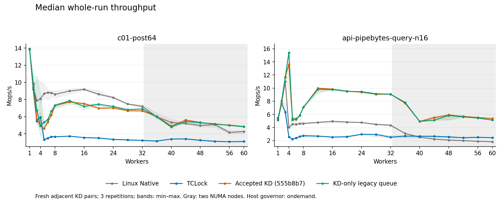
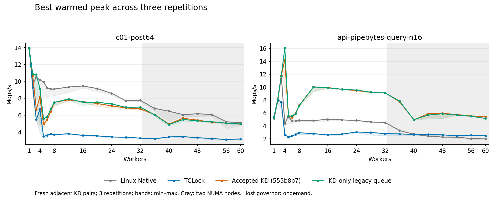

# KD-only mutex versus the accepted legacy compatibility version

The user accepted `555b8b7` and requested exclusively KD mutex objects and APIs.
The selected implementation removes Linux mutex objects/calls and the fixed
address-to-shadow map. It retains legacy delegation, pinned producers, bounded
NUMA grouping, the 1,024-body batch limit, ABI2 callers and immutable JIT images.
The [implementation contract](../../../../../../docs/design/kd_only_mutex.md)
describes the 256-byte object and ordinary API compatibility.

The final matrix (`matrix7`) contains 504 fresh, accepted and drained sessions:
21 worker counts (1–8 by one and 12–60 by four), three repetitions, two workloads
and four arms. Accepted KD and KD-only run adjacently with alternating order;
Native and TCLock rotate around those pairs. Pilot counts 60, 1, 2, 4, 7, 8 and 16 precede
the rest. Accepted KD uses its exact frozen binaries/translator from the accepted
run with fresh timing. The candidate is rebuilt from the final frozen inputs.
Earlier candidates and diagnostic measurements are separate and are not pooled.

Median whole-run throughput at 60 workers, Mops/s:

| Workload | Linux Native | TCLock | Accepted KD | KD-only | Change |
| --- | ---: | ---: | ---: | ---: | ---: |
| c01-post64 | 4.276 | 3.107 | 4.856 | 4.838 | -0.39% |
| api-pipebytes-query-n16 | 1.821 | 2.447 | 5.371 | 5.130 | -4.48% |

In the final three-repeat grid, **41 of 42 median whole-run comparison points** are within 5% of accepted KD or faster.

Every point below that threshold received nine fresh adjacent KD pairs, kept
separate from the main scores:

| Workload | Workers | Main change | Follow-up accepted KD | Follow-up KD-only | Follow-up change | Median paired change | Slower pairs |
| --- | ---: | ---: | ---: | ---: | ---: | ---: | ---: |
| api-pipebytes-query-n16 | 44 | -7.00% | 5.175 | 5.193 | +0.35% | -2.50% | 6/9 |

Follow-up rates are median Mops/s. [All extra pairs and their ranges](recheck-matrix7/recheck-comparison.csv)
remain separate from the [main comparison](comparison.csv). The ratio of medians and
median of adjacent-pair ratios summarize different aspects of the variation;
neither replaces the original grid or establishes that every pair improved.

This assessment uses median whole-run throughput. The highest warmed peak,
min/max range and paired ratios are also retained; it does not claim that every
individual run or peak matches the accepted version. Low-count results vary
under the recorded `ondemand` frequency policy.

[All 42 points](SCALING.md), [min/median/max/spread](statistics.csv),
[individual samples](samples.csv), [adjacent pairs](paired-samples.csv) and
[worker progress](workers.csv.gz) retain the complete comparison.
`legacy`/`baseline` in the data means accepted `555b8b7`; `compat` means KD-only.
Session filenames retain the runner's historical `kdlock-adaptive` suffix;
source manifests and this report identify the actual legacy delegation protocol.
Whole-run scores are medians. Peak scores are the highest valid warmed 300 ms
window across three repetitions. JIT and NO_JIT samples remain explicit.

## Change selection and retained experiments

Initial KD-only preserved 60-worker performance, but `matrix3` showed a 13.05%
c01 loss at two workers. Nine new pairs reproduced a 9.39% median loss. The
initial 44-worker pipebytes loss of 8.82% reduced to about 1% in its separate
nine-pair recheck. Both original matrices remain available under
[matrix3](matrix3/SCALING.md) and [recheck](recheck/recheck-comparison.csv).

Restoring the captured optimistic-spin pause and inlining physical helpers did
not resolve the two-worker c01 loss. The eight PMU diagnostic sessions found
matching node-0 allocation and similar clocks, but substantially more contention
path work in KD-only. This identifies the measured overhead pattern; it does not
prove why individual acquisition phases differ. See
[PMU diagnostics](profile-inline2/profile-samples.json), excluded from scores.

A single extra read-guarded retry was insufficient. Unguarded eight-probe entry
improved the initial two-worker check but regressed seven/eight-worker c01 in
`matrix4`, stopped cleanly after 206 sessions. Tail-only guarding restored c01
but retained API losses. Adding the active gate to that guard passed the focused
trial and led to `matrix5`; its nine-pair follow-up reproduced a 14.54% four-worker
c01 loss. Extending that guarded window to 32 attempts still lost 11.96% at four
workers. These rejected results remain separate from the final scores.

The object was then aligned to 128 bytes, grouping physical ownership separately
from producer-written tail and waiter count. Its size remains 256 bytes. Nine
focused four-worker pairs measured -4.13% for c01 and +9.05% for pipebytes, but
`matrix6` then showed a 44.60% four-worker c01 loss and was stopped cleanly after
133 sessions. Layout alone did not solve the regression. The measurements do not
prove a particular hardware prefetch mechanism or cause of the bimodal runs.

A 32-probe retry window that allowed sparse active queues improved the
four-worker c01 median by 39.13%, but lost 8.55% at two workers across nine
pairs. `trial-short-queue` was stopped cleanly after 48 sessions. Its seven-worker
point has only six pairs and it has no API timings; these gaps are explicit in
[the partial records](trial-short-queue/partial-comparison.csv).

Reducing that queue-count-guarded window to eight probes improved two/four-worker
c01 medians by 2.40%/23.86%, but still lost 12.40%/11.37% at seven/eight workers.
`trial-short-queue8` was stopped cleanly after 85 sessions: four complete nine-pair
c01 points, six 60-worker pairs plus one unpaired baseline, and no API timing.
[Its partial evidence](trial-short-queue8/partial-comparison.csv) is retained.

The selected entry allows up to eight read-guarded owner probes before legacy
admission. It ends retries when the existing gate indicates an active combiner
(state 3), so a running batch receives new work promptly. A lone gate owner
(state 1) may finish its local body during this bounded window. This uses the
existing service state, without a worker-count setting or a queue-count threshold.
Only an acquire CAS from a zero owner/flags word grants ownership. Busy reads do
not issue locked RMWs; the observed state never permits acquisition or retirement.
Published-waiter pinning, batching and lifetime obligations remain unchanged.
[The combiner-guard trial](trial-combiner-guard/trial-comparison.csv) contains nine
adjacent pairs at 2, 4, 7, 8 and 60 workers on both workloads. The final full
matrix and its predeclared follow-ups determine the selection, independently
of that focused trial. All low-count NO_JIT results remain explicit.

Provider initialization now prepares the private mutex runtime before publishing
the control device, and unpublishes the device before freeing that runtime.
The new lifecycle fixture reproduced premature publication in the prior code,
then passed ordinary and SELFTEST control flow, including all 17 injected
initialization-failure paths, after the fix. It is a synthetic service-boundary
check, not a live concurrent-module-load stress test.
The [trial table](TRIALS.md) lists the complete focused trials. Full and partial
matrices retain their separate records linked above.

The final translator also refuses Linux `atomic_dec_and_mutex_lock` and compiler
clones, which were outside the initial `mutex_*` pattern. Provider/workload import
guards cover these helpers, all native mutex symbols and native OSQ functions.
The final matrix includes this correction; no separate final-policy run is claimed.

## Measurement boundary

Each session measures two seconds after 48,000 warmup operations per worker;
pipebytes also requires one second of warmup. Peaks use a 300 ms window after
300 ms settling, sampled every 10 ms. Worker CPUs are 0…N−1; collector CPU 63 is
separate. The VM has 64 pinned vCPUs, two NUMA nodes (0–31 and 32–63), 24 GiB RAM,
voluntary preemption, `nokaslr`, `nopvspin`, and host `ondemand` frequency policy.
[Kernel identity](kernel-identity.json) and [environment](environment.json) record
exact before/after identities and placement. Timed builds use UBSAN off;
the ordinary-API correctness probe uses the normal UBSAN-enabled provider.
Preparation, allocator-guard refresh, translation and retirement are outside timing.

C01 has one shared business-data cacheline and 64 common post-unlock multiply/add
rounds. KD's four-cacheline lock is separate. Pipebytes redirects the FIONREAD
body over 16 occupied buffers in a controlled private pipe. Native and accepted
KD use the actual pipe mutex; KD-only and TCLock use private locks around the same
body. Reads, writes, resize and independent consumers are prohibited while bound.
The running kernel was not rebuilt for global mutex replacement. The replacement
assumption is tested for these controlled objects, not every kernel subsystem.

## Correctness and evidence

[Validation](validation.json) records provider/probe builds, two basic C programs,
affected fixtures and [the live API probe](local-live.json): eight workers,
160,000 operations, sleeping owners, nested locking, signal cancellation,
I/O accounting, trylock, atomic decrement and 2,048 initialized objects.
Compiled/JIT caller execution, FULL/terminal retirement, source lifetime, frame
capacity, instruction refusal and immutable publication checks passed. A nine-case
client-layout check validates the 256-byte lock and full-extent overlap rejection.
The [validation scope](validation-scope.json) distinguishes checks rerun after the
final runtime change from retained checks on unchanged protocol components.
All final sessions check source/binary identity, business results, worker progress,
JIT evidence where required, stable capability-v5 images and exact drain.
No full suite, new spin/rwlock measurement or whole-kernel integration pass is claimed.

Early build/fixture failures remain archived. Two standalone loads hit the captured
kernel's stale reserved-per-CPU allocation hint; the unchanged accepted provider
failed too. The existing allocation guard refreshed the hint before subsequent
loads. `matrix` failed an old 64-byte assertion. `matrix2` measured one baseline
session, then rejected the 256-byte candidate object before starting workers;
checked source retirement and normal unload followed. Its lone score is excluded.
`trial-spin-relax` failed preparation because the new import guard lacked `re`.
`profile-inline` failed before measurement because `perf` was absent from PATH;
checked cleanup preceded use of the already installed tool. No forced unload or
reboot was used. All successful and failed attempts remain in the raw archive.

The executed [driver](driver.py) and [follow-up driver](recheck.py), source and
binary manifests, commands and original logs are retained. The follow-up selects
every final-grid median loss greater than 5%, runs nine fresh adjacent pairs and
keeps those results separate. Final checks establish the same boot/kernel/source,
all 64 host pins, idle drain and no new kernel fault.

Across all four arms, the final matrix totals **6,043,578,112 timed operations**.
Its 252 KD sessions comprise **225 JIT-positive sessions** and
**27 NO_JIT controls**.
The sealed archive contains **150,984 regular files** and
**3916 symlink records**, including all retained attempts.
SHA256: `33f1f82a771a554c2abb6fd90d196203210ac3d11b47444f0983b3fc73c3ca8e` (684,567,169 bytes).
[Archive locations](archive.json), [file/hash verification](archive-check.json)
and [offline replay](replay.json) record matching guest/host/source-host copies
and independently reproduced numerical outputs.

The selected source is `/tmp/kdlock-mutex-kdonly`, branch `task/kd-only-mutex`.
`accepted/kd-mutex-compat-20261017` preserves the baseline; `current/kd-mutex`
selects the validated current commit. The primary checkout's 35 existing edits
remain unchanged. The archived [source review](measured-source-review.json)
checks final runtime bytes against the measured manifest. A separate
[post-publication review](post-publication-review.json) verifies the source after
documentation and reports were added; that receipt is outside the sealed archive.
All builds and live tests ran in the VM on `10.176.26.71`.
