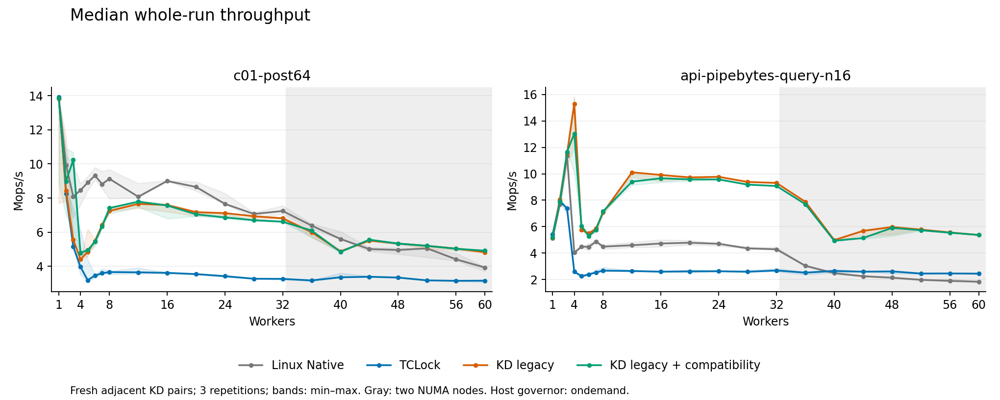
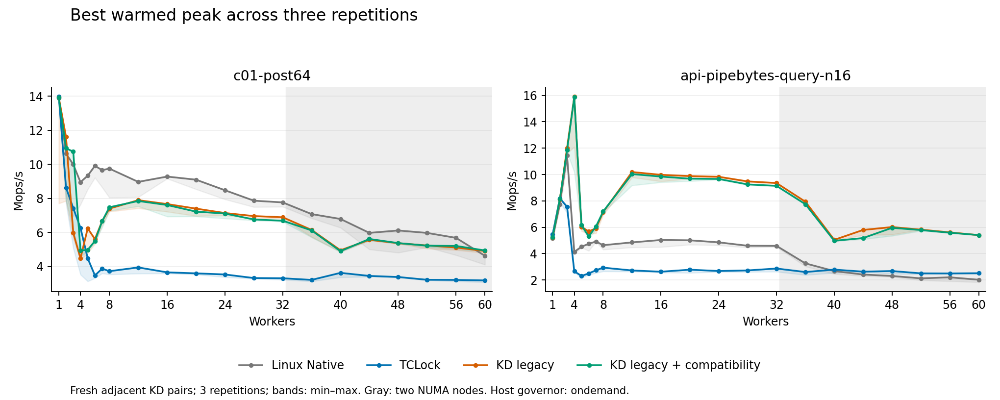

# Legacy KD mutex with compatibility backports

This compares freshly measured legacy KD mutex with the same legacy protocol
plus instruction-admission and immutable-image changes. Linux Native and TCLock
are measured controls. It covers **c01/post64** and
**api-pipebytes-query-n16**, workers **1–8 by one and 12–60 by four**, three
repetitions: **504 sessions** in the corrected attempt.

The code comparison and scope are in
[legacy_mutex_compatibility.md](../../../../../../docs/design/legacy_mutex_compatibility.md).
Baseline source is `74676c3`; the backport is on `task/legacy-mutex-compat` in
`/tmp/kdlock-mutex-legacy-compat`. The captured baseline binaries are reused but
**all timing samples in this comparison are new**. The original recovery and
baseline branches remain unchanged. The primary owned/adaptive branch and its
35 pre-existing edits are preserved.

## Results

At **60 workers**, rates in Mops/s:

| Workload | Native whole | TCLock whole | Legacy whole | Backport whole | Change | Legacy peak | Backport peak |
| --- | ---: | ---: | ---: | ---: | ---: | ---: | ---: |
| c01-post64 | 3.924 | 3.154 | 4.820 | 4.914 | +1.94% | 4.913 | 4.945 |
| api-pipebytes-query-n16 | 1.835 | 2.447 | 5.370 | 5.375 | +0.11% | 5.401 | 5.406 |

Whole is the median of three complete timed runs. Peak is the highest valid
warmed 300 ms window across those runs. These are throughput observations,
not measurements of individual lock-acquisition latency. Full min/median/max,
spread, paired ratios, worker progress and execution shares are retained.

At 60 workers, the selected compatibility features retain legacy's roughly
5.33 Mops/s pipebytes result. The fresh legacy and backport medians are within
0.11%; their adjacent-pair ratios range from 0.99795 to 1.00441. This experiment
does not show a meaningful pipebytes gain at that count. C01's median is 1.94%
higher, with all three adjacent ratios above one, but only three repetitions.

Across c01 counts 8–60, median differences range from −3.58% to +2.35%.
Pipebytes at 16–40 is 1.07–2.53% lower with the backport. Its **44-worker
regression is 9.47%** (5.682 → 5.144 Mops/s), with all three adjacent pairs
slower and a 10.62% lower best peak. At 48–56, median losses are 0.40–1.14%,
although the 48-worker repetitions vary by about 10% in both versions. These
regressions remain part of the result; the backport is not an across-the-board
performance improvement.

Low counts need particular care: c01 at three workers shows +83.93%, while the
backport's whole-run spread is 44.66% and its aggregate returned-JIT share is
5.09%, versus legacy's 19.17%. Pipebytes at four workers shows −14.76%, with
25.33% legacy spread and 43.33% backport spread. The shift between native and
JIT execution and the variability prevent treating these median ratios as
stable per-lock costs. All individual samples are retained.

Of the 252 KD sessions, 234 return JIT bodies and 18 execute no JIT bodies
(c01 at one worker; pipebytes at one and two workers, both versions). All 504
sessions pass the business-result, progress and drain checks, totaling
6,000,152,320 timed operations. No fresh owned/adaptive session was run.

See [all 21 counts](SCALING.md), [statistics](statistics.csv),
[adjacent pairs](paired-samples.csv), [raw sample summaries](samples.csv) and
[verification](verification.json).





Three repetitions do not establish a confidence interval. The host governor is
`ondemand`; the first one-worker c01 samples are slower than later repetitions,
and the low-contention cases show substantial spread. No valid sample was dropped
for being slow. JIT classification means at least one returned body; the actual
share is recorded, including cases that mostly execute natively. Small-count
NO_JIT performance is distinct from contended JIT acceptance.

## What was backported

- `98118e9`: scalar instruction/register admission, prefix-aware raw encoding
  checks, refusal of processor-state helpers, and errors instead of silent
  special-instruction omission or INT-to-NOP.
- `95bca27`, adapted to legacy: complete staged uploads, immutable mutex image
  descriptors, frame-bound generations, stale-generation miss rejection and the
  existing publication gate's IRQ save/restore discipline.
- Legacy integration: explicit preparation accepts a registered UNINIT root
  before image allocation. The matching provider/daemon/translator negotiate
  capability version 4, bit 3; ABI0/2 and the two-word wrapper input stay intact.

The lock protocol is retained. [Protocol identity](protocol-identity.json)
verifies 65 protocol, caller, workload and control files byte for byte, and that
only `kd_mutex_prepare()` changed in the legacy mutex call adapter. No owned OSQ,
sleeping producer, origin-claim or adaptive protocol was inserted. ABI4 ordinary-C
calling support remains separate interface work. The legacy workload coverage
already contains the pipe/file adapters; owned-object adapters are not needed.

Published versions consume the existing 64-block pool until session teardown;
there is no in-session reclamation. Spin/rwlock images still use in-place storage.
General flags repair, runtime pointer guards and arbitrary processor-state
virtualization are not implemented by the instruction refusal policy.

Instruction screening runs during translation, and preparation/upload precedes
timing. Immutable-image support adds frame initialization, image binding and
metadata checks to execution. This experiment measures the combined backport;
it does not isolate each feature's cost or separate instruction cost from
compiler layout and batching variation.

## Method and evidence

Both KD versions use the Linux mutex, shadow queue, pinned polling, NUMA cohorts,
1024-body batch limit, ABI2 outer cookie and unchanged business operations. The
c01 workload has the same emitted 64-round post-unlock arithmetic in every arm;
its ELF audit is replayed. The API is the same pipe-byte query over 16 entries.

Each point runs for 2 seconds after 48,000 warmup operations per worker; API warmup
also lasts at least 1 second. Peaks use 300 ms settling, a 300 ms window, 10 ms
sampling and 256-operation progress checkpoints. Worker CPUs are the prefix of
0–59, collector CPU 63. CPUs 0–31 and 32–63 are different NUMA nodes. KD pairs
are adjacent, with alternating order; control order varies by repetition.

The VM has 64 vCPUs, 24 GiB, voluntary preemption and `nokaslr nopvspin`.
Physical host `10.176.26.71` has one-to-one vCPU pins and service threads on CPU 63.
Kernel release is `6.1.159-kdclobber2`, Build ID
`5ca28058e156f34a2c7fe91e8e0fbf92f4e51960`. The snapshot is
`before-mutex-legacy-compat-20261017T122742Z`. Exact source/config/build identity,
boot policy, CPU/NUMA placement and final idle state are recorded. Timed providers
and workloads have no UBSAN imports; no kernel rebuild was performed.

[Driver](driver.py) invokes the maintained session validators against frozen
per-version providers, daemons, translators and callers. Source and binary hashes
are checked between cases. Preparation is outside timing. Candidate image ABI,
capabilities, requirements and generation are read before/after each timed KD
case; both versions retain the original business-result and drain oracles.

[Validation](validation.json) records provider/strict-daemon builds, two basic C
programs and 16 directly affected Python drivers. Tests cover processor-state
refusal, supported emitted execution, partial uploads, immutable replacement,
stale misses, exhaustion, explicit preparation, source lifetime, generic dispatch,
frame capacity and legacy ABI2/wrapper behavior. This was not a full test suite;
no fresh spin/rwlock performance result or general live concurrent-republication
stress result is claimed.

The first live attempt is retained separately. Its baseline sample succeeded;
the candidate failed explicit preparation because the old helper required a code
block before upload. It executed no timed body and retired cleanly. The helper and
its production regression test were fixed, the provider was rebuilt, and the
entire corrected matrix was run in `attempt2/`. Neither sample from the earlier
attempt enters the tables. Earlier unit-fixture failures and fixes are retained
in the validation logs as well.

`verification.json` is produced by [analyze.py](analyze.py), with the frozen
[synthetic auditor](legacy-audit.py) and [API auditor](api-audit.py). It recomputes
business oracles, worker progress/placement, peaks, source/ELF/JIT identities,
TCLock context checks, exact retirement and the paired schedule. The final archive
retains every sample and failure, source inputs, generated images, commands,
validation attempts, environment receipts and executed orchestration scripts.

The sealed raw archive is `mutex-legacy-compat-20261017T122742Z.tar.gz`, **76,774,565 bytes**,
SHA256 `cd5777d1f79894467cf3c551f31349111ad80346eac936e99e151aeaf707cb86`. It contains **20,567 regular files**
and **506 symlink records**, including the failed first attempt.
Identical bytes were verified in the guest, on physical host `10.176.26.71`,
and on source host `380G10`; paths and hashes are in [archive.json](archive.json).
The guest's logical evidence directory points to its ext4 data disk because the
root filesystem had limited free space.

[Archive checking](archive-check.json) validates every stored regular-file hash,
size and mode, plus every symlink target. Offline extraction does not materialize
external symlinks. [Source-host replay](replay.json) reproduces all 11 numerical
outputs, comparing decompressed worker CSV contents. Plots were generated in the
guest after timing and visually inspected; they are covered by the archive hash.

To replay a copy of the archive (no live modules or benchmark execution):

```sh
python3 check-archive.py /path/to/mutex-legacy-compat-20261017T122742Z.tar.gz --extract /new/path/replay
python3 analyze.py --root /new/path/replay/attempt2 --output /new/path/analysis
```

Verify the outer archive SHA256 above before extraction. Add `--plots` in an
environment with matplotlib to regenerate the figures. Exact preparation/build
scripts and all validation attempt logs are retained under the archive's
`attempt2/control/orchestration/` and `attempt2/validation/` directories.
