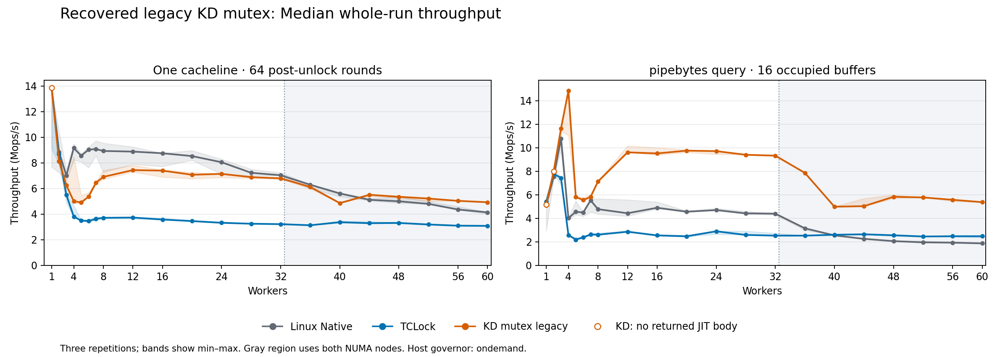

# Recovered legacy KD mutex: c01 and pipebytes, 2026-10-16

**All 378 planned sessions passed and drained.** This is a fresh three-backend
comparison of the recovered legacy mutex across the complete requested worker
range. At 60 workers, pipebytes reaches **5.379 Mops/s**, reproducing the historical
**5.330 Mops/s** result (+0.92% in this block). The prior one/60-worker recovery
check measured 5.367 Mops/s; those earlier samples remain separate.

## Results at 60 workers

Rates are **Mops/s**. Whole is the median of three repetitions; peak is the best
valid warmed 300 ms window across those repetitions.

| Workload | Native whole | TCLock whole | KD legacy whole | KD / Native | KD / TCLock | Native peak | TCLock peak | KD peak |
| --- | ---: | ---: | ---: | ---: | ---: | ---: | ---: | ---: |
| c01-post64 | 4.142 | 3.085 | 4.931 | 1.19× | 1.60× | 5.009 | 3.141 | 4.961 |
| api-pipebytes-query-n16 | 1.873 | 2.481 | 5.379 | 2.87× | 2.17× | 2.052 | 2.528 | 5.405 |

For one cacheline, KD improves median whole-run throughput by **19.1% over Native**
and **59.8% over TCLock** at 60 workers. Its best warmed peak is **0.95% below
Native**. For pipebytes, KD is **2.87× Native** and **2.17× TCLock** by median
whole-run throughput; its best peak is **2.63× Native** and **2.14× TCLock**.



## Scaling and limits

- **One cacheline:** KD is below Native's whole-run median at every tested count
  from 2 through 40. It overtakes Native at 44–60 workers, but Native retains the
  higher best warmed peak at every multithreaded count. KD beats TCLock on both
  metrics from three workers onward; it trails TCLock at one and two workers.
- **Pipebytes:** KD exceeds Native on both metrics at all 21 tested counts. It
  exceeds TCLock's whole-run median from two workers onward and its best peak
  from three workers onward. TCLock leads at one worker and has the higher peak
  at two. The four-worker KD median of 14.844 Mops/s has only **1.64% aggregate
  returned JIT work**, so that low-count gain is predominantly local execution.
- **Variation:** this is one three-repetition block. Some low-count points vary
  substantially: c01 four-worker KD whole-run spread is **72.74%**, and pipebytes
  four-worker KD spread is **26.95%**. The first single-worker Native samples are
  slower in both workloads and remain included. At 60 workers, KD spreads are
  **0.37% for c01** and **0.59% for pipebytes**. No slow sample was discarded and
  no extra runs were selected to improve a score.
- **Execution:** 117 of 126 KD sessions return JIT bodies. The remaining nine are
  the three one-worker c01 repetitions and all three repetitions at each of
  one and two pipebytes workers. All are accepted with their actual execution classification;
  none is used as proof of JIT execution. At 60 workers, aggregate measured JIT
  shares are **96.98% for c01** and **97.91% for pipebytes**.

The restored legacy implementation reproduces the requested pipebytes result.
It does not establish parity with Native for the tiny synthetic critical section
at small worker counts. The workload-dependent curves are retained without a
cross-workload aggregate or a new adaptive-policy change.

## Scope and measured source

This run measures the recovered **legacy KD mutex**, Linux Native and TCLock.
It contains 21 worker counts: **1, 2, 3, 4, 5, 6, 7, 8, 12, 16, 20, 24, 28,
32, 36, 40, 44, 48, 52, 56 and 60**, with three repetitions per backend and
workload: 189 sessions per workload, 378 total. No results from earlier runs
enter these aggregates.

The measured source is recovery commit `6ecdd0a15e42ead07451a955eaeb2506f50ee909`
plus one workload-only change: `workload_modules/spin_cacheline/post_work.h`
is the exact 64-round file from `09bfffe07f0123622b7b68ae67057339d18ca7f2`, SHA256
`2fdb17ee1afe3b88ecb8a88eb928789bef399fd7a586416bf6b49f2a9806caee`.
The recovery checkout defaults to four rounds; the requested workload document
specifies 64. All three synthetic arms execute the same 64 dependent multiply/add
pairs after unlocking. The emitted modules each contain two verified 64-round
groups, covering warmup and measurement. Pipebytes has no artificial post-work.

All **215 historical source inputs** from the original 5.330 Mops/s pipebytes
archive still match exactly. The provider, translator, direct mutex ABI2 caller,
API adapter and TCLock sources are unchanged from the
[verified recovery](../mutex-legacy-recovery-20261016T113518Z/README.md).
The legacy provider retains Linux mutex ownership, the shadow MCS queue, live
successor combining, bounded NUMA cohorts and pinned polling producers.
The later owned/adaptive mutex implementation is absent from these measured inputs.
The old synthetic runner's `-adaptive` filename suffix describes its historical
hot-lock admission policy; it does not identify the rejected owned adaptive mutex.

The original recovery worktree remains unchanged. The measured workload variant
and report live in `/tmp/kdlock-mutex-legacy-grid`, branch
`bench/legacy-mutex-c01-pipebytes`. The primary checkout's 35 pre-existing code
edits are preserved. The full 784-file pre-run source snapshot, the exact
historical subset and the requested workload document are archived.

## Workload and measurement details

| Setting | One cacheline | api-pipebytes-query-n16 |
| --- | --- | --- |
| Completed operation | Increment one shared counter on one cacheline under the selected mutex; execute 64 post-unlock arithmetic rounds | One `ioctl(FIONREAD)` on a shared pipe with 16 occupied buffers; traverse their lengths under the selected mutex |
| Warmup | 48,000 operations per worker | At least 48,000 operations and one second per worker |
| Measurement | 2,000 ms | 2,000 ms |
| Peak | Observed 300 ms full-cohort window after 300 ms settling, sampled every 10 ms | Same |
| Placement | Worker CPUs `0..N-1`; collector 63 | Same |
| KD | Recovered legacy ABI2; NUMA on; batch limit 1024; benchmark provider UBSAN off | Same provider and ABI; original embedded pipe mutex |
| Native / TCLock | Native Linux mutex / ported TCLock mutex with matching payload | Matching scoped syscall adapter; Native uses the embedded pipe mutex, TCLock uses its own object |

Native in the API comparison is the matched adapter using Linux mutex calls.
The separate unmodified `stock` syscall arm is outside this three-backend run.
The pipe is a private benchmark object; concurrent reads, writes, resize and
unbound consumers are excluded. API throughput includes the syscall and result
copy. These are operation rates, not isolated acquisition latency, and absolute
rates should be compared within each workload.

Whole-run throughput is completed operations divided by actual wall time; the
headline value is the median of three repetitions. Best warmed peak is the
highest valid window across those repetitions. Both metrics retain
min/median/max and spread `(max-min)/median × 100%`. Spread is descriptive,
not a confidence interval. NO_JIT means no measured returned JIT body; it is
retained as native-path execution, never presented as a JIT gain. Aggregates
separated by execution status are supplied.

## Environment and validation

All compilation, unit checks, live workloads and plotting ran in the recovery VM
on **10.176.26.71**. Source edits, Git and offline archive replay ran on 380G10.
The VM has exactly 64 vCPUs and 24 GiB RAM, with node 0 CPUs 0–31 and node 1
CPUs 32–63. Every vCPU is pinned to its same-numbered physical host core.
Workers at 36–60 span both NUMA nodes. Collector and QEMU service threads use
CPU 63, outside every worker cohort. The host governor remains `ondemand`.

Kernel `6.1.159-kdclobber2`, Build ID
`5ca28058e156f34a2c7fe91e8e0fbf92f4e51960`, `nokaslr nopvspin`, voluntary
preemption and the existing kernel configuration were retained. The verified
recovery snapshot is `before-mutex-legacy-grid-20261016T125529Z`.

Pre-run checks cover the two basic C programs and the cacheline, direct-runner,
peak-selection and API-report drivers. They include post-work arithmetic and
assembly checks. No full test suite or kernel rebuild was requested or run.
The replay validates every business oracle, warmup, worker affinity/progress,
sampled peak, JIT counter/publication/image and final retirement/drain record.
It also checks source, binary and captured kernel identities, TCLock emitted
context and the common 64-round generated loops. Host pins, boot identity,
source bytes and guest idle/kernel health are checked again after measurement.
An exact previously archived intentional userspace mutation-test trap is recorded
separately; new kernel faults are never waived.

## Files and reproduction

- [All 21 worker counts](SCALING.md)
- [Whole-run scaling plot](whole-throughput.png) and [SVG](whole-throughput.svg)
- [Best warmed peak plot](peak-throughput.png) and [SVG](peak-throughput.svg)
- [Every timed sample](samples.csv), [three-round statistics](statistics.csv),
  [statistics by execution status](statistics-by-execution.csv) and [KD ratios](comparison.csv)
- [Per-worker data](workers.csv.gz), including CPU time and progress
- [Replay receipt](verification.json), [validation/environment receipt](validation.json)
  and [exact commands](commands.json)
- [Source provenance](provenance.json), [archive receipt](archive.json)
  and [archive verification](archive-validation.json)
- [Read-only analyzer](analyze.py) and [API verifier](api-audit.py)

Full raw samples, source/ELF/JIT images, preparation logs and the frozen source
are retained under `bench/results/10.176.26.71/raw/bench/mutex-legacy-grid-20261016T125529Z/`
on both source and benchmark hosts. The original guest directory is
`/root/kdlock-evidence/10.176.26.71/bench/mutex-legacy-grid-20261016T125529Z`.
The tar archive is sealed by a per-file SHA256/size/mode manifest, checked in a
single sequential pass, and replayed offline after extraction.

To replay an extracted archive without loading modules:

```sh
python3 analyze.py --root /path/to/extracted/mutex-legacy-grid-20261016T125529Z \
  --output /tmp/legacy-mutex-replay
```

Plotting additionally uses `--plots` with the pinned guest Matplotlib environment.
Exact benchmark invocations are in `commands.json`; fresh live runs require the
documented idle, kernel, snapshot, placement and source checks before execution.

Publication SVG files remove only trailing whitespace; the original generated
bytes remain in the raw archive. [Normalization hashes](publication-normalization.json)
record both versions and an XML-content comparison. Worker CSV is compressed
without changing its bytes.
