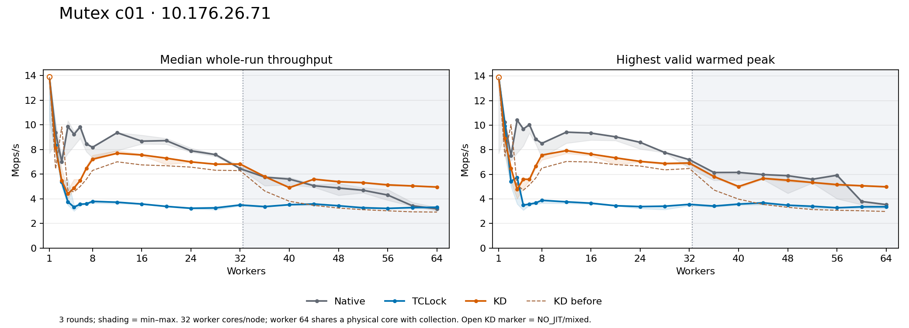
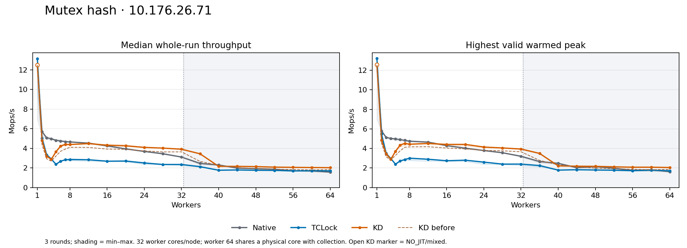

# KD mutex c01 optimization on 10.176.26.71

The selected changes reduce coordination overhead and cross-NUMA owner movement. **KD still does not match both Native and TCLock at every multithreaded point.** The tables below state the remaining gaps; neither JIT execution nor an improved historical score establishes parity.

The final comparison contains **396 drained timed sessions**, **396 accepted**: c01 and hash, Native/TCLock/KD, three rounds at all 22 worker counts from 1–64. Strict comparison uses both highest valid warmed peak and median whole-run throughput. Multithreaded point statuses: `{'FAIL': 28, 'PASS': 14}`. These are descriptive three-round comparisons, not confidence intervals.

## Causes and selected changes

1. **Per-acquisition task-record churn.** The opening code allocates a candidate and takes a bucket writer lock for each admitted acquisition, then removes the record on the final put. The selected cache reuses task identities through RCU and atomic exact reference counts. Zero references disable routing immediately. Up to eight identities per bucket remain cached; live acquisitions may temporarily exceed that bound. Eviction uses a zero-to-minus-one CAS, with actual task release after an RCU grace period. This removes repeated allocation/callback work without extending acquisition ownership.

2. **Polling coherence and cross-NUMA handoff.** Polling formerly shared a line with ABI/result metadata. Completion bytes now use the existing node tail at offsets 304/305/306; minimal packet and metadata writes use different lines. The node remains 320 bytes. FIFO execution also moved packet/body working state between sockets. Bounded local selection defers only fully linked nodes: 64-node scan budget, 128-body local cohort boundary, default 1024-body total cap. Deferred requests receive priority at the boundary. A remote cohort smaller than eight is serviced by the current owner; larger cohorts receive physical handoff. For the 32+4-worker case, avoiding an owner move for four requests was material.

3. **A widened retirement load.** Disassembly and the separate event profile found a compiler-generated 64-bit ABI/packet comparison overlapping the wrapper’s 32-bit packet-state store. Separate field-width `READ_ONCE` loads preserve the complete retirement predicate. The physical-owner predicate is also inlined without changing its Linux owner/flag mask.

The protected c01 body is very small, so queue publication, packet/frame preparation, validation, wakeup and pinned polling can cost more than Native’s local optimistic handoff. The selected changes reduce those costs; the remaining within-NUMA gap is consistent with this extra work. That is an architectural interpretation of the measured execution paths, not a precise per-instruction latency attribution. No kernel, governor, payload, admission predicate, owner proof, source lease, final ACK or wrapper ABI was weakened.

## Current comparison

Rates are Mops/s. Each table cell is **best warmed peak / median whole-run**. A complete point has three valid rounds for each backend. Full min/median/max/spread, execution types and worker/node progress are in the CSV files. Blank scores indicate incomplete acceptance rather than an estimated result.

### c01

| Workers | Native | TCLock | KD | KD / Native whole | Strict target |
| --- | --- | --- | --- | --- | --- |
| 1 | 13.902 / 13.846 | 13.969 / 13.912 | 13.916 / 13.879 | 1.002× | FAIL |
| 2 | 10.240 / 9.364 | 9.945 / 8.338 | 8.927 / 8.108 | 0.866× | FAIL |
| 3 | 7.521 / 7.008 | 5.433 / 5.350 | 6.498 / 5.462 | 0.779× | FAIL |
| 4 | 10.417 / 9.850 | 5.745 / 3.748 | 4.774 / 4.395 | 0.446× | FAIL |
| 5 | 9.694 / 9.230 | 3.493 / 3.312 | 5.609 / 4.873 | 0.528× | FAIL |
| 6 | 10.040 / 9.829 | 3.574 / 3.556 | 5.581 / 5.477 | 0.557× | FAIL |
| 7 | 8.877 / 8.456 | 3.664 / 3.579 | 6.661 / 6.464 | 0.764× | FAIL |
| 8 | 8.518 / 8.173 | 3.881 / 3.780 | 7.564 / 7.206 | 0.882× | FAIL |
| 12 | 9.433 / 9.356 | 3.758 / 3.715 | 7.928 / 7.686 | 0.822× | FAIL |
| 16 | 9.356 / 8.670 | 3.649 / 3.567 | 7.644 / 7.551 | 0.871× | FAIL |
| 20 | 9.052 / 8.712 | 3.440 / 3.375 | 7.339 / 7.289 | 0.837× | FAIL |
| 24 | 8.602 / 7.890 | 3.372 / 3.220 | 7.050 / 6.987 | 0.886× | FAIL |
| 28 | 7.773 / 7.578 | 3.403 / 3.249 | 6.880 / 6.800 | 0.897× | FAIL |
| 32 | 7.188 / 6.439 | 3.552 / 3.490 | 6.919 / 6.810 | 1.058× | FAIL |
| 36 | 6.145 / 5.749 | 3.414 / 3.357 | 5.818 / 5.798 | 1.008× | FAIL |
| 40 | 6.152 / 5.589 | 3.575 / 3.511 | 5.006 / 4.897 | 0.876× | FAIL |
| 44 | 5.977 / 5.051 | 3.680 / 3.568 | 5.668 / 5.582 | 1.105× | FAIL |
| 48 | 5.886 / 4.864 | 3.482 / 3.429 | 5.516 / 5.376 | 1.105× | FAIL |
| 52 | 5.596 / 4.684 | 3.396 / 3.256 | 5.333 / 5.301 | 1.132× | FAIL |
| 56 | 5.925 / 4.296 | 3.274 / 3.214 | 5.162 / 5.125 | 1.193× | FAIL |
| 60 | 3.788 / 3.426 | 3.351 / 3.277 | 5.066 / 5.036 | 1.470× | PASS |
| 64 | 3.533 / 3.173 | 3.355 / 3.305 | 4.983 / 4.946 | 1.559× | PASS |

### Hash

| Workers | Native | TCLock | KD | KD / Native whole | Strict target |
| --- | --- | --- | --- | --- | --- |
| 1 | 12.530 / 12.450 | 13.219 / 13.134 | 12.568 / 12.509 | 1.005× | FAIL |
| 2 | 5.793 / 5.703 | 5.480 / 5.025 | 4.850 / 4.799 | 0.842× | FAIL |
| 3 | 5.120 / 5.072 | 3.497 / 3.331 | 3.437 / 3.190 | 0.629× | FAIL |
| 4 | 5.029 / 4.979 | 2.953 / 2.902 | 2.894 / 2.873 | 0.577× | FAIL |
| 5 | 4.972 / 4.810 | 2.387 / 2.369 | 3.709 / 3.649 | 0.759× | FAIL |
| 6 | 4.902 / 4.743 | 2.722 / 2.682 | 4.343 / 4.223 | 0.890× | FAIL |
| 7 | 4.829 / 4.675 | 2.859 / 2.834 | 4.523 / 4.397 | 0.940× | FAIL |
| 8 | 4.743 / 4.651 | 3.003 / 2.850 | 4.430 / 4.386 | 0.943× | FAIL |
| 12 | 4.647 / 4.523 | 2.893 / 2.830 | 4.510 / 4.482 | 0.991× | FAIL |
| 16 | 4.285 / 4.252 | 2.738 / 2.683 | 4.409 / 4.316 | 1.015× | PASS |
| 20 | 4.025 / 3.940 | 2.795 / 2.697 | 4.412 / 4.247 | 1.078× | PASS |
| 24 | 3.784 / 3.678 | 2.599 / 2.501 | 4.140 / 4.095 | 1.113× | PASS |
| 28 | 3.558 / 3.441 | 2.394 / 2.348 | 4.047 / 4.020 | 1.168× | PASS |
| 32 | 3.197 / 3.106 | 2.397 / 2.349 | 3.940 / 3.910 | 1.259× | PASS |
| 36 | 2.655 / 2.459 | 2.245 / 2.119 | 3.489 / 3.436 | 1.397× | PASS |
| 40 | 2.475 / 2.296 | 1.779 / 1.761 | 2.211 / 2.155 | 0.939× | FAIL |
| 44 | 2.028 / 1.979 | 1.819 / 1.790 | 2.180 / 2.157 | 1.090× | PASS |
| 48 | 2.150 / 1.918 | 1.790 / 1.756 | 2.164 / 2.133 | 1.112× | PASS |
| 52 | 1.974 / 1.866 | 1.767 / 1.745 | 2.115 / 2.078 | 1.114× | PASS |
| 56 | 1.756 / 1.698 | 1.719 / 1.687 | 2.077 / 2.055 | 1.210× | PASS |
| 60 | 1.810 / 1.693 | 1.772 / 1.710 | 2.075 / 2.037 | 1.203× | PASS |
| 64 | 1.621 / 1.567 | 1.712 / 1.695 | 2.046 / 2.021 | 1.290× | PASS |

## Remaining c01 bottleneck and worker progress

At four workers, the measured JIT share is 47–75%, with 4.395 Mops/s median whole-run throughput. Session-lifetime observations (including warmup) show only 4.8–16.2 successful bodies per combiner, versus 892–972 at sixteen workers. Short batches repeatedly pay physical acquisition and queue/frame setup. The selected runtime still has that mixed native/delegation bottleneck; relative to the earlier full matrix, c01 whole-run throughput fell 44.4% at three workers and 6.3% at four workers. Hash at 40 workers fell 4.7%. The earlier three-worker c01 peak spread was 51.2%, so a historical median difference alone cannot isolate source effects from run variability. These measured regressions remain unresolved and are not evidence of universal improvement.

| c01 workers | Lowest node-1 share of a valid peak | Lowest worker whole-run operations |
| --- | --- | --- |
| 36 | 9.81% | 280,320 |
| 40 | 16.46% | 192,000 |
| 44 | 49.53% | 173,312 |
| 48 | 49.79% | 167,168 |
| 52 | 49.85% | 163,840 |
| 56 | 49.87% | 155,392 |
| 60 | 49.82% | 155,392 |
| 64 | 49.92% | 152,320 |

All workers made progress in each accepted peak window and over the complete run. Positive counts and bounded within-batch bypass do not prove starvation freedom. Node shares are observed work distribution, not scheduling guarantees.

## Before and after

The dashed plot uses the earlier `full-matrix-20261011T025525Z` KD results on the same temporary 66-vCPU geometry and payload settings. These historical samples are not pooled with the new matrix. Host frequency policy stayed `ondemand`; time-dependent frequency/load differences remain possible, which is why the final run includes fresh Native and TCLock controls. Normal 64-vCPU screening stages are separate from both full matrices.

| Payload | Workers | Previous KD whole | Current KD whole | Change |
| --- | --- | --- | --- | --- |
| mutex-cacheline-c01 | 2 | 6.417 | 8.108 | +26.4% |
| mutex-cacheline-c01 | 3 | 9.827 | 5.462 | -44.4% |
| mutex-cacheline-c01 | 4 | 4.692 | 4.395 | -6.3% |
| mutex-cacheline-c01 | 8 | 6.291 | 7.206 | +14.5% |
| mutex-cacheline-c01 | 16 | 6.742 | 7.551 | +12.0% |
| mutex-cacheline-c01 | 32 | 6.278 | 6.810 | +8.5% |
| mutex-cacheline-c01 | 36 | 4.624 | 5.798 | +25.4% |
| mutex-cacheline-c01 | 40 | 3.791 | 4.897 | +29.2% |
| mutex-cacheline-c01 | 60 | 2.932 | 5.036 | +71.8% |
| mutex-cacheline-c01 | 64 | 2.913 | 4.946 | +69.8% |
| mutex-rcuht | 2 | 4.370 | 4.799 | +9.8% |
| mutex-rcuht | 3 | 2.925 | 3.190 | +9.0% |
| mutex-rcuht | 4 | 2.691 | 2.873 | +6.8% |
| mutex-rcuht | 8 | 4.101 | 4.386 | +6.9% |
| mutex-rcuht | 16 | 3.920 | 4.316 | +10.1% |
| mutex-rcuht | 32 | 3.637 | 3.910 | +7.5% |
| mutex-rcuht | 36 | 2.659 | 3.436 | +29.2% |
| mutex-rcuht | 40 | 2.262 | 2.155 | -4.7% |
| mutex-rcuht | 60 | 1.791 | 2.037 | +13.8% |
| mutex-rcuht | 64 | 1.825 | 2.021 | +10.7% |

## Candidate screening and diagnostics

All screening used the regular 64-vCPU VM, collector 63, and only c01/hash. Each timed configuration used three rounds. Group identities remain separate in `statistics.csv`; earlier partial candidates and rejected variants are retained with their exact source/ELF/JIT hashes. The frozen group source is authoritative when a saved patch contains only one component of a candidate.

| Candidate groups | Decision and reason |
| --- | --- |
| `membership-c01` | Reject sharded waiter-count traffic change: no repeatable gain. |
| `layout-c01` | Keep completion/metadata separation as part of the selected layout. |
| `state-words-c01` | Reject packed/wider state comparisons: c01 slowed. |
| `numa128-c01`, `numa128-inline-c01` | Keep bounded NUMA selection; reject executor inlining. Later refine small-remote-cohort service. |
| `task-cache-c01` | Keep bounded RCU task-identity reuse with exact active references. |
| `lookahead4-c01` | Reject four-successor lookahead; cross-NUMA c01 slowed. Keep unchanged-owner predicate inline. |
| `packet-prefetch-c01/hash`, `stack-prefetch-hash` | Packet-only prefetch helped some c01 points but hurt hash. Restore successor SP/SP-8 hints. |
| `field-width-c01/hash` | Keep separate ABI/packet retirement loads. |
| `cohort-floor-c01/hash` | Keep current-owner service for fewer than eight deferred remote requests. |
| `frame-reuse-c01/hash` | Reject frame-header reuse flag: c01 regressed substantially. Restore full initialization. |
| `batch16-c01/hash` | Reject cap 16: cross-NUMA throughput fell. Default remains 1024; built mutex-cap metadata is now verified. |
| `cohort4-c01/hash`, `cohort2-c01/hash` | Reject capped queue admission/native fallback: some c01 gains, but hash and high-worker c01 regressed. |
| `result-layout-c01/hash` | Reject moving packet-state into the polling tail. |
| `late-retry-c01/hash` | Reject extra native retry after heat admission: unstable low-worker routing and poor four-worker c01. |

PMU runs are diagnostics, excluded from all throughput comparisons. Counters ran without multiplexing (100% enabled/running time). Aggregate events include polling workers and client overhead; dividing by completed operations is not serial critical-section latency.

| Diagnostic | KD store-forwarding blocks/op | KD store-buffer stall events/op |
| --- | --- | --- |
| final-pmu | 0.0073 | 260.07 |
| packet-prefetch-pmu | 1.2741 | 113.05 |

The forwarding event fell sharply; total store-buffer stalls did not. The earlier store-buffer event profile had zero lost samples and concentrated at the post-comparison instruction, but skid and other changed components prevent an exact causal partition. Its hardware event used fixed period 100003 and a sample format the profile parser rejected. The original failed session remains unchanged; `parser-recovery-2` separately validates client results, stable publication, returned JIT bodies, source retirement and clean unload. It is a recovered diagnostic, never a performance score.

## Validation

- Selected source: two basic programs plus mutex resource, task-cache, terminal, outer-progress and execution-capacity drivers: **7 passed, 0 failed**. Production-code fixtures cover delayed links, refusal rejoin, immediate native reuse, early release, scan/cohort bounds and exact retirement checks; existing mutation checks remain enabled.
- Live cross-NUMA task/ACK probe on CPUs 0,32,33: **two unlock orders, four ACKs, two actual RCU deferred frees**; three-worker × 4096-iteration cache stress checks three reused identities and their actual final frees. This probe executes no JIT bodies.
- Four directly affected benchmark interface/provider/mandatory-JIT/UBSAN-metadata tests passed. Additional ABI/clobber and packet checks from the component trials remain in the raw logs.
- Final matrix: **396 drained**, **396 accepted**; KD acceptance includes **126 ACTUAL_JIT** and **6 NO_JIT** sessions. NO_JIT controls do not prove delegation gain. Full status-separated aggregates are retained.
- No full test-suite rerun. The maintained benchmark supplies plain mutex JIT; nested/early mutex transitions are covered by production-code fixtures and the real owner/ACK probe, not a new live nested JIT workload. These checks do not prove starvation freedom or every concurrent schedule.

## Reproduction and evidence

Host: `10.176.26.71`; captured guest `6.1.159-kdclobber2`, `nopvspin`, `nokaslr`, voluntary preemption, original mitigations. Final workers: guest 0–31,33–64 → physical cores 0–63; collector 65 → physical 63. **At 64 workers, the collector and QEMU services share the last worker’s physical core.** The normal boot has 64 vCPUs; screening used workers from 0–61 and collector 63. No cross-topology pooling.

Each session uses 48,000 warmup operations per worker, 2,000 ms measurement, a 300 ms peak window after 300 ms settling, and the existing 64 post-work arithmetic rounds. All cacheline payloads use c01. c02/c08/c16 were never run. Mutex JIT stays enabled and existing returned-body acceptance remains enforced.

The benchmark/test archives retain the original generated report. The separately hashed final-report archive adds the restoration receipt, offline replay result and explicit regression discussion; its scored audit CSV files are unchanged.

The final source starts at `33b65ce` with the selected runtime/test changes and the same nine pre-existing working-tree edits captured at task start. `control/final-source-approved.json`, `final-source-working-tree.patch` and each group’s frozen source/binary manifests identify measured bytes. Documentation edits made during the run were not synchronized into the running inputs.

- [Every timed session](samples.csv) and [all screening statistics](statistics.csv)
- [Final comparison samples](final-samples.csv), [final statistics](final-statistics.csv), [execution-status statistics](statistics-by-execution.csv), [strict comparison ratios](comparison.csv)
- [Before/after data](before-after.csv), [PMU/profile diagnostics](diagnostics.json), [independent verification](verification.json), [captured environment](environment.json)
- [Raw archive receipts](archives.json), [offline archive replay](archive-validation.json), [normal VM restoration](vm-restoration.json)
- Portable audit: `python3 audit.py --root EXTRACTED/bench/mutex-opt-20261011T045425Z --output REPLAY`; it hashes frozen inputs and retained ELF/JIT files, independently recomputes warmed peaks, checks raw client totals/placement/progress and source retirement, and keeps the failed diagnostic distinct.
- Plots are available as PNG, SVG and PDF beside this report. `publish.py` consumes audited JSON and `previous-full-statistics.json`; report rendering ran in the guest.
