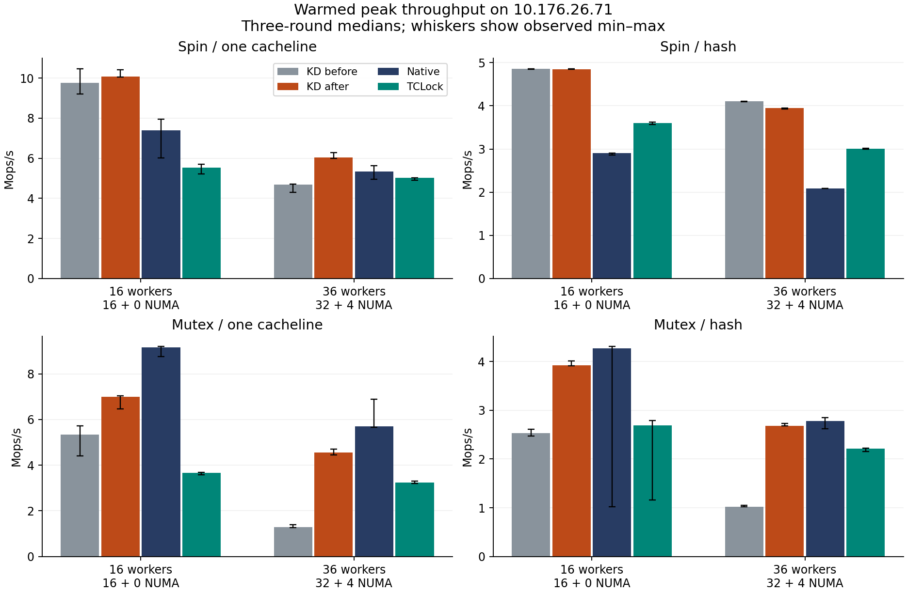
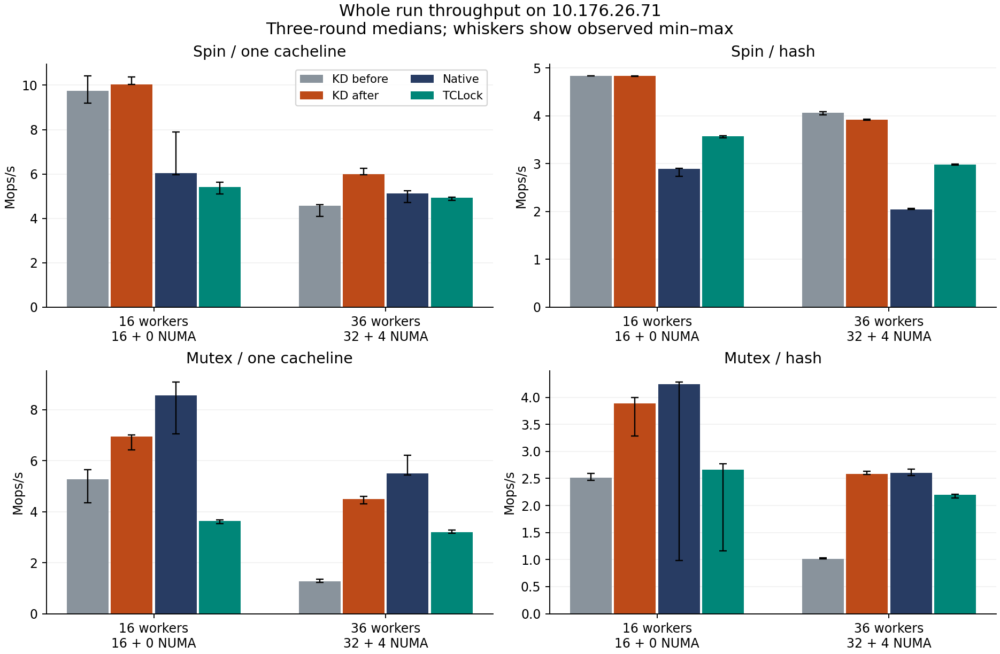

# NUMA spin and mutex investigation — 10.176.26.71, 2026-10-10

The accepted changes recover much of the new-host regression. Cross-NUMA KD spin/cacheline median peak increases **29.1%**, mutex/cacheline **253.0%**, and mutex/hash **161.9%**. Mutex still trails Linux Native; this investigation does not establish universal parity or eliminate the NUMA cliff. Spin/hash loses about **3.9%** of median peak while remote progress improves.

All **354 timed sessions** passed data, placement, positive worker progress and drain checks. Six separately instrumented sessions are diagnostics only. One provider preparation failure and rejected candidates are retained. The accepted comparison consists of the four `final-*` groups: **72 sessions**, three rounds for KD, TCLock and Native at 16 and 36 workers. No new multi-cacheline performance scenario was run.

## Causes and accepted fixes

### Spin: short batches and repeated cross-socket handoff

The existing NUMA combiner immediately stopped at an empty successor link whenever a remote chain was deferred. Returning producers therefore had no refill grace at precisely the cross-node boundary. On the new machine, spin/cacheline lifetime JIT bodies per combiner dropped from roughly 482–761 at 16 local workers to 33–39 at 36 workers. These counters include warmup; they are diagnostic batch averages, not measured-window JIT share. Repeated handoff prevents the small critical section from amortizing queue, continuation and cross-socket coherence work.

The fix permits the existing eight-PAUSE refill even when remote work is deferred, only before body 128. Later empty links hand off immediately; linked work retains the configured 1,024-body cap, finite NUMA scan and deferred-first splice. The node remains queue-owned throughout the refill. Final cross-node batch averages are 57–65, and median peak rises from 4.684 to 6.047 Mops/s. Publication-boundary, native-node and cap fixtures exercise the real helper. This is a bounded opportunity to refill, not a starvation-freedom guarantee.

### Mutex: serialized bookkeeping and avoidable cacheline ownership transfers

Three interacting costs were exposed by incremental experiments:

1. Routed acquisitions serialized exact task membership under one global raw spinlock, updated a global count on insertion/removal, and executed a locked CAS on the normally disabled allocation-fault switch. The registry now uses 256 cacheline-aligned buckets with independent locks and exact counts; task identity still selects one serialized bucket. Last put immediately removes membership and RCU retains the task until readers finish. Quiescent drain sums the exact bucket counts. The fault switch is read before its one-shot CAS.
2. The combiner wrote IP/SP and virtual registers on the waiter’s polling cacheline. Queue-tail exchanges, physical-owner checks and exact waiter accounting also shared a 32-byte gate. The node now puts registers at offset 128, away from notification bytes 64/65; its stride grows from 256 to 320 bytes. The gate separates tail, physical ownership/state and exact waiter count into three lines (192 bytes). Compile-time assertions protect the required offsets.
3. Producers repeatedly attempted locked CAS operations on an original mutex and private gate already held by the combiner. Busy-read guards now decline these attempts without requesting exclusive ownership. A zero observation still requires the original acquire CAS; Linux WAITERS/HANDOFF/PICKUP flags and races remain authoritative. The public outer helper and provider share this rule. Successor prefetch uses write hints for the hot packet and virtual stack slots while their queue lifetime is still held.

The registry change alone raised cross-node throughput but hurt local cacheline throughput. More JIT participation was therefore not sufficient: the layout and failed-CAS costs had to be addressed as well. No acquisition reference, owner check, waiter counter, source lease, final ACK or frame-retirement condition was removed.

The incremental mutex screens used three rounds per point. Median peaks (Mops/s) show why no single change was sufficient:

| Stage | c01 / 16 | c01 / 36 | hash / 16 | hash / 36 |
| --- | ---: | ---: | ---: | ---: |
| Baseline | 5.335 | 1.293 | 2.533 | 1.024 |
| Bucket registry + fault-switch read | 3.265 | 2.171 | 2.673 | 1.753 |
| + Separate packet from polling | 3.527 | 2.424 | 2.944 | 1.962 |
| + Separate gate lines | 4.606 | 2.986 | 3.324 | 2.141 |
| + Owner/gate busy-read guards | 6.795 | 4.422 | 3.937 | 2.579 |
| + Write prefetch | 6.851 | 4.638 | 3.858 | 2.730 |
| Fresh final confirmation | 6.994 | 4.563 | 3.923 | 2.682 |

Flat-IP cycle diagnostics show `native_queued_spin_lock_slowpath` falling from **69.94% to 0.08%** at 16 workers and **22.00% to 0.01%** at 36. The final dominant addresses resolve to `__kd_mutex_lock_slowpath` polling the waiter’s `locked` byte. Flat samples do not identify every calling lock; the registry attribution also relies on the source and controlled sharding experiment. Instrumentation materially changes throughput, so none of these six sessions is scored. See [profiles](profiles-before-after.txt), [exact percentages](profile-symbol-input.txt) and [matching ELF disassembly](final-mutex-poll-disassembly.txt).

## Why 380G10 looked different

| Setting | 380G10 historical run | New host focused run |
| --- | --- | --- |
| Processor | Two Xeon Gold 6133, 20 cores/socket | Two Xeon Gold 6438N, 32 cores/socket |
| 36-worker NUMA split | 20 + 16 | 32 + 4 |
| Host frequency policy | 2.5 GHz minimum = maximum | `ondemand`, 0.8–3.6 GHz limits |
| Cacheline post-work | 4 arithmetic rounds | 64 arithmetic rounds from pre-existing workspace edits |
| Guest/collector | Historical 40-vCPU arrangement | Regular 64 vCPUs, collector 63, workers exclude 63 |

All 64 current vCPU pins and the NUMA memory-binding configuration were captured and checked. The kernel Build ID is `5ca28058e156f34a2c7fe91e8e0fbf92f4e51960`; `nopvspin`, `nokaslr`, voluntary preemption and mitigations stayed unchanged. No kernel or host frequency/KVM setting was modified. The earlier temporary 66-vCPU full matrix is separate evidence. See [new-host capture](benchmark-host-environment.json) and [source-host capture](source-host-environment.json).

Placement controls used the original spin policy. Splitting the same 16 workers 8+8 across sockets reduced cacheline median peak from 9.764 to 3.351 Mops/s, confirming a cross-node problem independently of worker count. Balancing 36 workers 18+18 improved it from 4.684 to 5.647 Mops/s. Restoring four post-work rounds produced only 4.886 Mops/s at 36 workers: the post-work edit does not explain the cliff.

The old-host premise also depends on the workload and fairness. Its cacheline score stayed high at 36 workers (9.163 Mops/s), while hash already fell from 3.998 at 20 workers to 2.019 at 36. At 24 workers (20+4), the old cacheline peak gave the remote node only 0.48–0.50% of completed work; at 36 workers the split was roughly 47–49%. Thus its apparently good early cross-NUMA aggregate concealed very poor remote progress. These are historical observations from [the frozen old-host report](../../../../380G10/bench/tclock_compare/20261008-protocol-simplification/README.md), not new tests on that host.

Topology, workload and fairness explain why raw cross-host scores are not directly comparable, but do not account for the full hardware gap. The supported mechanism is sensitivity of queue refill and ownership transfers to placement and timing. No matched interconnect-latency measurement or controlled KVM PAUSE-exit experiment was performed on both hosts. KVM PLE parameters matched; that alone does not rule out different PLE behavior. A new-guest PAUSE-loop diagnostic measured roughly 20.9 ns per warm iteration including loop overhead; it is not a measurement of the old machine or proof of a PLE cause.

## Final performance

Rates below are Mops/s. Before/after use the same 64-vCPU placement and payload. Native and TCLock entries come from the fresh final comparison. Three-round min/median/max and `(max-min)/median` spread, including all low outliers, are in [statistics.csv](statistics.csv). Best peak means the highest valid warmed window; whole-run rate uses actual completed operations and wall time. These ranges are observations, not confidence intervals.

| Workload | Workers | KD median peak before → after | Change | KD median whole before → after |
| --- | ---: | ---: | ---: | ---: |
| spin/cacheline | 16 | 9.764 → 10.071 | +3.1% | 9.736 → 10.041 |
| spin/cacheline | 36 | 4.684 → 6.047 | +29.1% | 4.574 → 6.002 |
| spin/rcuht | 16 | 4.855 → 4.850 | -0.1% | 4.834 → 4.830 |
| spin/rcuht | 36 | 4.104 → 3.944 | -3.9% | 4.065 → 3.916 |
| mutex/cacheline | 16 | 5.335 → 6.994 | +31.1% | 5.279 → 6.936 |
| mutex/cacheline | 36 | 1.293 → 4.563 | +253.0% | 1.262 → 4.497 |
| mutex/rcuht | 16 | 2.533 → 3.923 | +54.9% | 2.511 → 3.891 |
| mutex/rcuht | 36 | 1.024 → 2.682 | +161.9% | 1.014 → 2.582 |

| Workload | Workers | Backend | Best peak | Median peak | Median whole |
| --- | ---: | --- | ---: | ---: | ---: |
| spin/cacheline | 16 | native | 7.960 | 7.386 | 6.048 |
| spin/cacheline | 16 | tclock | 5.706 | 5.544 | 5.420 |
| spin/cacheline | 16 | kdlock | 10.413 | 10.071 | 10.041 |
| spin/cacheline | 36 | native | 5.620 | 5.353 | 5.135 |
| spin/cacheline | 36 | tclock | 5.034 | 5.018 | 4.929 |
| spin/cacheline | 36 | kdlock | 6.280 | 6.047 | 6.002 |
| spin/rcuht | 16 | native | 2.909 | 2.908 | 2.890 |
| spin/rcuht | 16 | tclock | 3.623 | 3.601 | 3.570 |
| spin/rcuht | 16 | kdlock | 4.854 | 4.850 | 4.830 |
| spin/rcuht | 36 | native | 2.089 | 2.089 | 2.045 |
| spin/rcuht | 36 | tclock | 3.018 | 3.009 | 2.983 |
| spin/rcuht | 36 | kdlock | 3.947 | 3.944 | 3.916 |
| mutex/cacheline | 16 | native | 9.193 | 9.156 | 8.559 |
| mutex/cacheline | 16 | tclock | 3.691 | 3.652 | 3.631 |
| mutex/cacheline | 16 | kdlock | 7.029 | 6.994 | 6.936 |
| mutex/cacheline | 36 | native | 6.894 | 5.708 | 5.508 |
| mutex/cacheline | 36 | tclock | 3.295 | 3.237 | 3.187 |
| mutex/cacheline | 36 | kdlock | 4.693 | 4.563 | 4.497 |
| mutex/rcuht | 16 | native | 4.308 | 4.275 | 4.246 |
| mutex/rcuht | 16 | tclock | 2.789 | 2.688 | 2.668 |
| mutex/rcuht | 16 | kdlock | 4.010 | 3.923 | 3.891 |
| mutex/rcuht | 36 | native | 2.848 | 2.779 | 2.606 |
| mutex/rcuht | 36 | tclock | 2.220 | 2.214 | 2.199 |
| mutex/rcuht | 36 | kdlock | 2.732 | 2.682 | 2.582 |

KD spin exceeds both alternatives on best peak and median whole-run rate at all four selected points. KD mutex exceeds TCLock at these points but still falls short of Native. In particular, cross-NUMA mutex/hash is close on whole-run throughput (2.582 versus 2.606), while mutex/cacheline remains 4.497 versus 5.508. The tiny body still pays for task references, continuation capture, queue publication and completion traffic, which the current batching does not fully amortize. The sampled waiter loops alone cannot assign the remaining combiner latency to individual operations. The Native gap and cross-host attribution remain open; these fixes do not establish parity at untested worker counts.

## Progress and rejected candidates

All peak windows require positive progress from every worker. At 36 workers, spin/cacheline remote peak share changes from 5.09–5.78% to 3.00–3.23%; minimum per-worker peak completions change from 15,872–20,224 to 13,568–14,848. That is a real remaining distribution tradeoff. Spin/hash remote share increases from 0.83–0.85% to 1.64–1.72%, with the minimum rising from 2,560 to 4,608–5,120. Per-worker totals and node shares are retained in [samples.json](samples.json).

| Candidate | Observation | Decision |
| --- | --- | --- |
| Refill with no early remote limit | Cacheline cross-node median peak 8.852; remote share about 0.6%, minimum worker only 3,840–4,096 | Rejected |
| Refill limit 64 | Cross-node cacheline 5.157; minimum worker near baseline | Superseded by the measured 128-body refill grace |
| 32 PAUSEs instead of 8 | Cross-node cacheline 4.136 and hash 3.020 | Rejected; restored eight |
| Extra native-owner retry after mutex admission | No repeatable benefit | Rejected |
| Busy-read guard at spin root entry | Cacheline cross-node 9.784, but remote share 0.63–0.81% and minimum 4,608–5,376 | Rejected; spin entry remains unchanged |
| Spin busy-read guard plus firm 128-body remote cap, including linked work | Cacheline cross-node 5.915; hash collapses to 2.611 | Rejected; retained the refill-only limit |

The first gate-layout candidate failed a size assertion before source freeze or module load; the corrected three-line layout passed. The spin shadow fixture initially lacked existing ABI3 declarations; it was updated to compile the real production definitions. A later firm-cap experiment correctly failed the old configured-cap expectation; its revised handoff-chain fixture passed, but the candidate was then rejected on performance. These failed attempts remain evidence, not passing measurements.

## Reproduction and validation

Each timed configuration uses 48,000 warmup operations per worker, a 2,000 ms measurement, a valid 300 ms peak window after 300 ms settling, NUMA on, batch maximum 1,024 and provider UBSAN off. Backends alternate order over three rounds. Main cohorts use CPUs 0–15 and 0–35, collector 63. Placement and post-work controls are separately labelled. Every final KD session returned JIT bodies; publication alone is not used as execution evidence.

The source baseline is commit `375369b` plus the pre-existing workspace edits and the reviewed fixes. The original pre-existing patch, exact command lines, all frozen inputs, kernel identity bundles, ELF and JIT images are preserved in the raw archives. Do not reconstruct the measured workload from the final commit alone without those frozen inputs: the user’s 64-round post-work edits remain outside this change. After rejected experiments were reverted, all 292 frozen input hashes matched in each of the four accepted groups, including the rebuilt derived provider copy.

Validation includes the two basic programs and directly affected spin batch/shadow, mutex resource/lifetime, clobber, terminal, outer-API and outer-progress fixtures. The outer-API fixture executes real generated continuations and checks owner flags and a read/CAS race. The registry stress uses CPUs 0, 32 and 33, three workers × 4,096 iterations, a shared anchored task plus concurrent membership turnover, 8,193 deferred frees, and zero leaked membership. Its separate real-owner ACK probe checks both unlock orders and four ACKs without claiming JIT execution.

Live final regression runs at 36 workers completed 3,600,000 nested-spin operations (3,535,559 JIT bodies), 3,600,000 early-unlock operations (974,224 JIT bodies), and rwlock c01 with 2,880,000 reads plus 720,000 writes (42,359 JIT bodies). All drained. No full unit suite, new kernel build or full performance matrix was run.

The default spin/mutex runner now selects c01. The full comparison driver now selects six c01/hash groups, 1,584 sessions; an explicit `--include-multicacheline` restores the historical 3,960-session plan. The existing runner checks and exporter were validated against the historical archive and its c01/hash subset. That export check executed no new 1,584/3,960-session matrix.

## Evidence and audit

The independent audit verified **11,096 source hashes**, **229 binary hashes**, **630 JIT-image hashes**, and recomputed **354 peaks** from raw worker progress. It also checked worker and collector placement, correctness, immutable publication, exact final source retirement and drain.

- [Every timed session](samples.csv), [three-round statistics](statistics.csv), [before/after comparisons](comparison.csv), [audit result](audit.json).
- [Audit script](audit.py) with its [frozen helper](matrix-audit-helpers.py); [plot script](plots.py).
- [Archive replay](archive-replay.json) reproduced every sample/statistics CSV and JSON plus the audit result byte-for-byte from the extracted benchmark archive; translator workspace symlinks were left unfollowed.
- [Archive receipts and SHA256 values](archives.json). Raw archives are retained on both physical hosts under `bench/results/10.176.26.71/raw/{bench,tests}/numa-mutex-20261010-{bench,tests}.tar.gz`; guest originals remain under `/root/kdlock-evidence/10.176.26.71/`.
- The benchmark archive contains `bench/numa-mutex-20261010/`, including exact commands in `control/`, restored-source verification and final idle receipt. The test archive contains the live probes, unit output and scope-check results. Historical-subset symlinks retain their original targets; they do not embed or re-execute the historical matrix.

For an offline replay, extract the benchmark archive into a new directory and run `python3 audit.py --root EXTRACTED/bench/numa-mutex-20261010 --output NEW_REPORT`. The bundled helper avoids a dependency on the live checkout. Plotting requires Matplotlib and NumPy; it never starts a workload.
