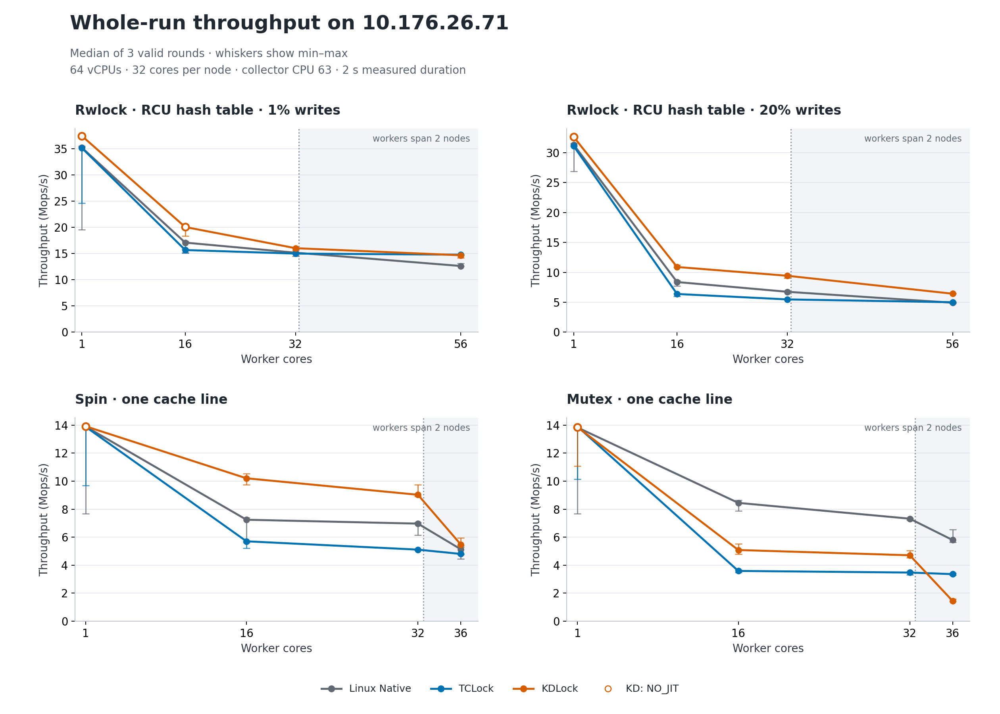
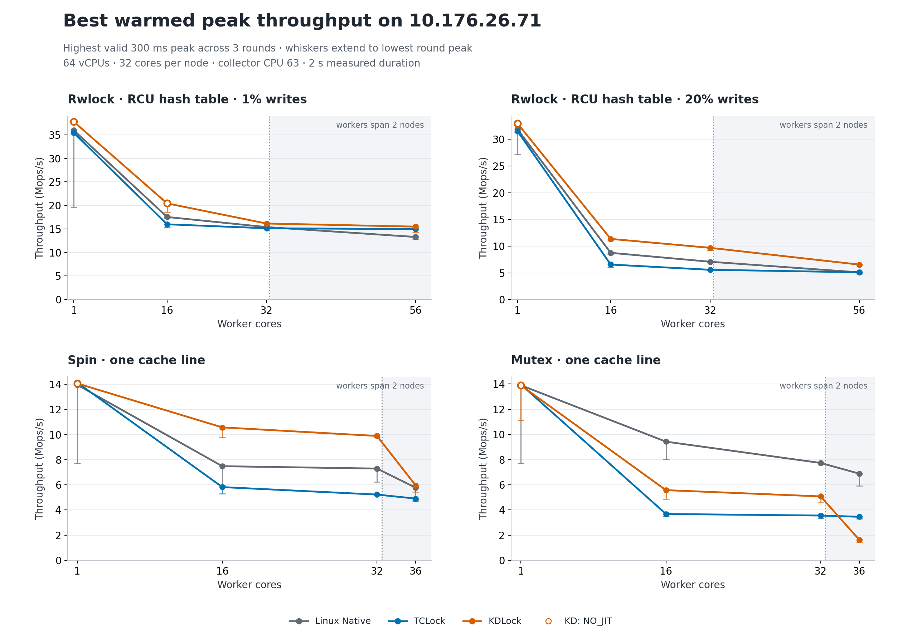

# Performance measurements on 10.176.26.71

This report covers 144 timed sessions in the 64-vCPU guest; 144 satisfy execution, business-result, full measurement and drain checks.

KD met both Linux Native and TCLock on both best warmed peak and median whole-run throughput in **10 of 16 selected configurations**. The per-case comparisons below retain every measured throughput deficit.

Selected larger-worker results, in **Mops/s**; each cell is **best warmed peak / median whole-run**. Compare backends within each row, since rwlock and spin/mutex perform different work:

| Workload | Workers | Linux Native | TCLock | KDLock |
| --- | --- | --- | --- | --- |
| Rwlock · RCU hash table · 1% writes | 56 | 13.300 / 12.618 | 14.968 / 14.773 | 15.497 / 14.665 |
| Rwlock · RCU hash table · 20% writes | 56 | 5.087 / 4.910 | 5.103 / 4.994 | 6.542 / 6.422 |
| Spin · one cache line | 36 | 5.775 / 5.136 | 4.906 / 4.802 | 5.958 / 5.476 |
| Mutex · one cache line | 36 | 6.883 / 5.794 | 3.456 / 3.359 | 1.627 / 1.444 |

At 20% writes, KD's 56-worker whole-run median exceeded TCLock by **28.58%** and
Native by **30.78%**. At 1% writes and 56 workers, its peak exceeded TCLock by
**3.53%**, but its whole-run median trailed by **0.73%**. KD spin met both
comparators at 16, 32 and 36 workers. KD mutex stayed below Native at 16 and
32 workers; at 36 workers its whole-run median was **75.08% below Native** and
**57.03% below TCLock**. These measurements locate the gaps but do not establish
that crossing the NUMA boundary alone caused them.

The VM has 32 cores per NUMA node, each vCPU pinned to the same host core. Workers use consecutive CPUs starting at 0; 32 workers fit node 0, while 36 and 56 workers span both nodes. Collector CPU 63 is excluded from workers and shares its host core with QEMU service threads.

Source was synchronized from `380G10` at Git HEAD `9f09a09a57183c1ba8a84cb1760f918c695bbbbe` **plus 9 captured working-tree edits**; the source manifest identifies the actual tested bytes. Host `Super-Server` used governor `ondemand` throughout; frequency policy was preserved.

Each backend/configuration has three rounds: 2,000 ms measured duration, 300 ms warmed peak window after a 300 ms settling interval, with 48,000 warmup operations per worker. Rwlock uses the RCU hash-table workload with 1% or 20% writes and 4 post-work rounds; spin/mutex use one shared cache line and the frozen 64-round post-work default.

Of 48 valid KD sessions, **33 returned JIT bodies and 15 were NO_JIT native controls**. Tables and open chart markers identify those controls; their throughput does not prove JIT gain. Status-separated aggregates and the original rwlock parity verdict are retained. Failed or undrained samples are excluded from scores and produce gaps in primary curves.

All rates below are **million operations per second (Mops/s)**. Peak is the highest valid warmed 300 ms window across three rounds. Whole-run is completed operations divided by measured wall time. Range columns show min / median / max. Spread is `(max − min) / median × 100%`, separately for each metric; it is observed variation, not a confidence interval.





## Rwlock · RCU hash table · 1% writes

| Workers | Backend | Valid | Best peak | Peak min / median / max | Peak spread | Whole min / median / max | Whole spread | KD returned-body evidence |
| --- | --- | --- | --- | --- | --- | --- | --- | --- |
| 1 | Linux Native | 3/3 | 35.961 | 19.618 / 35.404 / 35.961 | 46.16% | 19.513 / 35.205 / 35.547 | 45.54% | not applicable |
| 1 | TCLock | 3/3 | 35.433 | 35.363 / 35.407 / 35.433 | 0.20% | 24.656 / 35.140 / 35.308 | 30.31% | not applicable |
| 1 | KDLock | 3/3 | 37.780 | 37.728 / 37.744 / 37.780 | 0.14% | 37.413 / 37.443 / 37.605 | 0.51% | 0 JIT / 3 NO_JIT (NO_JIT) |
| 16 | Linux Native | 3/3 | 17.548 | 17.242 / 17.296 / 17.548 | 1.77% | 15.066 / 17.079 / 17.384 | 13.57% | not applicable |
| 16 | TCLock | 3/3 | 15.993 | 15.277 / 15.844 / 15.993 | 4.52% | 15.148 / 15.664 / 15.865 | 4.58% | not applicable |
| 16 | KDLock | 3/3 | 20.439 | 18.563 / 20.276 / 20.439 | 9.25% | 18.332 / 20.054 / 20.175 | 9.19% | 0 JIT / 3 NO_JIT (NO_JIT) |
| 32 | Linux Native | 3/3 | 15.400 | 15.123 / 15.282 / 15.400 | 1.81% | 14.443 / 15.157 / 15.267 | 5.43% | not applicable |
| 32 | TCLock | 3/3 | 15.150 | 15.073 / 15.127 / 15.150 | 0.51% | 14.927 / 14.986 / 14.989 | 0.41% | not applicable |
| 32 | KDLock | 3/3 | 16.160 | 15.736 / 16.155 / 16.160 | 2.62% | 15.595 / 16.019 / 16.019 | 2.64% | 3 JIT / 0 NO_JIT (ACTUAL_JIT) |
| 56 | Linux Native | 3/3 | 13.300 | 12.795 / 13.158 / 13.300 | 3.84% | 12.581 / 12.618 / 13.120 | 4.27% | not applicable |
| 56 | TCLock | 3/3 | 14.968 | 14.833 / 14.946 / 14.968 | 0.90% | 14.655 / 14.773 / 14.821 | 1.12% | not applicable |
| 56 | KDLock | 3/3 | 15.497 | 14.332 / 14.822 / 15.497 | 7.86% | 14.176 / 14.665 / 14.712 | 3.66% | 3 JIT / 0 NO_JIT (ACTUAL_JIT) |

## Rwlock · RCU hash table · 20% writes

| Workers | Backend | Valid | Best peak | Peak min / median / max | Peak spread | Whole min / median / max | Whole spread | KD returned-body evidence |
| --- | --- | --- | --- | --- | --- | --- | --- | --- |
| 1 | Linux Native | 3/3 | 31.865 | 27.139 / 31.566 / 31.865 | 14.97% | 26.916 / 31.341 / 31.610 | 14.98% | not applicable |
| 1 | TCLock | 3/3 | 31.510 | 31.293 / 31.315 / 31.510 | 0.69% | 31.084 / 31.105 / 31.348 | 0.85% | not applicable |
| 1 | KDLock | 3/3 | 32.969 | 32.923 / 32.963 / 32.969 | 0.14% | 32.594 / 32.643 / 32.659 | 0.20% | 0 JIT / 3 NO_JIT (NO_JIT) |
| 16 | Linux Native | 3/3 | 8.744 | 8.486 / 8.660 / 8.744 | 2.98% | 7.694 / 8.376 / 8.614 | 10.99% | not applicable |
| 16 | TCLock | 3/3 | 6.548 | 6.023 / 6.438 / 6.548 | 8.17% | 5.984 / 6.376 / 6.463 | 7.51% | not applicable |
| 16 | KDLock | 3/3 | 11.353 | 10.997 / 11.005 / 11.353 | 3.24% | 10.862 / 10.892 / 11.217 | 3.26% | 3 JIT / 0 NO_JIT (ACTUAL_JIT) |
| 32 | Linux Native | 3/3 | 7.076 | 6.882 / 6.914 / 7.076 | 2.80% | 6.722 / 6.745 / 6.822 | 1.49% | not applicable |
| 32 | TCLock | 3/3 | 5.570 | 5.518 / 5.530 / 5.570 | 0.94% | 5.456 / 5.469 / 5.499 | 0.79% | not applicable |
| 32 | KDLock | 3/3 | 9.682 | 9.201 / 9.547 / 9.682 | 5.03% | 9.066 / 9.424 / 9.427 | 3.83% | 3 JIT / 0 NO_JIT (ACTUAL_JIT) |
| 56 | Linux Native | 3/3 | 5.087 | 4.835 / 5.050 / 5.087 | 5.00% | 4.764 / 4.910 / 5.026 | 5.33% | not applicable |
| 56 | TCLock | 3/3 | 5.103 | 5.011 / 5.042 / 5.103 | 1.82% | 4.950 / 4.994 / 5.022 | 1.44% | not applicable |
| 56 | KDLock | 3/3 | 6.542 | 6.506 / 6.508 / 6.542 | 0.56% | 6.419 / 6.422 / 6.438 | 0.29% | 3 JIT / 0 NO_JIT (ACTUAL_JIT) |

## Spin · one cache line

| Workers | Backend | Valid | Best peak | Peak min / median / max | Peak spread | Whole min / median / max | Whole spread | KD returned-body evidence |
| --- | --- | --- | --- | --- | --- | --- | --- | --- |
| 1 | Linux Native | 3/3 | 13.949 | 7.708 / 13.944 / 13.949 | 44.76% | 7.690 / 13.897 / 13.903 | 44.71% | not applicable |
| 1 | TCLock | 3/3 | 14.131 | 13.916 / 13.931 / 14.131 | 1.55% | 9.692 / 13.875 / 14.057 | 31.46% | not applicable |
| 1 | KDLock | 3/3 | 14.062 | 13.948 / 13.953 / 14.062 | 0.82% | 13.907 / 13.914 / 14.024 | 0.84% | 0 JIT / 3 NO_JIT (NO_JIT) |
| 16 | Linux Native | 3/3 | 7.482 | 5.966 / 7.331 / 7.482 | 20.67% | 5.602 / 7.244 / 7.407 | 24.92% | not applicable |
| 16 | TCLock | 3/3 | 5.819 | 5.287 / 5.819 / 5.819 | 9.15% | 5.213 / 5.705 / 5.719 | 8.87% | not applicable |
| 16 | KDLock | 3/3 | 10.568 | 9.763 / 10.482 / 10.568 | 7.68% | 9.739 / 10.204 / 10.533 | 7.78% | 3 JIT / 0 NO_JIT (ACTUAL_JIT) |
| 32 | Linux Native | 3/3 | 7.293 | 6.237 / 7.135 / 7.293 | 14.79% | 6.150 / 6.967 / 7.054 | 12.98% | not applicable |
| 32 | TCLock | 3/3 | 5.226 | 5.172 / 5.202 / 5.226 | 1.03% | 5.082 / 5.109 / 5.115 | 0.65% | not applicable |
| 32 | KDLock | 3/3 | 9.887 | 9.770 / 9.849 / 9.887 | 1.19% | 8.913 / 9.027 / 9.745 | 9.22% | 3 JIT / 0 NO_JIT (ACTUAL_JIT) |
| 36 | Linux Native | 3/3 | 5.775 | 4.700 / 5.529 / 5.775 | 19.45% | 4.453 / 5.136 / 5.284 | 16.18% | not applicable |
| 36 | TCLock | 3/3 | 4.906 | 4.810 / 4.878 / 4.906 | 1.97% | 4.763 / 4.802 / 4.820 | 1.19% | not applicable |
| 36 | KDLock | 3/3 | 5.958 | 5.430 / 5.556 / 5.958 | 9.49% | 5.406 / 5.476 / 5.951 | 9.95% | 3 JIT / 0 NO_JIT (ACTUAL_JIT) |

## Mutex · one cache line

| Workers | Backend | Valid | Best peak | Peak min / median / max | Peak spread | Whole min / median / max | Whole spread | KD returned-body evidence |
| --- | --- | --- | --- | --- | --- | --- | --- | --- |
| 1 | Linux Native | 3/3 | 13.902 | 7.691 / 13.894 / 13.902 | 44.70% | 7.680 / 13.829 / 13.864 | 44.72% | not applicable |
| 1 | TCLock | 3/3 | 13.963 | 13.954 / 13.956 / 13.963 | 0.07% | 10.135 / 13.896 / 13.913 | 27.19% | not applicable |
| 1 | KDLock | 3/3 | 13.896 | 11.104 / 13.895 / 13.896 | 20.09% | 11.083 / 13.851 / 13.873 | 20.14% | 0 JIT / 3 NO_JIT (NO_JIT) |
| 16 | Linux Native | 3/3 | 9.426 | 8.002 / 8.810 / 9.426 | 16.16% | 7.877 / 8.448 / 8.650 | 9.15% | not applicable |
| 16 | TCLock | 3/3 | 3.678 | 3.503 / 3.618 / 3.678 | 4.83% | 3.483 / 3.588 / 3.649 | 4.64% | not applicable |
| 16 | KDLock | 3/3 | 5.571 | 4.850 / 5.145 / 5.571 | 14.01% | 4.797 / 5.082 / 5.537 | 14.56% | 3 JIT / 0 NO_JIT (ACTUAL_JIT) |
| 32 | Linux Native | 3/3 | 7.733 | 7.685 / 7.695 / 7.733 | 0.62% | 7.221 / 7.320 / 7.360 | 1.90% | not applicable |
| 32 | TCLock | 3/3 | 3.554 | 3.338 / 3.494 / 3.554 | 6.18% | 3.314 / 3.474 / 3.535 | 6.34% | not applicable |
| 32 | KDLock | 3/3 | 5.076 | 4.574 / 4.754 / 5.076 | 10.56% | 4.544 / 4.706 / 5.037 | 10.49% | 3 JIT / 0 NO_JIT (ACTUAL_JIT) |
| 36 | Linux Native | 3/3 | 6.883 | 5.926 / 6.661 / 6.883 | 14.38% | 5.643 / 5.794 / 6.541 | 15.50% | not applicable |
| 36 | TCLock | 3/3 | 3.456 | 3.302 / 3.371 / 3.456 | 4.58% | 3.280 / 3.359 / 3.442 | 4.83% | not applicable |
| 36 | KDLock | 3/3 | 1.627 | 1.446 / 1.467 / 1.627 | 12.34% | 1.419 / 1.444 / 1.600 | 12.50% | 3 JIT / 0 NO_JIT (ACTUAL_JIT) |

## Backend comparisons

Ratios compare KDLock with each backend at the same workload and worker count. A ratio above 1 means higher observed throughput. PASS requires both best warmed peak and median whole-run throughput to meet both comparators. MIXED_EXECUTION retains the descriptive ratios but does not convert mixed JIT/NO_JIT evidence into a status-separated parity pass.

| Case | Workers | KD / Native peak | KD / Native whole | KD / TCLock peak | KD / TCLock whole | Throughput status |
| --- | --- | --- | --- | --- | --- | --- |
| mutex-cacheline | 1 | 1.000× | 1.002× | 0.995× | 0.997× | FAIL |
| mutex-cacheline | 16 | 0.591× | 0.602× | 1.515× | 1.416× | FAIL |
| mutex-cacheline | 32 | 0.656× | 0.643× | 1.428× | 1.355× | FAIL |
| mutex-cacheline | 36 | 0.236× | 0.249× | 0.471× | 0.430× | FAIL |
| rwlock-rcuht 1% | 1 | 1.051× | 1.064× | 1.066× | 1.066× | PASS |
| rwlock-rcuht 1% | 16 | 1.165× | 1.174× | 1.278× | 1.280× | PASS |
| rwlock-rcuht 1% | 32 | 1.049× | 1.057× | 1.067× | 1.069× | PASS |
| rwlock-rcuht 1% | 56 | 1.165× | 1.162× | 1.035× | 0.993× | FAIL |
| rwlock-rcuht 20% | 1 | 1.035× | 1.042× | 1.046× | 1.049× | PASS |
| rwlock-rcuht 20% | 16 | 1.298× | 1.300× | 1.734× | 1.708× | PASS |
| rwlock-rcuht 20% | 32 | 1.368× | 1.397× | 1.738× | 1.723× | PASS |
| rwlock-rcuht 20% | 56 | 1.286× | 1.308× | 1.282× | 1.286× | PASS |
| spin-cacheline | 1 | 1.008× | 1.001× | 0.995× | 1.003× | FAIL |
| spin-cacheline | 16 | 1.412× | 1.409× | 1.816× | 1.789× | PASS |
| spin-cacheline | 32 | 1.356× | 1.296× | 1.892× | 1.767× | PASS |
| spin-cacheline | 36 | 1.032× | 1.066× | 1.214× | 1.140× | PASS |

## Evidence and limits

This is a bounded workload selection, not the full project test suite or benchmark matrix. It measures current source bytes in one VM boot; it does not establish gains against the original host or the earlier 60-vCPU migration run. Host governor and measured ranges remain part of the evidence rather than a claim of fixed-frequency reproducibility.

- [Raw session metrics](samples.csv)
- [Three-round statistics](statistics.csv)
- [Status-separated statistics](statistics-by-execution.csv)
- [Comparison ratios](comparison.csv)
- [Environment and provenance](evidence.json)

Commands, kernel identity, boot policy, source/ELF hashes, raw worker measurements, publication/retirement evidence and failed samples remain in the accompanying raw archive. The report exporter does not rerun or modify any benchmark.

## Captured environment and commands

| Runner | Guest kernel | Verified live Build ID | Preemption | Recovery snapshot |
| --- | --- | --- | --- | --- |
| mutex-cacheline | 6.1.159-kdclobber2 | 5ca28058e156f34a2c7fe91e8e0fbf92f4e51960 | none (voluntary) full | perf64-20261010T081816Z |
| rwlock-rcuht | 6.1.159-kdclobber2 | 5ca28058e156f34a2c7fe91e8e0fbf92f4e51960 | none (voluntary) full | perf64-20261010T081816Z |
| spin-cacheline | 6.1.159-kdclobber2 | 5ca28058e156f34a2c7fe91e8e0fbf92f4e51960 | none (voluntary) full | perf64-20261010T081816Z |

mutex-cacheline:

```sh
bench/tclock_compare/run_mutex.py --backends native tclock kdlock --workload cacheline --cachelines 1 --threads 1 16 32 36 --collector-cpu 63 --repeats 3 --duration-ms 2000 --peak-window-ms 300 --peak-settle-ms 300 --keep-going-no-jit --output /root/kdlock-evidence/10.176.26.71/bench/performance-20261010T081816Z/mutex-cacheline
```

rwlock-rcuht:

```sh
bench/rwlock_compare/run.py --backends native tclock kdlock --workloads rcuht --write-percent 1 20 --threads 1 16 32 56 --collector-cpu 63 --repeats 3 --duration-ms 2000 --peak-window-ms 300 --peak-settle-ms 300 --post-work-rounds 4 --output /root/kdlock-evidence/10.176.26.71/bench/performance-20261010T081816Z/rwlock-rcuht
```

spin-cacheline:

```sh
bench/tclock_compare/run.py --backends native tclock kdlock --workload cacheline --cachelines 1 --threads 1 16 32 36 --collector-cpu 63 --repeats 3 --duration-ms 2000 --peak-window-ms 300 --peak-settle-ms 300 --keep-going-no-jit --output /root/kdlock-evidence/10.176.26.71/bench/performance-20261010T081816Z/spin-cacheline
```

## Verification and report reproduction

All 144 sessions passed business correctness, every worker's progress, measured
placement and final ownership/frame/queue drain. The three runners exited zero,
and the final guest was running with no project workers or modules. The affected
post-work fixture passed its arithmetic and disassembly checks at 64, 4 and
256 rounds; this was one directed unittest, not the full test suite.

An independent offline audit recomputed every warmed peak from progress samples
and every whole-run rate from completed operations and wall time. All 432
reported group metrics matched that independent derivation. It also checked
806 retained frozen-source hashes, 23 binary hashes, 21 kernel-bundle hashes,
144 JIT-image hashes, approved-source consistency and all 64 host CPU pins before
and after the run. The [verification receipt](verification.json) records this
scope; the [environment record](evidence.json) retains the captured source edits,
commands, kernel Build ID, raw parity verdict and final audit.

Keep all valid rounds when interpreting these results. For example, one-worker
Native spin whole-run throughput ranged from **7.690 to 13.903 Mops/s**, a
44.71% spread under the preserved `ondemand` policy. Three two-second rounds
provide descriptive ranges; small differences such as the 0.73% rwlock median
gap should be read alongside those ranges. Absolute rates are not comparable
across the rwlock and spin/mutex workloads, or against historical runs with
different source, post-work, topology or frequency policy.

The immutable [raw archive](../../../raw/bench/performance-20261010T081816Z/evidence.tar.gz)
is retained on both physical hosts outside Git at
`bench/results/10.176.26.71/raw/bench/performance-20261010T081816Z/evidence.tar.gz`.
Its SHA256 is:

```text
ed11d709ada817645f403aadd1fb399afefb9485efd93fa1e79058c5932a8493
```

Original live output remains in the destination guest at
`/root/kdlock-evidence/10.176.26.71/bench/performance-20261010T081816Z/`.
PNG and [SVG](whole-throughput.svg) whole-run curves, plus PNG and
[SVG](peak-throughput.svg) peak curves, were rendered in the guest using
matplotlib 3.10.3 and numpy 2.2.6. The separate reporting venv did not change the
pinned benchmark environment.

To rebuild the generated tables and figures inside the VM from the preserved
archive, use [export.py](export.py) and the exact plotting
[requirements](requirements.txt). This only reads saved measurements; it does
not execute a new benchmark. The interpretation and verification notes in this
section were added after export.

```sh
report_src=/root/host_fs/kdlock/bench/results/10.176.26.71/bench/comparison/performance-20261010T081816Z
report_work=/root/kdlock-evidence/10.176.26.71/reports/performance-20261010T081816Z
python3 -m venv "$report_work/reexport-venv"
"$report_work/reexport-venv/bin/python3" -m pip install -r "$report_src/requirements.txt"
"$report_work/reexport-venv/bin/python3" "$report_src/export.py" \
  --input "$report_work/evidence.tar.gz" \
  --output "$report_work/reexport"
```
