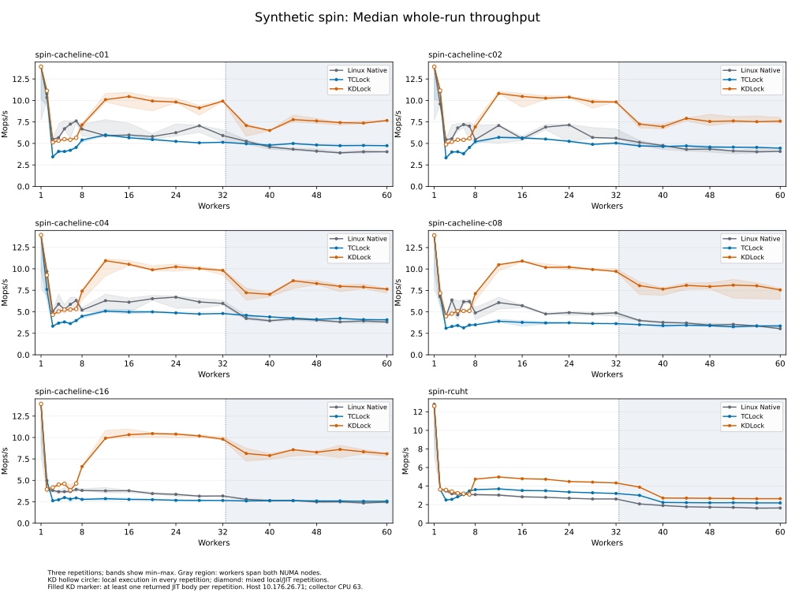
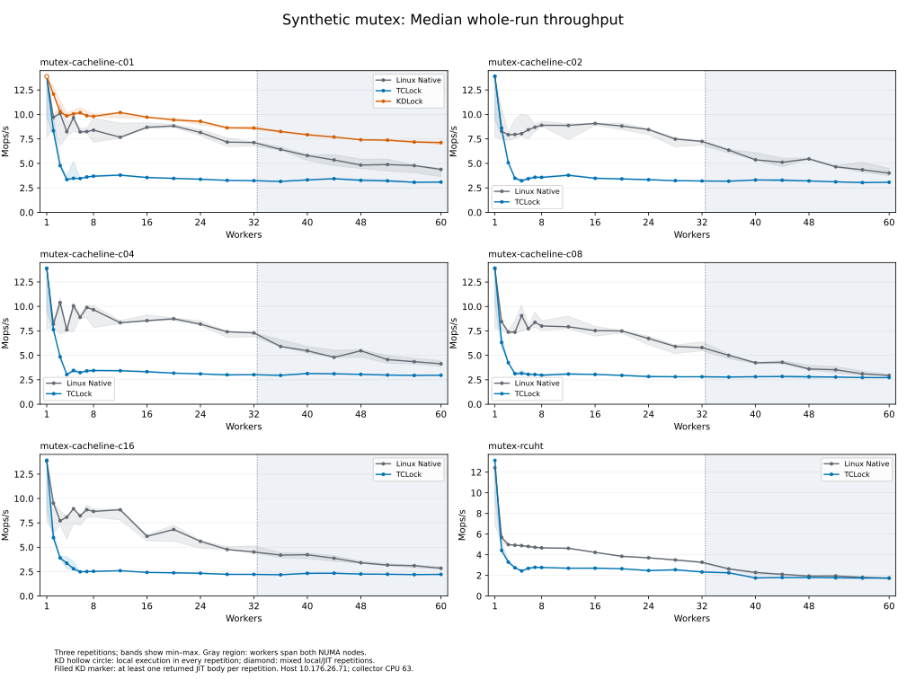
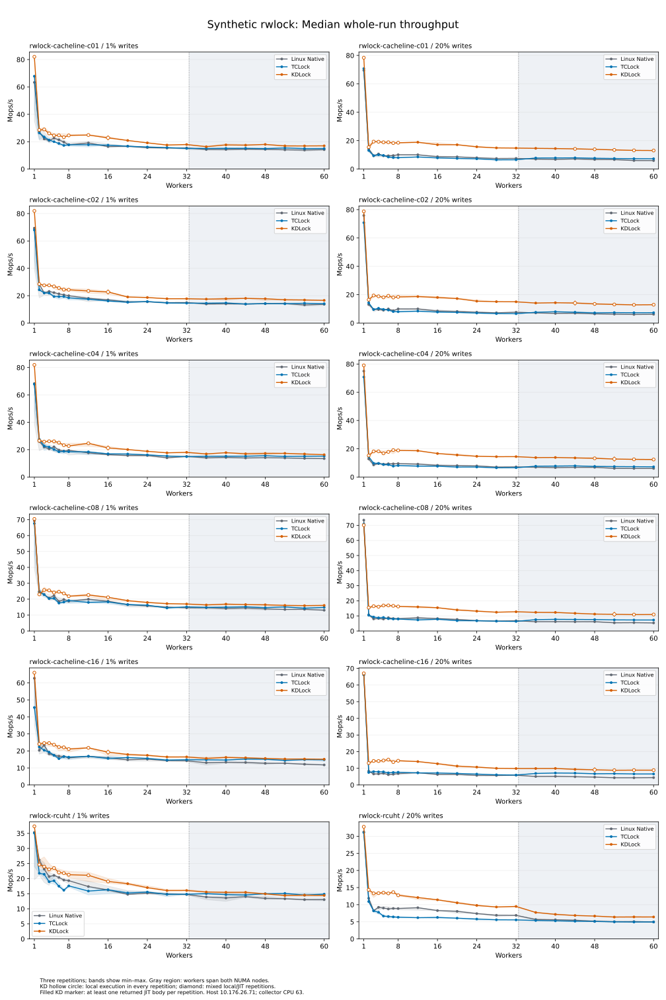
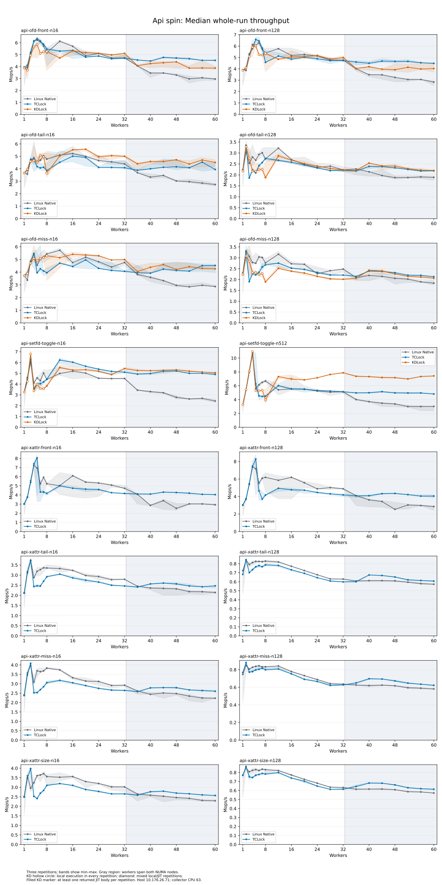
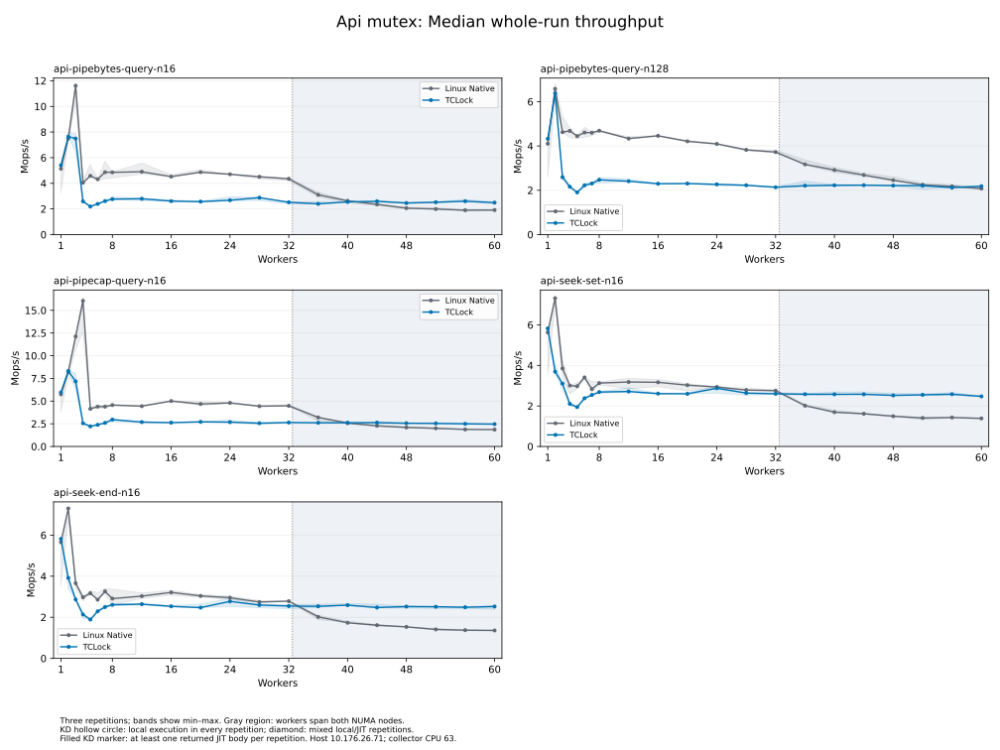
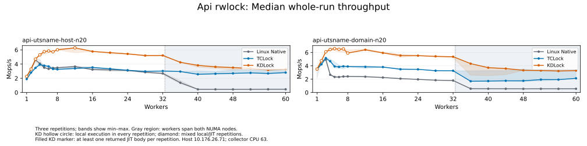

# Current kdlock microbenchmarks at 1 to 60 workers

This round planned 7,749 timed sessions across 41 workload groups. 7,749 executed, 7,749 drained, and 7,749 passed performance-data acceptance. Matrix state: **COMPLETE**.

Worker counts: **1, 2, 3, 4, 5, 6, 7, 8, 12, 16, 20, 24, 28, 32, 36, 40, 44, 48, 52, 56, 60**. Each supported backend has three fresh repetitions per configuration. No historical samples enter these comparisons.

The measured sessions ran from **2026-10-15 18:11:00 UTC to 2026-10-16 02:08:04 UTC**. The workload definitions are in [BENCHMARK_WORKLOADS.md](../../../../../../docs/BENCHMARK_WORKLOADS.md).

## Findings

The following comparisons use median whole-run throughput. The complete curves below include all requested worker counts.

- **Spinlock:** at 60 workers, KD's cacheline payloads reach 1.87–3.29× Native and 1.62–3.15× TCLock. The c16 result is 8.102 Mops/s versus 2.465 Native and 2.573 TCLock. Every repetition at these points returned JIT bodies.
- **Mutex:** at 60 workers, KD c01 reaches 7.127 Mops/s, 1.63× Native and 2.30× TCLock, with returned JIT bodies in all three repetitions. Native exceeds TCLock for all five cacheline payloads at this count; the RCUHT results are close. KD currently supports only c01 in this synthetic mutex harness.
- **Rwlock:** at 60 workers and 1% writes, KD's cacheline payloads reach 1.20–1.29× Native and 1.02–1.17× TCLock, with JIT execution in every repetition. RCUHT at 1% writes is 1.11× Native but 0.97× TCLock. All five 20%-write cacheline points at 60 workers execute locally with zero returned JIT bodies; their higher throughput does not establish a JIT gain.
- **Syscall/API:** at 60 workers, setfd n512 reaches 2.46× Native and 1.54× TCLock. OFD front queries trail TCLock at both sizes (0.86× and 0.90×), while exceeding Native. TCLock's pipe/seek results are 1.05–1.86× Native; KD is unsupported there. UTS uses different lock primitives across arms, as detailed below.
- **Regressions:** c01 spin at seven workers is 0.74× Native, with local KD execution in all repetitions. Setfd n512 at eight workers is 0.59× Native and 0.88× TCLock, with mixed JIT/local repetitions. High-worker gains do not imply gains throughout the grid.

Across the 2,583 backend/configuration points, the median whole-run spread is 4.79%; the largest is 105.69% for TCLock UTS domain at 48 workers. Spread is `(max − min) / median`. Plot bands show the observed minimum and maximum, not confidence intervals. Small differences should be interpreted with these three-repetition ranges.

## Configuration

Source: `ae4c3a7227941d6f69e5072c7e701991dec7d8ed` plus the captured uncommitted workspace changes. The source manifest and patch identify the measured bytes. The only benchmark selection change exposes the existing c02/c04 spin and Native/TCLock mutex payloads. Lock implementation bytes are the requested current workspace.

All runs use the recovery VM on physical host `10.176.26.71`, with exactly 64 vCPUs. Guest CPUs 0–31 belong to node 0 and 32–63 to node 1, pinned to same-numbered host cores. Workers use CPUs 0 through N−1; collector CPU 63 is separate at every requested count. The 36–60-worker cohorts cross NUMA nodes. Kernel: `6.1.159-kdclobber2`, `nokaslr nopvspin`, voluntary preemption, native qspinlock dispatch verified. Host governors: ondemand. Timed providers/workloads have UBSAN disabled.

Synthetic payloads cover c01/c02/c04/c08/c16 and RCUHT. Rwlocks use 1% and 20% writes. KD mutex c01 uses owned-v1, ordinary C ABI4, reuse allowance 32, and adaptive-performance acceptance; owned origin-spin and owned NUMA selection remain off. Shared spin/rwlock NUMA policy is on. API cases cover OFD front/tail/miss at n16/n128; setfd toggle at n16/n512; pipebytes query at n16/n128; pipecap query at n16; seek set/end at n16; UTS host/domain at 20% writes; and xattr front/tail/miss/size at n16/n128. API value size is 64 bytes where applicable.

## Coverage limits

- KD owned mutex performance payloads currently support c01 only. Other synthetic mutex payloads compare Native and TCLock.
- Pipe and seek API mutex cases compare Native and TCLock; KD cannot replace their kernel-owned mutex storage.
- Xattr compares Native and TCLock. The documented KD pointer/context translation refusal excludes KD from this performance matrix.
- UTS Native uses a Linux rwsem; KD/TCLock use reader/writer spinlocks around the bounded metadata body. This is the documented scoped API experiment.
- API Native means the matched compiled kernel-body substitution. The separate, unmodified Stock arm is outside this three-backend request.

## Measurement

Warmup is 48,000 operations per synthetic worker; API workers warm up for at least 48,000 operations and one second. Measurement lasts two seconds. Best warmed peak is the highest valid observed 300 ms window after 300 ms settling, with every worker progressing. Whole-run rate includes the complete measured phase and its tail. The reported whole-run rate is the median of three repetitions; min/median/max and spread are preserved in CSV. Synthetic backend order reverses in the second repetition; API backend order rotates between repetitions. Spin/mutex loops include 64 arithmetic rounds after unlocking; rwlock loops use four. Compare backends within the same workload. API rates include syscall and result-validation costs. These are throughput measurements, not acquisition latency.

Returned JIT body counts distinguish ACTUAL_JIT, KD_SELF and NO_JIT execution. A published image alone is not execution evidence. Status-separated statistics are retained; failed or incomplete three-round points have no comparison ratio. TCLock spin/rwlock delegation is unmeasured.

The fresh block contains 2,961 Native sessions, 2,961 TCLock sessions and 1,827 KD sessions. KD execution comprises **1,096 ACTUAL_JIT, 728 NO_JIT and 3 KD_SELF** sessions. All pass the configured performance-data checks; the 731 local KD sessions are controls and are not JIT execution passes.

Descriptive across-round totals can include KD local and JIT executions; these totals do not establish three-round JIT parity. Hollow KD plot markers mean all repetitions returned zero JIT bodies; diamonds mark a mixture of local and JIT repetitions. A filled KD marker means every repetition returned at least one JIT body, not that every operation was delegated.

Earlier attempts are retained separately and contribute no samples to this block. The first launch inherited ignored SIGTERM; the idle translator was stopped after zero-worker/frame checks, and source retirement and normal unload succeeded. A subsequent block stopped at rwlock setup because the runner referenced a removed provider parameter. The launcher restores default termination signals, and the rwlock runner now sets and verifies `owned_mutex_spin_limit`. Its regression tests and 1/16-worker functional checks passed before this fresh matrix. Kernel and lock implementation bytes were unchanged by these harness repairs.

## Results at 60 workers

Rates are million operations per second. Ratios above one favor KD. Full 21-point curves and all repetition data are linked below.

| Workload | Native median | TCLock median | KD median | KD / Native | KD / TCLock | KD JIT rounds |
| --- | ---: | ---: | ---: | ---: | ---: | --- |
| spin-cacheline-c01 | 4.030 | 4.738 | 7.664 | 1.90× | 1.62× | 3/3 |
| mutex-cacheline-c01 | 4.385 | 3.095 | 7.127 | 1.63× | 2.30× | 3/3 |
| rwlock-cacheline-c01 w01 | 14.180 | 14.991 | 16.984 | 1.20× | 1.13× | 3/3 |
| rwlock-cacheline-c01 w20 | 5.973 | 7.266 | 13.065 | 2.19× | 1.80× | 0/3 (local) |
| spin-cacheline-c02 | 4.068 | 4.450 | 7.595 | 1.87× | 1.71× | 3/3 |
| mutex-cacheline-c02 | 4.009 | 3.072 | — | — | — | — |
| rwlock-cacheline-c02 w01 | 13.705 | 14.128 | 16.589 | 1.21× | 1.17× | 3/3 |
| rwlock-cacheline-c02 w20 | 6.180 | 7.305 | 12.920 | 2.09× | 1.77× | 0/3 (local) |
| spin-cacheline-c04 | 3.810 | 4.070 | 7.637 | 2.00× | 1.88× | 3/3 |
| mutex-cacheline-c04 | 4.131 | 2.964 | — | — | — | — |
| rwlock-cacheline-c04 w01 | 13.443 | 15.267 | 16.294 | 1.21× | 1.07× | 3/3 |
| rwlock-cacheline-c04 w20 | 6.055 | 7.225 | 12.394 | 2.05× | 1.72× | 0/3 (local) |
| spin-cacheline-c08 | 3.041 | 3.355 | 7.564 | 2.49× | 2.25× | 3/3 |
| mutex-cacheline-c08 | 2.943 | 2.723 | — | — | — | — |
| rwlock-cacheline-c08 w01 | 13.051 | 14.836 | 16.090 | 1.23× | 1.08× | 3/3 |
| rwlock-cacheline-c08 w20 | 5.346 | 7.265 | 10.910 | 2.04× | 1.50× | 0/3 (local) |
| spin-cacheline-c16 | 2.465 | 2.573 | 8.102 | 3.29× | 3.15× | 3/3 |
| mutex-cacheline-c16 | 2.845 | 2.220 | — | — | — | — |
| rwlock-cacheline-c16 w01 | 11.767 | 14.819 | 15.126 | 1.29× | 1.02× | 3/3 |
| rwlock-cacheline-c16 w20 | 4.411 | 6.586 | 8.867 | 2.01× | 1.35× | 0/3 (local) |
| spin-rcuht | 1.637 | 2.185 | 2.641 | 1.61× | 1.21× | 3/3 |
| mutex-rcuht | 1.735 | 1.740 | — | — | — | — |
| rwlock-rcuht w01 | 13.021 | 14.840 | 14.415 | 1.11× | 0.97× | 3/3 |
| rwlock-rcuht w20 | 4.966 | 4.950 | 6.415 | 1.29× | 1.30× | 3/3 |
| api-ofd-front-n16 | 2.960 | 4.526 | 3.875 | 1.31× | 0.86× | 3/3 |
| api-ofd-front-n128 | 2.842 | 4.484 | 4.028 | 1.42× | 0.90× | 3/3 |
| api-ofd-tail-n16 | 2.739 | 3.944 | 4.515 | 1.65× | 1.14× | 3/3 |
| api-ofd-tail-n128 | 1.887 | 2.184 | 2.200 | 1.17× | 1.01× | 3/3 |
| api-ofd-miss-n16 | 2.867 | 4.524 | 4.257 | 1.49× | 0.94× | 3/3 |
| api-ofd-miss-n128 | 1.832 | 2.131 | 2.060 | 1.12× | 0.97× | 3/3 |
| api-setfd-toggle-n16 | 2.432 | 4.905 | 5.053 | 2.08× | 1.03× | 3/3 |
| api-setfd-toggle-n512 | 3.015 | 4.807 | 7.422 | 2.46× | 1.54× | 3/3 |
| api-pipebytes-query-n16 | 1.913 | 2.491 | — | — | — | — |
| api-pipebytes-query-n128 | 2.075 | 2.184 | — | — | — | — |
| api-pipecap-query-n16 | 1.857 | 2.464 | — | — | — | — |
| api-seek-set-n16 | 1.385 | 2.471 | — | — | — | — |
| api-seek-end-n16 | 1.360 | 2.525 | — | — | — | — |
| api-utsname-host-n20 | 0.450 | 2.802 | 3.278 | 7.29× | 1.17× | 3/3 |
| api-utsname-domain-n20 | 0.554 | 2.123 | 3.289 | 5.94× | 1.55× | 3/3 |
| api-xattr-front-n16 | 2.927 | 4.036 | — | — | — | — |
| api-xattr-front-n128 | 2.858 | 4.052 | — | — | — | — |
| api-xattr-tail-n16 | 2.142 | 2.471 | — | — | — | — |
| api-xattr-tail-n128 | 0.573 | 0.607 | — | — | — | — |
| api-xattr-miss-n16 | 2.230 | 2.602 | — | — | — | — |
| api-xattr-miss-n128 | 0.582 | 0.623 | — | — | — | — |
| api-xattr-size-n16 | 2.289 | 2.570 | — | — | — | — |
| api-xattr-size-n128 | 0.572 | 0.614 | — | — | — | — |

## Scaling curves

### Synthetic spin

[Best warmed peak](synthetic-spin-peak.svg)

### Synthetic mutex

[Best warmed peak](synthetic-mutex-peak.svg)

### Synthetic rwlock

[Best warmed peak](synthetic-rwlock-peak.svg)

### API spin

[Best warmed peak](api-spin-peak.svg)

### API mutex

[Best warmed peak](api-mutex-peak.svg)

### API rwlock

[Best warmed peak](api-rwlock-peak.svg)

## Evidence

- [Every session](samples.csv)
- [Three-round statistics](statistics.csv)
- [Statistics by execution type](statistics-by-execution.csv)
- [Unscored controls](no-jit-controls.csv) (empty; all local KD controls were accepted under the configured performance-data policy)
- [Comparison ratios](comparisons.csv)
- [Per-worker progress and CPU time](workers.csv.gz) (gzip-compressed CSV)
- [NUMA-node progress](node-progress.csv)
- [Workload coverage](coverage.csv)
- [Independent audit](verification.json)
- [Run commands](matrix-plan.json)
- [Source identity](source-state.json)
- [Source hashes](source-sha256.json)
- [Captured workspace changes](workspace.patch.gz) (gzip-compressed patch)
- [Offline auditor](analyze.py)
- [Rwlock harness regression tests](test-rwlock-fix.log)
- [Rwlock harness functional checks](rwlock-fix-functional.json)
- [Excluded predecessor archive](predecessor-archive.json)
- [Complete raw archive checksum and location](archive.json)
- [Archive transfer and report verification](publication.json)

Complete raw evidence is retained under `/root/kdlock-evidence/10.176.26.71/bench/workloads-20261015T180603Z` in the guest and the matching machine-specific raw archive. The audit verifies source, module and JIT image hashes, CPU placement, returned-body retirement, and independently recomputes accepted warmed peaks from raw progress samples.

The 569,064,406-byte raw archive is retained on both the benchmark host and source host at `bench/results/10.176.26.71/raw/bench/workloads-20261015T180603Z/workloads-20261015T180603Z.tar.gz`. Its SHA256 is `9467977a5f277746f765f8207b4c575cf954882c04c0ae6225da4178ec8acc32`. The source-host copy matches the benchmark-host checksum; all 57 original report files also match the archive. This compact report preserves the CSV tables, compresses the worker table and source patch losslessly, and omits redundant JSON tables. The full original report remains in the archive. Earlier attempts are archived separately and excluded from every comparison here.

Each chart has both SVG and PNG files in this directory. [Published file hashes](files.sha256) cover the compact report and its evidence receipts.

- [Host before measurement](host-before.json)
- [Guest before measurement](guest-before.json)
- [Host after measurement](host-after.json)
- [Guest after measurement](guest-after.json)
