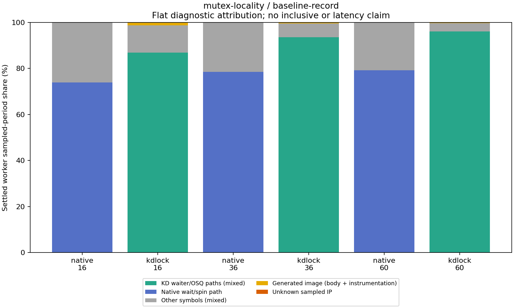

# 16 resident cache lines, post64: record diagnostics

These are instrumented, exploratory observations, one per point. Every generated record has `score_eligible=false`; throughput here is diagnostic and is not a replacement for the unprofiled benchmark.

[Full-precision table](table.csv) · [Archive/hash and exact replay audit](audit.json)

| Workers | Backend | Diagnostic Mops/s | Worker CPU µs/op | Jain fairness | Max/min completed | Returned write share |
|---:|:---|---:|---:|---:|---:|---:|
| 16 | native | 2.587 | 5.630 | 0.9999 | 1.041 | 0.00% |
| 16 | kdlock | 2.031 | 7.828 | 0.9993 | 1.089 | 97.51% |
| 36 | native | 2.797 | 11.551 | 0.9631 | 1.970 | 0.00% |
| 36 | kdlock | 3.629 | 9.852 | 0.9936 | 1.362 | 98.96% |
| 60 | native | 2.015 | 25.070 | 0.9511 | 2.458 | 0.00% |
| 60 | kdlock | 3.835 | 15.530 | 0.9960 | 1.147 | 97.91% |

| Workers | Backend | Settled worker samples | Generated image period | Unknown period | Lost-event lines |
|---:|:---|---:|---:|---:|---:|
| 16 | native | 12860 | 0.00% | 0.00% | 0 |
| 16 | kdlock | 13534 | 1.25% | 0.01% | 0 |
| 36 | native | 29281 | 0.00% | 0.00% | 0 |
| 36 | kdlock | 30431 | 0.47% | 0.00% | 0 |
| 60 | native | 46657 | 0.00% | 0.00% | 0 |
| 60 | kdlock | 50620 | 0.30% | 0.00% | 0 |

[Top 20 sampled IPs per point and source attribution](hotspots.csv); [conservative grouped shares](hotspot-groups.csv). Full per-IP detail remains in the raw analysis JSON. Grouping uses resolved inline function names. The KD waiter/OSQ group includes polling, waiter enter/exit accounting and queue bookkeeping; it is not a pure polling fraction. Mixed acquisition/unlock routines remain mixed. Samples are filtered to `rb_worker` on its assigned CPU between `max(active_started_ns) + peak_settle_ns` and the earliest deadline/worker finish. Both perf and the client use `CLOCK_MONOTONIC`; `perf script --ns` retains nanosecond timestamps. Shares weight each sample by its reported event period. No borrowed-stack unwinding is used. Generated ranges, unknown IPs and lost-event records remain explicit.

Worker CPU/op is the sum of each worker’s recorded CPU time divided by completed operations; it includes scheduled waiting and operation/post-work. Jain fairness describes completed work distribution, not acquisition order or latency. Requester NUMA nodes do not identify the JIT executor. Reciprocal throughput is an aggregate completion interval, not operation latency.

Virtual PMU behavior, sampling skid and instrumentation can change contention and observed costs. The VM smoke probe included unknown user IPs even for `cycles:k`; those are retained. Flat symbols containing several code paths cannot by themselves separate polling from service. One observation gives no variability estimate; strict host timing qualification remains failed.

Frozen source: `c438bb2566245993e274ffb9c1f1e30196b426cb`. Exact replay validated 6 measurements and 6 warmups, with ordinary final count, source/frame retirement and provider drain checks. Full receipts and reproducible analysis remain at `bench/results/10.176.26.71/raw/bench/mutex-profile-20261026/receipts/baseline-record/mutex-locality` and `bench/results/10.176.26.71/raw/bench/mutex-profile-20261026/analysis/scripts/e259ea85d9af4c720a72c0a2c555ea5f9d8f5c07cf6064d3c8dcfd4babf413fd.py`.
