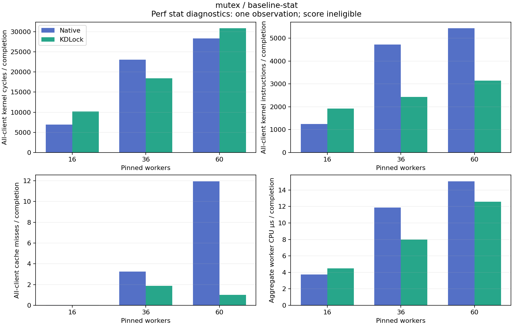

# Minimal pair, post4: stat diagnostics

These are instrumented, exploratory observations, one per point. Every generated record has `score_eligible=false`; throughput here is diagnostic and is not a replacement for the unprofiled benchmark.

[Full-precision table](table.csv) · [Archive/hash and exact replay audit](audit.json)

| Workers | Backend | Diagnostic Mops/s | Worker CPU µs/op | Jain fairness | Max/min completed | Returned write share |
|---:|:---|---:|---:|---:|---:|---:|
| 16 | native | 3.786 | 3.755 | 0.9266 | 3.085 | 0.00% |
| 16 | kdlock | 3.567 | 4.472 | 0.9997 | 1.067 | 97.74% |
| 36 | native | 2.198 | 11.880 | 0.9845 | 1.680 | 0.00% |
| 36 | kdlock | 4.468 | 8.000 | 0.9938 | 1.367 | 98.57% |
| 60 | native | 1.213 | 15.064 | 0.9957 | 1.328 | 0.00% |
| 60 | kdlock | 4.708 | 12.585 | 0.9962 | 1.160 | 97.26% |

| Workers | Backend | Kernel cycles/op | Kernel instructions/op | Cycles/instruction | Cache misses/op | Cache miss fraction | Branch miss fraction |
|---:|:---|---:|---:|---:|---:|---:|---:|
| 16 | native | 6921.18 | 1245.20 | 5.558 | 0.0293 | 0.47% | 0.30% |
| 16 | kdlock | 10158.72 | 1916.38 | 5.301 | 0.0232 | 0.13% | 0.65% |
| 36 | native | 23098.57 | 4720.19 | 4.894 | 3.2496 | 17.66% | 0.18% |
| 36 | kdlock | 18419.98 | 2430.57 | 7.578 | 1.8668 | 8.89% | 0.52% |
| 60 | native | 28395.81 | 5430.17 | 5.229 | 11.9505 | 38.74% | 0.28% |
| 60 | kdlock | 30875.57 | 3140.33 | 9.832 | 0.9966 | 4.53% | 0.41% |

Perf stat covers the measured client and inherited threads, including client startup and collection. Preparation and warmup are excluded. Hardware events use `:k`; software events retain their requested scope. Dividing these all-client counts by completed operations does not isolate the protected body. All reported events must have valid runtime metadata; multiplexing is retained explicitly in the CSV.

Worker CPU/op is the sum of each worker’s recorded CPU time divided by completed operations; it includes scheduled waiting and operation/post-work. Jain fairness describes completed work distribution, not acquisition order or latency. Requester NUMA nodes do not identify the JIT executor. Reciprocal throughput is an aggregate completion interval, not operation latency.

Virtual PMU behavior, sampling skid and instrumentation can change contention and observed costs. The VM smoke probe included unknown user IPs even for `cycles:k`; those are retained. Flat symbols containing several code paths cannot by themselves separate polling from service. One observation gives no variability estimate; strict host timing qualification remains failed.

Frozen source: `c438bb2566245993e274ffb9c1f1e30196b426cb`. Exact replay validated 6 measurements and 6 warmups, with ordinary final count, source/frame retirement and provider drain checks. Full receipts and reproducible analysis remain at `bench/results/10.176.26.71/raw/bench/mutex-profile-20261026/receipts/baseline-stat/mutex` and `bench/results/10.176.26.71/raw/bench/mutex-profile-20261026/analysis/scripts/e259ea85d9af4c720a72c0a2c555ea5f9d8f5c07cf6064d3c8dcfd4babf413fd.py`.
