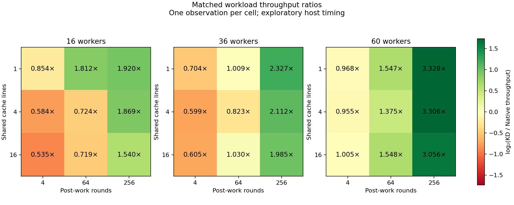
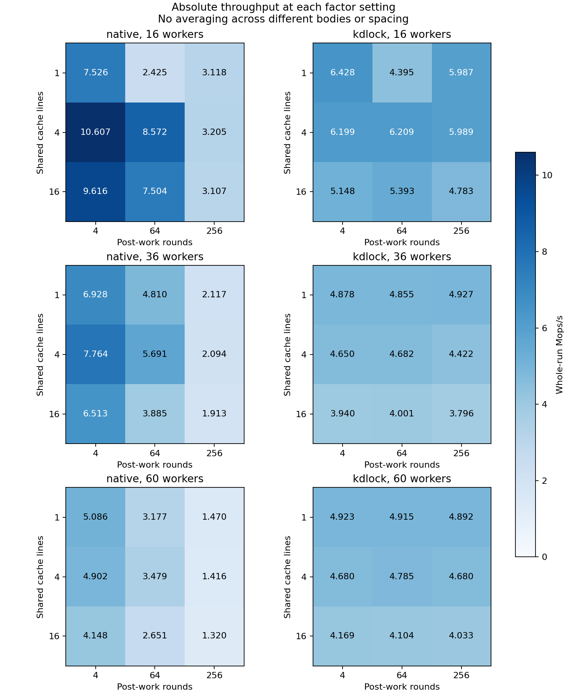

# Mutex body-size and spacing factors

The grid measures three shared working sets and three post-lock spacings at 16, 36 and 60 workers, using Native and KD. All 54 points are separate single-round unprofiled observations from one frozen source. Strict host timing qualification remains failed.

| Post-work rounds | Body tables |
|---:|:---|
| 4 | [1 cache line](factor2-post4/cacheline-c01/README.md), [4 cache lines](factor2-post4/cacheline-c04/README.md), [16 cache lines](factor2-post4/cacheline-c16/README.md) |
| 64 | [1 cache line](factor2-post64/cacheline-c01/README.md), [4 cache lines](factor2-post64/cacheline-c04/README.md), [16 cache lines](factor2-post64/cacheline-c16/README.md) |
| 256 | [1 cache line](factor2-post256/cacheline-c01/README.md), [4 cache lines](factor2-post256/cacheline-c04/README.md), [16 cache lines](factor2-post256/cacheline-c16/README.md) |

[Full-precision matrix](matrix.csv) · [Combined audit](audit.json). Each rate includes its configured post-work. A favorable ratio can result from Native throughput falling more than KD; it is not automatically an increase in KD throughput. These workload choices are separate factors, not repetitions or production optimizations.

[Spacing and completed-work fairness](FAIRNESS.md) compares all nine matched coordinates. Native wins eight of nine tight-spacing cases with substantially less equal worker completion counts. Post256 makes Native nearly equal in eight cases, but KD wins all nine rates. Native's throughput falls 58.57–73.03% from post4 to post256 while KD changes −7.10% to +0.99%. Rapid Native reacquisition and producer/combiner overlap are source-supported hypotheses; the archived totals do not measure acquisition sequences or overlap directly.

Frozen source: `b0d12ba86ca33dd71aaf5bc12b932f21c0b89525`. All 54 measurements and 54 warmups passed exact frozen-oracle replay
and drain checks. Diagnostic-off provider executable sections, plus the matched c16/post64 workload modules, were compared separately with the c438bb25 baseline; detailed byte hashes and equality results are in `bench/results/10.176.26.71/raw/bench/mutex-profile-20261026/analysis/factor-code-identity.json`. Source and full binary identities remain separate.

[Initial build failure retained separately](factor-post4/README.md).
