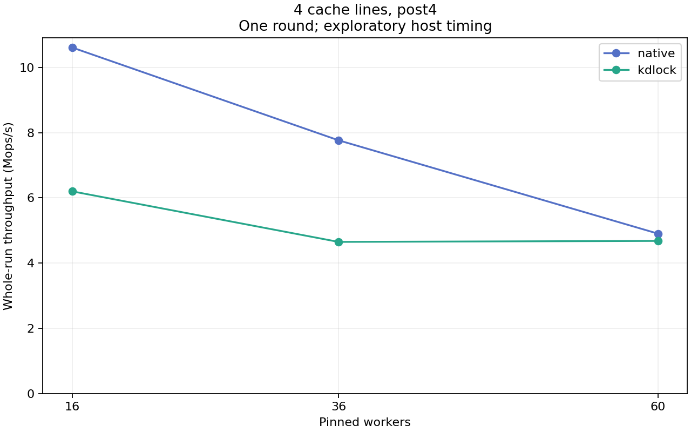

# 4 resident cache lines, post4

One unprofiled observation per point. Strict host timing qualification remains failed. The shared write body and post-lock work run through the existing bulk ioctl shell.

| Workers | Native Mops/s | KD Mops/s | KD / Native | KD returned share |
|---:|---:|---:|---:|---:|
| 16 | 10.607 | 6.199 | 0.584 | 94.64% |
| 36 | 7.764 | 4.650 | 0.599 | 96.91% |
| 60 | 4.902 | 4.680 | 0.955 | 96.73% |

[Full-precision table](table.csv) · [Stage exact replay/hash audit](../audit.json)

Frozen source: `b0d12ba86ca33dd71aaf5bc12b932f21c0b89525`. Each write updates 4 padded counters (256 shared bytes); post-work rounds: 4. The table includes all completed operations. Returned-share classification uses exact returned-body counter deltas; publication alone is insufficient.

Both warmup and measurement passed the frozen oracle, exact payload/count checks and source/frame drain. Worker CPU/op is aggregate worker CPU time, including scheduled waiting; fairness is completed-work distribution. No repeat uncertainty or acquisition latency is measured. Changes across body size or spacing are separate factor settings and are never averaged together.
