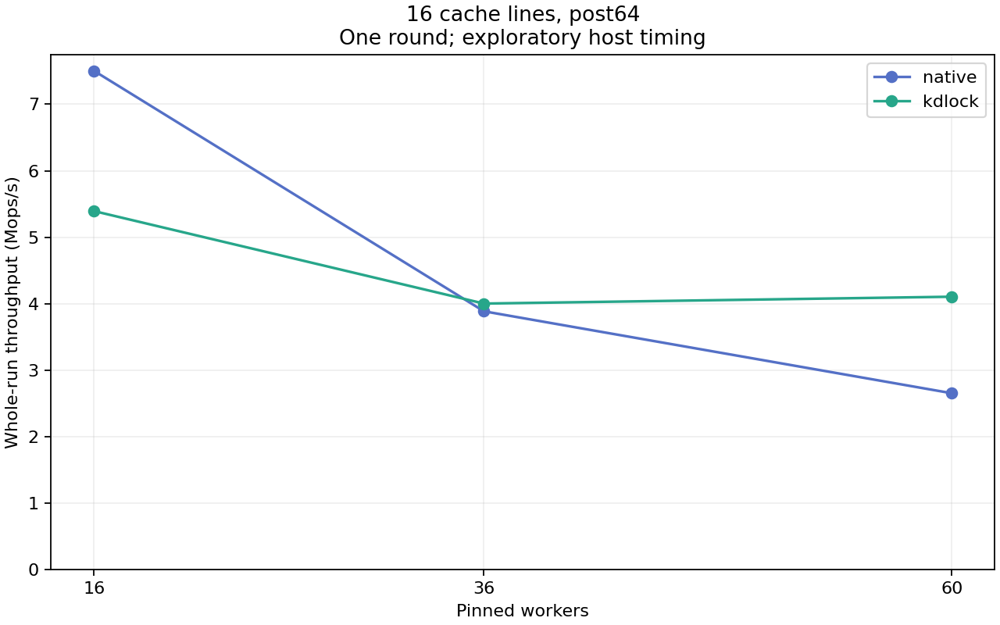

# 16 resident cache lines, post64

One unprofiled observation per point. Strict host timing qualification remains failed. The shared write body and post-lock work run through the existing bulk ioctl shell.

| Workers | Native Mops/s | KD Mops/s | KD / Native | KD returned share |
|---:|---:|---:|---:|---:|
| 16 | 7.504 | 5.393 | 0.719 | 99.01% |
| 36 | 3.885 | 4.001 | 1.030 | 99.02% |
| 60 | 2.651 | 4.104 | 1.548 | 98.25% |

[Full-precision table](table.csv) · [Stage exact replay/hash audit](../audit.json)

Frozen source: `b0d12ba86ca33dd71aaf5bc12b932f21c0b89525`. Each write updates 16 padded counters (1024 shared bytes); post-work rounds: 64. The table includes all completed operations. Returned-share classification uses exact returned-body counter deltas; publication alone is insufficient.

Both warmup and measurement passed the frozen oracle, exact payload/count checks and source/frame drain. Worker CPU/op is aggregate worker CPU time, including scheduled waiting; fairness is completed-work distribution. No repeat uncertainty or acquisition latency is measured. Changes across body size or spacing are separate factor settings and are never averaged together.
