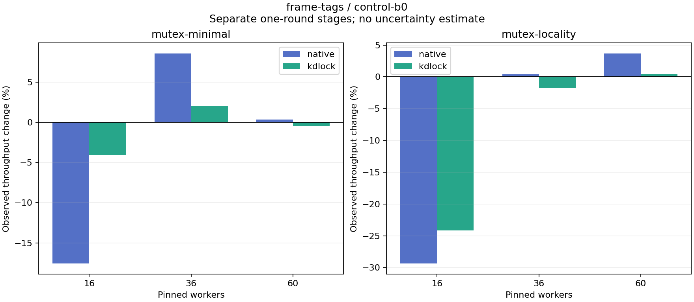

# frame-tags versus control-b0

Each stage supplies one observation per workload/backend/worker count. The tables show raw rates and observed changes separately for Native and KD; they do not estimate a normalized or causal code gain.

| Body | Workers | Native control Mops/s | Native candidate Mops/s | Native change | KD control Mops/s | KD candidate Mops/s | KD change |
|:---|---:|---:|---:|---:|---:|---:|---:|
| mutex-minimal | 16 | 9.076 | 7.480 | -17.58% | 6.461 | 6.200 | -4.05% |
| mutex-minimal | 36 | 6.942 | 7.536 | +8.56% | 4.883 | 4.983 | +2.04% |
| mutex-minimal | 60 | 5.288 | 5.307 | +0.35% | 5.001 | 4.979 | -0.43% |
| mutex-locality | 16 | 2.846 | 2.010 | -29.37% | 4.579 | 3.472 | -24.17% |
| mutex-locality | 36 | 3.589 | 3.603 | +0.40% | 3.870 | 3.802 | -1.78% |
| mutex-locality | 60 | 2.609 | 2.705 | +3.67% | 4.124 | 4.143 | +0.46% |

| Body | Workers | Backend | Control Jain fairness | Candidate Jain fairness | Control returned share | Candidate returned share |
|:---|---:|:---|---:|---:|---:|---:|
| mutex-minimal | 16 | native | 0.9174 | 0.8779 | 0.00% | 0.00% |
| mutex-minimal | 16 | kdlock | 0.9986 | 0.9991 | 94.43% | 96.02% |
| mutex-minimal | 36 | native | 0.8326 | 0.8367 | 0.00% | 0.00% |
| mutex-minimal | 36 | kdlock | 0.9935 | 0.9952 | 98.76% | 98.03% |
| mutex-minimal | 60 | native | 0.9218 | 0.8983 | 0.00% | 0.00% |
| mutex-minimal | 60 | kdlock | 0.9960 | 0.9960 | 97.35% | 97.17% |
| mutex-locality | 16 | native | 0.9663 | 0.9750 | 0.00% | 0.00% |
| mutex-locality | 16 | kdlock | 0.9990 | 0.9999 | 98.73% | 98.72% |
| mutex-locality | 36 | native | 0.5017 | 0.5712 | 0.00% | 0.00% |
| mutex-locality | 36 | kdlock | 0.9933 | 0.9934 | 99.11% | 99.13% |
| mutex-locality | 60 | native | 0.7702 | 0.7458 | 0.00% | 0.00% |
| mutex-locality | 60 | kdlock | 0.9958 | 0.9958 | 98.15% | 98.07% |

[Full-precision rates, fairness and aggregate worker CPU/op](table.csv) · [Source/input audit](audit.json)

Control source: `b0d12ba86ca33dd71aaf5bc12b932f21c0b89525`. Candidate source: `96fc5e89d608a843025d17c1893577a99e54357b`. Each source snapshot was byte-checked against its commit, and each stage passed frozen oracle/hash/drain replay. No source versions or rounds are averaged. Fairness describes completed-work distribution; returned share counts successful completed JIT bodies. Strict host timing qualification remains failed.
