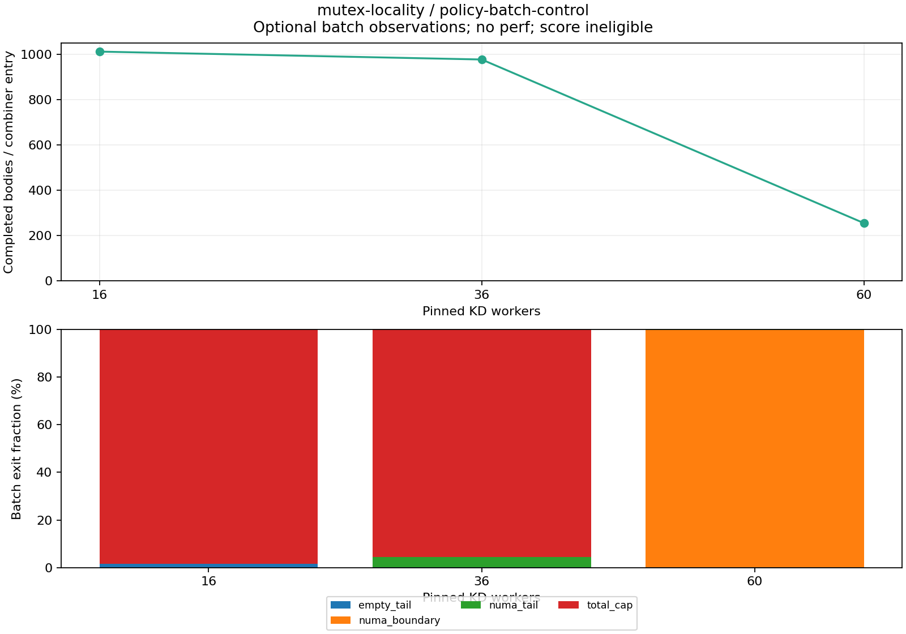

# 16 resident cache lines, post64: batch diagnostics

These are instrumented, exploratory observations, one per point. Every generated record has `score_eligible=false`; throughput here is diagnostic and is not a replacement for the unprofiled benchmark.

[Full-precision table](table.csv) · [Archive/hash and exact replay audit](audit.json)

| Workers | Backend | Diagnostic Mops/s | Worker CPU µs/op | Jain fairness | Max/min completed | Returned write share |
|---:|:---|---:|---:|---:|---:|---:|
| 16 | kdlock | 4.233 | 3.754 | 0.9994 | 1.119 | 98.89% |
| 36 | kdlock | 3.861 | 9.268 | 0.9932 | 1.390 | 98.97% |
| 60 | kdlock | 4.085 | 14.582 | 0.9958 | 1.150 | 98.17% |

| Workers | Batches | Completed bodies/batch | Zero-body batches | Remote returned JIT bodies | Deferrals/batch | Small FIFO batches |
|---:|---:|---:|---:|---:|---:|---:|
| 16 | 8306 | 1013.232 | 0.00% | 0.00% | 0.000 | 0.00% |
| 36 | 7854 | 978.353 | 0.00% | 8.55% | 5.176 | 95.56% |
| 60 | 31546 | 255.592 | 0.00% | 0.02% | 29.940 | 0.09% |

Observed provider policy: total cap 1024, NUMA boundary 256, deferred handoff 8, scan budget 64.

[Exact histogram bins](batch-histograms.csv) · [Exit reasons](batch-stops.csv). This optional compiled instrumentation launches no perf process and collects no PMU counts. Snapshots are taken quiescently after warmup and after the measured client joins. Every per-bin delta is monotone; histogram, stop-reason, legacy and exact returned-body identities are validated. Additional offline checks bound attempts by batches times the declared cap, reject occupied bins above that cap, and bound completed work by the cap-clipped histogram upper sum. These aggregate checks do not prove per-batch ownership. Mean batch size divides returned JIT plus completed native continuation bodies by all combiner entries, including zero-body entries. Remote returned JIT means requester node differs from executor node immediately before entry, not that a sleepable body stayed on that node. Legacy handoff counts only refusal paths, not all physical-owner transfers.

Worker CPU/op is the sum of each worker’s recorded CPU time divided by completed operations; it includes scheduled waiting and operation/post-work. Jain fairness describes completed work distribution, not acquisition order or latency. Requester NUMA nodes do not identify the JIT executor. Reciprocal throughput is an aggregate completion interval, not operation latency.

Optional compiled observations can change contention and observed costs. No PMU or sample attribution is collected in this mode. One observation gives no variability estimate; strict host timing qualification remains failed.

Frozen source: `f61ddc1a05e2542476d48116e491846610f1a79e`. Exact replay validated 3 measurements and 3 warmups, with ordinary final count, source/frame retirement and provider drain checks. Full receipts and reproducible analysis remain at `bench/results/10.176.26.71/raw/bench/mutex-profile-20261026/receipts/policy-batch-control/mutex-locality` and `bench/results/10.176.26.71/raw/bench/mutex-profile-20261026/analysis/scripts/3a88a1530d3621e4bac48c034fff947c4def31937eddcde8dd9895eb4421a4d4.py`.
