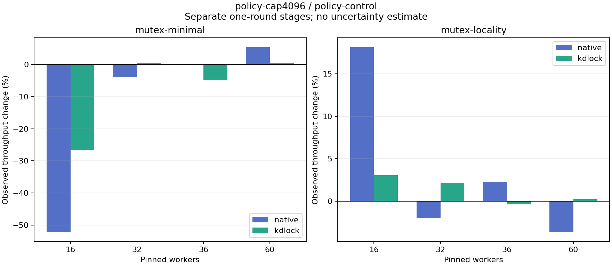

# policy-cap4096 versus policy-control

Each stage supplies one observation per workload/backend/worker count. The tables show raw rates and observed changes separately for Native and KD; they do not estimate a normalized or causal code gain.

| Body | Workers | Native control Mops/s | Native candidate Mops/s | Native change | KD control Mops/s | KD candidate Mops/s | KD change |
|:---|---:|---:|---:|---:|---:|---:|---:|
| mutex-minimal | 16 | 8.221 | 3.932 | -52.17% | 6.560 | 4.808 | -26.70% |
| mutex-minimal | 32 | 8.416 | 8.082 | -3.97% | 5.785 | 5.807 | +0.37% |
| mutex-minimal | 36 | 7.468 | 7.456 | -0.16% | 4.929 | 4.696 | -4.72% |
| mutex-minimal | 60 | 5.309 | 5.595 | +5.37% | 4.904 | 4.932 | +0.58% |
| mutex-locality | 16 | 3.404 | 4.021 | +18.15% | 5.002 | 5.155 | +3.07% |
| mutex-locality | 32 | 4.535 | 4.443 | -2.03% | 4.610 | 4.708 | +2.13% |
| mutex-locality | 36 | 4.088 | 4.180 | +2.25% | 3.768 | 3.753 | -0.39% |
| mutex-locality | 60 | 2.730 | 2.630 | -3.65% | 4.100 | 4.111 | +0.25% |

| Body | Workers | Backend | Control Jain fairness | Candidate Jain fairness | Control returned share | Candidate returned share |
|:---|---:|:---|---:|---:|---:|---:|
| mutex-minimal | 16 | native | 0.9101 | 0.8595 | 0.00% | 0.00% |
| mutex-minimal | 16 | kdlock | 0.9991 | 0.9999 | 95.08% | 98.99% |
| mutex-minimal | 32 | native | 0.8358 | 0.8013 | 0.00% | 0.00% |
| mutex-minimal | 32 | kdlock | 1.0000 | 0.9998 | 98.77% | 99.66% |
| mutex-minimal | 36 | native | 0.8348 | 0.8071 | 0.00% | 0.00% |
| mutex-minimal | 36 | kdlock | 0.9937 | 0.9994 | 98.32% | 99.56% |
| mutex-minimal | 60 | native | 0.9006 | 0.9449 | 0.00% | 0.00% |
| mutex-minimal | 60 | kdlock | 0.9960 | 0.9960 | 97.32% | 97.40% |
| mutex-locality | 16 | native | 0.9846 | 0.9666 | 0.00% | 0.00% |
| mutex-locality | 16 | kdlock | 0.9997 | 0.9964 | 98.89% | 99.70% |
| mutex-locality | 32 | native | 0.4325 | 0.3682 | 0.00% | 0.00% |
| mutex-locality | 32 | kdlock | 1.0000 | 1.0000 | 99.11% | 99.76% |
| mutex-locality | 36 | native | 0.3697 | 0.2075 | 0.00% | 0.00% |
| mutex-locality | 36 | kdlock | 0.9933 | 0.9996 | 99.11% | 99.74% |
| mutex-locality | 60 | native | 0.8223 | 0.7102 | 0.00% | 0.00% |
| mutex-locality | 60 | kdlock | 0.9954 | 0.9958 | 98.28% | 98.21% |

[Full-precision rates, fairness and aggregate worker CPU/op](table.csv) · [Source/input audit](audit.json)

Control source: `f61ddc1a05e2542476d48116e491846610f1a79e`. Candidate source: `f61ddc1a05e2542476d48116e491846610f1a79e`. Each source snapshot was byte-checked against its commit, and each stage passed frozen oracle/hash/drain replay. No source versions or rounds are averaged. Fairness describes completed-work distribution; returned share counts successful completed JIT bodies. Strict host timing qualification remains failed.

Recorded KD policies: baseline: cap=1024, NUMA boundary=256; candidate: cap=4096, NUMA boundary=256. Actual row policies and frozen binary identities remain separate.
