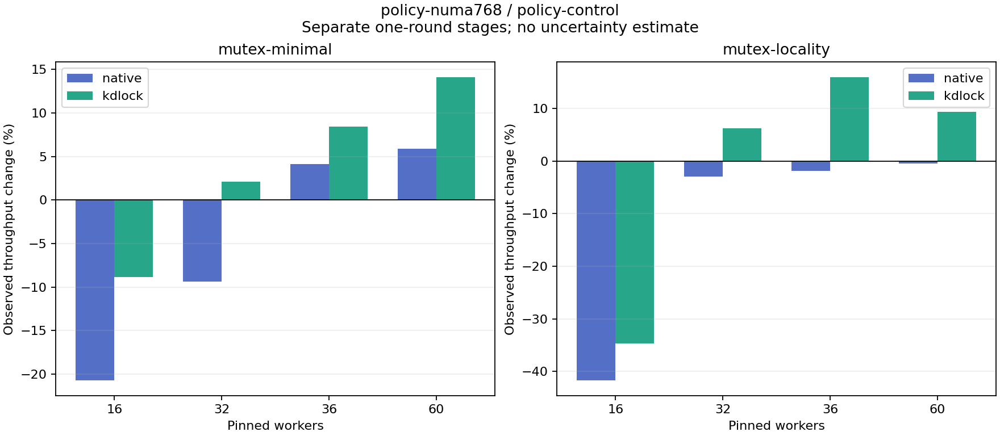

# policy-numa768 versus policy-control

Each stage supplies one observation per workload/backend/worker count. The tables show raw rates and observed changes separately for Native and KD; they do not estimate a normalized or causal code gain.

| Body | Workers | Native control Mops/s | Native candidate Mops/s | Native change | KD control Mops/s | KD candidate Mops/s | KD change |
|:---|---:|---:|---:|---:|---:|---:|---:|
| mutex-minimal | 16 | 8.221 | 6.518 | -20.72% | 6.560 | 5.979 | -8.86% |
| mutex-minimal | 32 | 8.416 | 7.627 | -9.38% | 5.785 | 5.908 | +2.11% |
| mutex-minimal | 36 | 7.468 | 7.777 | +4.13% | 4.929 | 5.343 | +8.41% |
| mutex-minimal | 60 | 5.309 | 5.623 | +5.91% | 4.904 | 5.595 | +14.10% |
| mutex-locality | 16 | 3.404 | 1.983 | -41.73% | 5.002 | 3.269 | -34.64% |
| mutex-locality | 32 | 4.535 | 4.402 | -2.92% | 4.610 | 4.895 | +6.19% |
| mutex-locality | 36 | 4.088 | 4.012 | -1.85% | 3.768 | 4.369 | +15.95% |
| mutex-locality | 60 | 2.730 | 2.717 | -0.49% | 4.100 | 4.486 | +9.40% |

| Body | Workers | Backend | Control Jain fairness | Candidate Jain fairness | Control returned share | Candidate returned share |
|:---|---:|:---|---:|---:|---:|---:|
| mutex-minimal | 16 | native | 0.9101 | 0.9056 | 0.00% | 0.00% |
| mutex-minimal | 16 | kdlock | 0.9991 | 0.9953 | 95.08% | 95.39% |
| mutex-minimal | 32 | native | 0.8358 | 0.9316 | 0.00% | 0.00% |
| mutex-minimal | 32 | kdlock | 1.0000 | 0.9999 | 98.77% | 98.57% |
| mutex-minimal | 36 | native | 0.8348 | 0.8037 | 0.00% | 0.00% |
| mutex-minimal | 36 | kdlock | 0.9937 | 0.9508 | 98.32% | 97.43% |
| mutex-minimal | 60 | native | 0.9006 | 0.9210 | 0.00% | 0.00% |
| mutex-minimal | 60 | kdlock | 0.9960 | 0.9958 | 97.32% | 99.02% |
| mutex-locality | 16 | native | 0.9846 | 0.9757 | 0.00% | 0.00% |
| mutex-locality | 16 | kdlock | 0.9997 | 1.0000 | 98.89% | 98.96% |
| mutex-locality | 32 | native | 0.4325 | 0.5785 | 0.00% | 0.00% |
| mutex-locality | 32 | kdlock | 1.0000 | 1.0000 | 99.11% | 99.06% |
| mutex-locality | 36 | native | 0.3697 | 0.3265 | 0.00% | 0.00% |
| mutex-locality | 36 | kdlock | 0.9933 | 0.9403 | 99.11% | 99.13% |
| mutex-locality | 60 | native | 0.8223 | 0.7627 | 0.00% | 0.00% |
| mutex-locality | 60 | kdlock | 0.9954 | 0.9959 | 98.28% | 99.41% |

[Full-precision rates, fairness and aggregate worker CPU/op](table.csv) · [Source/input audit](audit.json)

Control source: `f61ddc1a05e2542476d48116e491846610f1a79e`. Candidate source: `f61ddc1a05e2542476d48116e491846610f1a79e`. Each source snapshot was byte-checked against its commit, and each stage passed frozen oracle/hash/drain replay. No source versions or rounds are averaged. Fairness describes completed-work distribution; returned share counts successful completed JIT bodies. Strict host timing qualification remains failed.

Recorded KD policies: baseline: cap=1024, NUMA boundary=256; candidate: cap=1024, NUMA boundary=768. Actual row policies and frozen binary identities remain separate.
