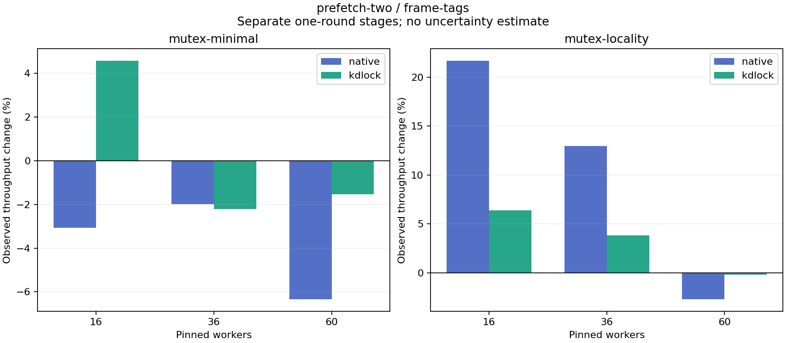

# prefetch-two versus frame-tags

Each stage supplies one observation per workload/backend/worker count. The tables show raw rates and observed changes separately for Native and KD; they do not estimate a normalized or causal code gain.

| Body | Workers | Native control Mops/s | Native candidate Mops/s | Native change | KD control Mops/s | KD candidate Mops/s | KD change |
|:---|---:|---:|---:|---:|---:|---:|---:|
| mutex-minimal | 16 | 7.480 | 7.251 | -3.07% | 6.200 | 6.483 | +4.57% |
| mutex-minimal | 36 | 7.536 | 7.387 | -1.98% | 4.983 | 4.873 | -2.21% |
| mutex-minimal | 60 | 5.307 | 4.970 | -6.34% | 4.979 | 4.902 | -1.54% |
| mutex-locality | 16 | 2.010 | 2.446 | +21.67% | 3.472 | 3.694 | +6.37% |
| mutex-locality | 36 | 3.603 | 4.069 | +12.94% | 3.802 | 3.947 | +3.84% |
| mutex-locality | 60 | 2.705 | 2.632 | -2.71% | 4.143 | 4.134 | -0.20% |

| Body | Workers | Backend | Control Jain fairness | Candidate Jain fairness | Control returned share | Candidate returned share |
|:---|---:|:---|---:|---:|---:|---:|
| mutex-minimal | 16 | native | 0.8779 | 0.9025 | 0.00% | 0.00% |
| mutex-minimal | 16 | kdlock | 0.9991 | 0.9993 | 96.02% | 96.02% |
| mutex-minimal | 36 | native | 0.8367 | 0.8284 | 0.00% | 0.00% |
| mutex-minimal | 36 | kdlock | 0.9952 | 0.9928 | 98.03% | 98.26% |
| mutex-minimal | 60 | native | 0.8983 | 0.9113 | 0.00% | 0.00% |
| mutex-minimal | 60 | kdlock | 0.9960 | 0.9959 | 97.17% | 97.38% |
| mutex-locality | 16 | native | 0.9750 | 0.9818 | 0.00% | 0.00% |
| mutex-locality | 16 | kdlock | 0.9999 | 0.9999 | 98.72% | 98.62% |
| mutex-locality | 36 | native | 0.5712 | 0.6386 | 0.00% | 0.00% |
| mutex-locality | 36 | kdlock | 0.9934 | 0.9934 | 99.13% | 99.10% |
| mutex-locality | 60 | native | 0.7458 | 0.7678 | 0.00% | 0.00% |
| mutex-locality | 60 | kdlock | 0.9958 | 0.9958 | 98.07% | 98.20% |

[Full-precision rates, fairness and aggregate worker CPU/op](table.csv) · [Source/input audit](audit.json)

Control source: `96fc5e89d608a843025d17c1893577a99e54357b`. Candidate source: `9ec2be096842cd3338b669c11f94d6a2fa355d7b`. Each source snapshot was byte-checked against its commit, and each stage passed frozen oracle/hash/drain replay. No source versions or rounds are averaged. Fairness describes completed-work distribution; returned share counts successful completed JIT bodies. Strict host timing qualification remains failed.
