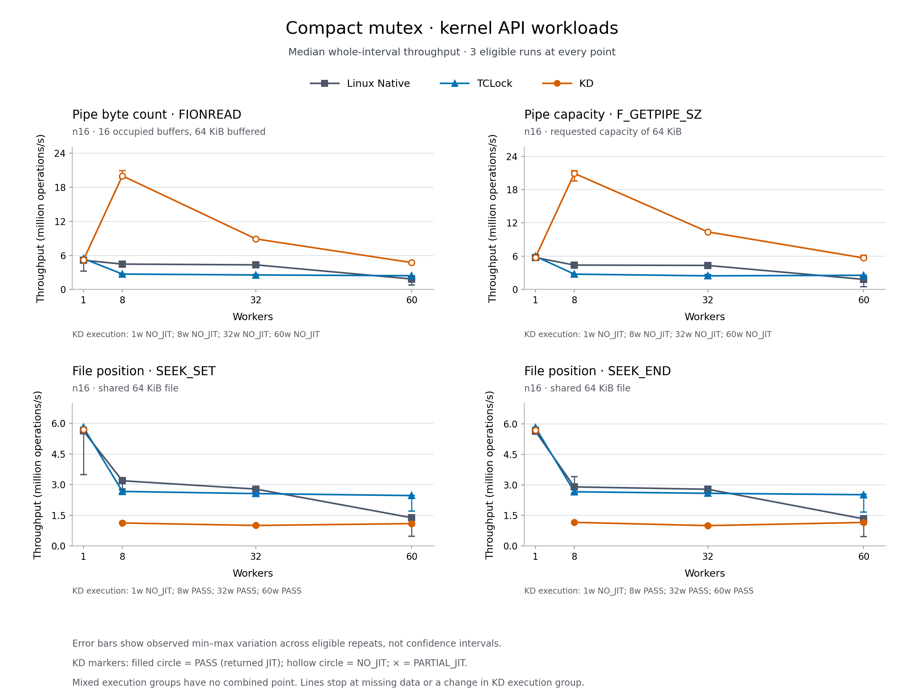

# Compact mutex: additional kernel API workloads

All **144 sessions passed and drained**. The compact KD mutex beats both
controls at every tested contended pipe-query point, using local physical
locking with **zero measured JIT entries**. Both seek variants return JIT
bodies under contention, but their KD whole-run medians trail Native and TCLock
at every tested contended point. These are different execution categories.

This screen compares the `7713897` compact, 32-byte KD mutex against fresh
Linux Native and TCLock controls. The source checkout is `a803592`; that later
commit contains the preceding synthetic report, without runtime changes.

## Median whole-run throughput

Rates are million completed syscalls per second (Mops/s), larger is better.
Each cell contains three valid repetitions. Ratios compare medians; the JIT
share is the sum of measured returned bodies divided by completed operations,
not a peak-window share. `PASS` in the final column means a returned JIT body
was observed; `NO_JIT` is valid local-path timing without delegation evidence.

| Workload | Workers | Native | TCLock | KD | KD / Native | KD / TCLock | KD execution / returned JIT share |
| --- | ---: | ---: | ---: | ---: | ---: | ---: | --- |
| pipebytes-query | 1 | 5.149 | 5.430 | 5.205 | 1.011× | 0.958× | NO_JIT / 0.0% |
| pipebytes-query | 8 | 4.470 | 2.717 | 19.995 | 4.473× | 7.360× | NO_JIT / 0.0% |
| pipebytes-query | 32 | 4.337 | 2.557 | 8.899 | 2.052× | 3.480× | NO_JIT / 0.0% |
| pipebytes-query | 60 | 1.844 | 2.423 | 4.735 | 2.567× | 1.954× | NO_JIT / 0.0% |
| pipecap-query | 1 | 5.758 | 5.970 | 5.775 | 1.003× | 0.967× | NO_JIT / 0.0% |
| pipecap-query | 8 | 4.401 | 2.767 | 20.919 | 4.753× | 7.560× | NO_JIT / 0.0% |
| pipecap-query | 32 | 4.336 | 2.460 | 10.375 | 2.393× | 4.217× | NO_JIT / 0.0% |
| pipecap-query | 60 | 1.824 | 2.559 | 5.686 | 3.117× | 2.222× | NO_JIT / 0.0% |
| seek-set | 1 | 5.618 | 5.799 | 5.693 | 1.013× | 0.982× | NO_JIT / 0.0% |
| seek-set | 8 | 3.188 | 2.666 | 1.124 | 0.353× | 0.422× | PASS / 96.6% |
| seek-set | 32 | 2.782 | 2.560 | 1.003 | 0.361× | 0.392× | PASS / 99.4% |
| seek-set | 60 | 1.382 | 2.464 | 1.095 | 0.792× | 0.445× | PASS / 74.9% |
| seek-end | 1 | 5.634 | 5.821 | 5.695 | 1.011× | 0.978× | NO_JIT / 0.0% |
| seek-end | 8 | 2.904 | 2.664 | 1.161 | 0.400× | 0.436× | PASS / 96.9% |
| seek-end | 32 | 2.787 | 2.588 | 1.001 | 0.359× | 0.387× | PASS / 95.7% |
| seek-end | 60 | 1.335 | 2.520 | 1.157 | 0.867× | 0.459× | PASS / 66.8% |

[SVG](comparison.svg), [comparison CSV](comparison.csv),
[backend ranges and peaks](backend-groups.csv), [all sessions](sessions.csv),
and [full summary](comparison.json) retain the underlying values. The plot
breaks the KD line when its execution category changes; hollow markers mean
`NO_JIT`. No mixed-category groups occurred within a worker-count point.

## Execution evidence and limits

All 24 KD pipe sessions and six single-worker KD seek sessions are `NO_JIT`.
The [existing admission diagnostics](admission.json) establish that none of
those 30 sessions reached a CPU's first 1,024-contention heat check: every
observed CPU has zero checks, zero last-window entries and a cold admission
flag. No delegation slowpath, combiner, task-allocation refusal or image/frame
refusal was recorded in those sessions. These final counters cover the whole
provider session, including warmup; they are not measurement-only totals.

All 18 contended KD seek sessions returned JIT bodies. Exact measured entries
and completions are retained separately. All accepted sessions passed the
original syscall oracle, exact redirect accounting, worker CPU/progress checks,
stable measured-image checks where applicable, and checked cleanup. All 144
per-session kernel logs contain no fault matches. The final guest is idle,
with every KD source retired to state 2 and zero modules, frames and writers.

The diagnostic collector deliberately retains an **INCOMPLETE** result and
exit status 1 for one separate diagnostic gap: `seek-end-n16-t32-r0-kdlock`
has no final CPU 19 ratio row. That session has valid measured JIT completion
and normal drain; it remains throughput-eligible. No missing counter is
inferred to be zero, and no cold-admission claim uses that session. The kernel
prints final ratio rows only for nonzero residual entry counts, so the absent
row alone does not establish a runtime failure. Every `NO_JIT` diagnosis has
complete required rows. See [postprocessing statuses](postprocess.json).

Cold admission explains why the pipe measurements stayed local. These runs
do not establish why contention observations were sparse, nor isolate the
performance effect of moving auxiliary state out of the lock. A NORMAL image
proves publication only. The pipe results are not a delegation speedup.

## Variation and peak metric

Native's 60-worker whole-run spread, `(max-min)/median`, is 62.9–72.7% across
the four workloads; TCLock's is 18.2–36.2%. KD's is 4.1–12.7%. The first
60-worker Native repetition is markedly lower than the other two in each
workload. Those observations are retained, and no causal attribution to
frequency policy or another mechanism is established. These short,
three-repetition screens are not confidence intervals or a full scaling study.

| Workload, 60 workers | Native best peak | TCLock best peak | KD best peak |
| --- | ---: | ---: | ---: |
| pipebytes-query | 2.040 | 2.460 | 4.850 |
| pipecap-query | 1.920 | 2.637 | 6.260 |
| seek-set | 1.457 | 2.482 | 1.002 |
| seek-end | 1.400 | 2.558 | 1.497 |

Peaks are also Mops/s. A warmed peak can be below whole-run throughput because
the peak policy excludes the initial settling interval. KD's best seek-end
peak exceeds Native's best peak while its whole-run median is lower. Do not
substitute these metrics for one another. Every worker progressed in each
measurement and selected full-cohort window. The largest whole-run worker
max/min count ratio is 343,296 / 146,432 = 2.344×, in KD pipecap t60 r0;
positive progress and aggregate throughput do not establish fairness.

## Measurement contract

Four workloads use 1, 8, 32 and 60 workers and three repetitions per backend.
The maintained runner rotates backend order between repetitions. Each worker
warms up for at least 48,000 operations and one second before the two-second
measurement. Progress is sampled every 10 ms; the separate peak metric selects
the best valid full-cohort 300 ms window after 300 ms settling. Whole-run
medians and observed minimum–maximum ranges are reported separately from peaks.

| Workload | Protected work | Setup |
| --- | --- | --- |
| `pipebytes/query` | `ioctl(FIONREAD)` traverses the occupied pipe buffers | 16 occupied 4 KiB buffers, 64 KiB buffered |
| `pipecap/query` | `fcntl(F_GETPIPE_SZ)` reads pipe capacity | 64 KiB capacity requested |
| `seek/set` | `lseek(SEEK_SET)` validates offsets and updates file position/version | Shared open description for a 64 KiB tmpfs file |
| `seek/end` | `lseek(SEEK_END)` also reads the file size | Same shared-description setup |

These are scoped syscall microbenchmarks. Native uses the object's native
kernel mutex with the matching recompiled critical-section body; KD and TCLock
use private locks. Ftrace substitution is restricted to the bound private
object, and all its consumers follow the same protocol. No pipe reads, writes
or capacity changes occur while bound. The seek measurements include shared
file-reference traffic outside the protected body. They are not end-to-end
application measurements or evidence for whole-kernel lock replacement.

The mutex uses native 8-byte alignment. The API payload does not add explicit
cacheline alignment to its private KD object. The provider uses NUMA=1 and
batch=1024, with UBSAN disabled in timed modules. Existing entry/completion and
hot-lock counters remain enabled; no diagnostic profiles were added. Native
and TCLock were built and measured again for this screen. `stock` was not an
additional arm, and no matched 256-byte KD arm was run.

## Machine and source identity

All builds and timing ran in the recovery VM on `10.176.26.71`, kernel
`6.1.159-kdclobber2`, Build ID
`5ca28058e156f34a2c7fe91e8e0fbf92f4e51960`. Boot policy is `nokaslr`, `nopvspin`
and voluntary preemption. The live PV dispatch check verifies native spinlock
function pointers. The actual monitor listed snapshot
`before-mutex-kdonly-20261017T140354Z` before live work.

The VM has 64 vCPUs and two 12 GiB NUMA nodes: CPUs 0–31 on node 0 and 32–63
on node 1. Workers use CPU prefixes 0 through N−1; collector CPU 63 is separate.
Each vCPU is pinned to the same host CPU, and QEMU service threads use CPU 63.
Host frequency policy is `intel_cpufreq`, `ondemand`, with 800–3,600 MHz limits;
effective frequency is not controlled or measured per sample. [Before](host-before.json)
and [after](host-after.json) captures verify the same vCPU task identities and
affinities. QEMU service worker tasks were normally replaced; all captured
service threads remained on CPU 63. Frequency policies stayed unchanged.

Actual memory placement is imperfect despite binding. The node-0 backend has
254,587 / 3,143,373 pages on node 1 before timing and 253,542 afterward
(about 8.1%). The node-1 backend has 106,653 / 3,145,728 pages on node 0 before
and 106,883 afterward (about 3.4%). Exact [before](host-numa-before.json) and
[after](host-numa-after.json) placement is retained; it was not normalized.

The runner freezes source, kernel inputs and binaries, and records hashes for
each invocation. Do not pool these API results with the preceding synthetic
screen or historical 256-byte results. This screen cannot isolate the cost of
the object-size change.

## Reproduction and retained evidence

Commands and exit statuses are captured in `pipes-command.json` and
`seek-command.json`. Both use the maintained `bench/real_api/run.py` with
`--entries 16 --threads 1 8 32 60 --backends native tclock kdlock --repeats 3
--duration-ms 2000`, explicit worker CPUs 0–59 and collector 63. The pipe
invocation uses `--kinds pipebytes pipecap --queries query`; seek uses
`--kinds seek --queries set end`. The existing runner classifies measured
`PASS`, `PARTIAL_JIT` and `NO_JIT` separately. `--require-jit` was not selected,
so a valid local-path measurement does not abort the remaining independent
workloads. Instruction admission and all correctness/drain checks are unchanged.

The first custom preflight adapter passed the kernel verification command but
then supplied string paths where its capture helper required `Path` objects.
That adapter error occurred before module loading; the corrected preflight
passed. `preflight-first-attempt.txt` retains the failure. No kernel changes,
reboots, forced unloads or cleanup obligations were introduced.

The initial health adapter also compared complete QEMU thread lists and
rejected normal replacement of service worker tasks. The corrected check
retains exact vCPU identities/affinities, unchanged common-thread affinities,
the same QEMU PID/arguments, and CPU 63 placement for every service thread.
[The initial adapter failure](postprocess-first-attempt.txt) and both raw host
captures are retained. Benchmark execution and result checks were unchanged.

Complete source, private `.inc` files, binaries, records, generated images and
logs remain in the three [hashed archives](archives.json), under ignored
`bench/results/10.176.26.71/raw/bench/mutex32-api-screen-20261019/` and in the VM's
sibling evidence archive directory. The archiver confirmed unchanged input
inventory and final guest idle. Compact receipts and scripts are tracked here;
the full per-session records remain in raw archives. Independent
[archive preservation](archive-review.json) and [statistics](statistics-review.json)
reviews record their exact scope and limits.
