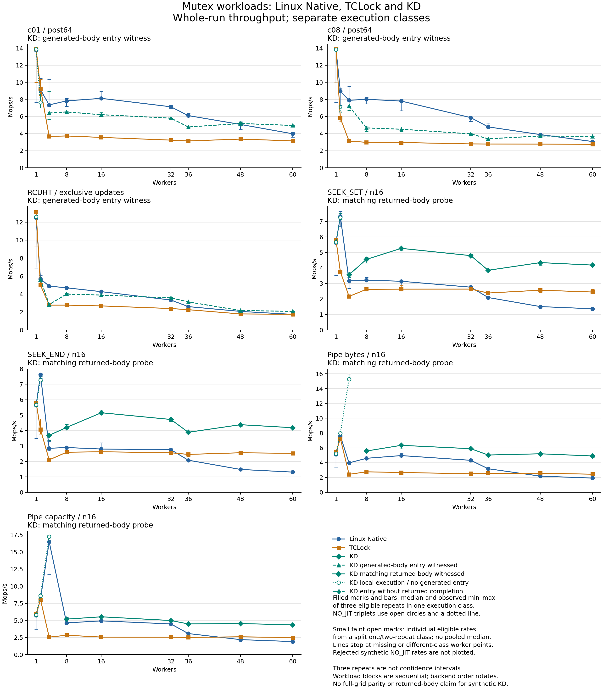

# 32-byte mutex: fresh Linux Native and TCLock comparison

The retained shared-node KD mutex completed **567 correct, drained timing sessions**
against fresh Linux Native and TCLock controls. At 60 workers, KD's whole-run
median is above both controls in all seven workloads. At eight workers, KD is
below Native on c01, c08 and RCUHT, while above both controls on the four API
workloads. These are measured outcomes for the selected settings, not a uniform
speedup or full-grid parity claim.

Collection source is `bd9d4ce205512fd34dc00044e3ad238f985d4b6d`; production remains
`752fec1e5cbb0d54144fa995987424afabf11b46`. This round changes documentation and
collection/report helpers, with no production protocol, payload or admission
change. The public KD mutex remains **32 bytes, aligned to 8 bytes**. OSQ and
delegation share preallocated node storage with independent membership and
retirement; the 256-body locality boundary and total 1024-body cap remain.
There is no auxiliary hash, shared lock reference count, registry lock or new
RCU mechanism. See the [implementation guide](../../../../../docs/design/mutex_implementation.md)
and [static review](source-review.md).

## Sustained throughput

Rates are median **Mops/s**, millions of completed operations per second, over
three full two-second measurements. Each displayed cell contains three eligible
repetitions in one execution class. Ratios compare medians.

| Workload | Workers | Linux Native | TCLock | KD | KD / Native | KD / TCLock |
| --- | ---: | ---: | ---: | ---: | ---: | ---: |
| c01/post64 | 8 | 7.827 | 3.719 | 6.532 | 0.834× | 1.756× |
| c01/post64 | 60 | 3.974 | 3.145 | 4.952 | 1.246× | 1.575× |
| c08/post64 | 8 | 8.016 | 2.974 | 4.662 | 0.582× | 1.567× |
| c08/post64 | 60 | 3.067 | 2.744 | 3.671 | 1.197× | 1.338× |
| RCUHT | 8 | 4.698 | 2.770 | 4.001 | 0.852× | 1.444× |
| RCUHT | 60 | 1.740 | 1.752 | 2.077 | 1.194× | 1.186× |
| SEEK_SET n16 | 8 | 3.216 | 2.623 | 4.554 | 1.416× | 1.736× |
| SEEK_SET n16 | 60 | 1.369 | 2.448 | 4.185 | 3.057× | 1.709× |
| SEEK_END n16 | 8 | 2.902 | 2.596 | 4.203 | 1.448× | 1.619× |
| SEEK_END n16 | 60 | 1.310 | 2.525 | 4.185 | 3.196× | 1.658× |
| Pipe bytes n16 | 8 | 4.588 | 2.763 | 5.571 | 1.214× | 2.016× |
| Pipe bytes n16 | 60 | 1.919 | 2.442 | 4.904 | 2.555× | 2.008× |
| Pipe capacity n16 | 8 | 4.632 | 2.833 | 5.184 | 1.119× | 1.830× |
| Pipe capacity n16 | 60 | 1.907 | 2.491 | 4.345 | 2.279× | 1.744× |

At 60 workers, KD is 1.194–3.196× Native and 1.186–2.008× TCLock. Its observed
minimum exceeds each control's observed maximum at all seven 60-worker points.
Those non-overlapping three-repetition ranges are descriptive evidence, not
confidence intervals. At eight workers, the synthetic KD/Native ratios are
0.834, 0.582 and 0.852 for c01, c08 and RCUHT respectively; these regressions
remain part of the result. RCUHT also trails Native by 42.0% at four workers;
c01 and c08 retain substantial Native gaps through the tested middle counts.
Native's first single-worker repetition is markedly slower in every workload,
with observed whole-run spreads of roughly 33–45%. KD c01 at four workers has
51.3% spread. Every repetition remains in the evidence; no cause is inferred
from these ranges alone.

The [SVG figure](mutex-comparison.svg), [all groups and ranges](comparison-table.md),
[complete comparison JSON](comparison.json), and [figure receipt](mutex-comparison.json)
retain every worker count, execution class and repetition. Filled markers and
bars show complete class triplets. Separate faint markers show the split
c08/two-worker observations; their classes are never pooled into one median.

## Peak rates and execution evidence

The original runner's best warmed-window rate is retained separately. These
values select the best valid 300 ms cohort window across three repetitions;
they are not the whole-run medians above.

| Workload, 60 workers | Native best peak | TCLock best peak | KD best peak |
| --- | ---: | ---: | ---: |
| c01/post64 | 4.833 | 3.164 | 5.014 |
| c08/post64 | 3.509 | 2.769 | 3.720 |
| RCUHT | 1.858 | 1.778 | 2.100 |
| SEEK_SET n16 | 1.441 | 2.626 | 4.214 |
| SEEK_END n16 | 1.389 | 2.644 | 4.217 |
| Pipe bytes n16 | 2.058 | 2.511 | 4.925 |
| Pipe capacity n16 | 2.058 | 2.622 | 4.426 |

Of 189 KD sessions, **68 witnessed generated-body entry**, **78 recorded matching
returned JIT bodies**, and **43 recorded no generated entry**. There are no
PARTIAL_JIT sessions or rejected NO_JIT timings. Synthetic counters establish
entry only; their completion count remains unknown. API probes establish
returned bodies. NORMAL image publication is not execution evidence.

The c08/two-worker point has two entry-positive repetitions and one NO_JIT
repetition. Its two classes remain separate, so neither supplies a three-run
median. The two positive c08/two-worker repetitions contain only one and two
entries; RCUHT/two-worker repetitions contain four, one and three entries.
Those entry-positive labels describe almost entirely local execution. All
other backend/worker/workload groups have complete triplets.
Pipe-byte and pipe-capacity KD measurements have no generated entry at one,
two and four workers; their high local-execution rates are not JIT performance.
SEEK_SET/END remain local at one and two workers. Low-contention synthetic
classes are retained explicitly in the complete tables.

Measured shares sum the appropriate counter and completed-operation count
across the three matching repetitions. They describe the full measured phase,
not the selected peak window. TCLock's returned delegation counter is distinct
from KD's generated-body counters.

| Workload, 60 workers | KD evidence | KD measured share | TCLock measured delegated share |
| --- | --- | ---: | ---: |
| c01/post64 | Entry witness | 97.70% | 98.94% |
| c08/post64 | Entry witness | 97.38% | 98.93% |
| RCUHT | Entry witness | 98.48% | 99.25% |
| SEEK_SET n16 | Returned body | 97.35% | 99.79% |
| SEEK_END n16 | Returned body | 97.31% | 99.82% |
| Pipe bytes n16 | Returned body | 97.51% | 99.83% |
| Pipe capacity n16 | Returned body | 97.62% | 99.79% |

Provider `jit_success / combiner` diagnostics include warmup and checks. They
are not measured-phase batch distributions or a causal explanation of throughput.
No PMU sampling or cache-transfer profiling was performed in this round.

## Workloads and collection

Seven workload blocks each contain 81 sessions: three backends, workers
**1, 2, 4, 8, 16, 32, 36, 48 and 60**, and three repetitions. This is a focused
nine-point grid; the documented standard grid has 21 points. No earlier results
or 256-byte KD measurements are pooled into this comparison. The earlier
[shared-node/old256 comparison](../mutex32-mcs-20261020/README.md) keeps its own
source blocks and controls.

- c01/c08 update one/eight shared cachelines with the same post64 arithmetic.
- RCUHT uses 1024 buckets, 4096 preallocated nodes and 8192 keys, with exclusive
  move/conflict/miss requests. Timed bodies perform no allocation or RCU service.
- SEEK_SET and SEEK_END use a shared open description of a 64 KiB file (`n16`).
- Pipe-byte queries sum 16 occupied 4 KiB buffers. Pipe capacity requests 16
  pages and validates the actual returned capacity. Both use per-worker open
  descriptions of the shared pipe. Recorded `v64` does not size these payloads.

Synthetic workers execute repeated bodies inside one ioctl per phase; API
workers issue real syscalls individually. API rates include syscall, reference,
security and result-copy costs. Native uses the matching adapter body with the
kernel-owned mutex; KD/TCLock use private adapter locks for the controlled
object. Every consumer follows the selected protocol. This does not measure a
global kernel replacement or an end-to-end application.

Every worker warms up for at least 48,000 operations; API warmup also lasts at least
1000 ms. Timings are 2000 ms with 10 ms sampling and a 300 ms peak window after
300 ms settling. Collector CPU 63 is separate; workers use CPU prefixes 0–N−1.
Synthetic backend order reverses on alternating repetitions; API order rotates.
Workload blocks are sequential, not randomized paired trials. Exact commands
and original verdicts are retained in [the matrix receipt](current/matrix.json)
and [operations plan](OPERATIONS.md).

KD uses ABI2/clobber callers, NUMA on, total batch cap 1024, prefetch 2, entry
ratio limit 2 and UBSAN-off benchmark providers. TCLock uses its ordinary mutex
backend with native-stack delegation and parking; its configured 1024 limit can
execute 1025 bodies because of zero-based jumps. Published KD waiters poll
pinned. Each collection preserves its actual source and ELF identities. The
synthetic lock objects are explicitly cacheline-aligned; native type alignment
alone does not establish the placement of every embedded lock.

## Machine and validation

All builds, tests and timings ran in the recovery VM on `10.176.26.71`: 64 vCPUs,
24 GiB, two NUMA nodes (CPUs 0–31 and 32–63). At 60 workers the cohort uses
32 CPUs on node 0 and 28 on node 1. Kernel is `6.1.159-kdclobber2`, Build ID
`5ca28058e156f34a2c7fe91e8e0fbf92f4e51960`, with `nokaslr`, `nopvspin` and
voluntary preemption. Boot UUID is `b65f0205-c8f9-4385-8b13-039cbce243a6`.
The actual monitor listed snapshot `before-mutex-kdonly-20261017T140354Z`.
No kernel installation, reboot or policy change was performed.

[Host before](host-before.json) and [host after](host-after.json) confirm unchanged
one-to-one vCPU pins and frequency settings: `intel_cpufreq`, `ondemand`,
800–3600 MHz limits. Service threads stay on CPU 63. Effective frequency was
not measured per sample. Actual memory residency is imperfect despite the bind
policies: the opposite-node share is about 8.33%→8.30% for bind:0 and
4.32%→4.07% for bind:1. These are host snapshots, not per-session placement
measurements. Initial guest preflight was observed through tool output; the
persisted guest receipts honestly begin [during collection](guest-during.log)
and finish [after collection](guest-after.log).

Fresh checks passed: the two basic C programs, 52 direct-runner cases, 10 peak
cases, 11 API-plan cases and 13 API-report cases. Dependency, provider W=1 and
daemon builds passed. The provider log contains 48 warning lines, retained in
[the build log](checks/provider.log) and [validation](validation.json).
No full suite or separate protocol/live-probe rerun is claimed for this
benchmark/documentation-only change; the unchanged production retains its
[earlier focused validation](../mutex32-mcs-20261020/README.md).

All 567 session kernel logs were present with zero matched runtime faults.
The final [health receipt](health.json) confirms an idle VM. The independent
[offline review](offline-review.json) passed **668,688 checks** with zero issues:
22,124 archive members, 19,502 regular files and all 567 independently
reconstructed timing windows. It binds committed source/private `.inc` files,
ELFs, generated images, command receipts, original verdicts, exact drain and
whole/peak arithmetic. A separate [numeric review](numeric-review.json) passed
6,952 checks of compact results and comparison ratios; its exact
[review script](numeric-review.py) is preserved. Source edits, Git and
inert archive review ran on `380G10`.

[Archive receipts](archives.json) and [compact-export hashes](compact-export.json)
record completed idle preservation. Raw evidence remains in ignored
`bench/results/10.176.26.71/raw/bench/mutex32-native-tclock-20261020/` and guest
`/root/kdlock-evidence/10.176.26.71/bench/mutex32-native-tclock-20261020-archives/`.
The [postprocessing command](post-command.sh) records bounded validation,
plotting and archival steps. No failed timing, retry or discarded sample is
hidden by the report.
