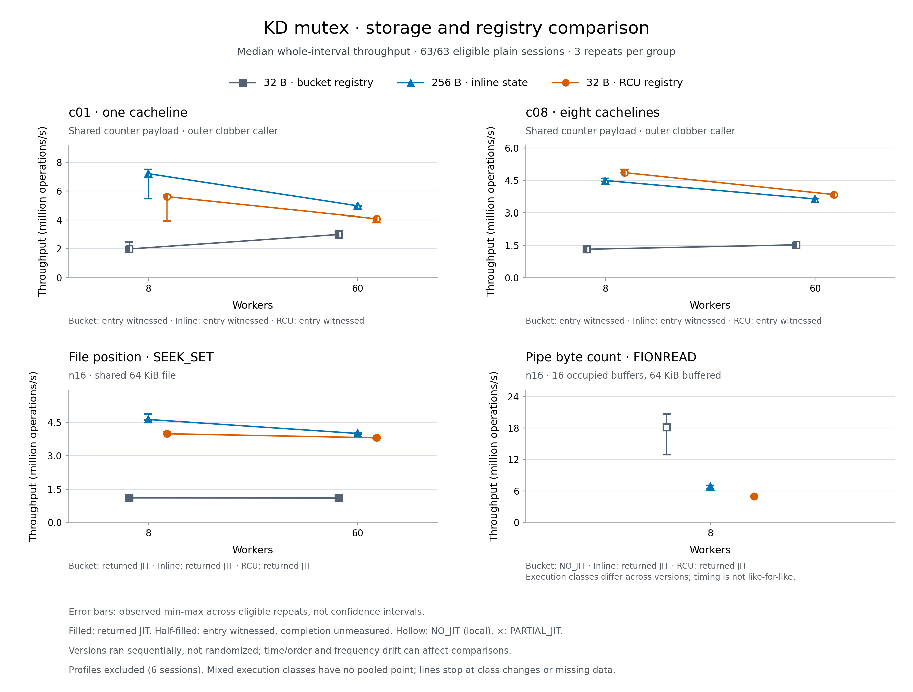

# Compact mutex registry optimization

The compact mutex's auxiliary registry introduced a major serialization cost.
Revision `fcbacbe` removes bucket locking from lookups, observations and ordinary
reference updates while keeping the caller's mutex **32 bytes, aligned to 8 bytes**.
Matched c01/c08/seek whole-run medians improve by **1.36–3.69×** over the initial
compact implementation. Recovery is workload dependent: short bodies still trail
the 256-byte version, and pipe changes from local execution to delegation.

## Cause and change

The initial compact implementation used a raw spinlock around every auxiliary
lookup and reference change. All callers of one hot mutex use the same registry
bucket. This added serialization to the bounded outer contention probes,
producer acquisition/retirement and delegated frame retirement. Increasing the
number of buckets would not remove contention on that one mutex's bucket.
The former inline 256-byte object needed no registry lookup for these fields.

The [six diagnostic profiles](profile-analysis.json) support this diagnosis.
Period-weighted `native_queued_spin_lock_slowpath` shares of retained kernel
samples are 44.616% at eight workers and 19.255% at 60 in the compact baseline.
The optimized version records zero such samples at eight workers and one sample,
0.0055%, at 60. The 256-byte baseline records none. All six profiles report zero
lost samples; 81,444 sample lines were independently parsed. Flat profiles do not
identify a spinlock's caller, and sampling shares are not elapsed-time costs.
The source-level bottleneck and the controlled registry change provide the
additional attribution. Profile throughput is excluded from timing medians.

Only `include/kd_mutex_aux.h` and `kernel_module/kd_mutex_aux.c` change production
behavior between the compact baseline and `fcbacbe`. RCU protects linked-list
traversal until an exact positive reference is acquired. Ownership and combiner
observations borrow the record only inside RCU. Atomic references retain
invocations and physical owners; publication and the final zero/unlink remain
serialized by the bucket. Zero-reference records cannot be revived. Deferred
freeing never touches caller storage, and provider teardown drains callbacks
before destroying the slab. Caller cleanup obligations do not increase.

The KD physical protocol, two-word wrapper ABI, pinned published waiters,
queue/batch limits, exact ownership/ACK/source/frame rules, immutable images,
translator and admission settings are unchanged. See the maintained
[lifetime description](../../../../../docs/design/mutex_implementation.md#current-storage-and-lookup).

## Matched results

All values below are **median whole-run Mops/s from three repetitions**. The
[CSV](comparison.csv) and [JSON](comparison.json) retain every range and separate
300 ms peak statistic; [session rows](sessions.csv) preserve per-run counters.

| Workload | Workers | Old 256 B | Initial 32 B | Optimized 32 B | Optimized / initial | Optimized / old |
| --- | ---: | ---: | ---: | ---: | ---: | ---: |
| c01, post64 | 8 | 7.206 | 1.991 | 5.610 | 2.818× | 0.779× |
| c01, post64 | 60 | 4.970 | 2.997 | 4.085 | 1.363× | 0.822× |
| c08, post64 | 8 | 4.495 | 1.317 | 4.863 | 3.693× | 1.082× |
| c08, post64 | 60 | 3.639 | 1.521 | 3.843 | 2.526× | 1.056× |
| SEEK_SET, n16 | 8 | 4.636 | 1.111 | 3.990 | 3.592× | 0.861× |
| SEEK_SET, n16 | 60 | 4.004 | 1.106 | 3.808 | 3.443× | 0.951× |

c01/c08 use the same entry-witness instrumentation in all versions, with the
completion probe disabled. Their runner `PASS` establishes generated-body entry,
correct workload results and drain; it does **not** independently count returned
JIT bodies. The report calls this `WITNESSED_JIT` and leaves measured completion
counts null. API workloads separately count matching completed bodies; all seek
runs have positive completions. Publication alone is never execution evidence.

The c01 gaps against the old object remain 22.15% at eight workers and 17.81% at
60; seek gaps remain 13.92% and 4.89%. Exact atomic references and indirection
still cost work. Their contribution to each remaining gap is not isolated by
this experiment. At eight workers, c08 profiles charge 3.62% of weighted samples
to auxiliary reference acquisition and 1.90% to put; these are observations, not
estimates of removable wall time. The larger c01 ranges also limit precision.

The acquisition mix changes within the JIT category too. Across the three
repetitions, old-to-optimized measured entry share for c01 at 60 workers falls
from 93.70% to 77.31%; returned-body share for seek at eight falls from 91.46%
to 79.05%, and pipe at eight from 96.94% to 85.83%. These shares and the remaining
registry work both matter; the residual throughput gaps cannot be assigned
solely to lookup/reference cost.

**Pipe is a material tradeoff, not an improvement:** at eight workers, FIONREAD
n16 measures 18.138 Mops/s with the initial compact implementation, entirely
`NO_JIT`, versus 6.843 for the old 256-byte version and 4.986 for the optimized
version, both with returned JIT bodies. The optimized delegated result remains
27.14% below the old delegated result. The 18.138-to-4.986 change includes an
execution-path switch and must not be described as a like-for-like registry
speed ratio.

[Admission records](pipe-admission.json) show zero slowpath/combiner activity in
all three initial compact pipe runs. Two never reached their first per-CPU heat
check; the third made at most one check per CPU and has no hot-lock rows, so its
complete admission history is not established by the final snapshot. All old
and optimized pipe runs have active admission and positive matching entry and
completion counts. Removing probe serialization changes which clashes reach
the unchanged contention sampler. No admission threshold was retuned to suppress
this result or force a preferred execution category.

## Method and scope

Three source blocks ran sequentially on the same VM boot: initial compact
`ee38524` (runtime `7713897`), immediate precompact parent `0324e60`, then
optimized `fcbacbe04d470b7ccfaa2a0db48dccfd3a85685e`. The parent supplies the
256-byte KD-only protocol with the same modern benchmark infrastructure; old
historical measurements are not pooled into this comparison. Frozen source
manifests and exact commands are retained separately for each block.

Each block contains 21 plain timings: c01/c08 at 8/60 workers, seek SET n16 at
8/60, and pipebytes n16 at eight, all repeated three times. Two additional c08
profiles at 8/60 use kernel cycles at 199 Hz without call graphs. Timings last
2,000 ms; peak windows are 300 ms after 300 ms settling. Synthetic warmup is
48,000 operations per worker; API warmup also includes 1,000 ms. Mutex NUMA is
enabled, batch limit is 1,024 and private benchmark providers have UBSAN off.

Execution ran only in the recovery VM on `10.176.26.71`: 64 vCPUs, 24 GiB,
two NUMA nodes, workers CPUs 0 through N−1, collector CPU 63. The kernel remains
`6.1.159-kdclobber2`, Build ID
`5ca28058e156f34a2c7fe91e8e0fbf92f4e51960`, boot ID
`b65f0205-c8f9-4385-8b13-039cbce243a6`. [Before](host-before.json) and
[after](host-after.json) receipts verify the actual recovery snapshot, QEMU
identity, vCPU affinity and unchanged host `ondemand` frequency policy. This
does not establish equal effective frequency, host load or physical page
placement throughout the run. Sequential source blocks are not randomized;
three repeats and their min/max are descriptive, not confidence intervals.
There are no new Native/TCLock arms or full-grid claims in this investigation.

## Validation and preservation

[Validation](validation.json) records successful provider `W=1 UBSAN_SANITIZE=n`
and daemon `-Wall -Wextra -Werror` builds, isolated dependency checks, both basic
C programs and 12 directly affected Python drivers. Provider assembly/objtool
warnings remain. The new registry fixture covers a held reader across unlink
and same-address replacement, no resurrection, getter/final-put and two-put
races, exact owner/frame/ACK references, allocation failures, 2,048 simultaneous
objects, eight racing creators, 8 × 4,000 operations and callback drain before
slab destruction. Three deliberately broken lifetime variants are rejected.

The live [ordinary mutex](checks-retry/local/result.json),
[rwsem](checks-retry/rwsem/result.json) and
[JIT/native instruction-exit](checks-retry/instruction-exit/result.json) probes
passed and drained. Ordinary locking verifies size/alignment, containing-object
geometry, 2,048 objects, address reuse without destroy, sleeping ownership and
cancellation. Instruction exit retains all four 3,200,000-operation phases,
matching generated completions, original-task escape and terminal disablement.
All 69 benchmark/profile sessions are valid and drained. The final
[health receipt](health.json) checks idle state and 72 kernel logs with no matched
fault reports. These are basic and affected checks, not a full suite.

The first unit bundle passed 13 checks and failed frame-capacity preparation
because its frozen copy omitted `tests/kernel/execution/exec_relay_exit_probe.c`.
The unchanged test passed from a new complete bundle; both frozen attempts and
logs are retained. The first finalization command also correctly refused its
own log held open for writing inside the evidence tree. Repeating with output
outside that tree passed; both logs remain. Neither failure is relabelled a pass.

[Archive receipts](archives.json) preserve five groups, including all failures,
exact source snapshots/private `.inc` files, binaries, generated code, profiles
and measurement logs. Raw archives are in ignored
`bench/results/10.176.26.71/raw/bench/mutex32-opt-20261019/` and the guest sibling
`/root/kdlock-evidence/10.176.26.71/bench/mutex32-opt-20261019-archives/`.
The independent [archive audit](archive-review.json),
[source review](source-review.json) and [statistics review](statistics-review.json)
passed separately from runtime acceptance. They verify all 11,232 archive
members, 172 compact copies, 95 binary manifest entries, 3,947 original source
entries and the current 90 production files against their exact Git revisions.
Each runtime snapshot retains 39 private `.inc` files. Seven retained prepared
provider trees reconstruct exactly from the original inputs and observation
overlays. API runs preserve the original inputs, preparation recipe and binaries,
but do not retain an expanded prepared-provider tree. The statistics audit also
independently reconstructs all 69 peak selections and the 81,444 profile samples.
[Audit development notes](audit-development-notes.json) retain the offline
parser corrections separately; no benchmark evidence was changed to make the
audit pass.
