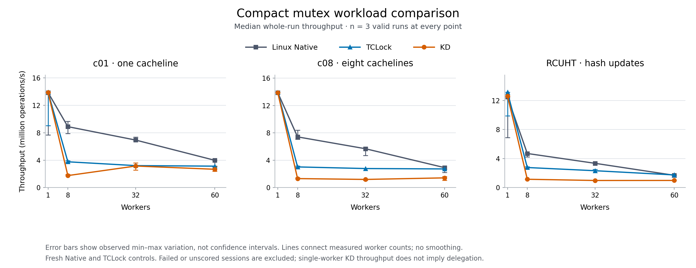

# Compact mutex comparison: c01, c08 and RCUHT

The `7713897` 32-byte KD mutex completed all 108 sessions with valid results and
full drain. Its median whole-run throughput is approximately level with Linux
Native at one worker, but below Native and TCLock at every tested contended
point. This is a focused comparison against fresh controls. No matched 256-byte
KD arm was run, so these results do not isolate the cost of the storage change.

Three workloads were measured at 1, 8, 32 and 60 workers, with three repetitions
for each of Native, TCLock and KD. The existing runner alternates backend order
between repetitions. Each session uses 48,000 warmup operations per worker,
two seconds of measurement, 10 ms sampling, and the best valid 300 ms cohort
window after 300 ms settling. No diagnostic profiling was enabled.

## Median whole-run throughput

All rates below are million completed operations per second (Mops/s); larger is
better. Each cell has three accepted repetitions. Ratios compare medians, not
paired repetitions. KD JIT share is the weighted measured returned-body count
divided by completed operations, and is not the share in a peak window.

| Workload | Workers | Native | TCLock | KD | KD / Native | KD / TCLock | KD JIT share |
| --- | ---: | ---: | ---: | ---: | ---: | ---: | ---: |
| c01 | 1 | 13.861 | 13.914 | 13.867 | 1.000× | 0.997× | 0.0% |
| c01 | 8 | 8.891 | 3.765 | 1.754 | 0.197× | 0.466× | 57.9% |
| c01 | 32 | 6.934 | 3.207 | 3.145 | 0.454× | 0.981× | 21.7% |
| c01 | 60 | 3.983 | 3.128 | 2.674 | 0.671× | 0.855× | 18.3% |
| c08 | 1 | 13.879 | 13.920 | 13.869 | 0.999× | 0.996× | 0.0% |
| c08 | 8 | 7.416 | 3.024 | 1.317 | 0.178× | 0.436× | 81.8% |
| c08 | 32 | 5.685 | 2.787 | 1.195 | 0.210× | 0.429× | 82.8% |
| c08 | 60 | 2.921 | 2.730 | 1.423 | 0.487× | 0.521× | 60.0% |
| RCUHT | 1 | 12.489 | 13.137 | 12.625 | 1.011× | 0.961× | 0.0% |
| RCUHT | 8 | 4.701 | 2.767 | 1.149 | 0.244× | 0.415× | 98.9% |
| RCUHT | 32 | 3.345 | 2.326 | 0.981 | 0.293× | 0.422× | 96.6% |
| RCUHT | 60 | 1.695 | 1.746 | 0.986 | 0.582× | 0.565× | 95.0% |

[SVG plot](comparison.svg), [comparison CSV](comparison.csv),
[backend ranges and peaks](backend-groups.csv), and [all sessions](sessions.csv)
retain the measurements behind the table. [comparison.json](comparison.json)
also records identities, statuses, exact counts and report input hashes.

At 60 workers, KD's whole-run medians are 32.9%, 51.3% and 41.8% below Native
for c01, c08 and RCUHT respectively. At eight workers, KD reaches only
17.8–24.4% of Native. High JIT share alone does not establish high throughput:
RCUHT returns 95.0–98.9% of measured operations through JIT under contention.
TCLock also records returned delegation in every contended sample; its counts
and successful waiter-parking CAS deltas are separate from KD JIT counts.

## Peaks and variation

The maintained runner's scoring policy selects the best valid warmed peak.
The whole-run median above is emphasized to expose sustained behavior and
repeatability; the original peak summaries remain unchanged under
[cacheline](cacheline/summary.csv) and [RCUHT](rcuht/summary.csv).

| Workload, 60 workers | Native best peak | TCLock best peak | KD best peak |
| --- | ---: | ---: | ---: |
| c01 | 4.747 | 3.162 | 4.956 |
| c08 | 3.282 | 2.803 | 1.713 |
| RCUHT | 1.794 | 1.767 | 1.008 |

KD's c01 peak exceeds both controls, while its whole-run median remains below
both. Peak-window throughput and whole-run throughput must not be substituted
for each other. Error bars show observed minimum–maximum ranges, not confidence
intervals. Whole-run spread, `(max - min) / median`, reaches 33.2% for KD c01 at
32 workers and 39.7% for KD c08 at 60 workers. Native c01 and RCUHT single-worker
controls show approximately 45% spread. These are three-repetition screen
results, with every sample retained; they are not a full scaling study.
Every worker progressed in each complete run and selected cohort window, but
counts can be very uneven. Native c08 at 32 workers, repetition 0, has a whole-run
maximum/minimum worker count of 2,791,936/117,248 (23.81×). Aggregate throughput
and positive worker progress do not establish fairness.

## Workload and machine identity

c01 and c08 update one and eight shared cachelines respectively, followed by
the existing post64 arithmetic. RCUHT uses 1,024 buckets, 4,096 preallocated
nodes, 8,192 keys and write-only move/conflict/miss requests, without per-body
allocation or RCU services. All hash structure and exact outcome checks passed.
The measured outcome mix stays approximately 25% moves, 25% conflicts and 50%
misses; exact per-backend mixtures are retained rather than assumed identical.

All timing and builds ran in the recovery VM on `10.176.26.71`. The kernel is
`6.1.159-kdclobber2`, Build ID
`5ca28058e156f34a2c7fe91e8e0fbf92f4e51960`, with `nokaslr`, `nopvspin` and voluntary
preemption. [Live PV dispatch verification](preflight/boot-policy.json) confirms
the actual native spinlock function pointers for this boot. The actual monitor
listed recovery snapshot `before-mutex-kdonly-20261017T140354Z` before timing.

The VM has 64 vCPUs and two 12 GiB NUMA nodes. Workers use CPU prefixes 0 through
N−1; the first three cohorts stay on node 0, and 60 workers use 32 CPUs on node 0
plus 28 on node 1. Collector 63 is separate; QEMU service threads also use host
CPU 63. [Host before](host-before.json) and [after](host-after.json) records
confirm unchanged one-to-one vCPU pinning and all 64 frequency policies:
`intel_cpufreq`, `ondemand`, 800–3,600 MHz limits. Effective frequency was not
controlled or measured per sample.

Actual memory placement is imperfect despite the two `policy=bind` backends.
[Before](host-numa-before.json), about 7.94% of resident pages for bind:0 and
3.42% for bind:1 were on the opposite node; [after](host-numa-after.json), these
were about 8.09% and 3.39%. These conditions qualify the screen and are not
silently treated as perfectly local NUMA memory.

KD uses the accepted KD-only legacy protocol, ABI2 outer cookie, default heat
admission, NUMA on, batch 1024 and a private UBSAN-off benchmark provider. The
public mutex is 32 bytes with alignment 8; the standalone workload lock retains
explicit cacheline alignment. Native/TCLock/KD use distinct objects and matching
compiled callers. No guest kernel, runtime protocol or admission threshold was
changed. Historical 256-byte results and other topologies remain separate.
The cacheline and RCUHT collections retain separate provider ELF hashes in their
[cacheline](cacheline/binary-sha256.json) and [RCUHT](rcuht/binary-sha256.json)
manifests. Matching source inputs do not imply identical rebuilt binaries;
workload results are summarized separately.

## Validation and preservation

The two runner commands exited zero: [cacheline](cacheline-command.json),
[RCUHT](rcuht-command.json). All 108 planned sessions are score-eligible and
drained. Every contended KD sample has measured returned JIT bodies; single-worker
zero-JIT samples establish ordinary throughput only. No sample was rejected,
skipped, retried or discarded in this screen. The final [health receipt](health.json)
checks 108 session kernel logs with no fault matches and confirms the idle VM.

[Independent statistical review](statistics-review.json) recomputes the results
from archived records without executing the report script. [Archive review](archive-review.json)
checks compressed hashes, complete inventory, source/binary identities and
session evidence. [archives.json](archives.json) records completed idle capture.
Full source snapshots, private `.inc` files, binaries, command output, per-worker
progress, counter snapshots and the archive inventory remain in ignored
`bench/results/10.176.26.71/raw/bench/mutex32-screen-20261019/` and the guest
`/root/kdlock-evidence/10.176.26.71/bench/mutex32-screen-20261019-archives/`.
Source edits, Git and read-only archive checks ran on `380G10`.
