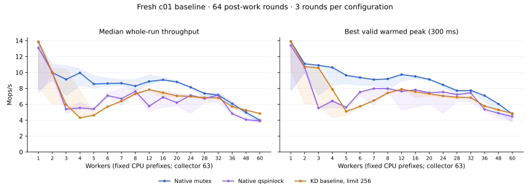
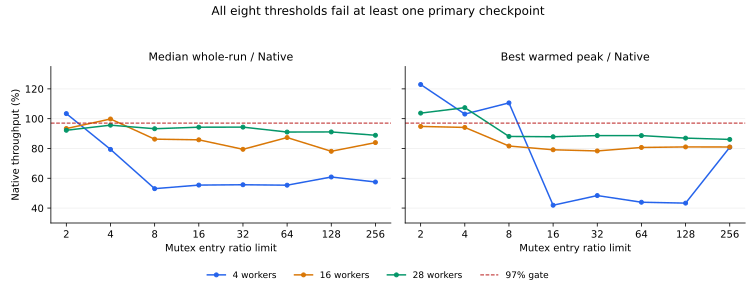

# c01 mutex admission study, 2026-10-13

**The 97% Native target was not reached. All eight thresholds were rejected;
the default remains 256.** The pinned sampler now avoids the redundant pin-state
check and cold address-table work. Its retained-default run passed the four
higher-thread regression gates, but these measurements do not establish a
low-thread throughput gain from that code change.

The runner now distinguishes adaptive native execution, returned JIT bodies and
forced-native diagnostics. JIT-required acceptance remains the default.
The [acceptance audit](acceptance-screen.json) selects no new default and records
every rejection. No candidate qualified for the two confirmation blocks, so
those blocks were not run.

## Environment and method

All compilation and execution took place in the recovery VM on `10.176.26.71`.
The starting checkout was `09bfffe`, including its existing outer acquisition
cookie and 64-round post-work changes. The baseline is a new execution of that
checkout, not a reuse of the October 12 archived measurements.

| Setting | Captured value |
| --- | --- |
| Kernel | `6.1.159-kdclobber2`, Build ID `5ca28058e156f34a2c7fe91e8e0fbf92f4e51960` |
| Boot | `nokaslr nopvspin`, native qspinlocks, voluntary preemption |
| Recovery | Actual `savevm mutex-admission-20261013`, verified in QEMU snapshot listing |
| Placement | 64 vCPUs pinned to same-numbered host cores; workers use `0..N-1`, collector 63 |
| NUMA | CPUs 0–31 on node 0, 32–63 on node 1; first cross-node cohort is 36 |
| Governor | `ondemand` on all 64 host CPUs, unchanged before/after; frequency was not fixed |
| Workload | c01, one increment under the lock, 64 post-work rounds |
| Timing | 48,000 warmup operations per worker; two-second measurement; existing 300 ms settle and warmed-peak window |
| KD | Blocking after 4,096 polling iterations, NUMA policy on, batch limit 1,024, UBSAN off |
| Rounds | Three, alternating Native/KD, KD/Native, Native/KD; all samples retained |

The baseline covers Native mutex, Native qspinlock and current KD at all 17
requested counts. Screening uses necessary checkpoints 4, 16, 28, 32 and 60 for
each power of two from 2 through 256. Any failed checkpoint rejects a candidate;
this partial screen cannot pass one. A survivor would require the full grid and
then two fresh, independently passing three-round blocks. None survived.
The retained default received a separate full-grid run after screening.

[Coverage](coverage.json) accounts for **543 correct, progressing, drained
sessions**: 153 baseline, 240 screening, 102 retained-default, and 48 unscored
diagnostics. All saved source/ELF/JIT hashes and raw warmed-peak calculations
were checked offline. The exact commands, environments, sources and binaries
remain with each raw run. Dates in guest/perf logs use UTC (October 12); this
report uses the source host's Asia/Shanghai date (October 13).

## Fresh baseline

Median whole-run Mops/s, three rounds per point:

| Workers | Native mutex | Native qspinlock | KD mutex | KD / Native |
| ---: | ---: | ---: | ---: | ---: |
| 4 | 9.955 | 5.534 | 4.294 | 43.1% |
| 16 | 9.070 | 6.879 | 7.463 | 82.3% |
| 28 | 7.357 | 6.714 | 6.832 | 92.9% |
| 32 | 7.160 | 7.145 | 6.806 | 95.1% |
| 36 | 6.065 | 4.806 | 5.705 | 94.1% |
| 48 | 4.960 | 4.053 | 5.251 | 105.9% |
| 60 | 3.971 | 3.910 | 4.834 | 121.7% |



[All baseline statistics](baseline.csv) include min/median/max, best peak,
spread, worker shares, CPU ns/op and returned JIT participation. Shaded ranges
are observed minima/maxima, not confidence intervals. The small cohorts vary
substantially: at four workers, Native's whole-run spread is 21.2% and KD's is
80.5%. At two workers the initial KD median is 9.960 Mops/s; the later retained
default measures 5.511 Mops/s. These runs do not isolate whether that change is
due to the sampler, scheduling, ownership behavior or frequency.

## Threshold decision and retained default

Each cell below gives **median whole-run / best warmed peak**, as a percentage
of the fresh Native mutex paired with that threshold. Both must reach 97%.

| Limit | 4 workers | 16 workers | 28 workers | Decision |
| ---: | ---: | ---: | ---: | --- |
| 2 | 103.4 / 122.9 | 93.4 / 94.8 | 92.2 / 103.7 | Reject |
| 4 | 79.4 / 103.1 | 99.8 / 94.1 | 95.6 / 107.4 | Reject |
| 8 | 53.0 / 110.6 | 86.3 / 81.6 | 93.2 / 88.1 | Reject |
| 16 | 55.4 / 41.9 | 85.8 / 79.1 | 94.3 / 87.9 | Reject |
| 32 | 55.7 / 48.4 | 79.4 / 78.3 | 94.3 / 88.6 | Reject |
| 64 | 55.4 / 43.9 | 87.3 / 80.7 | 91.0 / 88.6 | Reject |
| 128 | 60.9 / 43.3 | 78.1 / 81.0 | 91.1 / 86.9 | Reject |
| 256 | 57.5 / 80.8 | 83.9 / 81.0 | 88.9 / 86.1 | Reject |



Limit 2 routes all three four-worker and sixteen-worker measurements natively
with zero returned JIT bodies. It recovers the four-worker point but still loses
at sixteen workers; its 60-worker median also falls to 96.9% of baseline KD.
Limit 4 reaches the sixteen-worker whole-run gate but misses its peak gate.
Thus neither metric can substitute for the other. No route depends on benchmark
thread count. [Candidate statistics](candidates.csv) retain every measured point,
including regressions, variation and execution evidence.

With limit 256 retained, all four regression cohorts passed against the fresh
starting KD baseline, with returned JIT in every round:

| Workers | Whole-run / baseline KD | Peak / baseline KD | Minimum returned JIT bodies per round |
| ---: | ---: | ---: | ---: |
| 32 | 98.39% | 99.81% | 13,317,703 |
| 36 | 100.78% | 99.77% | 11,414,174 |
| 48 | 99.76% | 100.21% | 10,240,282 |
| 60 | 99.94% | 100.14% | 9,401,545 |

The same run fails primary acceptance at every multithreaded point. At 4, 16
and 28 workers its whole/peak ratios to the paired Native controls are
53.64/52.92%, 83.29/80.33% and 93.42/87.11%, respectively. The one-worker point
passes. See [all retained-default statistics](retained-default.csv) and the
[independent metric checks](retained-default-audit.json). This run validates the
specified high-thread regression limits; it is not a parity confirmation block.

## What the diagnostics support

Linux mutex is not a purely sleeping alternative to a spinlock. Its optimistic
path spins while the owner is running and uses OSQ to serialize spinners;
sleeping is a fallback. The source permits taking an unowned mutex before an
explicit handoff is requested, whereas contended qspinlock uses pending/queued
handoff. This makes repeated ownership and reduced cacheline transfer a plausible
explanation for the native mutex advantage on one increment.
[Linux mutex design](https://docs.kernel.org/6.1/locking/mutex-design.html),
[mutex implementation](https://raw.githubusercontent.com/gregkh/linux/v6.1.159/kernel/locking/mutex.c),
[qspinlock implementation](https://raw.githubusercontent.com/gregkh/linux/v6.1.159/kernel/locking/qspinlock.c).

Worker shares support differing ownership behavior but do not prove exact
ownership streaks. In the fresh baseline, the median largest worker share at
four workers is 41.4% for Native mutex, versus approximately 25% for qspinlock.
At two workers it is 52.7% for Native mutex, so the archived 97.3% imbalance is
not reproduced as the typical fresh result. Every worker progressed in both the
whole run and each accepted peak window. Sampled owners are opaque values;
the profiler never dereferences them.

KD coordination remains material even when delegation is common. At sixteen
workers the baseline has about 99.8% returned JIT participation, yet whole-run
throughput is 82.3% of Native and worker CPU cost is 2,144 ns/op versus 1,754.
Existing final counters report 897–982 returned bodies per combiner at this
point ([lifetime batch data](baseline-batches.csv), including warmup). Large
batches do not eliminate each request's admission, task-reference, publication,
frame and completion work. Native fallback also retains the wrapper/admission
cost: the explicitly native-routing diagnostics returned no JIT bodies and did
not consistently match Native. Their single-run rates are not acceptance scores.

Separate probes at 2, 4, 16, 28, 32 and 60 workers collected native fast/slow
entries, admission decisions, per-combiner completed-packet histograms, scheduler
activity and 100 us owner samples. All 18 probe runs report zero missed probes.
At sixteen workers, Native records 8,101,632 calls, including 3,518,878 slow
entries; a slow entry includes optimistic spinning and does not mean a sleep.
The KD probe changes returned JIT share to 31.6%, with a mean measured batch of
7.34 bodies, far from the uninstrumented result. The probes therefore perturb
the mechanism being measured. [Probe counters](probes.csv) and full raw
histograms are diagnostic observations only.

The additional [PMU-only series](pmu-only.csv) removes kprobes/owner sampling.
Cycles, instructions, generic cache misses, task-clock, context switches and
migrations were available, all at 100% event running time. At four workers it
records about 380 Native versus 1,381 KD instructions/op, consistent with
additional KD coordination. At sixteen workers, KD again returns 99.87% JIT
bodies. The single-round PMU rates and effective cycles/task-clock vary sharply,
especially at sixty workers; perf includes the measured client and inherited
workers. These are not matched-frequency estimates or proof of cacheline
bouncing. Generic cache misses do not isolate coherence traffic, and exact
ownership streaks, cache-to-cache transfers and a causal frequency contribution
remain unmeasured.

The fresh whole-run crossover is at 48 workers among the measured cohorts,
while best-peak KD exceeds Native only at 60. The historical reversal at 32
does not recur consistently. NUMA placement changes at 36, so neither 28 nor
32 is an established topology threshold. No parking calls were recorded in the
baseline two-worker KD runs, excluding actual parking calls as their slowdown
mechanism without excluding polling or other coordination costs.

## Implementation and validation

The read-only `mutex_entry_ratio_limit` accepts powers of two from 2 to 256.
The strict `(entries >> 10) < limit` comparison, 1,024-contention cadence and
1,025-observation exact-address heat checks remain intact. Each attempt retains
its entry/contention observation. The already-pinned sampler avoids another
pin-state check and skips the table while the CPU is cold between comparisons.
Native fallback still precedes task references, shadow allocation and queue
publication. The acquisition cookie, owner flags, unlock path, native-peer
exclusion, sleeping, ACK and retirement rules are unchanged by this patch.

[Validation receipt](validation.json) records 14 basic/affected unit groups,
54 runner tests, six acceptance-auditor tests, normal and SELFTEST builds,
and live wait/task probes. Cooling tests drive admission hot-to-cold while a
real result reservation or physical-owner gate waiter remains outstanding;
the observations are synthetic and the parked tasks/publication/drain are real.
They pass at polling budgets 0, 1,024 and 4,096. The cross-NUMA task test passes
both owner-unlock orders and four ACKs. These resource probes are explicitly
zero-JIT; actual returned JIT is established separately by the benchmark runs.

All 543 sessions have correct results, worker progress, exact CPU placement and
complete drain. All KD runs retire sources to zero modules, frames and writers;
final owner acquire/release counts balance and reserved nodes/waiters are zero.
No benchmark kernel error was reported. Final checks find no project modules or
benchmark processes, with unchanged host pins/governors and matching kernel
identity. Expected mutation-fixture failures and existing build warnings remain
in the raw logs. An initial runner test omitted the new threshold field; its
failure and subsequent correction are retained. No full suite, other mutex
workload acceptance or 64-worker topology test was performed.

## Evidence and reproduction

Raw benchmark data are retained at
`bench/results/10.176.26.71/raw/bench/mutex-admission-20261013/` on the source
host and `/root/kdlock-evidence/10.176.26.71/bench/mutex-admission-20261013/`
in the guest. Test evidence uses the matching `raw/tests/` and guest `tests/`
paths. The compact [coverage manifest](coverage.json) hashes each run's plan,
environment, source manifest and binary manifest. These resolve every original
input and sample without pooling different frozen versions.

Use the frozen source for baseline reproduction. For a new screening trial on
the current source, after the documented snapshot/identity/idle checks:

```sh
export KDLOCK_RECOVERY_CONFIRMED=1 KDLOCK_SNAPSHOT_TAG=mutex-admission-20261013
python bench/tclock_compare/run_mutex.py --backends native kdlock \
  --cachelines 1 --threads 4 16 28 32 60 --cpus 0-59 --collector-cpu 63 \
  --duration-ms 2000 --repeats 3 --mutex-entry-ratio-limit 2 \
  --mutex-acceptance adaptive-performance --output /root/kdlock-evidence/NEW-RUN
```

Run with a fresh output path and an outer timeout. Change the threshold for each
trial; use the full grid before considering confirmation. Add `--profile-lock
--pmu --repeats 1` only for separate diagnostics, or `--mutex-routing native` for
an unscored native control. The maintained [runner guide](../../../../../tclock_compare/README.md)
owns the full CLI and lifecycle contract. The [acceptance auditor](../../../../../tclock_compare/mutex_study.py)
recomputes raw peaks, requires three rounds per arm/count and checks both metrics
independently. It rejects incomplete screens as passes, reused confirmation
samples and changes to frozen source between selection and confirmation.
